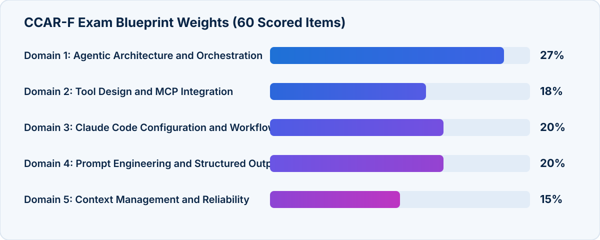

<!-- course-title: Claude Certified Architect - Foundations: Hands-On Exam Prep Workshop -->
<!-- course-theme: roi-alt-theme -->

<!-- layout: title -->

Claude Certified Architect - Foundations: Hands-On Exam Prep Workshop

# Chapter 1: Claude Certified Architect - Foundations Overview

---

# Chapter 1: Objectives

- Review the CCAR-F exam format, scoring, and domain weights
- Distinguish in-scope topics from out-of-scope distractors
- Analyze all six official exam scenarios
- Apply a structured strategy to deconstruct exam questions

---

<!-- layout: navigation -->
# Chapter 1

- **Understanding the Exam**
- Reviewing the Six Exam Scenarios
- Preparing to Pass the Exam

---

<!-- layout: card-layout -->
# Exam Details at a Glance

### Format and Timing
- The CCAR-F exam contains 60 multiple-choice and multiple-response items in 120 minutes.
- Each question is anchored in one of 4 production scenarios randomly drawn from a pool of 6.

### Scoring Standard
- Criterion-referenced scoring uses a scaled range of 100 to 1,000 with a passing cut score of 720.
- You are measured against a fixed competency standard, not graded on a curve against other test takers.

### Score Reporting
- You receive an overall pass or fail result along with your scaled score.
- Percentage-correct breakdowns by domain are provided for diagnostics, though total scaled score determines passing.

### Credential Validity
- The certification is valid for 12 months from the award date due to rapid platform evolution.
- On-time renewal requires a free, non-proctored assessment on the Anthropic Partner Academy.

---

<!-- layout: stacked -->
# Exam Blueprint and Domain Weights

- **Agentic Architecture and Orchestration (27%)** is the largest domain, testing `stop_reason` loops, coordinator-subagent patterns, and SDK hooks
- **Claude Code (20%)** and **Prompt Engineering and Structured Output (20%)** together account for 40% of the exam
- **Tool Design and MCP Integration (18%)** and **Context Management and Reliability (15%)** round out the five domains

---

# Target Candidate Profile

- **Role profile**: solution architects and technical practitioners designing and implementing production applications with Claude
- **Core technology stack**:
  - **Claude Agent SDK**: agentic loops, multi-agent orchestration, subagent delegation (`Task`), and lifecycle hooks
  - **Claude Code**: `CLAUDE.md` hierarchies, `.claude/rules/`, custom slash commands, skills (`SKILL.md`), plan mode, and CI/CD flags
  - **Model Context Protocol (MCP)**: tool boundary design, structured error responses (`isError`), MCP resources, and `.mcp.json` scoping
  - **Claude API**: `tool_use` JSON schemas, `tool_choice`, Message Batches API, and multi-pass review patterns

> [!IMPORTANT]
> The exam tests practical architectural judgment and trade-off evaluation in production deployments - not memorized API parameter trivia.

---

<!-- layout: 2-column -->
# In-Scope vs Out-of-Scope Topics

### Explicitly Tested (In Scope)
- Agentic loop control flow (`stop_reason`: `"tool_use"` vs `"end_turn"`)
- Coordinator-subagent context passing and `Task` spawning
- MCP tool descriptions, `isError` metadata, and `.mcp.json`
- `CLAUDE.md` hierarchy, `.claude/rules/` globs, and `SKILL.md` frontmatter
- JSON schema extraction via `tool_use`, retry loops, and Message Batches API
- Context preservation, provenance, escalation, and stratified sampling

### Never Tested (Out of Scope)
- Fine-tuning Claude models, RLHF, or Constitutional AI training
- Embedding models or vector database implementation details
- Computer use (browser automation) or vision/image analysis
- Streaming API / Server-Sent Events (SSE) implementation details
- OAuth internals, API key rotation, billing, or rate-limit math
- Deploying or hosting MCP servers (containers, networking, cloud IAM)

<!-- below-columns -->

> [!TIP]
> If an exam option proposes fine-tuning a custom model, training an ML classifier, or configuring cloud container networking, treat it with immediate skepticism.

---

<!-- layout: navigation -->
# Chapter 1

- Understanding the Exam
- **Reviewing the Six Exam Scenarios**
- Preparing to Pass the Exam

---

# How Scenario-Based Testing Works

- **Four scenarios on exam day**: your exam form presents 4 scenarios selected at random from the 6 published scenarios in the Exam Guide
- **Shared context block**: each scenario introduces an architecture, toolset, business target, and operational pain points
- **15 questions per scenario on average**: every item asks you to diagnose a failure mode, choose a configuration, or resolve a trade-off within that scenario
- **Knowing all 6 scenarios beforehand** saves reading time and lets you spot which domain rules are being tested immediately

---

<!-- layout: 3-column -->
# Exam Scenarios 1 to 3

### 1. Customer Support Agent
- Built with the Claude Agent SDK and custom MCP tools (`get_customer`, `lookup_order`, `process_refund`, `escalate_to_human`)
- Handles high-ambiguity returns, billing disputes, and account issues
- Target: 80%+ first-contact resolution while enforcing deterministic refund and escalation policies
- **Primary Domains**: 1, 2, 5

### 2. Code Generation with Claude Code
- Team uses Claude Code for code generation, refactoring, debugging, and documentation
- Focuses on `CLAUDE.md` hierarchy, `.claude/rules/` path globs, slash commands, and skills
- Tests when to use plan mode vs direct execution across varying task complexities
- **Primary Domains**: 3, 5

### 3. Multi-Agent Research System
- Coordinator agent delegates to specialized subagents: web search, document analysis, synthesis, and reporting
- Produces comprehensive, cited reports across complex topics
- Tests task decomposition, parallel `Task` calls, error propagation, and claim-source provenance
- **Primary Domains**: 1, 2, 5

---

<!-- layout: 3-column -->
# Exam Scenarios 4 to 6

### 4. Developer Productivity Tools
- Built with the Claude Agent SDK to explore unfamiliar codebases, understand legacy systems, and automate tasks
- Combines built-in tools (`Read`, `Write`, `Edit`, `Bash`, `Grep`, `Glob`) with MCP servers
- Tests incremental codebase exploration, scratchpads, and tool distribution
- **Primary Domains**: 2, 3, 1

### 5. Claude Code for CI/CD
- Integrates Claude Code into automated pipelines for PR code reviews and test generation
- Requires non-interactive execution (`-p`) and schema-compliant JSON findings (`--json-schema`)
- Focuses on actionable feedback, multi-pass reviews, and minimizing false positives
- **Primary Domains**: 3, 4

### 6. Structured Data Extraction
- Extracts structured JSON from unstructured documents and integrates with downstream systems
- Uses `tool_use` schemas, `tool_choice`, nullable fields, and validation-retry loops
- Tests Message Batches API workflows and calibrated human review routing
- **Primary Domains**: 4, 5

---

# Scenario-to-Domain Mapping Matrix

| Scenario | Domain 1: Agentic (27%) | Domain 2: Tools/MCP (18%) | Domain 3: Claude Code (20%) | Domain 4: Prompt/JSON (20%) | Domain 5: Context (15%) |
| :--- | :--- | :--- | :--- | :--- | :--- |
| **1. Customer Support Agent** | Primary | Primary | - | - | Primary |
| **2. Code Gen with Claude Code** | - | - | Primary | - | Primary |
| **3. Multi-Agent Research** | Primary | Primary | - | - | Primary |
| **4. Developer Productivity** | Primary | Primary | Primary | - | - |
| **5. Claude Code for CI/CD** | - | - | Primary | Primary | - |
| **6. Structured Extraction** | - | - | - | Primary | Primary |

---

<!-- layout: navigation -->
# Chapter 1

- Understanding the Exam
- Reviewing the Six Exam Scenarios
- **Preparing to Pass the Exam**

---

<!-- layout: card-layout -->
# Four Rules for Deconstructing Exam Questions

### 1. Isolate the Root Cause
- Read the diagnostic clue in the stem carefully, such as coordinator logs showing narrow subtasks or an agent skipping identity verification in 12% of cases.
- Pick the answer that fixes the exact failure layer rather than blaming a working downstream component.

### 2. Match Determinism to Consequence
- When a business rule has financial, security, or compliance impact, prompt wording and few-shot examples are insufficient because LLM compliance is probabilistic.
- Choose programmatic enforcement (SDK hooks, prerequisite gates) whenever 100% compliance is mandatory.

### 3. Prefer Proportionate First Steps
- When tool selection fails because descriptions are minimal, expand the tool descriptions before building custom routing classifiers or consolidating backends.
- Avoid over-engineered ML pipelines when a targeted configuration or prompt refinement solves the root problem.

### 4. Respect Context Boundaries
- Subagents never inherit coordinator history automatically, and same-session self-reviews retain generation bias.
- Choose explicit context passing for subagents and independent instances for code review verification.

---

<!-- layout: 2-column -->
# Common Distractor Patterns on the Exam

### Plausible-Sounding Traps
- **“Add a bold system prompt warning”** when deterministic financial or safety enforcement is required
- **“Self-report confidence from 1 to 10”** or **“run sentiment analysis”** to route complex customer support escalations
- **“Switch to a larger model with a bigger context window”** to fix multi-file attention dilution or tool-description ambiguity
- **“Use the Message Batches API”** for blocking pre-merge CI checks that developers wait on

### Correct Architectural Choices
- Enforce critical ordering and thresholds with programmatic prerequisites and SDK hooks
- Define explicit escalation criteria with few-shot examples; calibrate field-level confidence with labeled validation sets
- Split large PR reviews into per-file local passes plus a cross-file integration pass; expand tool descriptions
- Reserve Message Batches API for latency-tolerant workloads (up to 24 hours) and keep pre-merge checks synchronous

---

# Exam-Day Pacing and Logistics

- **Budget 30 minutes per scenario**: with 60 questions across 4 scenarios in 120 minutes, aim for roughly 2 minutes per question
- **Flag and move forward**: unanswered questions score the same as wrong answers (no penalty for guessing), so never leave an item blank
- **Check response count**: multiple-response items state explicitly how many options to select
- **Environment check**: online proctoring via Pearson VUE requires a clear desk, no secondary monitors, and government ID matching registration

---

# What You Learned

- Reviewed the CCAR-F exam format, scoring, and domain weights
- Distinguished in-scope topics from out-of-scope distractors
- Analyzed all six official exam scenarios
- Applied a structured strategy to deconstruct exam questions

---

<!-- layout: stacked -->
# Questions and Answers

