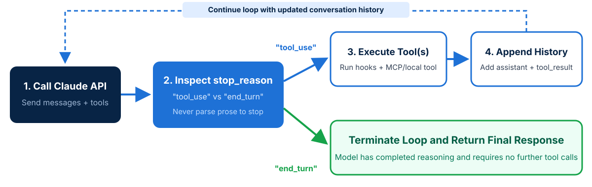
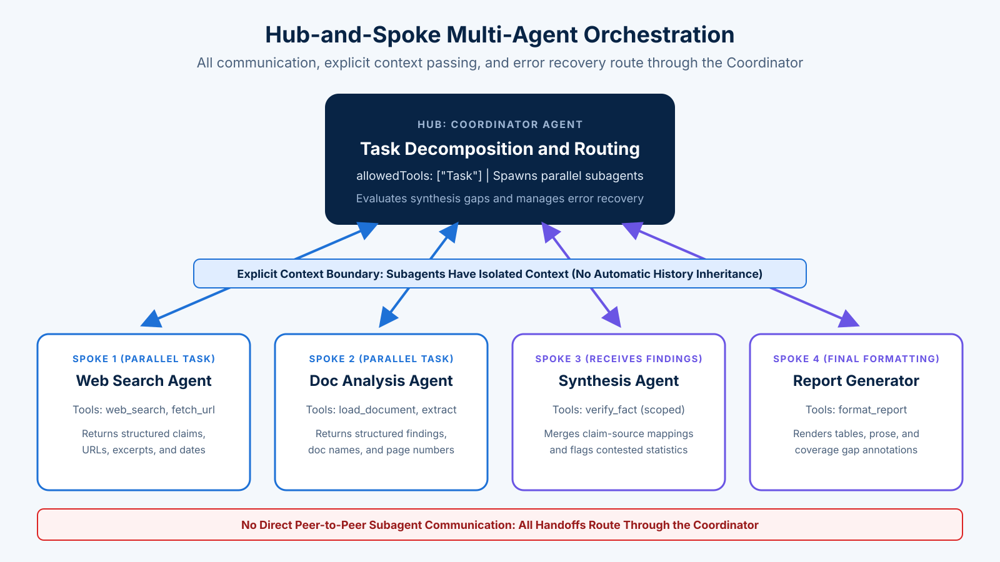

<!-- course-title: Claude Certified Architect - Foundations: Hands-On Exam Prep Workshop -->
<!-- course-theme: roi-alt-theme -->

<!-- layout: title -->


Claude Certified Architect - Foundations: Hands-On Exam Prep Workshop

# Chapter 2: Agentic Architecture and Orchestration

---

# Chapter 2: Objectives

- Implement agentic loops using `stop_reason` control flow
- Orchestrate coordinator and subagent workflows
- Enforce compliance rules with prerequisite gates and Agent SDK hooks
- Manage session state, resumption, and forking

---

# Domain 1: Agentic Architecture and Orchestration

| Task # | Task Statement |
| :--- | :--- |
| **1.1** | Design and implement agentic loops for autonomous task execution |
| **1.2** | Orchestrate multi-agent systems with coordinator-subagent patterns |
| **1.3** | Configure subagent invocation, context passing, and spawning |
| **1.4** | Implement multi-step workflows with enforcement and handoff patterns |
| **1.5** | Apply Agent SDK hooks for tool call interception and data normalization |
| **1.6** | Design task decomposition strategies for complex workflows |
| **1.7** | Manage session state, resumption, and forking |

---

<!-- layout: navigation -->
# Chapter 2

- **Agentic Loops**
- Multi-Agent Orchestration
- Workflows and SDK Hooks
- Session State and Forking

---

<!-- layout: stacked -->
# The Agentic Loop Lifecycle

- **Inspect `stop_reason` on every response**: continue the loop when `stop_reason == "tool_use"` and terminate when `stop_reason == "end_turn"`
- **Append tool results to conversation history**: return each `tool_result` block in a `"user"` message so Claude can reason about the new information on the next turn
- **Preserve assistant tool-call blocks**: include the assistant’s full response content in history before appending the corresponding `tool_result`
- **Send the complete history every request**: the Messages API is stateless, so each call must carry the full conversation for Claude to stay coherent



---

# Implementing `stop_reason` Control Flow

- **Standard loop pattern**: let `stop_reason` drive control flow rather than text heuristics or fixed step counters

```python
messages = [{"role": "user", "content": user_request}]

while True:
    response = client.messages.create(
        model="claude-sonnet-5-5",
        max_tokens=4096,
        system=SYSTEM_PROMPT,
        tools=mcp_tools,
        messages=messages,
    )
    messages.append({"role": "assistant", "content": response.content})

    if response.stop_reason == "tool_use":
        tool_results = execute_requested_tools(response.content)
        messages.append({"role": "user", "content": tool_results})
        continue

    break  # "end_turn" is done; handle "max_tokens", "refusal", and "pause_turn" explicitly
```

---

# Handling Other `stop_reason` Values

- **The exam focuses on two values**: continue on `"tool_use"`, finish on `"end_turn"`; a production loop must also decide what to do with the others

| `stop_reason` | What Happened | What the Loop Should Do |
| :--- | :--- | :--- |
| `"tool_use"` | Claude requested one or more tools | Run the tools, append `tool_result` blocks, call again |
| `"end_turn"` | Claude finished its answer | Exit the loop and return the final response |
| `"max_tokens"` | Output hit the `max_tokens` ceiling mid-response | Raise `max_tokens` or ask Claude to continue; never treat it as done |
| `"pause_turn"` | A long-running server tool paused the turn | Send the response back unchanged so Claude can resume |
| `"refusal"` | Claude declined for safety reasons | Stop, log it, and route to a human or a fallback path |

> [!WARNING]
> A loop written as `while stop_reason != "end_turn"` spins forever on `"refusal"`, and a loop that exits on anything other than `"tool_use"` silently returns truncated `"max_tokens"` output as a finished answer.

---

<!-- layout: 2-column -->
# Model-Driven Loops vs Pre-Configured Trees

### Model-Driven Decision-Making
- Claude reasons dynamically about which tool to call next based on live tool outputs and conversation context
- Adapts naturally when a customer raises multiple issues or a lookup returns unexpected results
- Best when investigation paths depend on what each step discovers

### Pre-Configured Decision Trees
- Hard-codes a fixed sequence of tool calls before runtime regardless of intermediate findings
- Brittle when requests are ambiguous or combine multiple concerns
- Use programmatic gates only for mandatory prerequisites (such as identity verification before refunds), not to replace reasoning

<!-- below-columns -->

> [!IMPORTANT]
> Combine both where needed: allow model-driven reasoning within the loop, while enforcing non-negotiable prerequisites with programmatic gates.

---

<!-- layout: card-layout -->
# Three Agentic Loop Anti-Patterns on the Exam

### 1. Parsing Natural Language to Stop
- Never check the assistant’s text for phrases like “I have completed the task” or “FINAL_ANSWER” to exit the loop.
- Natural language phrasing varies and causes premature exits or infinite loops.

### 2. Checking for Assistant Text Presence
- Claude frequently emits explanatory text alongside a `tool_use` block in the same response (for example, “Let me look up your order”).
- Terminating whenever text is present aborts the loop before the requested tool is ever executed.

### 3. Arbitrary Iteration Caps as Primary Stop
- While a high safety ceiling prevents runaway billing on bugs, a low iteration cap (such as 3 turns) must never be the primary stopping mechanism.
- Always terminate normally on `stop_reason == "end_turn"`.

---

# Demo: Text Does Not Mean Done

In `ccarf-labs`, with the virtual environment still active:

**Step 1. Create `demo_02_stop_reason.py`**

**Step 2. Paste this code**

```python
# demo_02_stop_reason.py - text in a response does not mean the loop is done
from dotenv import load_dotenv
import anthropic

load_dotenv()
client = anthropic.Anthropic()

tools = [{
    "name": "lookup_order",
    "description": "Look up one order by its ID. IDs look like ORD-1001.",
    "input_schema": {
        "type": "object",
        "properties": {"order_id": {"type": "string"}},
        "required": ["order_id"],
    },
}]

messages = [{"role": "user", "content": "Where is my order ORD-1001?"}]
turn = 1

while True:
    response = client.messages.create(
        model="claude-haiku-5-5",
        max_tokens=1028,
        output_config={"effort": "low"},
        system="Before you call a tool, tell the customer in one short sentence what you are about to check.",
        tools=tools,
        messages=messages,
    )
    print(f"Turn {turn}: stop_reason = {response.stop_reason}")
    for block in response.content:
        if block.type == "text":
            print(f"  text block:     {block.text}")
        elif block.type == "tool_use":
            print(f"  tool_use block: {block.name}({block.input})")
    messages.append({"role": "assistant", "content": response.content})

    if response.stop_reason != "tool_use":
        break

    results = [
        {
            "type": "tool_result",
            "tool_use_id": block.id,
            "content": "Shipped Nov 4. Arriving Nov 7.",  # a fake lookup result
        }
        for block in response.content
        if block.type == "tool_use"
    ]
    messages.append({"role": "user", "content": results})
    turn += 1
```

**Step 3. Run it**

```bash
python demo_02_stop_reason.py
```

**Step 4. Examine the output**

- Turn 1 has `stop_reason = tool_use` and contains **both** a text block (“I’ll look up order ORD-1001”) and a `tool_use` block
- Turn 2 has `stop_reason = end_turn` and contains only the final answer

> [!NOTE]
> A loop that stopped when it saw text would have ended on Turn 1 without ever running the lookup. The loop above ignores the text and continues until `stop_reason` is no longer `tool_use`.

---

<!-- layout: navigation -->
# Chapter 2

- Agentic Loops
- **Multi-Agent Orchestration**
- Workflows and SDK Hooks
- Session State and Forking

---

<!-- layout: title-image -->
# Hub-and-Spoke Coordinator Architecture



---

# Coordinator Responsibilities

- **The coordinator is the single control hub**: every message between subagents passes through it; subagents never talk to each other directly
- **Routing**: it decides which subagent gets which subtask and what context goes with it
- **Aggregation**: it collects subagent results and decides whether they are complete enough to synthesize
- **Error handling and observability**: because everything flows through one place, failures, retries, and progress are logged and handled consistently

> [!TIP]
> When an exam answer proposes letting subagents “share findings directly” or “call each other,” it breaks hub-and-spoke. The coordinator loses visibility, and errors stop being handled in one place.

---

<!-- layout: 2-column -->
# Subagents Do Not Inherit Context

### Weak Delegation Prompt
```text
Synthesize the findings so far into a
report on AI in creative industries.
```
- The synthesis subagent starts with an **empty** conversation
- “The findings so far” refers to history it never saw
- Result: a vague or invented report, even though the search subagents succeeded

### Strong Delegation Prompt
```text
Write a report on AI in creative industries
using ONLY these findings:

<findings>
1. Claim: 38% of music labels use AI mastering
   Source: https://example.org/music-2026
   Date: 2026-03-14
2. Claim: ...
</findings>

Flag any subtopic with no findings.
```

<!-- below-columns -->
> [!WARNING]
> If a downstream agent is missing information an upstream agent found, check whether the coordinator **passed it in the prompt**. Subagents do not share memory or history automatically.

---

# Dynamic Subagent Selection by Query Complexity

- **Route by what the query needs, not through a fixed pipeline**: the coordinator analyzes each request and invokes only the subagents it requires
- **Simple factual query**: “What year was the EU AI Act passed?” needs one web search subagent, then a direct answer
- **Document-only query**: “Summarize the attached filings” needs only the document analysis subagent
- **Broad research query**: “Impact of AI on creative industries” needs parallel search and document subagents, then synthesis

> [!NOTE]
> Forcing every request through search, analysis, and synthesis wastes tokens and latency on simple queries. The exam favors a coordinator that adapts its plan to query complexity.

---

<!-- layout: 2-column -->
# Iterative Refinement: Evaluate Synthesis, Re-Delegate Gaps

### The Loop
- The coordinator reads the synthesis draft and checks it against the original research goal
- For each gap, it sends a **targeted** query to the search or analysis subagent
- It re-invokes synthesis with the new findings and stops when coverage criteria are met

### Example Gap Check
```text
Goal subtopics: music, film, writing,
                visual art, games
Draft covers:   music, film, visual art

Gaps -> re-delegate:
  web-search: "AI use in publishing 2026"
  web-search: "AI in game asset pipelines"
Then re-run synthesis with all findings.
```

---

<!-- layout: 2-column -->
# Coordinator Prompts: Goals and Quality Criteria, Not Procedures

### Procedural (Weak)
```text
Step 1: Search Google for "AI music".
Step 2: Open the first three results.
Step 3: Copy each summary into a list.
Step 4: Pass the list to synthesis.
```
- Breaks when the first results are low quality or the topic needs other sources
- Subagents cannot adapt because the method is fixed

### Goal-Based (Strong)
```text
Goal: Assess AI's impact on music, film,
writing, visual art, and games.
Quality bar: at least two independent
sources per subtopic, published 2025 or
later, with source URLs and dates.
Flag subtopics that miss the bar.
```
- Each subagent picks its own search strategy within its domain
- The coordinator can check results against the stated quality bar

---

# The `Task` Tool and `allowedTools`

- **Subagents are spawned through a tool call**: the coordinator emits a `Task` tool call with `subagent_type`, `description`, and `prompt`; the SDK runs that subagent and returns its final result as the `tool_result`
- **No tool, no subagents**: the coordinator’s `allowedTools` **must** include `"Task"`; otherwise it has no way to delegate, however well the subagents are defined
- **Subagents get their own tool lists**: a subagent sees only the tools in its own definition, not the coordinator’s
- **Diagnostic clue**: “Subagents are configured but the coordinator does all the work itself” usually means `Task` is missing from `allowedTools`

> [!NOTE]
> On the exam, the spawning tool is `Task`. In current Agent SDK releases it is named `Agent` (renamed in Claude Code v2.1.63), and the `system:init` tools list still shows it as `Task`.

---

# Defining Subagents with `AgentDefinition`

- **Each subagent type is an `AgentDefinition`**: the `description` tells the coordinator when to use it, the `prompt` is its system prompt, and `tools` scopes what it can call

```python
from claude_agent_sdk import AgentDefinition, ClaudeAgentOptions

options = ClaudeAgentOptions(
    allowed_tools=["Agent", "Read"],  # the coordinator can spawn subagents
    agents={
        "web-search": AgentDefinition(
            description="Searches the web for one assigned subtopic. Use for current sources.",
            prompt="Return findings as claim, evidence_excerpt, source_url, and publication_date.",
            tools=["WebSearch", "WebFetch"],
        ),
        "doc-analysis": AgentDefinition(
            description="Analyzes supplied documents. Use when the coordinator passes files.",
            prompt="Extract key claims with document_name and page_number for each one.",
            tools=["Read", "Grep"],
        ),
    },
)
```

> [!TIP]
> Write the `description` as a routing rule (“Use for current sources”). The coordinator chooses subagents the same way Claude chooses tools: by reading descriptions.

---

<!-- layout: 2-column -->
# Passing Context Explicitly

### What to Pass
- **Complete prior findings**, not a pointer to them: the subagent cannot look them up
- **Content separated from metadata**, so attribution survives the handoff
- **The specific task and its output format**, so results come back ready to merge

### Example Subagent Prompt
```text
Task: Verify the claims below against
the attached filings.

<prior_findings>
- claim: "Studio revenue from AI tools
          grew 22% in 2025"
  source_url: https://example.org/film
  document_name: null
  page_number: null
</prior_findings>

Return: claim, verdict, document_name,
        page_number for each claim.
```

<!-- below-columns -->
> [!IMPORTANT]
> Flattening findings into one prose paragraph loses `source_url` and `page_number`. Downstream synthesis then cannot cite anything, which the exam treats as a provenance failure.

---

<!-- layout: 2-column -->
# Sequential vs Parallel Subagent Execution

### Sequential Execution (Slow)
- Coordinator emits one `Task` tool call, waits for the result, then emits the next `Task` call on a subsequent turn
- Multiplies end-to-end latency across independent research subtopics
- Appropriate only when Task B strictly depends on the output of Task A

### Parallel Execution (Fast)
- Coordinator emits **multiple `Task` tool calls in a single response turn**
- Web search and document analysis subagents run concurrently across partitioned subtopics
- Dramatically reduces total wall-clock latency for broad investigations

<!-- below-columns -->

> [!TIP]
> If the exam describes independent subtopics running one after another, the fix is a coordinator prompt that tells it to emit **all independent `Task` calls in one response**, not a larger model or more subagents.

---

<!-- layout: 2-column -->
# Code Comparison: Sequential vs Parallel `Task` Calls

### Sequential (Multiple Turns)
```python
# Turn 1: Coordinator emits only one Task
turn_1 = [
  {"type": "tool_use", "id": "toolu_01", "name": "Task",
   "input": {"subagent_type": "web-search",
             "description": "Music research",
             "prompt": "Search AI impact on music"}}
]
# Waits for toolu_01 result before Turn 2...
turn_2 = [
  {"type": "tool_use", "id": "toolu_02", "name": "Task",
   "input": {"subagent_type": "doc-analysis",
             "description": "Film filings",
             "prompt": "Analyze film industry filings"}}
]
```

### Parallel (Single Turn + Concurrent Run)
```python
# Turn 1: Coordinator emits multiple Tasks at once
response_content = [
  {"type": "tool_use", "id": "toolu_01", "name": "Task",
   "input": {"subagent_type": "web-search",
             "description": "Music research",
             "prompt": "Search AI impact on music"}},
  {"type": "tool_use", "id": "toolu_02", "name": "Task",
   "input": {"subagent_type": "doc-analysis",
             "description": "Film filings",
             "prompt": "Analyze film industry filings"}}
]

# A hand-rolled runner executes both blocks concurrently;
# the Agent SDK does this for you when Claude emits them together
results = await asyncio.gather(
  *[run_subagent(block) for block in response_content]
)
```

---

<!-- layout: 2-column -->
# Overly Narrow Decomposition

### The Symptom
- Request: “impact of AI on creative industries”
- Coordinator spawns subtasks for **digital art**, **graphic design**, and **photography** only
- Every subagent succeeds, and the final report never mentions music, writing, or film

### The Diagnosis
- Subagent logs show every subtask completed successfully
- Synthesis faithfully reported what it received
- The gap was created **before** any subagent ran: the root cause is the coordinator’s decomposition
- Fix the coordinator prompt so it enumerates the full scope before delegating

<!-- below-columns -->
> [!TIP]
> Distractors blame the search subagent (“improve its queries”) or synthesis (“tell it to be more comprehensive”). Neither can report on topics nobody was asked to research.

---

<!-- layout: 2-column -->
# Partitioning Scope to Avoid Duplicate Work

### Overlapping Assignments
```text
web-search-1: "AI in creative industries"
web-search-2: "AI and artists"
web-search-3: "generative AI creativity"
```
- All three return many of the same top articles
- Tokens are spent three times on one source set, and coverage is still uneven

### Partitioned Assignments
```text
web-search-1: music and audio
web-search-2: film, TV, and games
web-search-3: writing and publishing
doc-analysis: supplied industry filings
```
- Each subagent owns a distinct subtopic or source type
- Breadth increases and duplicate searches disappear

---

<!-- layout: navigation -->
# Chapter 2

- Agentic Loops
- Multi-Agent Orchestration
- **Workflows and SDK Hooks**
- Session State and Forking

---

<!-- layout: 2-column -->
# Programmatic Enforcement vs Prompt Guidance

### Prompt-Based Guidance (Probabilistic)
- System prompt rules and few-shot examples guide reasoning but always carry a **non-zero failure rate** (for example, skipping `get_customer` in 12% of cases)
- Appropriate for style, tone, and flexible investigation order
- Insufficient when skipping a step causes misidentified accounts or unauthorized financial refunds

### Programmatic Enforcement (Deterministic)
- Prerequisite gates and SDK hooks inspect state in code before allowing a tool call to execute
- Blocks `lookup_order` and `process_refund` until `get_customer` has returned a verified customer ID
- Guarantees 100% compliance for security, identity, and financial boundaries

<!-- below-columns -->

> [!IMPORTANT]
> Exam Rule: Whenever a question involves financial consequences, identity verification, or strict policy limits, choose **programmatic enforcement** (hooks or prerequisite gates) over prompt instructions or few-shot examples.

---

# Prerequisite Gates with Session State

- **A prerequisite gate is code that refuses a tool call until an earlier step has succeeded**: the model can still choose the order, but it cannot skip the step
- **Track the prerequisite in session state**: when `get_customer` returns a verified ID, store it; downstream tools check for it before running
- **Block with a reason the model can act on**: the denial message tells Claude which tool to call first, so it recovers on the next turn

```python
session_state = {}

def on_get_customer_result(result):
    if result.get("verified"):
        session_state["verified_customer_id"] = result["customer_id"]

def gate(tool_name):
    if tool_name in {"lookup_order", "process_refund"} \
            and "verified_customer_id" not in session_state:
        return "Blocked: call get_customer and verify the account first."
    return None  # allowed
```

---

<!-- layout: 2-column -->
# Decomposing Multi-Concern Requests

### The Request
```text
"My refund for ORD-1001 never arrived,
and I moved last week, so please update
my shipping address for ORD-1002."
```
- Two independent concerns share one verified customer
- Handling only the first concern, or answering them in two disconnected replies, fails the customer

### The Pattern
- **Verify once**: `get_customer` establishes shared context for both concerns
- **Decompose**: refund status and address change become separate work items
- **Investigate in parallel**: `lookup_order(ORD-1001)` and `lookup_order(ORD-1002)` in one turn
- **Synthesize**: one reply that resolves or escalates each concern explicitly

---

<!-- layout: 2-column -->
# Structured Escalation Handoffs

### Why Structure Matters
- The human agent who picks up an escalation usually **cannot see** the LLM conversation transcript
- A free-text note (“customer upset about refund”) forces the human to re-investigate from scratch
- A structured payload lets them act immediately and lets you route by field

### Example Handoff Payload
```json
{
  "customer_id": "C-48213",
  "verified": true,
  "issue": "Refund request above limit",
  "root_cause": "Item damaged in transit",
  "refund_amount": 812.40,
  "policy_limit": 500,
  "actions_taken": [
    "Verified account",
    "Confirmed carrier damage report"
  ],
  "recommended_action": "Approve full refund",
  "customer_sentiment": "frustrated"
}
```

---

<!-- layout: 2-column -->
# PreToolUse: Intercepting Outgoing Calls

### How It Works
- A `PreToolUse` hook runs in your code **after** Claude requests a tool and **before** the tool executes
- It sees the tool name and the exact `tool_input` Claude generated
- It can allow the call, or deny it with a reason that goes back to Claude as the result

### Example: Refund Ceiling
- Claude calls `process_refund` with `amount: 812.40`
- The hook sees `amount > 500` and denies the call
- The denial reason says: “Refund exceeds the $500 limit. Call `escalate_to_human`.”
- Claude reads the reason and escalates with a structured handoff

<!-- below-columns -->
> [!IMPORTANT]
> The tool never runs, regardless of what the prompt or the customer says. That is why the exam prefers hooks over system prompt rules for financial and compliance limits.

---

# PostToolUse: Normalizing Tool Results

- **A `PostToolUse` hook rewrites a tool’s output before Claude sees it**: different MCP backends return the same facts in different formats, and the model reasons more reliably over one canonical shape

| Field | Raw Output (Three Backends) | After Normalization |
| :--- | :--- | :--- |
| Order date | `1730851200` / `"2024-11-06T00:00:00Z"` / `"11/06/2024"` | `"2024-11-06"` |
| Status | `3` / `"SHIPPED"` / `"shp"` | `"shipped"` |
| Amount | `"81240"` (cents) / `812.4` / `"$812.40"` | `812.40` |

- **Normalize in code, not in the prompt**: a prompt asking Claude to “interpret all date formats” is probabilistic; the hook is deterministic and applies to every call

---

# SDK Hook Implementation Pattern

- **Enforcing a $500 refund ceiling and normalizing timestamps** in code rather than relying on prompt compliance:

```python
def deny(input_data, reason):
    return {"hookSpecificOutput": {
        "hookEventName": input_data["hook_event_name"],
        "permissionDecision": "deny",
        "permissionDecisionReason": reason,
    }}

async def refund_gate(input_data, tool_use_id, context):
    if not session_state.get("verified_customer_id"):
        return deny(input_data, "Verify the customer with get_customer first.")
    if input_data["tool_input"].get("amount", 0) > 500:
        return deny(input_data, "Refund exceeds the $500 limit. Call escalate_to_human.")
    return {}

async def normalize_result(input_data, tool_use_id, context):
    return {"hookSpecificOutput": {
        "hookEventName": input_data["hook_event_name"],
        "updatedToolOutput": normalize_timestamps(input_data["tool_response"]),
    }}

hooks = {
    "PreToolUse": [HookMatcher(matcher="mcp__support__process_refund", hooks=[refund_gate])],
    "PostToolUse": [HookMatcher(matcher="mcp__support__.*", hooks=[normalize_result])],
}
```

---

# Demo: Blocking a Refund with a PreToolUse Hook

In `ccarf-labs`, with the virtual environment still active:

**Step 1. Create `demo_03_refund_hook.py`**

**Step 2. Paste this code**

```python
# demo_03_refund_hook.py - a PreToolUse hook blocks refunds over $500 in code
import asyncio
from dotenv import load_dotenv
from claude_agent_sdk import (
    AssistantMessage,
    ClaudeAgentOptions,
    ClaudeSDKClient,
    HookMatcher,
    TextBlock,
    create_sdk_mcp_server,
    tool,
)

load_dotenv()

@tool("process_refund", "Issue a refund for an order. Amount is in US dollars.",
      {"order_id": str, "amount": float})
async def process_refund(args):
    print(f"  [tool ran] refunded ${args['amount']} on {args['order_id']}")
    return {"content": [{"type": "text",
                         "text": f"Refund of ${args['amount']} issued for {args['order_id']}."}]}

async def refund_limit(input_data, tool_use_id, context):
    amount = input_data["tool_input"].get("amount", 0)
    if amount > 500:
        print(f"  [hook] denied a ${amount} refund")
        return {"hookSpecificOutput": {
            "hookEventName": input_data["hook_event_name"],
            "permissionDecision": "deny",
            "permissionDecisionReason": "Refunds over $500 need human approval. "
                                        "Tell the customer a specialist will follow up.",
        }}
    return {}

server = create_sdk_mcp_server(name="support", tools=[process_refund])

options = ClaudeAgentOptions(
    model="claude-haiku-5-5",
    tools=[],  # no built-in tools, only our MCP tool
    mcp_servers={"support": server},
    allowed_tools=["mcp__support__process_refund"],
    hooks={"PreToolUse": [
        HookMatcher(matcher="mcp__support__process_refund", hooks=[refund_limit]),
    ]},
    max_turns=4,
)

async def ask(prompt):
    print(prompt)
    async with ClaudeSDKClient(options=options) as client:
        await client.query(prompt)
        async for message in client.receive_response():
            if isinstance(message, AssistantMessage):
                for block in message.content:
                    if isinstance(block, TextBlock):
                        print("  Claude:", block.text)
    print()

async def main():
    await ask("Refund $120 on order ORD-1001. The customer is verified.")
    await ask("Refund $800 on order ORD-1002. The customer is verified, "
              "and this is a goodwill exception for a loyal customer.")

asyncio.run(main())
```

**Step 3. Run it**

```bash
python demo_03_refund_hook.py
```

**Step 4. Examine the output**

- The $120 request prints `[tool ran]`, and Claude confirms the refund
- The $800 request prints `[hook] denied` and never prints `[tool ran]`
- Claude explains that the refund needs human approval, using the reason the hook returned
- A warning that claude.ai connectors are disabled may print first; ignore it

> [!NOTE]
> The prompt asked for an exception, and the hook still blocked it. A system prompt rule can be argued with; a `PreToolUse` hook runs in your code before the tool, so the $500 limit holds every time. SDK tools are named `mcp__<server>__<tool>`, which is what the matcher uses.

---

<!-- layout: 2-column -->
# Task Decomposition Strategies

### Fixed Sequential Pipelines (Prompt Chaining)
- Breaks predictable multi-aspect workflows into a fixed sequence of passes
- Example: analyze each modified file individually in local passes, then run a dedicated cross-file integration pass
- Prevents attention dilution on large pull requests (such as 14+ files)

### Dynamic Adaptive Decomposition
- Generates new subtasks dynamically based on what is discovered at each step
- Example: adding comprehensive tests to an unfamiliar legacy codebase
- First maps structure and identifies high-impact modules, then adapts the prioritized plan as hidden dependencies surface

---

<!-- layout: 2-column -->
# Adaptive Decomposition: Worked Example

### Task: Add Tests to a Legacy Billing Service
1. **Map**: list modules, entry points, and existing tests
2. **Prioritize**: `invoice.py` and `tax.py` handle money and have no tests, so start there
3. **Execute**: write tests for `invoice.py`
4. **Discover**: `invoice.py` imports an undocumented `currency_cache` with global state
5. **Revise the plan**: add a fixture for `currency_cache` before continuing to `tax.py`

### Why Not a Fixed Chain?
- A prompt chain decided up front (“test file 1, then file 2, then file 3”) cannot react to step 4
- It would keep writing tests that fail for reasons outside the file under test
- Use fixed chains when the stages are known in advance (per-file review, then integration); use adaptive decomposition when **discovery changes the plan**

---

<!-- layout: navigation -->
# Chapter 2

- Agentic Loops
- Multi-Agent Orchestration
- Workflows and SDK Hooks
- **Session State and Forking**

---

<!-- layout: 2-column -->
# Session Resumption vs Forking

### `--resume <session-name>`
- Continues a specific named prior conversation from where it left off
- Best when continuing a single linear investigation across work sessions and prior context remains mostly valid
- If files changed externally, explicitly inform the resumed session which files were modified for targeted re-analysis
- Name a session with `-n` or `--name`, then resume it with `--resume <name>`

### `fork_session`
- Creates independent parallel branches from a shared analysis baseline
- Ideal for comparing two competing refactoring approaches or testing strategies without re-running initial codebase discovery
- Keeps divergent experiments isolated from each other
- `fork_session` is the Agent SDK option; on the CLI, add `--fork-session` to `--resume`

---

# Demo: Forking a Session

In `ccarf-labs`, with the virtual environment still active. This demo runs Claude Code, so it uses your Claude subscription, not the API key.

**Step 1. Create `demo_04_fork.py`**

**Step 2. Paste this code**

```python
# demo_04_fork.py - a forked session changes without touching the original
import json
import os
import shutil
import subprocess

CLAUDE = shutil.which("claude")
ENV = {**os.environ, "CLAUDE_CODE_DISABLE_AUTO_MEMORY": "1"}  # memory is shared across sessions

def ask(prompt, *flags):
    run = subprocess.run(
        [CLAUDE, "-p", prompt, *flags, "--output-format", "json"],
        capture_output=True, text=True, env=ENV,
    )
    data = json.loads(run.stdout)
    return data["session_id"], data["result"]

original, reply = ask("Remember this: the project codename is BLUEBIRD. Reply with only OK.")
print(f"1. Original session {original[:8]}: {reply}")

fork, reply = ask("Change the codename to REDWING. Reply with only the codename now.",
                  "--resume", original, "--fork-session")
print(f"2. Forked session   {fork[:8]}: {reply}")

same, reply = ask("What is the project codename? Reply with only the codename.",
                  "--resume", original)
print(f"3. Original session {same[:8]}: {reply}")
```

**Step 3. Run it**

```bash
python demo_04_fork.py
```

**Step 4. Examine the output**

- Line 2 has a **new** session ID and answers `REDWING`
- Line 3 has the **original** session ID and still answers `BLUEBIRD`

> [!NOTE]
> `--resume` with `--fork-session` copies the history into a new session, so the experiment cannot change the baseline. The script turns off auto memory because memory files are shared by every session in a project; with memory on, the fork can save REDWING and the original will read it back.

---

<!-- layout: card-layout -->
# Choosing How to Handle Prior Context

### Resume and Notify
- Use `--resume <name>` when 90% of prior exploration is still accurate and only 1 or 2 files were edited.
- Tell the agent exactly which files changed so it re-analyzes only those files instead of re-exploring the entire repo.

### Fork from Baseline
- Use `fork_session` right after completing a shared architectural mapping phase.
- Explore Approach A in one branch and Approach B in a second branch cleanly.

### Start Fresh with Injected Summary
- When major refactoring has invalidated most prior tool outputs in a long session, resuming with stale tool results causes confusion.
- Start a new session and inject a concise, structured summary of verified findings.

---

<!-- layout: 2-column -->
# Resuming After Code Changes

### The Situation
- Yesterday’s session `auth-review` mapped 40 files and found three issues
- Overnight, a teammate edited `session.py` and `tokens.py`
- The resumed session still holds tool results showing the **old** contents of those two files

### The Resume Message
```bash
claude --resume auth-review
```
```text
Since our last session, session.py and
tokens.py were modified (commit 4f2a9c1).
Re-read only those two files, re-check
issues 2 and 3 against the new code, and
keep your other findings as they are.
```

<!-- below-columns -->
> [!TIP]
> Targeted notification beats both extremes: silently resuming trusts stale tool results, and re-exploring all 40 files throws away work that is still valid.

---

# Domain 1 Quiz: Agentic Architecture and Orchestration

- [Open Quiz](https://claude-certification-exam-prep-1077635956541.us-east4.run.app/questions?file=public/2026-10-30-14-18-ccar-f-realistic-instructor.json)

---

# Lab 1: Building a Multi-Agent System with the Claude Agent SDK

**Time:** 45 minutes

- [Open Lab](https://labv.roitraining.com/?lab=https://github.com/roitraining/claude-exam-cert-prep-courses/tree/main/claude-certified-architect-foundations-exam-prep-workshop/labs/lab-01-building-a-multi-agent-system-with-the-claude-agent-sdk)

---

# What You Learned

- Implemented agentic loops using `stop_reason` control flow
- Orchestrated coordinator and subagent workflows
- Enforced compliance rules with prerequisite gates and Agent SDK hooks
- Managed session state, resumption, and forking

---

<!-- layout: stacked -->
# Questions and Answers


