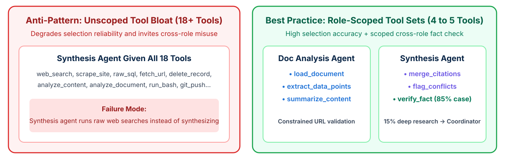

<!-- course-title: Claude Certified Architect - Foundations: Hands-On Exam Prep Workshop -->
<!-- course-theme: roi-alt-theme -->

<!-- layout: title -->


Claude Certified Architect - Foundations: Hands-On Exam Prep Workshop

# Chapter 3: Tool Design and MCP Integration

---

# Chapter 3: Objectives

- Design clear tool descriptions and selection boundaries
- Implement structured MCP error responses
- Scope agent tool sets and configure `tool_choice`
- Integrate MCP servers and built-in tools effectively

---

# Domain 2: Tool Design and MCP Integration

| Task # | Task Statement |
| :--- | :--- |
| **2.1** | Design effective tool interfaces with clear descriptions and boundaries |
| **2.2** | Implement structured error responses for MCP tools |
| **2.3** | Distribute tools appropriately across agents and configure tool choice |
| **2.4** | Integrate MCP servers into Claude Code and agent workflows |
| **2.5** | Select and apply built-in tools (`Read`, `Write`, `Edit`, `Bash`, `Grep`, `Glob`) effectively |

---

<!-- layout: navigation -->
# Chapter 3

- **Tool Interface Design**
- Structured Error Responses
- Tool Distribution and Built-In Tools
- MCP Server Integration

---

# How Descriptions Drive Tool Selection

- **Claude chooses tools by reading their names and descriptions**: there is no other routing signal, so the description is the tool’s entire interface contract
- **Root cause of misrouting**: when two tools have minimal or overlapping descriptions (such as `"Retrieves customer info"` vs `"Retrieves order details"`), Claude frequently picks the wrong tool on ambiguous user queries
- **What a strong description contains**: what the tool returns, the input format, example queries it answers, edge cases, and when **not** to use it
- **First-step architectural fix**: expand tool descriptions before building external classifiers or consolidating backends

> [!IMPORTANT]
> Exam Rule: When an agent misroutes calls between two similar tools with minimal descriptions, the most effective **first step** is expanding the tool descriptions - not adding 8 few-shot examples or building a pre-routing classifier.

---

<!-- layout: 2-column -->
# Weak vs High-Reliability Tool Descriptions

### Weak Description (Causes Misrouting)
```json
{
  "name": "lookup_order",
  "description": "Retrieves order details",
  "input_schema": {
    "type": "object",
    "properties": {
      "id": { "type": "string" }
    }
  }
}
```
- No format guidance on `id`
- No boundary distinguishing order lookups from `get_customer`

### Strong Description (Clear Boundaries)
```json
{
  "name": "lookup_order",
  "description": "Fetches order status, line items, and shipment tracking using an order ID (format: ORD-XXXXX or #12345). Use when the user asks about a purchase or delivery. Do NOT use for account profile lookups; call get_customer first if only an email or name is provided.",
  "input_schema": {
    "type": "object",
    "properties": {
      "order_id": { "type": "string" }
    }
  }
}
```

---

<!-- layout: 2-column -->
# System Prompt Keywords Can Override Descriptions

### The Trap
```text
System prompt:
"Always look up the customer before
answering any question about an account."
```
- User asks: “Where is order ORD-10442?”
- Claude reads “account” into the request and calls `get_customer` first, then asks for an email it does not need
- The tool descriptions were fine; the **system prompt** biased selection

### The Fix
```text
System prompt:
"If the user gives an order ID, call
lookup_order directly. Call get_customer
only when you need to verify identity
before a refund or account change."
```
- Audit system prompts for keyword-triggered instructions that compete with tool descriptions
- State the condition that triggers each tool, not a blanket rule

---

<!-- layout: 2-column -->
# Renaming Tools to Remove Overlap

### Before: Colliding Names
```json
[
  {"name": "analyze_content",
   "description": "Analyzes content."},
  {"name": "analyze_document",
   "description": "Analyzes a document."}
]
```
- Near-identical names and descriptions give Claude no way to tell them apart
- Selection becomes close to a coin flip on any “analyze this” request

### After: Distinct Domains
```json
[
  {"name": "extract_web_results",
   "description": "Extracts titles, snippets, and URLs from web search results. Use only on search output, never on uploaded files."},
  {"name": "analyze_document",
   "description": "Analyzes an uploaded PDF or DOCX by document_id. Use for files the user attached."}
]
```

---

<!-- layout: 2-column -->
# Splitting Generic Tools into Purpose-Specific Tools

### Before: One Tool, Many Modes
```json
{
  "name": "analyze_document",
  "input_schema": {"properties": {
    "document_id": {"type": "string"},
    "mode": {"enum": ["extract", "summarize",
             "verify", "compare", "classify"]},
    "options": {"type": "object"}
  }}
}
```
- Claude must guess the right `mode` and the shape of `options` for each mode
- One vague description has to cover five behaviors

### After: One Tool per Job
```json
[
  {"name": "extract_data_points",
   "description": "Returns metric, value, unit, and page for each figure in a document."},
  {"name": "summarize_content",
   "description": "Returns a 150-word summary of a document."},
  {"name": "verify_claim_against_source",
   "description": "Returns supported, contradicted, or not_found for one claim against one document."}
]
```

---

<!-- layout: navigation -->
# Chapter 3

- Tool Interface Design
- **Structured Error Responses**
- Tool Distribution and Built-In Tools
- MCP Server Integration

---

<!-- layout: card-layout -->
# Four Error Categories in MCP Tools

### 1. Transient Errors
- Network timeouts, rate limits, or temporary `503 Service Unavailable` responses.
- Mark `isRetryable: true` so the subagent can retry locally with backoff before escalating.

### 2. Validation Errors
- Malformed identifier format or missing required query fields.
- Mark `isRetryable: true` with specific parameter feedback so the model reformats its call.

### 3. Business / Policy Errors
- Requests that violate policy, such as a return outside the 30-day window or a refund over limit.
- Mark `isRetryable: false` and include a customer-friendly explanation so the agent stops retrying and explains or escalates.

### 4. Permission Errors
- Unauthorized access to restricted records or missing credentials.
- Mark `isRetryable: false` and propagate immediately to the coordinator or human escalation flow.

---

# Returning Structured Error Metadata

- **Why generic errors fail**: returning a uniform `"Operation failed"` string prevents the agent from knowing whether to retry, reformulate inputs, or explain a policy limit
- **MCP `isError` pattern**: return `isError: true` alongside structured JSON metadata

```json
{
  "isError": true,
  "content": [
    {
      "type": "text",
      "text": "{\"errorCategory\": \"business_rule\", \"isRetryable\": false, \"code\": \"RETURN_WINDOW_EXPIRED\", \"userMessage\": \"Orders delivered more than 30 days ago require supervisor approval for return.\", \"attemptedOrderId\": \"ORD-99281\"}"
    }
  ]
}
```

---

# How the Agent Responds to Each Error Category

- **The category tells the agent what to do next**: the tool’s job is to classify the failure; the agent’s job is to act on that classification

| Category | `isRetryable` | Agent Action | Example Message in the Error |
| :--- | :--- | :--- | :--- |
| **Transient** | `true` | Retry locally with backoff; escalate after a few attempts | “Payment service timed out after 10 seconds.” |
| **Validation** | `true` | Fix the input and call again; ask the user if the value is unknown | “`order_id` must match `ORD-` plus 5 digits; received `10442`.” |
| **Business rule** | `false` | Stop retrying; explain the policy to the user or escalate | “Return window of 30 days expired on Oct 2.” |
| **Permission** | `false` | Stop; propagate to the coordinator or a human | “Agent role `support-tier1` cannot read payment records.” |

> [!TIP]
> Retrying a business-rule error is the most common wrong answer: the agent burns turns and the customer still gets no explanation. Include a user-safe `userMessage` so the agent can explain without guessing.

---

# Demo: A Policy Error Versus a Transient Error

In `ccarf-labs`, with the virtual environment still active:

**Step 1. Create `demo_05_error_category.py`**

**Step 2. Paste this code**

```python
# demo_05_error_category.py - the same tool failure, two different error categories
import json
from dotenv import load_dotenv
import anthropic

load_dotenv()
client = anthropic.Anthropic()

tools = [{
    "name": "process_refund",
    "description": "Issue a refund for a delivered order.",
    "input_schema": {
        "type": "object",
        "properties": {"order_id": {"type": "string"}, "amount": {"type": "number"}},
        "required": ["order_id", "amount"],
    },
}]

FAILURES = {
    "transient": {"errorCategory": "transient", "isRetryable": True,
                  "message": "Payment service timed out."},
    "business_rule": {"errorCategory": "business_rule", "isRetryable": False,
                      "code": "RETURN_WINDOW_EXPIRED",
                      "userMessage": "Orders delivered more than 30 days ago cannot be refunded online."},
}

def run(failure):
    messages = [{"role": "user", "content": "Please refund $45 on order ORD-2001."}]
    for _ in range(2):
        response = client.messages.create(
            model="claude-haiku-5-5",
            max_tokens=1028,
            output_config={"effort": "low"},
            system="You are a support agent. Read tool error metadata before you decide what to do next.",
            tools=tools,
            messages=messages,
        )
        calls = [b for b in response.content if b.type == "tool_use"]
        if not calls:
            break
        messages.append({"role": "assistant", "content": response.content})
        messages.append({"role": "user", "content": [{
            "type": "tool_result", "tool_use_id": calls[0].id,
            "is_error": True, "content": json.dumps(failure),
        }]})
    if calls:
        print("  Claude called process_refund again (a retry).")
    else:
        text = "".join(b.text for b in response.content if b.type == "text")
        print("  Claude:", text)

for name, failure in FAILURES.items():
    print(f"Error category: {name}")
    run(failure)
    print()
```

**Step 3. Run it**

```bash
python demo_05_error_category.py
```

**Step 4. Examine the output**

- For `transient`, Claude should call `process_refund` again
- For `business_rule`, Claude should stop, explain the 30-day window to the customer, and offer an escalation instead of retrying

> [!NOTE]
> The tool failed both times; only the metadata changed. `errorCategory` and `isRetryable` are what let the agent choose between a retry and an explanation. A bare `"Operation failed"` string gives it nothing to choose with.

---

<!-- layout: 2-column -->
# Access Failures vs Valid Empty Results

### Access Failure (Error State)
- Database timeout, unreachable API, or expired auth token
- Must return `isError: true` with `errorCategory: "transient"` or `"permission"`
- Subagent attempts local retry for transient failures; if unresolved, propagates structured error context and partial results to the coordinator

### Valid Empty Result (Success State)
- Query executed cleanly against the backend, and zero records matched `"email: unknown@example.com"`
- Must return `isError: false` with an empty list `[]`
- Tells the agent definitively that no matching record exists so it can ask the user for another identifier

<!-- below-columns -->

> [!WARNING]
> Never catch a timeout inside a tool or subagent and return an empty array `[]` marked as successful. Suppressing access errors tricks the coordinator into reporting that no data exists.

---

<!-- layout: navigation -->
# Chapter 3

- Tool Interface Design
- Structured Error Responses
- **Tool Distribution and Built-In Tools**
- MCP Server Integration

---

<!-- layout: 2-column -->
# Too Many Tools Degrade Selection

### One Agent, 18 Tools
- Every tool description competes for attention on every turn
- Similar tools (`search_orders`, `find_order`, `lookup_purchase`) blur together
- Selection accuracy drops, and tool definitions consume a large share of the input tokens

### Four Agents, 4 to 5 Tools Each
- **Support agent**: `get_customer`, `lookup_order`, `process_refund`, `escalate_to_human`
- **Research agent**: `web_search`, `fetch_document`, `extract_data_points`
- Each agent chooses among a small, distinct set that matches its role
- Apply least privilege: an agent gets only the tools its role requires

---

<!-- layout: 2-column -->
# Out-of-Role Tools Get Misused

### The Failure
- A synthesis agent is given `web_search` “just in case”
- When a finding looks thin, it runs its own searches instead of reporting the gap
- The coordinator loses track of what was searched, sources go unvetted, and work is duplicated

### The Fix
- Remove tools that belong to another role
- Have the synthesis agent **report gaps** back to the coordinator, which decides whether to re-delegate
- **Constrain generic tools**: replace an open `fetch_url` with `load_document`, which accepts only URLs in approved document storage

---

<!-- layout: stacked -->
# Scoped Cross-Role Tools for High-Frequency Needs

- **Allow a narrow exception when one need dominates**: if 85% of the synthesis agent’s verification needs are simple fact checks (a date, a name, a statistic), routing each one through the coordinator adds a full round trip
- **Grant a constrained `verify_fact` tool**, not general `web_search`: it checks one claim and returns `supported`, `contradicted`, or `not_found`
- **Keep the 15% of complex investigations** routed back through the coordinator, so research stays coordinated



---

<!-- layout: 3-column -->
# Configuring `tool_choice` Options

### `"auto"` (Default)
- Model decides whether to return conversational text or call one or more tools
- Use for open-ended customer support and interactive coding sessions

### `"any"`
- Forces the model to call **at least one** tool from the provided list rather than returning plain text
- Ideal when multiple extraction schemas exist and the model must pick the matching schema tool

### `{"type": "tool", "name": "..."}`
- Forces the model to call **one specific named tool** on the current turn
- Use to guarantee `extract_metadata` runs on turn 1 before enrichment tools run on follow-up turns

<!-- below-columns -->

> [!NOTE]
> On the exam, `"any"` and forced selection are correct answers. In current releases, they work on Claude Haiku 5.5 and Opus 5 but return a 400 error on Opus 5.5, Sonnet 5.5, Fable 5.1, and Mythos 5.1, and a forced call skips thinking. There is also a fourth option, `"none"`, which prevents tool calls.

---

# Forcing a First Tool, Then Returning to `auto`

- **`tool_choice` is set per request, so it can change from turn to turn**: force the required first step, then let Claude choose freely for the rest of the loop

```python
tool_choice = {"type": "tool", "name": "extract_metadata"}  # turn 1: must extract first

while True:
    response = client.messages.create(
        model="claude-haiku-5-5",  # forced tool_choice is supported on this model
        max_tokens=2048,
        tools=[extract_metadata, lookup_vendor, check_po_number],
        tool_choice=tool_choice,
        messages=messages,
    )
    messages.append({"role": "assistant", "content": response.content})
    if response.stop_reason != "tool_use":
        break
    messages.append({"role": "user", "content": run_tools(response.content)})
    tool_choice = {"type": "auto"}  # later turns: Claude picks enrichment tools as needed
```

> [!NOTE]
> Leaving the forced choice on every turn traps the loop: Claude must call `extract_metadata` again and can never reach `end_turn`.

---

<!-- layout: 2-column -->
# Selecting Built-In Search Tools: `Grep` vs `Glob`

### `Grep` (Content Search)
- Searches **inside file contents** using regular expressions
- Use to find all callers of a function, locate specific error message strings, or trace `import` statements across a codebase

### `Glob` (File Path Matching)
- Matches **file names and directory paths** by wildcard pattern
- Use to locate files by extension or naming convention, such as `**/*.test.tsx` or `src/**/schema.json`

<!-- below-columns -->

> [!TIP]
> Ask what the question is searching: **text inside files** (a function name, an error string) is `Grep`; **file names or paths** (all test files, every `schema.json`) is `Glob`.

---

<!-- layout: 2-column -->
# `Edit` Failures and the `Read` + `Write` Fallback

### How `Edit` Works
- Replaces one **unique** text anchor (`old_string`) with new text
- Leaves the rest of the file untouched, so it is the preferred tool for targeted changes
- Fails when the anchor appears more than once, because it cannot tell which occurrence you mean

### When It Fails
- Example: `timeout = 30` appears in three config blocks, and only one should change
- **First choice**: widen the anchor with surrounding lines so it becomes unique
- **Fallback**: `Read` the full file, apply the change, and `Write` the complete updated contents
- `Write` replaces the whole file, so use it only after a fresh `Read` of the current contents

---

<!-- layout: 2-column -->
# Tracing Wrapper Modules to Their Implementations

### The Trap
```python
# utils/payments.py (a wrapper module)
from vendor.stripe_client import (
    charge as create_charge,
    refund as issue_refund,
)
```
- `Grep "stripe_client.refund"` finds almost no call sites
- Callers import `issue_refund` from `utils.payments`, so the real usage is hidden behind the alias

### The Method
1. `Read` the wrapper module to list every exported name and alias
2. `Grep` for each exported name (`issue_refund`, `create_charge`) across the codebase
3. `Read` the call sites that matter for the change
- Result: a complete call-site list instead of a misleading “only 2 uses”

---

# Building Codebase Understanding Incrementally

- **Explore in widening steps, guided by what each step finds**: reading every file up front fills the context window before you know what matters

| Step | Tool | Example | What You Learn |
| :--- | :--- | :--- | :--- |
| 1. Locate files | `Glob` | `src/**/refund*.py` | Where refund logic lives |
| 2. Find the entry point | `Grep` | `def handle_refund` | Which function starts the flow |
| 3. Read the entry point | `Read` | `src/api/refunds.py` | What it calls and imports |
| 4. Follow imports | `Read` | `src/services/ledger.py` | How the flow continues |
| 5. Find other callers | `Grep` | `post_ledger_entry\(` | Who else depends on this code |

> [!TIP]
> Exam distractors include “read all files in the repository first” and “use `Bash` with `find` and `cat`.” The built-in search tools plus targeted `Read` calls are the expected answer.

---

<!-- layout: navigation -->
# Chapter 3

- Tool Interface Design
- Structured Error Responses
- Tool Distribution and Built-In Tools
- **MCP Server Integration**

---

<!-- layout: 2-column -->
# Project-Scoped vs User-Scoped MCP Configuration

### Project-Scoped (`.mcp.json`)
- Checked into version control at the repository root so the entire team shares the same MCP servers
- Uses environment variable expansion (such as `"${GITHUB_TOKEN}"`) to inject secrets at runtime without committing credentials
- Best for standard team integrations (Jira, GitHub, internal APIs)

### User-Scoped (`~/.claude.json`)
- Stored in the individual developer’s home directory outside the repository
- Best for personal productivity tools or experimental MCP servers being tested by one engineer
- All configured project and user MCP servers connect simultaneously at session start

---

# `.mcp.json` with Environment Variable Expansion

- **Never hard-code tokens in `.mcp.json`**: use `${VAR_NAME}` expansion so teams share configuration safely via Git

```json
{
  "mcpServers": {
    "github": {
      "type": "http",
      "url": "https://api.githubcopilot.com/mcp/",
      "headers": { "Authorization": "Bearer ${GITHUB_TOKEN}" }
    }
  }
}
```

---

<!-- layout: 2-column -->
# MCP Resources vs MCP Tools

### MCP Tools: Actions
- Claude **calls** a tool with arguments, and it runs code: search, fetch, create, update
- Each call costs a turn and returns a result into context
- Example: `fetch_runbook(name="db-failover")`

### MCP Resources: Readable Content
- The server **exposes** read-only content by URI, such as an issue summary list, a documentation tree, or a database schema
- The agent sees what exists up front instead of discovering it through exploratory calls
- Example: `runbooks://catalog` lists every runbook name and its purpose

<!-- below-columns -->
> [!TIP]
> When the exam describes an agent wasting turns calling `list_*` or search tools just to find out what data exists, the answer is to expose a **catalog as an MCP resource**.

---

# Demo: An MCP Server with a Tool and a Resource

In `ccarf-labs`, with the virtual environment still active. This demo runs Claude Code, so it uses your Claude subscription.

**Step 1. Create `runbook_server.py` and paste this code**

```python
# runbook_server.py - one resource (the catalog) and one tool (fetch a runbook)
from mcp.server.mcpserver import MCPServer

mcp = MCPServer("runbooks")

RUNBOOKS = {
    "db-failover": "1. Page the on-call DBA. 2. Promote the read replica. 3. Update the app connection string.",
    "cache-flush": "1. Announce in #ops. 2. Run the flush job. 3. Watch the hit rate for 10 minutes.",
    "cert-renewal": "1. Request the new certificate. 2. Upload it to the load balancer. 3. Verify the expiry date.",
}

@mcp.resource("runbooks://catalog")
def catalog() -> str:
    """The names of all available runbooks, one per line."""
    return "\n".join(RUNBOOKS)

@mcp.tool()
def get_runbook(name: str) -> str:
    """Return the steps for one runbook. Use a name from the runbooks://catalog resource."""
    return RUNBOOKS.get(name, f"No runbook named {name}.")

if __name__ == "__main__":
    mcp.run()
```

**Step 2. Create `.mcp.json` in the same folder**

```json
{
  "mcpServers": {
    "runbooks": {
      "command": "python",
      "args": ["runbook_server.py"]
    }
  }
}
```

**Step 3. Start Claude Code from the same terminal**

```bash
claude
```

When Claude Code asks whether to use the MCP server in `.mcp.json`, approve `runbooks`.

**Step 4. Run `/mcp` and confirm that `runbooks` is connected, then press Esc**

**Step 5. Ask Claude**

```text
Using the runbooks MCP server, which runbooks exist, and what are the steps for db-failover? Say which MCP tools or resources you used.
```

**Step 6. Examine the output**

- Claude reads the `runbooks://catalog` resource to list the three runbook names
- Claude calls the `get_runbook` tool (shown as `mcp__runbooks__get_runbook`) for the db-failover steps
- Type `/exit` when you are done

> [!NOTE]
> The catalog is a **resource**: read-only content the agent can see without guessing. Fetching one runbook is a **tool**. Because `.mcp.json` lives in the project, everyone who clones the repository gets the same server.

---

<!-- layout: 2-column -->
# Writing MCP Tool Descriptions That Compete with Built-Ins

### Vague: Claude Uses `Grep` Instead
```json
{"name": "search_docs",
 "description": "Searches documentation."}
```
- Claude Code already knows `Grep` well and can see the docs folder
- With no stated advantage, the MCP tool looks redundant, so the agent falls back to the built-in tool

### Specific: Claude Uses the MCP Tool
```json
{"name": "search_docs",
 "description": "Semantic search across the internal developer portal (12,000 pages, including Confluence and archived wikis NOT in this repo). Returns title, URL, owning team, and last-updated date. Use for questions about internal APIs, runbooks, or architecture decisions."}
```
- States what the tool reaches that `Grep` cannot, and what it returns

---

<!-- layout: 2-column -->
# Community Servers vs Custom Servers

### Use a Community or Official Server
- The integration is a standard platform: GitHub, Jira, Slack, Postgres
- Someone else maintains authentication, pagination, and API changes
- Configure it in `.mcp.json` and you are done

### Build a Custom Server
- The workflow is proprietary: internal ticketing, a domain-specific pricing engine, a regulated data store
- You need business rules enforced inside the tool, such as policy checks or field masking
- No vetted server exists for the system

<!-- below-columns -->
> [!NOTE]
> Writing a custom GitHub MCP server when an official one exists is a classic over-engineering distractor.

---

# Domain 2 Quiz: Tool Design and MCP Integration

- [Open Quiz](https://claude-certification-exam-prep-1077635956541.us-east4.run.app/questions?file=public/2026-10-30-14-46-ccar-f-realistic-instructor.json)

---

# What You Learned

- Designed clear tool descriptions and selection boundaries
- Implemented structured MCP error responses
- Scoped agent tool sets and configured `tool_choice`
- Integrated MCP servers and built-in tools effectively

---

<!-- layout: stacked -->
# Questions and Answers


