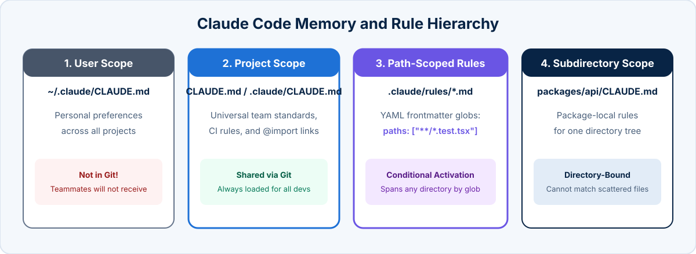

<!-- course-title: Claude Certified Architect - Foundations: Hands-On Exam Prep Workshop -->
<!-- course-theme: roi-alt-theme -->

<!-- layout: title -->


Claude Certified Architect - Foundations: Hands-On Exam Prep Workshop

# Chapter 4: Claude Code Configuration and Workflows

---

# Chapter 4: Objectives

- Configure `CLAUDE.md` hierarchies and path-scoped `.claude/rules/`
- Create custom slash commands and isolated skills
- Choose between Plan Mode and Direct Execution, and refine output iteratively
- Integrate Claude Code into CI/CD pipelines

---

# Domain 3: Claude Code Configuration and Workflows

| Task # | Task Statement |
| :--- | :--- |
| **3.1** | Configure `CLAUDE.md` files with appropriate hierarchy, scoping, and modular organization |
| **3.2** | Create and configure custom slash commands and skills |
| **3.3** | Apply path-specific rules for conditional convention loading |
| **3.4** | Determine when to use plan mode vs direct execution |
| **3.5** | Apply iterative refinement techniques for progressive improvement |
| **3.6** | Integrate Claude Code into CI/CD pipelines |

---

<!-- layout: navigation -->
# Chapter 4

- **CLAUDE.md and Path Rules**
- Slash Commands and Skills
- Plan Mode and Iterative Refinement
- CI/CD Integration

---

<!-- layout: stacked -->
# The `CLAUDE.md` Configuration Hierarchy

- **User-level (`~/.claude/CLAUDE.md`)**: personal instructions applied only on your machine; **never shared via version control**
- **Project-level (`CLAUDE.md` or `.claude/CLAUDE.md`)**: committed to Git so every developer and CI job receives universal team standards
- **Subdirectory-level (`packages/billing/CLAUDE.md`)**: directory-bound instructions for a specific package or service folder



---

<!-- layout: 2-column -->
# Diagnosing a Missing Instruction

### The Symptom
- Priya’s Claude Code always uses the team’s `pytest` fixtures and naming rules
- A new teammate clones the repo, and Claude ignores those conventions completely
- Same repository, same prompt, different behavior

### The Diagnosis
- Ask **where the instruction lives**, not how it is worded
- Priya wrote the conventions in `~/.claude/CLAUDE.md`, which is user scope and never committed
- **Fix**: move team conventions into the project `CLAUDE.md` (or `.claude/rules/`) and commit it
- Keep only personal preferences, such as editor habits, in user scope

<!-- below-columns -->

> [!TIP]
> “Works for one developer, not for others” points to configuration **scope**. Rewording the instruction or adding emphasis will not reach a file the teammate never received.

---

<!-- layout: 2-column -->
# Modular `CLAUDE.md` with `@import`

### The Problem
- Three packages each need the same API and security standards
- Copying the text into three `CLAUDE.md` files means three copies drift apart
- One giant root `CLAUDE.md` loads billing rules while you edit the web UI

### The Pattern
```markdown
# packages/billing/CLAUDE.md
Billing service. Money values are
integer cents; never use floats.

@docs/api-standards.md
@docs/security-checklist.md
```
- `@path` pulls the referenced file into context when this `CLAUDE.md` loads
- Each standard lives in one file, and each package imports only what it needs

---

# Verifying Loaded Memory with `/memory`

- **`/memory` shows which memory files are loaded in the current session**: user, project, and subdirectory `CLAUDE.md` files, plus their imports
- **Use it before rewriting an instruction**: if the file is not listed, the problem is location or scope, not wording
- **Use it to open a memory file for editing** without hunting for its path

```text
> /memory

  User memory     ~/.claude/CLAUDE.md
  Project memory  ./CLAUDE.md
                  ./packages/billing/CLAUDE.md
                  @docs/api-standards.md
```

> [!NOTE]
> The exact display varies by release. The exam point is the workflow: verify what is loaded first, then fix scope or content.

---

# Path-Scoped Rules in `.claude/rules/`

- **Conditional rule loading**: files in `.claude/rules/*.md` use YAML frontmatter `paths` globs so conventions load **only** when Claude edits matching files
- **Solves scattered file conventions**: when test files (`Button.test.tsx`) live next to components across dozens of directories, `.claude/rules/testing.md` with `paths: ["**/*.test.tsx"]` applies test conventions everywhere automatically

```yaml
# .claude/rules/testing.md frontmatter
paths:
  - "**/*.test.ts"
  - "**/*.test.tsx"
  - "terraform/**/*"
# Body: Testing and Infrastructure Conventions
# - Query React Testing Library by accessible role, never by test ID.
# - Mock external HTTP calls with MSW fixtures from src/test/fixtures/.
```

---

<!-- layout: 2-column -->
# Choosing `.claude/rules/` vs `CLAUDE.md`

### Use `.claude/rules/` with `paths` Globs
- Conventions apply to file types spread across many directories (`**/*.test.tsx`, `**/*.sql`)
- Rules are specialized (such as Terraform HCL or GraphQL schemas) and would waste context tokens when editing unrelated code
- Keeps active context lean and relevant

### Use Root or Subdirectory `CLAUDE.md`
- **Root `CLAUDE.md`**: universal repo commands (build, lint, test), architecture overview, and rules that apply to every file
- **Subdirectory `CLAUDE.md`**: rules strictly confined to one folder tree (such as `services/legacy-auth/CLAUDE.md`)

---

<!-- layout: navigation -->
# Chapter 4

- CLAUDE.md and Path Rules
- **Slash Commands and Skills**
- Plan Mode and Iterative Refinement
- CI/CD Integration

---

<!-- layout: 2-column -->
# Custom Slash Commands: Project vs User Scope

### Project-Scoped (`.claude/commands/`)
- Markdown files placed in `.claude/commands/` inside the repository (for example, `.claude/commands/review.md` creates `/review`)
- Version-controlled in Git and automatically available to every developer who clones or pulls the repo
- Use for standardized team checklists, PR reviews, and release workflows

### User-Scoped (`~/.claude/commands/`)
- Stored in the developer’s home directory
- Available only to that individual user across their local projects
- Note: `.claude/config.json` with a `commands` array does **not** exist in Claude Code (common exam distractor)

<!-- below-columns -->

> [!NOTE]
> On the exam, `.claude/commands/` is the answer for shared commands. In current releases, commands are merged into skills: `.claude/commands/review.md` and `.claude/skills/review/SKILL.md` both create `/review`. Command files still work; skills are preferred for new work.

---

<!-- layout: 2-column -->
# Skill Frontmatter: `context: fork`

### Without `context: fork`
- The skill runs **inside your main conversation**
- A codebase audit reads 60 files, and every file’s contents land in your session history
- After the skill finishes, the context is crowded with output you no longer need

### With `context: fork`
- The skill runs in an **isolated subagent context**
- It does its verbose work there and returns only its final result to the main session
- Use it for codebase analysis, log triage, and exploratory brainstorming

<!-- below-columns -->

> [!TIP]
> If an exam scenario says a skill’s output “fills the context” or “derails the conversation,” the fix is `context: fork`, not a shorter prompt.

---

# Skill Frontmatter: `allowed-tools`

- **On the exam, `allowed-tools` limits what a skill can do**: a read-only audit skill lists only inspection tools, so it cannot edit files while it runs

```yaml
# .claude/skills/dependency-audit/SKILL.md frontmatter
name: dependency-audit
description: Lists outdated and vulnerable dependencies without changing anything
allowed-tools: ["Read", "Grep", "Glob"]
# Body: Inspect package manifests and lock files. Report findings only.
```

- **Exam framing**: choose `allowed-tools` when a scenario asks how to keep a skill read-only or limit its blast radius

> [!NOTE]
> On the exam, `allowed-tools` restricts tools. In current releases, it **pre-approves** the listed tools so they run without permission prompts, and it does not remove the others; use `disallowed-tools` to block tools during a skill.

---

<!-- layout: 2-column -->
# Skill Frontmatter: `argument-hint`

### The Problem
- `/new-migration` needs a migration name and a target schema
- Developers type `/new-migration` alone and get a vague, guessed result
- Nobody remembers the argument order

### The Fix
```yaml
# .claude/skills/new-migration/SKILL.md frontmatter
name: new-migration
description: Creates a reversible SQL migration
argument-hint: "<migration-name> <target-schema>"
# Body: Create migration $ARGUMENTS with up and down scripts and a rollback test.
```
- The hint shows the expected arguments as the developer types the command
- `$ARGUMENTS` passes what they typed into the skill body

---

<!-- layout: 2-column -->
# Personal Skill Variants in `~/.claude/skills/`

### The Situation
- The team shares `.claude/skills/review/SKILL.md`, which creates `/review`
- You want a stricter version with extra checks for your own work
- Editing the shared skill changes it for everyone

### The Pattern
- Create `~/.claude/skills/review-strict/SKILL.md` in your home directory
- Use a **distinct name** (`/review-strict`), so the team’s `/review` keeps working as expected
- Your variant follows you across projects and is never committed

<!-- below-columns -->

> [!NOTE]
> In current releases, a personal skill with the **same** name as a project skill takes precedence for you. A distinct name avoids silently replacing the shared workflow.

---

# Example `SKILL.md` Configuration

- **A complete skill combines the fields**: an isolated context, a read-only tool set, and an argument hint

```yaml
# .claude/skills/security-audit/SKILL.md frontmatter
name: security-audit
description: Audits authentication and SQL modules for OWASP vulnerabilities
context: fork
allowed-tools: ["Read", "Grep", "Glob"]
argument-hint: "<directory-or-module-path>"
# Body: Analyze the target module for injection risks and return a summarized report.
```

- Invoke it with `/security-audit src/auth`; the audit runs in a fork and returns only the summary

---

# Skills vs `CLAUDE.md`: Choosing the Mechanism

- **Ask when the guidance is needed**: always, only for certain files, or only when someone runs a specific job

| Need | Mechanism | Example |
| :--- | :--- | :--- |
| Standards that apply to every task in the repo | Root `CLAUDE.md` | Build commands, architecture overview, commit rules |
| Standards for one folder tree | Subdirectory `CLAUDE.md` | `services/legacy-auth/CLAUDE.md` |
| Standards for a file type spread across folders | `.claude/rules/` with `paths` | Test conventions for `**/*.test.tsx` |
| An on-demand, multi-step workflow | Skill in `.claude/skills/` | Security audit, migration generator, release notes |
| A personal workflow | Skill in `~/.claude/skills/` | Your own stricter review checklist |

> [!TIP]
> Putting a 40-step security audit procedure in `CLAUDE.md` loads it into every session, even when nobody is auditing. That is a skill.

---

<!-- layout: navigation -->
# Chapter 4

- CLAUDE.md and Path Rules
- Slash Commands and Skills
- **Plan Mode and Iterative Refinement**
- CI/CD Integration

---

<!-- layout: 2-column -->
# Plan Mode vs Direct Execution

### Use Plan Mode When
- Restructuring a monolith into microservices or migrating a library across 45+ files
- Multiple valid architectural approaches exist with different infrastructure or dependency trade-offs
- You need safe, read-only codebase exploration and dependency mapping before modifying code

### Use Direct Execution When
- Fixing a well-scoped single-file bug with a clear stack trace
- Adding a straightforward validation check or date conditional to a known function
- Executing an implementation approach that was already designed and approved in Plan Mode

<!-- below-columns -->

> [!TIP]
> When the scenario stresses “many files,” “multiple valid approaches,” or “unfamiliar code,” choose plan mode. When it stresses “clear stack trace” or “one function,” choose direct execution.

---

<!-- layout: 2-column -->
# The `Explore` Subagent

### What It Does
- A built-in, **read-only** subagent that searches and reads the codebase in its **own** context window
- Returns a concise summary of what it found to the main conversation
- Claude Code uses it automatically for broad searches, and you can ask for it directly: “Use the Explore subagent to map how billing events flow”

### Plan Mode vs `Explore`
- **Plan mode** controls *permissions*: the main session can read and propose but not edit
- **`Explore`** controls *context*: verbose discovery happens elsewhere and only the summary comes back
- They combine well: plan mode for the decision, with `Explore` doing the discovery so the planning context stays clean

<!-- below-columns -->

> [!TIP]
> For multi-phase tasks where discovery output would exhaust the main context window, the exam answer is to delegate exploration to the **`Explore` subagent**.

---

# Demo: Plan Mode Reads but Does Not Write

In `ccarf-labs`, with the virtual environment still active. This demo runs Claude Code, so it uses your Claude subscription.

**Step 1. Create `pricing.py` and paste this code**

```python
def apply_discount(price, percent):
    return price - price * percent / 100
```

**Step 2. Create `demo_07_plan_mode.py` and paste this code**

```python
# demo_07_plan_mode.py - plan mode reads and plans but does not edit
import os
import shutil
import subprocess
from pathlib import Path

before = Path("pricing.py").read_text()

run = subprocess.run(
    [shutil.which("claude"), "-p",
     "Add input validation to apply_discount in pricing.py: raise ValueError "
     "for a negative price or a percent outside 0 to 100.",
     "--permission-mode", "plan"],
    capture_output=True, text=True,
    env={**os.environ, "CLAUDE_CODE_DISABLE_AUTO_MEMORY": "1"},
)
print("Claude's plan:\n")
print(run.stdout)

after = Path("pricing.py").read_text()
print("pricing.py changed?", before != after)
```

**Step 3. Run it**

```bash
python demo_07_plan_mode.py
```

**Step 4. Examine the output**

- Claude read `pricing.py` and describes the checks it would add and how it would test them
- Claude says it has not edited the file because plan mode is on
- The last line prints `pricing.py changed? False`

> [!NOTE]
> Plan mode lets Claude explore and propose without changing anything, which is what you want before a large or ambiguous change. In an interactive session, press **Shift+Tab** to switch into plan mode, then approve the plan to let Claude make the edit.

---

# Plan Then Execute: Combining Modes

- **Large changes use both modes in sequence**: investigate and decide in plan mode, then implement the approved plan with direct execution

| Phase | Mode | Example: Migrate 45 Files from `requests` to `httpx` |
| :--- | :--- | :--- |
| 1. Explore | Plan mode, with `Explore` for discovery | Find every import, session object, and retry wrapper |
| 2. Propose | Plan mode | Compare a shim layer with a direct rewrite; list risks and the file order |
| 3. Approve | You review | Choose the shim layer; ask for the auth module to go first |
| 4. Implement | Direct execution | Apply the approved changes file by file, running tests after each group |

> [!NOTE]
> Skipping phases 1 to 3 on a 45-file change risks a half-finished migration built on the wrong approach. Using plan mode for a one-line fix wastes a round of review.

---

<!-- layout: 2-column -->
# Refinement Pattern: Concrete Input/Output Examples

### Prose Instruction (Inconsistent)
```text
Convert the legacy date strings to ISO
format, handling the different styles
the old system used.
```
- Claude guesses which styles exist and how to treat ambiguous dates such as `03/04/22`
- Each rerun can resolve the ambiguity differently

### Two or Three Examples (Consistent)
```text
Convert like this:
  "03/04/22"    -> "2022-03-04"  (MM/DD/YY)
  "4 Mar 2022"  -> "2022-03-04"
  "20220304"    -> "2022-03-04"
  ""            -> null
```
- The examples settle the ambiguous cases faster than more prose rules would

---

<!-- layout: 2-column -->
# Refinement Pattern: Test-Driven Iteration

### The Loop
1. Write tests first: expected behavior, edge cases such as `null` values in a migration, and a performance bound
2. Ask Claude to implement until the tests pass
3. Paste the **actual failure output** back to Claude
4. Repeat until the suite is green

### Example Prompt
```text
Here are the failing tests after your
last change:

FAILED test_migrate.py::test_null_email
  AssertionError: expected None, got ""

Fix the migration so empty emails become
NULL. Do not change the tests.
```

---

<!-- layout: 2-column -->
# Refinement Pattern: The Interview Pattern

### When to Use It
- The domain is unfamiliar, or the request hides design decisions
- Example: “Add caching to the pricing service”
- Hidden questions: How stale can prices be? What invalidates the cache? What happens if the cache is down?

### Example Prompt
```text
Before writing any code, interview me.
Ask one question at a time about
requirements, edge cases, and failure
behavior for caching the pricing service.
When you have enough, summarize the
design and wait for my approval.
```
- Surfaces cache invalidation and partial-failure recovery **before** they become bugs

---

<!-- layout: 2-column -->
# Refinement Pattern: Interacting vs Independent Issues

### Interacting Issues: One Message
- Example: a checkout fix must keep the response under 200 ms **and** stop double-charging on retry
- Fixing one alone tends to break the other (adding a lock slows the response)
- Send both constraints in **one detailed message** so the fix satisfies them together

### Independent Issues: One at a Time
- Example: a typo in an error message, a missing log line, a wrong default page size
- No fix affects the others
- Fix them **sequentially**, verifying each one before moving on

---

<!-- layout: navigation -->
# Chapter 4

- CLAUDE.md and Path Rules
- Slash Commands and Skills
- Plan Mode and Iterative Refinement
- **CI/CD Integration**

---

# Running Claude Code in Automated CI/CD Pipelines

- **Preventing interactive hangs**: always pass the **`-p` (or `--print`)** flag so Claude Code runs non-interactively, prints to stdout, and exits cleanly
- **Enforcing structured JSON output**: combine **`--output-format json`** with **`--json-schema`** so the pipeline can parse findings deterministically and post inline PR comments

```bash
claude -p "Review the git diff for security and concurrency bugs" \
  --output-format json \
  --json-schema '{"type":"object","properties":{"findings":{"type":"array","items":{"type":"object","properties":{"file":{"type":"string"},"line":{"type":"number"},"severity":{"type":"string"},"issue":{"type":"string"},"suggested_fix":{"type":"string"}},"required":["file","line","severity","issue"]}}},"required":["findings"]}'
```

> [!WARNING]
> Exam Trap: Flags like `--batch`, environment variables like `CLAUDE_HEADLESS=true`, or `< /dev/null` redirection are distractors. Always choose **`claude -p`**.

---

# Consuming `--output-format json` Results

- **The JSON envelope wraps the answer with run metadata**: with `--json-schema`, the schema-valid object is in `structured_output`, so the pipeline never parses prose

```json
{
  "type": "result",
  "subtype": "success",
  "session_id": "8c1f...",
  "num_turns": 6,
  "result": "Found 2 issues.",
  "structured_output": {
    "findings": [
      {"file": "api/orders.py", "line": 88, "severity": "critical",
       "issue": "SQL built with f-string", "suggested_fix": "Use a parameterized query"}
    ]
  }
}
```

```bash
jq -c '.structured_output.findings[]' review.json | while read -r f; do
  gh api "repos/$REPO/pulls/$PR/comments" -f commit_id="$SHA" -f side=RIGHT \
    -f path="$(jq -r .file <<<"$f")" -F line="$(jq -r .line <<<"$f")" \
    -f body="$(jq -r '"[\(.severity)] \(.issue)"' <<<"$f")"
done
```

---

<!-- layout: 2-column -->
# Independent Review Instances in CI

### Same-Session Review (Weak)
- The session that wrote the code reviews it in the same conversation
- It still holds its own reasoning for every choice, so it tends to confirm rather than question
- Bugs that come from a wrong assumption survive review

### Independent Instance (Strong)
- A separate `claude -p` run with clean context sees only the diff and the review criteria
- It has no memory of why the code was written that way, so it judges the code as written
- This is the standard design for automated PR review

<!-- below-columns -->

> [!TIP]
> “Ask the same session to double-check its work” and “add a self-review step to the prompt” are distractors. Independence comes from a **new context**, not from more instructions.

---

<!-- layout: 2-column -->
# Re-Reviews: Pass Prior Findings

### The Problem
- A PR gets a review with 6 findings
- The author pushes two fix commits, and CI reviews again from scratch
- It re-posts 4 findings that were already fixed or already discussed, and developers start ignoring the bot

### The Pattern
```text
Prior review findings for this PR:
<prior_findings>
1. api/orders.py:88 SQL f-string (critical)
2. api/orders.py:120 missing timeout
...
</prior_findings>

Review the new diff. Report only NEW
issues, or prior issues that are still
unaddressed. Do not repeat fixed ones.
```

---

<!-- layout: 2-column -->
# Test Generation Context: Existing Tests and Fixtures

### Include Existing Tests
- Pass the current test files for the module in context
- Claude sees which scenarios are already covered and writes only the missing ones
- Without them, it regenerates happy-path tests that already exist

### Document Conventions in `CLAUDE.md`
```markdown
## Testing
- High-value tests: money math,
  permission checks, retries
- Use fixtures in tests/fixtures/
  (customer_factory, order_factory)
- Never call real payment APIs; use
  the stripe_mock fixture
```
- CI jobs load the project `CLAUDE.md` automatically, so every run follows the same rules

---

# Domain 3 Quiz: Claude Code Configuration and Workflows

- [Open Quiz](https://claude-certification-exam-prep-1077635956541.us-east4.run.app/questions?file=public/2026-10-30-14-48-ccar-f-realistic-instructor.json)

---

# Lab 2: MCP Tool Design and Claude Code Configuration

**Time:** 45 minutes

- [Open Lab](https://labv.roitraining.com/?lab=https://github.com/roitraining/claude-exam-cert-prep-courses/tree/main/claude-certified-architect-foundations-exam-prep-workshop/labs/lab-02-mcp-tool-design-and-claude-code-configuration)

---

# What You Learned

- Configured `CLAUDE.md` hierarchies and path-scoped `.claude/rules/`
- Created custom slash commands and isolated skills
- Chose between Plan Mode and Direct Execution, and refined output iteratively
- Integrated Claude Code into CI/CD pipelines

---

<!-- layout: stacked -->
# Questions and Answers


