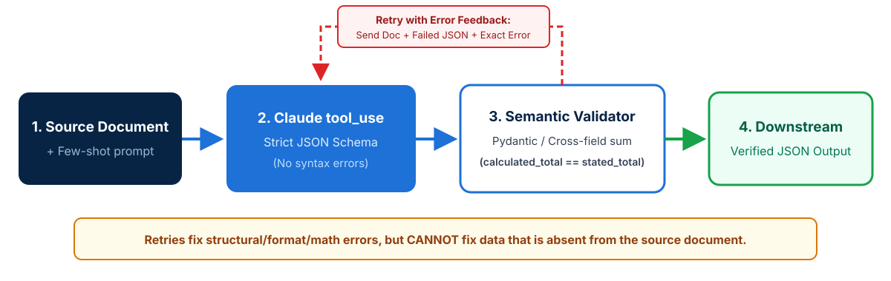
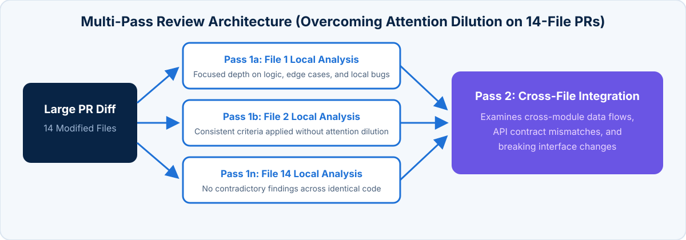

<!-- course-title: Claude Certified Architect - Foundations: Hands-On Exam Prep Workshop -->
<!-- course-theme: roi-alt-theme -->

<!-- layout: title -->


Claude Certified Architect - Foundations: Hands-On Exam Prep Workshop

# Chapter 5: Prompt Engineering and Structured Output

---

# Chapter 5: Objectives

- Write explicit criteria and targeted few-shot examples
- Enforce structured JSON outputs using `tool_use` schemas
- Build validation-retry loops for extraction quality
- Design Message Batches workflows and multi-pass reviews

---

# Domain 4: Prompt Engineering and Structured Output

| Task # | Task Statement |
| :--- | :--- |
| **4.1** | Design prompts with explicit criteria to improve precision and reduce false positives |
| **4.2** | Apply few-shot prompting to improve output consistency and quality |
| **4.3** | Enforce structured output using tool use and JSON schemas |
| **4.4** | Implement validation, retry, and feedback loops for extraction quality |
| **4.5** | Design efficient batch processing strategies |
| **4.6** | Design multi-instance and multi-pass review architectures |

---

<!-- layout: navigation -->
# Chapter 5

- **Explicit Criteria and Few-Shot Prompting**
- Structured Output and JSON Schemas
- Validation and Retry Loops
- Batch Processing and Multi-Pass Reviews

---

<!-- layout: 2-column -->
# Explicit Criteria vs Vague Confidence Filters

### Vague Instructions (Low Precision)
- Instructions like `"be conservative"`, `"only report high-confidence findings"`, or `"check that comments are accurate"` fail to reduce false positives
- Models calibrate self-reported confidence poorly on subtle code review rules
- High false-positive categories erode developer trust across the entire review system, causing engineers to ignore accurate security findings too

### Explicit Categorical Criteria (High Precision)
- Define exact conditions to report vs skip: `"Flag comments ONLY when claimed behavior directly contradicts actual code operations; skip stylistic or incomplete comments"`
- Provide concrete code examples for each severity level (`critical`, `error`, `warning`)
- Temporarily disable noisy, high false-positive categories while you refine their prompts to protect developer trust

---

<!-- layout: card-layout -->
# Few-Shot Prompting for Consistency and Generalization

### Ambiguous-Case Reasoning
- Include 2 to 4 targeted few-shot examples showing **why** one decision or tool was chosen over a plausible alternative.
- Helps the model generalize judgment to novel edge cases rather than only matching literal rules.

### Strict Output Formatting
- Demonstrate the exact target structure (`location`, `issue`, `severity`, `suggested_fix`) in few-shot examples when prose instructions alone yield inconsistent formatting.

### Distinguishing Acceptable Patterns
- Pair genuine bug examples with acceptable local code idioms so the reviewer stops flagging intentional repository conventions as defects.

### Handling Document Variety Without Hallucination
- Show extraction examples across varied document layouts (inline citations vs bibliographies, tables vs narrative prose, informal measurements) so required fields are extracted accurately instead of returning empty or fabricated values.

---

<!-- layout: navigation -->
# Chapter 5

- Explicit Criteria and Few-Shot Prompting
- **Structured Output and JSON Schemas**
- Validation and Retry Loops
- Batch Processing and Multi-Pass Reviews

---

# Enforcing Structured Output via `tool_use`

- **Most reliable mechanism**: defining an extraction tool with a JSON Schema and reading the `tool_use` input guarantees **zero JSON syntax errors**
- **Syntax vs semantic correctness**: strict JSON schemas via `tool_use` eliminate malformed JSON syntax, but **do not prevent semantic errors** (such as line items that do not sum to the stated invoice total, or values placed in the wrong field)
- **Selecting `tool_choice` for extraction**:
  - `tool_choice: "any"` when multiple document extraction schemas exist and the document type is unknown upfront
  - `tool_choice: {"type": "tool", "name": "extract_invoice"}` when forcing a specific extraction tool to run first

---

<!-- layout: card-layout -->
# Schema Design Patterns That Prevent Hallucination

### Nullable / Optional Fields
- When source documents may not contain a piece of information (such as `discount_code` or `expiration_date`), mark the field optional or nullable (`["string", "null"]`).
- Making absent fields strictly required forces the model to fabricate values to satisfy the schema.

### `"unclear"` Enum Values
- When classifying ambiguous text into an `enum`, include an explicit `"unclear"` or `"not_specified"` value so the model is not forced to guess.

### Extensible `"other"` + Detail Pattern
- For open-ended categories, add `"other"` to the `enum` alongside an optional `category_other_detail` string property to capture novel cases cleanly.

### Prompt Normalization Rules
- Pair strict output schemas with prompt-level normalization rules (for example, converting `"Oct 30, 2026"` and `"30/10/26"` into ISO `YYYY-MM-DD`).

---

# Extraction Tool Schema Example

- **Combining nullable fields, `"unclear"` enums, and `"other"` + detail strings**:

```json
{
  "name": "extract_contract_terms",
  "description": "Extracts key commercial terms from a vendor contract. Return null for any field not explicitly stated in the document.",
  "input_schema": {
    "type": "object",
    "properties": {
      "effective_date": { "type": ["string", "null"], "description": "ISO 8601 YYYY-MM-DD or null if unstated" },
      "governing_law": {
        "type": "string",
        "enum": ["delaware", "new_york", "california", "uk", "unclear", "other"]
      },
      "governing_law_other_detail": { "type": ["string", "null"] },
      "stated_total": { "type": ["number", "null"] },
      "calculated_total": { "type": ["number", "null"] },
      "conflict_detected": { "type": "boolean" }
    },
    "required": ["effective_date", "governing_law", "stated_total", "calculated_total", "conflict_detected"]
  }
}
```

---

<!-- layout: navigation -->
# Chapter 5

- Explicit Criteria and Few-Shot Prompting
- Structured Output and JSON Schemas
- **Validation and Retry Loops**
- Batch Processing and Multi-Pass Reviews

---

<!-- layout: stacked -->
# Validation-Retry Feedback Loops

- **Retry-with-error-feedback**: when Pydantic or semantic validation fails, send a follow-up request containing the **original document**, the **failed extraction JSON**, and the **exact validation error message**
- **Self-correction fields**: extract `calculated_total` alongside `stated_total` and `conflict_detected` booleans to catch arithmetic discrepancies automatically
- **Tracking false-positive patterns**: include a `detected_pattern` field in code review findings so you can analyze which constructs developers frequently dismiss



---

<!-- layout: 2-column -->
# When Retries Succeed vs When Retries Fail

### Retryable Errors (Will Succeed)
- Format mismatches (such as returning `"10/30/2026"` instead of `"2026-10-30"`)
- Structural output errors or misplaced field values
- Arithmetic sum mismatches where the line items exist in the source text

### Non-Retryable Situations (Futile)
- The required information is **completely absent from the source document** (or lives in an external appendix that was never provided)
- Retrying when data is absent wastes tokens and pressures the model into hallucinating a value

---

<!-- layout: navigation -->
# Chapter 5

- Explicit Criteria and Few-Shot Prompting
- Structured Output and JSON Schemas
- Validation and Retry Loops
- **Batch Processing and Multi-Pass Reviews**

---

<!-- layout: 2-column -->
# Synchronous API vs Message Batches API

### Synchronous Messages API
- Immediate real-time response with full multi-turn `tool_use` loop support
- Required for **blocking workflows** where a human or CI pipeline is actively waiting (such as pre-merge PR checks or live support chat)

### Message Batches API
- **50% cost savings** with an asynchronous processing window of **up to 24 hours** (no guaranteed latency SLA)
- Correlates requests and responses via `custom_id`
- **Does NOT support multi-turn tool calling** within a single batch request
- Ideal for overnight technical debt reports, weekly audits, and bulk document extraction

---

# Batch SLA Math and Failure Recovery

- **SLA submission frequency math**: because a batch can take up to **24 hours**, if your business SLA requires all incoming documents to be processed within **30 hours**, you must submit newly queued documents at least **every 6 hours** (or on a 4-hour schedule with safety margin: `4h queue + 24h max batch = 28h <= 30h SLA`)
- **Handling partial batch failures**:
  - Identify failed items using their `custom_id`
  - Resubmit **only the failed documents** with targeted adjustments (such as chunking oversized documents that exceeded context limits)
- **Pre-batch sample refinement**: test and refine your extraction prompt on a small representative sample set first to maximize first-pass batch accuracy

---

<!-- layout: stacked -->
# Multi-Instance and Multi-Pass Review Architectures

- **Why same-session self-review fails**: a model in the same session retains its generation reasoning context and rarely questions its own implementation choices; always use a **second independent Claude instance** for verification
- **Overcoming attention dilution on large PRs**: reviewing 14 modified files in one single pass causes superficial comments and contradictory feedback
- **Two-stage multi-pass review**: run focused **per-file local analysis passes** first, followed by a separate **cross-file integration pass** examining data flow across modules



---

# Domain 4 Quiz: Prompt Engineering and Structured Output

- [Open Quiz](https://claude-certification-exam-prep-1077635956541.us-east4.run.app/questions?file=public/2026-10-30-14-50-ccar-f-realistic-instructor.json)

---

# Lab 3: Structured Data Extraction and Validation Pipelines

**Time:** 60 minutes

- [Open Lab](https://labv.roitraining.com/?lab=https://github.com/roitraining/claude-exam-cert-prep-courses/tree/main/claude-certified-architect-foundations-exam-prep-workshop/labs/lab-03-structured-data-extraction-and-validation-pipelines)

---

# What You Learned

- Wrote explicit criteria and targeted few-shot examples
- Enforced structured JSON outputs using `tool_use` schemas
- Built validation-retry loops for extraction quality
- Designed Message Batches workflows and multi-pass reviews

---

<!-- layout: stacked -->
# Questions and Answers


