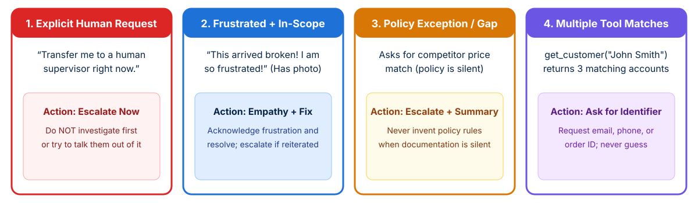

<!-- course-title: Claude Certified Architect - Foundations: Hands-On Exam Prep Workshop -->
<!-- course-theme: roi-alt-theme -->

<!-- layout: title -->


Claude Certified Architect - Foundations: Hands-On Exam Prep Workshop

# Chapter 6: Context Management and Reliability

---

# Chapter 6: Objectives

- Preserve critical facts across long interactions and large codebase explorations using persistent case-fact blocks, tool output trimming, scratchpads, and state manifests
- Design calibrated escalation rules and structured multi-agent error propagation strategies
- Implement human review routing using calibrated field-level confidence and stratified random sampling
- Preserve claim-source provenance, publication dates, and conflict annotations across multi-agent synthesis

---

# Domain 5: Context Management and Reliability

| Task # | Task Statement |
| :--- | :--- |
| **5.1** | Manage conversation context to preserve critical information across long interactions |
| **5.2** | Design effective escalation and ambiguity resolution patterns |
| **5.3** | Implement error propagation strategies across multi-agent systems |
| **5.4** | Manage context effectively in large codebase exploration |
| **5.5** | Design human review workflows and confidence calibration |
| **5.6** | Preserve information provenance and handle uncertainty in multi-source synthesis |

---

<!-- layout: navigation -->
# Chapter 6

- **Context Preservation and Codebase Exploration**
- Escalation and Error Propagation
- Human Review and Information Provenance

---

<!-- layout: card-layout -->
# Three Context Degradation Failure Modes

### 1. Progressive Summarization Loss
- Rolling conversation summaries condense exact numbers, percentages, dates, and customer-stated expectations into vague prose.
- Later turns lose precision and contradict earlier commitments.

### 2. The “Lost in the Middle” Effect
- Models process information at the very beginning and very end of long inputs reliably, but frequently overlook details buried in the middle.

### 3. Tool Result Accumulation Bloat
- Raw MCP tool calls (such as an order lookup returning 40+ database columns when only 5 matter) rapidly fill the context window with low-value noise.

---

# Mitigating Context Drift in Long Interactions

- **Persistent “Case Facts” block**: extract transactional facts (`customer_id`, `order_ids`, `exact_amounts`, `dates`, `statuses`) into a dedicated structured block injected at the top of every prompt **outside** summarized conversation history
- **Trim verbose tool outputs**: strip irrelevant fields (such as internal warehouse audit arrays) via a `PostToolUse` hook before appending tool results to history
- **Mitigate position effects**: place key findings summaries at the **beginning** of aggregated inputs and organize detailed evidence under explicit section headers
- **Require structured upstream handoffs**: configure upstream subagents to return structured facts, citations, and relevance scores rather than raw reasoning chains when downstream context budgets are tight

---

<!-- layout: 2-column -->
# Managing Context in Large Codebase Exploration

### Symptom of Context Degradation
- In extended exploration sessions, the model stops citing exact class names discovered earlier and starts referencing vague “typical patterns”
- Caused by verbose search and file dumps crowding the context window

### Four Architectural Remedies
- **Scratchpad files**: have agents record verified findings in a persistent markdown or JSON scratchpad file and reference it across turns
- **Subagent isolation**: spawn subagents for verbose searches (`"trace refund flow dependencies"`) and return only concise summaries to the main agent
- **`/compact` command**: run `/compact` to compress verbose discovery history during extended interactive sessions
- **Crash recovery manifests**: export structured agent state to a known manifest file on disk so a resumed coordinator can reload verified state after a crash

---

<!-- layout: navigation -->
# Chapter 6

- Context Preservation and Codebase Exploration
- **Escalation and Error Propagation**
- Human Review and Information Provenance

---

<!-- layout: stacked -->
# Escalation and Ambiguity Decision Rules

- **Calibrate with explicit criteria + few-shot examples**: define exact boundaries between autonomous resolution (standard damage replacement with photo) and human escalation
- **Honor explicit human requests immediately**: if a customer asks for a human agent, escalate right away without investigating first
- **Never guess across multiple matches**: when `get_customer` returns multiple records for `"John Smith"`, ask the user for an additional identifier (email or order ID) rather than picking the most recent account heuristically



---

<!-- layout: 2-column -->
# Unreliable Escalation Proxies vs Reliable Triggers

### Unreliable Proxies (Exam Traps)
- **Sentiment analysis scores**: customer frustration does not correlate with technical case complexity; a frustrated customer with a simple tracking question can be helped immediately
- **Self-reported confidence scores (1 to 10)**: uncalibrated LLM confidence scores are frequently overconfident on policy edge cases
- **External ML ticket classifiers**: over-engineered when prompt criteria have not been defined

### Reliable Escalation Triggers
- **Explicit customer request** for a human representative
- **Policy gaps or silence**: when a customer asks for competitor price matching and your policy document only covers own-site price adjustments
- **Policy threshold violations**: refunds exceeding autonomous limits (enforced via hook)
- **Inability to make progress** after clarification attempts

---

# Multi-Agent Error Propagation Strategies

- **Rich error context for the coordinator**: when a subagent cannot resolve a failure locally, it must return structured error context to the coordinator:
  - `failureType` (timeout, rate limit, permission)
  - `attemptedQuery` (exact parameters tried)
  - `partialResults` (any data collected before failure)
  - `suggestedAlternatives` (fallback sources or modified queries)
- **Local transient recovery first**: subagents retry transient timeouts locally and only propagate unresolvable errors upward
- **Annotate coverage gaps**: if a source remains unavailable, the coordinator proceeds with partial results and instructs the synthesis agent to **explicitly annotate which topic areas have coverage gaps**

```json
{
  "status": "partial_failure",
  "failureType": "UPSTREAM_TIMEOUT",
  "attemptedQuery": "EU AI Act compliance penalties 2026",
  "partialResults": [{ "claim": "Tier 1 fines up to 7% global turnover", "source": "eu-summary.pdf" }],
  "suggestedAlternatives": ["Query internal regulatory database MCP resource"]
}
```

---

<!-- layout: navigation -->
# Chapter 6

- Context Preservation and Codebase Exploration
- Escalation and Error Propagation
- **Human Review and Information Provenance**

---

<!-- layout: 2-column -->
# Human Review and Confidence Calibration

### Why Aggregate Accuracy Misleads
- An aggregate extraction accuracy of **97% overall** can hide a **60% error rate** on a rare vendor invoice layout or a specific complex field
- Never automate high-confidence extractions globally without segmenting accuracy by **document type** and **field** first

### Calibrated Review Routing
- Have the model output **field-level confidence scores** alongside extracted values
- Calibrate confidence routing thresholds using a **labeled validation set**
- Route low-confidence fields and contradictory source documents to human reviewers
- Use **stratified random sampling** of high-confidence extractions in production to measure ongoing error rates and catch novel document drift

---

<!-- layout: card-layout -->
# Preserving Provenance in Multi-Source Synthesis

### Structured Claim-Source Mappings
- Summarization loses attribution if findings are compressed into plain text early.
- Require subagents to emit structured mappings (`claim`, `evidence_excerpt`, `source_url` or `document_name`, `page_number`) that the synthesis agent preserves and merges.

### Temporal Context Preservation
- Require subagents to extract **publication or data collection dates** in every finding.
- Prevents a 2023 statistic and a 2026 statistic from being misinterpreted as a factual contradiction.

### Annotating Contested Statistics
- When two credible sources report conflicting numbers for the same period, **never pick one value arbitrarily** or average them silently.
- Preserve both values with full source attribution and methodological context, and distinguish well-established findings from contested ones.

### Content-Appropriate Rendering
- Render financial figures as structured tables, news developments as narrative prose, and technical findings as structured lists rather than forcing everything into one uniform format.

---

# Domain 5 Quiz: Context Management and Reliability

- Open the Exam Prep Program to complete the Domain 5 review questions

<!-- TODO: Add Exam Prep Program URL for Domain 5 Quiz -->

---

# Lab 4: Context Preservation, Provenance, and Escalation Workflows

**Time:** 60 minutes

---

# What You Learned

- Preserved critical context across long conversations and codebase explorations using persistent case-fact blocks, tool output trimming, scratchpads, `/compact`, and state manifests
- Designed reliable escalation criteria (honoring explicit human requests and policy gaps) and structured subagent-to-coordinator error propagation
- Calibrated field-level confidence scores with labeled validation sets and applied stratified random sampling for human review
- Preserved claim-source mappings, publication dates, and conflict annotations across multi-agent synthesis

---

<!-- layout: stacked -->
# Questions and Answers


