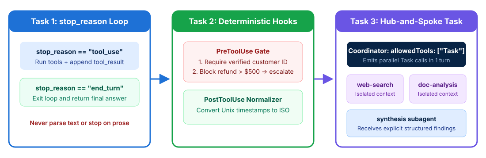

# Building a Multi-Agent System with the Claude Agent SDK

## Time Required

45 minutes

## Overview

In this lab, you will build and validate core multi-agent orchestration and control-flow patterns using the Claude Agent SDK.

### You learn how to:
- Implement reliable agentic loop control flow.
- Enforce compliance rules and normalize data with SDK hooks.
- Orchestrate a coordinator agent and parallel subagents.
- Manage session state across resumed and forked sessions.

## Scenario

Your team operates a customer support and research platform built on the Claude Agent SDK. In production, the support agent occasionally exits loops early or skips mandatory identity and refund checks, while the research pipeline suffers from high latency and missing subagent context. You need to fix these reliability and orchestration issues before scaling the system.



## Lab Instructions

### Task 1: Set up your lab workspace and fix a broken agentic loop

In this task, you create your workspace folder, inspect a buggy agentic loop that contains all three exam anti-patterns, and replace it with a clean `stop_reason` loop.

1. Open your terminal (Terminal on macOS or PowerShell / Command Prompt / VS Code Terminal on Windows) and create a directory for this lab:

```bash
mkdir ccarf-lab-01
cd ccarf-lab-01
```

2. Open the `ccarf-lab-01` folder in VS Code (or your preferred text editor) and create a new file named `broken_loop.py` with the following code:

```python
# broken_loop.py - Contains the 3 agentic loop anti-patterns tested on the exam
def run_broken_support_agent(client, user_request, mcp_tools):
    messages = [{"role": "user", "content": user_request}]

    # ANTI-PATTERN 1: Low arbitrary iteration cap as primary stopping mechanism
    for step in range(3):
        response = client.messages.create(
            model="claude-sonnet-5-5",
            max_tokens=4096,
            system="You are a customer support agent. Say FINAL_ANSWER when done.",
            tools=mcp_tools,
            messages=messages,
        )

        # ANTI-PATTERN 2: Stopping whenever assistant text content is present
        text_blocks = [b.text for b in response.content if b.type == "text"]
        if len(text_blocks) > 0:
            # BUG: Claude often emits "Let me check that order" alongside a tool_use block!
            return text_blocks[0]

        # ANTI-PATTERN 3: Parsing natural language strings to terminate the loop
        if any("FINAL_ANSWER" in t for t in text_blocks):
            break

        tool_results = execute_requested_tools(response.content)
        # BUG: Forgot to append the assistant response before appending tool_results!
        messages.append({"role": "user", "content": tool_results})
```

3. Launch Claude Code inside your `ccarf-lab-01` folder:

```bash
claude
```

4. In Claude Code, paste the following prompt to analyze `broken_loop.py` and generate a corrected implementation in `agent_loop.py`:

```text
Read broken_loop.py. List the 4 bugs/anti-patterns in that loop, and then create a new file named agent_loop.py that implements the canonical stop_reason control flow:
1. Appends response.content as an "assistant" message on every turn.
2. Continues the loop when response.stop_reason == "tool_use", executes all tool_use blocks, and appends the tool_result blocks in a "user" message.
3. Terminates the loop cleanly when response.stop_reason == "end_turn".
4. Includes a runnable mock test at the bottom of agent_loop.py that simulates Turn 1 returning both a text block ("Let me look up your order.") and a tool_use block (stop_reason="tool_use"), followed by Turn 2 returning the final answer (stop_reason="end_turn").
```

5. Review the generated `agent_loop.py` in your editor and run it (either via Claude Code or by running `python agent_loop.py` / `python3 agent_loop.py`) to confirm that Turn 1 does **not** exit early when explanatory text accompanies a `tool_use` block.

> [!IMPORTANT]
> On the CCAR-F exam, never select an option that parses natural-language tokens (such as `"FINAL_ANSWER"`), checks whether assistant text is present, or uses a small fixed turn counter to stop an agentic loop. Always inspect `stop_reason` (`"tool_use"` vs `"end_turn"`).

### Task 2: Enforce deterministic compliance with PreToolUse and PostToolUse hooks

In this task, you replace probabilistic prompt warnings with deterministic Agent SDK hooks that guarantee 100% compliance for customer identity verification, refund limits, and timestamp normalization.

1. In your `ccarf-lab-01` folder, create a file named `compliance_hooks.py` and paste the following starter template:

```python
# compliance_hooks.py
from datetime import datetime, timezone

class SessionState:
    def __init__(self):
        self.verified_customer_id = None

def pre_tool_use_hook(tool_name: str, tool_input: dict, state: SessionState) -> dict:
    """
    Deterministic PreToolUse hook:
    Rule 1: Block lookup_order and process_refund until get_customer has set state.verified_customer_id.
    Rule 2: Block process_refund when amount > 500 and instruct the agent to call escalate_to_human.
    """
    if tool_name in ("lookup_order", "process_refund") and not state.verified_customer_id:
        return {
            "allow": False,
            "error": "PREREQUISITE_FAILED: You must call get_customer and verify the customer ID before calling " + tool_name
        }

    if tool_name == "process_refund":
        amount = float(tool_input.get("amount", 0))
        if amount > 500.0:
            return {
                "allow": False,
                "error": f"POLICY_LIMIT_EXCEEDED: Refund of ${amount:.2f} exceeds the $500 autonomous limit. Call escalate_to_human with a structured handoff summary."
            }

    return {"allow": True}

def post_tool_use_hook(tool_name: str, raw_result: dict) -> dict:
    """
    PostToolUse hook:
    Normalizes heterogeneous Unix epoch timestamps and numeric status codes into ISO 8601 strings and canonical labels.
    """
    normalized = dict(raw_result)

    if tool_name == "get_customer" and raw_result.get("customer_id"):
        # Verified customer ID returned from get_customer
        pass

    if "created_epoch" in normalized:
        epoch = normalized.pop("created_epoch")
        normalized["created_at_iso"] = datetime.fromtimestamp(epoch, tz=timezone.utc).strftime("%Y-%m-%dT%H:%M:%SZ")

    status_map = {1: "PENDING", 2: "SHIPPED", 3: "DELIVERED", 4: "RETURNED"}
    if "status_code" in normalized:
        code = normalized.pop("status_code")
        normalized["status"] = status_map.get(code, "UNKNOWN")

    return normalized
```

2. Ask Claude Code to add a self-contained verification test at the bottom of `compliance_hooks.py` and run it:

```text
Add a __main__ test block to compliance_hooks.py that tests and prints the output for these 4 scenarios:
1. Agent attempts lookup_order BEFORE calling get_customer (must be blocked by pre_tool_use_hook).
2. Agent calls get_customer and sets state.verified_customer_id = "CUST-8841".
3. Raw lookup_order output {"order_id": "ORD-109", "created_epoch": 1761820800, "status_code": 3} is transformed by post_tool_use_hook into ISO 8601 and "DELIVERED".
4. Agent attempts process_refund for $650.00 (must be blocked and redirected to escalate_to_human).
Run the script and show me the output.
```

3. Inspect the output in Claude Code and verify that all four rules execute deterministically in code without relying on the LLM’s prompt compliance.

> [!TIP]
> These functions keep the rules easy to test in isolation. In a real Agent SDK app, register them with `HookMatcher` and return the SDK’s shapes instead: a `PreToolUse` hook returns `hookSpecificOutput` with `permissionDecision: "deny"` and a `permissionDecisionReason`, and a `PostToolUse` hook returns `updatedToolOutput`. The Chapter 2 demo “Blocking a Refund with a PreToolUse Hook” shows the full pattern.

> [!NOTE]
> Remember the exam decision rule: prompt instructions and few-shot examples are **probabilistic** (suitable for style or general guidance), whereas SDK hooks and programmatic prerequisite gates are **deterministic** (required whenever errors have financial, security, or identity consequences).

### Task 3: Configure a coordinator and parallel subagents with the Task tool

In this task, you design a hub-and-spoke multi-agent research configuration that avoids narrow task decomposition, enables subagent spawning via `allowedTools: ["Task"]`, passes structured context explicitly, and emits parallel `Task` calls in a single turn.

> [!NOTE]
> This task uses the exam’s wording, `Task`. In current Agent SDK releases, the tool is named `Agent` (renamed in Claude Code v2.1.63), and subagents are defined in code with `agents={"web-search-agent": AgentDefinition(description=..., prompt=..., tools=[...])}`. The JSON file below is a design document, not an SDK configuration file.

1. In your `ccarf-lab-01` folder, create a file named `multi_agent_research.json` that defines the coordinator and its subagents:

```json
{
  "coordinator": {
    "name": "research-coordinator",
    "description": "Hub coordinator that decomposes broad research topics, spawns parallel subagents, and verifies synthesis coverage.",
    "allowedTools": ["Task"],
    "systemPrompt": "You are the central coordinator in a hub-and-spoke architecture. Specify research goals and quality criteria rather than rigid step-by-step procedures. Partition broad topics across all major sub-domains (for example, for creative industries include visual arts, music, writing, and film). Emit independent subagent Task calls in parallel in a single turn. Subagents have isolated context: always pass complete structured findings and source metadata explicitly in the synthesis subagent prompt."
  },
  "subagents": [
    {
      "name": "web-search-agent",
      "description": "Searches external web articles and industry news for recent developments.",
      "allowedTools": ["web_search", "fetch_url"],
      "outputSchema": {
        "requiredFields": ["claim", "evidence_excerpt", "source_url", "publication_date"]
      }
    },
    {
      "name": "doc-analysis-agent",
      "description": "Analyzes internal PDF reports and regulatory filings.",
      "allowedTools": ["load_document", "extract_data_points", "summarize_content"],
      "outputSchema": {
        "requiredFields": ["claim", "evidence_excerpt", "document_name", "page_number", "publication_date"]
      }
    },
    {
      "name": "synthesis-agent",
      "description": "Combines structured findings from upstream agents into a cited research synthesis.",
      "allowedTools": ["verify_fact"],
      "systemPrompt": "Synthesize the structured findings passed in your prompt. Preserve all claim-source mappings and publication dates. Use verify_fact for simple date/name/stat checks; return complex verification gaps to the coordinator."
    }
  ]
}
```

2. Now ask Claude Code to simulate a coordinator turn for the topic `"Impact of generative AI on creative industries"` using `multi_agent_research.json`:

```text
Read multi_agent_research.json. Create a file named coordinator_turn_example.json that shows:
1. "parallel_turn_1": The exact assistant response content array where the coordinator emits parallel Task tool_use calls in a SINGLE turn covering both visual arts AND non-visual sectors (music, writing, and film).
2. "synthesis_turn_2": The exact Task tool_use call to synthesis-agent showing how the coordinator explicitly passes the structured findings (claim, evidence_excerpt, source_url/document_name, page_number, publication_date) inside the prompt because subagents do not inherit coordinator history.
```

3. Open `coordinator_turn_example.json` in your editor and confirm two key exam requirements:
   - `parallel_turn_1` contains multiple `"name": "Task"` blocks inside a single response array rather than waiting across separate turns.
   - `synthesis_turn_2` embeds the upstream findings and metadata directly in the `prompt` field passed to `synthesis-agent`.

> [!WARNING]
> If an exam scenario shows that every subagent succeeded on its assigned task, yet the final report on `"impact of AI on creative industries"` covers only visual arts and misses music, writing, and film, the root cause is **overly narrow task decomposition by the coordinator** - not a bug in the web search or synthesis subagents.

### Bonus Task 4: Practice session resumption and forking in Claude Code

In this bonus task, you practice choosing the right session state strategy (`--resume`, `fork_session`, or starting fresh with an injected summary) for three common developer scenarios.

1. In your `ccarf-lab-01` folder, create a file named `session_scenarios.md` and ask Claude Code to help you complete a decision table for the following three situations:
   - **Scenario A**: Yesterday you ran a named session (`auth-investigation`) that mapped 20 files in your authentication module. Overnight, a teammate modified `token_validator.py`.
   - **Scenario B**: You just finished a shared baseline analysis of your database layer and want to compare two competing migration approaches (Approach A: connection pooling refactor vs Approach B: read-replica split) without re-running discovery.
   - **Scenario C**: You have a 2-hour session filled with stale tool outputs from before a major directory restructure that renamed 35 files.

2. Verify that your `session_scenarios.md` matches the official exam rules:
   - **Scenario A**: Use `--resume auth-investigation` and explicitly tell the agent that `token_validator.py` changed so it performs targeted re-analysis instead of re-exploring all 20 files.
   - **Scenario B**: Use `fork_session` to branch two independent explorations from the shared analysis baseline. On the CLI, that is `claude --resume <session> --fork-session`.
   - **Scenario C**: Start a **new session** and inject a concise, structured summary of verified findings rather than resuming a session polluted with stale tool results.

## Congratulations!

In this lab, you have:
- Implemented reliable agentic loop control flow.
- Enforced compliance rules and normalized data with SDK hooks.
- Orchestrated a coordinator agent and parallel subagents.
- Managed session state across resumed and forked sessions.
