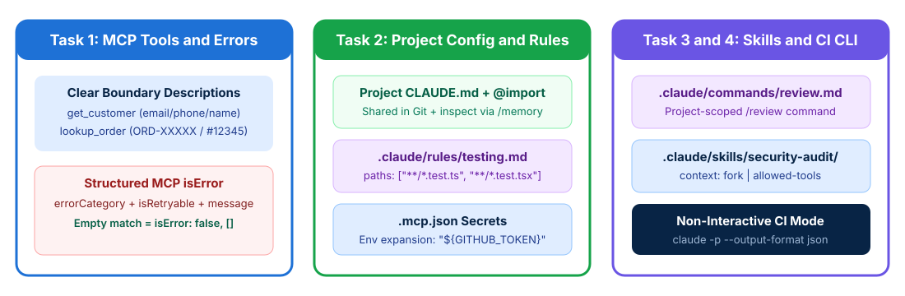

# MCP Tool Design and Claude Code Configuration

## Time Required

45 minutes

## Overview

In this lab, you will design clear Model Context Protocol (MCP) tool interfaces and configure Claude Code for team and CI/CD workflows.

### You learn how to:
- Design clear MCP tool boundaries and structured error responses.
- Configure project instructions, path-scoped rules, and MCP servers.
- Create shared slash commands and isolated skills in Claude Code.
- Run Claude Code non-interactively in automated pipelines.

## Scenario

Your engineering team is standardizing how developers and agents use MCP tools and Claude Code across shared repositories. Currently, agents misroute calls between similar tools, teammates miss local coding conventions, and automated pull request review jobs hang waiting for user input.



## Lab Instructions

### Task 1: Differentiate MCP tool descriptions and structure error responses

In this task, you create your lab workspace, fix minimal MCP tool descriptions that cause misrouting, and replace generic error strings with structured `isError` metadata.

1. Open your terminal (Terminal on macOS or PowerShell / Command Prompt / VS Code Terminal on Windows) and create a working folder for this lab:

```bash
mkdir ccarf-lab-02
cd ccarf-lab-02
```

2. Open `ccarf-lab-02` in VS Code (or your preferred text editor) and create a file named `mcp-tools-before.json` containing these problematic tool definitions:

```json
{
  "tools": [
    {
      "name": "get_customer",
      "description": "Retrieves customer information",
      "input_schema": {
        "type": "object",
        "properties": { "id": { "type": "string" } },
        "required": ["id"]
      }
    },
    {
      "name": "lookup_order",
      "description": "Retrieves order details",
      "input_schema": {
        "type": "object",
        "properties": { "id": { "type": "string" } },
        "required": ["id"]
      }
    },
    {
      "name": "analyze_document",
      "description": "Analyzes a document in various modes",
      "input_schema": {
        "type": "object",
        "properties": {
          "url": { "type": "string" },
          "mode": { "type": "string" }
        }
      }
    }
  ]
}
```

3. Create a new file named `mcp-tools-after.json` that applies the Domain 2 exam rules:
   - Expands `get_customer` and `lookup_order` descriptions with explicit input formats, example queries, edge cases, and boundary rules.
   - Splits the overloaded `analyze_document` catch-all tool into purpose-specific tools (`extract_data_points`, `summarize_content`, and `verify_claim_against_source`).

```json
{
  "tools": [
    {
      "name": "get_customer",
      "description": "Retrieves a customer account profile and verified customer_id using an email address (user@example.com), phone number, or full name. Example query: 'Find account for jane@example.com'. Do NOT use this tool when the user provides an order number like #12345 or ORD-99281; use lookup_order for order status and shipment tracking.",
      "input_schema": {
        "type": "object",
        "properties": {
          "customer_identifier": {
            "type": "string",
            "description": "Customer email address, phone number, or full name (never an order ID)."
          }
        },
        "required": ["customer_identifier"]
      }
    },
    {
      "name": "lookup_order",
      "description": "Fetches order status, line items, delivery dates, and tracking numbers using an order ID (formats: ORD-XXXXX or #12345). Example query: 'Check my order #12345'. Prerequisite: requires a verified customer_id from get_customer before execution. Do NOT use for general customer profile lookups.",
      "input_schema": {
        "type": "object",
        "properties": {
          "order_id": {
            "type": "string",
            "description": "Order identifier in ORD-XXXXX or #12345 format."
          }
        },
        "required": ["order_id"]
      }
    },
    {
      "name": "extract_data_points",
      "description": "Extracts structured key-value metrics and tables from a validated internal document.",
      "input_schema": {
        "type": "object",
        "properties": { "document_id": { "type": "string" } },
        "required": ["document_id"]
      }
    },
    {
      "name": "summarize_content",
      "description": "Produces a concise executive summary of a validated internal document.",
      "input_schema": {
        "type": "object",
        "properties": { "document_id": { "type": "string" } },
        "required": ["document_id"]
      }
    },
    {
      "name": "verify_claim_against_source",
      "description": "Checks whether a specific claim is supported by an internal document and returns exact page citations.",
      "input_schema": {
        "type": "object",
        "properties": {
          "document_id": { "type": "string" },
          "claim": { "type": "string" }
        },
        "required": ["document_id", "claim"]
      }
    }
  ]
}
```

4. Next, create `mcp-error-examples.json` in `ccarf-lab-02` to contrast a retryable transient failure, a non-retryable business policy failure, and a valid empty result:

```json
{
  "transient_timeout_error": {
    "isError": true,
    "content": [
      {
        "type": "text",
        "text": "{\"errorCategory\": \"transient\", \"isRetryable\": true, \"code\": \"DB_READ_TIMEOUT\", \"message\": \"Order database read timed out after 3000ms. Retry with backoff.\"}"
      }
    ]
  },
  "business_policy_error": {
    "isError": true,
    "content": [
      {
        "type": "text",
        "text": "{\"errorCategory\": \"business_rule\", \"isRetryable\": false, \"code\": \"RETURN_WINDOW_EXPIRED\", \"userMessage\": \"Orders delivered more than 30 days ago are outside the self-service return window and require supervisor approval.\"}"
      }
    ]
  },
  "valid_empty_search_result": {
    "isError": false,
    "content": [
      {
        "type": "text",
        "text": "{\"matches\": [], \"message\": \"Query succeeded cleanly; 0 customer records matched email unknown@example.com.\"}"
      }
    ]
  }
}
```

> [!IMPORTANT]
> On the exam, expanding tool descriptions is always the **first step** when an agent misroutes calls between similar tools (`get_customer` vs `lookup_order`). Also remember: a query that executes cleanly but finds zero matching records is a **valid empty result** (`isError: false`, `[]`), never an access failure.

### Task 2: Configure project CLAUDE.md, @import, .mcp.json, and path-scoped rules

In this task, you configure a project-level `CLAUDE.md` that uses `@import` modularity, create path-scoped `.claude/rules/` with YAML frontmatter globs for scattered test files, and configure `.mcp.json` with environment variable expansion.

1. Inside `ccarf-lab-02`, create a subdirectories structure for `docs`, `.claude/rules`, and a sample component folder (`src/components`):

```bash
mkdir -p docs .claude/rules src/components
```

2. Create `docs/api-standards.md` with shared API error conventions that will be imported into `CLAUDE.md`:

```markdown
# API Error and Logging Standards

- All HTTP handlers must use async/await and return structured JSON error objects containing `code`, `message`, and `requestId`.
- Never log raw authentication tokens or customer PII.
```

3. Create the project-root `CLAUDE.md` file in `ccarf-lab-02/CLAUDE.md` that references `@docs/api-standards.md`:

```markdown
# Project Engineering Standards

This repository contains customer support and order management services.

## Shared API Standards
@docs/api-standards.md

## Testing Overview
- Unit tests live alongside source files (`*.test.ts` and `*.test.tsx`).
- Use the mock order fixtures in `src/test/fixtures/` when writing new tests.
```

4. Create a path-scoped rule file at `.claude/rules/testing.md` so test conventions load conditionally whenever Claude edits any test file anywhere in the repository:

```markdown
---
paths:
  - "**/*.test.ts"
  - "**/*.test.tsx"
---
# Test File Conventions

- Query React components by accessible role (`getByRole`), never by `data-testid`.
- Do not duplicate scenarios already covered in existing test files.
- Always test `null` and empty-array edge cases.
```

5. Create a project-scoped `.mcp.json` file at the root of `ccarf-lab-02` using `${GITHUB_TOKEN}` environment variable expansion so secrets are never committed to Git:

```json
{
  "mcpServers": {
    "github-team": {
      "command": "npx",
      "args": ["-y", "@modelcontextprotocol/server-github"],
      "env": {
        "GITHUB_PERSONAL_ACCESS_TOKEN": "${GITHUB_TOKEN}"
      }
    }
  }
}
```

6. Launch Claude Code in `ccarf-lab-02` and inspect which memory files are loaded:

```bash
claude
```

7. Inside the Claude Code prompt, run the `/memory` command (or ask Claude Code to summarize the active `CLAUDE.md` and `.claude/rules/testing.md` rules):

```text
/memory
```

> [!NOTE]
> Remember why `.claude/rules/` with `paths` globs beats subdirectory `CLAUDE.md` files on the exam: when `Button.test.tsx` files are scattered across dozens of component directories, `paths: ["**/*.test.tsx"]` matches every test file automatically without duplicating `CLAUDE.md` in every folder.

### Task 3: Create a project slash command and an isolated skill with context: fork

In this task, you create a version-controlled project slash command (`.claude/commands/review.md`) and an on-demand skill (`.claude/skills/security-audit/SKILL.md`) that runs in an isolated subagent context (`context: fork`) with restricted tools (`allowed-tools`).

1. In your terminal (or via your editor inside `ccarf-lab-02`), create the directories `.claude/commands` and `.claude/skills/security-audit`:

```bash
mkdir -p .claude/commands .claude/skills/security-audit
```

2. Create a shared project slash command at `.claude/commands/review.md`:

```markdown
Review the staged or modified files in this repository against our project checklist:
1. Report only concrete bugs, security vulnerabilities, or broken API error contracts.
2. Skip minor stylistic preferences or formatting nitpicks.
3. For each finding, output the file path, line number, severity (critical/error/warning), issue description, and suggested fix.
```

3. Create an isolated skill at `.claude/skills/security-audit/SKILL.md` with YAML frontmatter configuring `context: fork`, `allowed-tools`, and `argument-hint`:

```markdown
---
name: security-audit
description: Performs a read-only security and MCP tool boundary audit on a target folder or file
context: fork
allowed-tools: ["Read", "Grep", "Glob"]
argument-hint: "<target-file-or-directory>"
---
Audit the specified target for:
1. Hard-coded credentials or missing environment variable expansion in MCP configs.
2. Unconstrained network tools (such as raw fetch_url instead of validated load_document).
3. Missing structured error metadata (errorCategory, isRetryable) in tool definitions.

Return a concise summary report so verbose file dumps do not pollute the main conversation context.
```

4. Create a sample source file `src/components/OrderRefundButton.tsx` in `ccarf-lab-02` so we have code to inspect:

```tsx
export async function submitOrderRefund(orderId: string, amount: number) {
  // BUG: No check for negative or > 500 amount, and logs raw token!
  console.log("Using token: ghp_secret123456");
  const res = await fetch(`/api/orders/${orderId}/refund`, {
    method: "POST",
    body: JSON.stringify({ amount })
  });
  return res.json();
}
```

5. In Claude Code inside `ccarf-lab-02`, invoke your custom `/review` command or ask Claude Code to execute the `security-audit` skill on `src/components/OrderRefundButton.tsx`:

```text
/review
```

> [!WARNING]
> Watch out for two frequent Domain 3 exam traps:
> - `.claude/config.json` with a `commands` array does **not** exist in Claude Code; shared slash commands always live in `.claude/commands/`.
> - When a skill produces verbose discovery output or exploratory brainstorming, configure `context: fork` in `SKILL.md` so the skill runs in an isolated sub-agent context without polluting the main session.

### Bonus Task 4: Run Claude Code non-interactively for CI/CD pipelines

In this bonus task, you run Claude Code from your terminal in non-interactive mode (`-p`) with `--output-format json` and `--json-schema` so it outputs machine-parseable JSON and exits cleanly without hanging.

1. Exit your interactive Claude Code session (type `/exit` or press `Ctrl+C`) so you are back at your shell prompt inside `ccarf-lab-02`.

2. Run `claude -p` with `--output-format json` and `--json-schema` against `src/components/OrderRefundButton.tsx`:

```bash
claude -p "Review src/components/OrderRefundButton.tsx for security bugs and policy violations" \
  --output-format json \
  --json-schema '{"type":"object","properties":{"findings":{"type":"array","items":{"type":"object","properties":{"file":{"type":"string"},"line":{"type":"number"},"severity":{"type":"string","enum":["critical","error","warning"]},"issue":{"type":"string"},"suggested_fix":{"type":"string"}},"required":["file","line","severity","issue","suggested_fix"]}}},"required":["findings"]}'
```

3. Verify that the command prints structured JSON to stdout and exits immediately without waiting for interactive user input.

## Congratulations!

In this lab, you have:
- Designed clear MCP tool boundaries and structured error responses.
- Configured project instructions, path-scoped rules, and MCP servers.
- Created shared slash commands and isolated skills in Claude Code.
- Run Claude Code non-interactively in automated pipelines.
