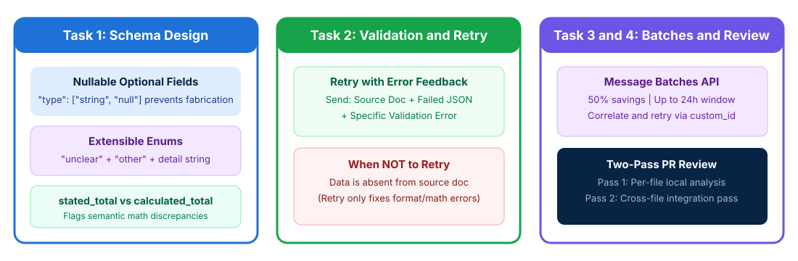

# Structured Data Extraction and Validation Pipelines

## Time Required

60 minutes

## Overview

In this lab, you will build reliable structured data extraction pipelines, validation-retry workflows, and multi-pass review prompts.

### You learn how to:
- Design JSON schemas that prevent hallucination on missing or ambiguous data.
- Build a validation-retry feedback loop for extraction quality.
- Design a Message Batches API workflow that meets SLA and cost targets.
- Structure a multi-pass code review using explicit criteria.

## Scenario

Your data engineering team extracts structured fields from thousands of unstructured vendor invoices and runs automated code reviews. When optional document fields are missing, the model occasionally invents placeholder values or miscalculates invoice totals. You need to enforce schema accuracy, automate validation retries, and schedule bulk processing within your SLA.



## Lab Instructions

### Task 1: Design a hallucination-proof extraction schema with nullable fields and enums

In this task, you create your lab workspace, define an extraction schema that prevents hallucination when data is missing or ambiguous, and test it on a messy vendor invoice using Claude Code.

1. Open your terminal (Terminal on macOS or PowerShell / Command Prompt / VS Code Terminal on Windows) and create a working folder for this lab:

```bash
mkdir ccarf-lab-03
cd ccarf-lab-03
```

2. Open `ccarf-lab-03` in VS Code (or your preferred text editor) and create a sample document file named `sample-invoice.txt`:

```text
VENDOR INVOICE - Northwind Cloud Services
Invoice ID: INV-2026-884
Invoice Date: 30/10/2026
Payment Terms: Net 45 (Subject to Delaware commercial code; jurisdiction disputed in Addendum B)

Line Items:
1. Dedicated Kubernetes Control Plane (Oct 2026) .... $900.00
2. Cross-Region Snapshot Storage (1.5 TB) ........... $350.00
3. Priority TAM Support ............................. $250.00

Stated Invoice Total: $1,600.00
Note: No Purchase Order (PO) number or promotional discount code was issued for this emergency order.
```

3. Create a JSON schema file named `invoice-schema.json` in `ccarf-lab-03` that incorporates the four exam schema patterns:
   - Nullable fields (`["string", "null"]`) for `purchase_order_number` and `discount_code` so the model returns `null` when absent.
   - An enum with `"unclear"` and `"other"` plus `payment_category_other_detail` for extensible categorization.
   - `stated_total`, `calculated_total`, and `conflict_detected` to catch arithmetic discrepancies between line items and the stated invoice total.

```json
{
  "type": "object",
  "properties": {
    "invoice_id": { "type": "string" },
    "invoice_date_iso": {
      "type": ["string", "null"],
      "description": "Normalized ISO 8601 date YYYY-MM-DD or null if unstated"
    },
    "purchase_order_number": {
      "type": ["string", "null"],
      "description": "Return null if no PO number is explicitly stated in the document. Never fabricate."
    },
    "discount_code": {
      "type": ["string", "null"],
      "description": "Return null if no discount code appears in the document."
    },
    "governing_law": {
      "type": "string",
      "enum": ["delaware", "new_york", "california", "unclear", "other"]
    },
    "governing_law_other_detail": {
      "type": ["string", "null"],
      "description": "Populate when governing_law is 'other' or 'unclear' to explain the source nuance."
    },
    "stated_total": { "type": ["number", "null"] },
    "calculated_total": {
      "type": ["number", "null"],
      "description": "Exact arithmetic sum of the extracted line items."
    },
    "conflict_detected": {
      "type": "boolean",
      "description": "True if stated_total does not equal calculated_total."
    }
  },
  "required": [
    "invoice_id",
    "invoice_date_iso",
    "purchase_order_number",
    "discount_code",
    "governing_law",
    "governing_law_other_detail",
    "stated_total",
    "calculated_total",
    "conflict_detected"
  ]
}
```

4. Launch Claude Code in `ccarf-lab-03`:

```bash
claude
```

5. In Claude Code, paste the following prompt to extract `sample-invoice.txt` against `invoice-schema.json` and save the result to `extracted-invoice.json`:

```text
Read sample-invoice.txt and invoice-schema.json. Extract the invoice data strictly following invoice-schema.json and write the resulting JSON object to extracted-invoice.json. Normalize dates to YYYY-MM-DD, return null for any field not present in the document, and compute calculated_total from the line items to set conflict_detected accurately.
```

6. Open `extracted-invoice.json` in your editor and verify:
   - `purchase_order_number` and `discount_code` are `null` (not fabricated strings like `"N/A"` or `"PO-0000"`).
   - `invoice_date_iso` is normalized from `"30/10/2026"` to `"2026-10-30"`.
   - `stated_total` is `1600`, `calculated_total` is `1500` (`900 + 350 + 250`), and `conflict_detected` is `true`.

> [!IMPORTANT]
> Also review the three `tool_choice` settings tested in Domain 4.3:
> - `"auto"`: The model may return conversational text instead of calling a tool.
> - `"any"`: Guarantees the model calls one of your provided tools (ideal when multiple document extraction schemas exist and the document type is unknown upfront).
> - `{"type": "tool", "name": "extract_metadata"}`: Forces one specific named tool to run first before enrichment steps.

### Task 2: Implement a validation-retry feedback prompt and few-shot examples

In this task, you build a retry-with-error-feedback prompt that sends the original document, the failed extraction JSON, and the specific Pydantic/semantic validation error back to Claude for self-correction, and distinguish when retries succeed vs when they are futile.

1. In `ccarf-lab-03`, create a file named `failed-extraction.json` representing a broken first-pass extraction from an invoice:

```json
{
  "invoice_id": "INV-2026-884",
  "invoice_date_iso": "30/10/2026",
  "purchase_order_number": null,
  "discount_code": null,
  "governing_law": "delaware",
  "governing_law_other_detail": null,
  "stated_total": 1600.0,
  "calculated_total": 1600.0,
  "conflict_detected": false
}
```

2. Notice the two validation failures in `failed-extraction.json`:
   - **Format error**: `invoice_date_iso` is `"30/10/2026"` instead of ISO `YYYY-MM-DD` (`"2026-10-30"`).
   - **Semantic math error**: The model copied `1600.0` into `calculated_total` instead of summing the line items (`900 + 350 + 250 = 1500.0`) and setting `conflict_detected: true`.

3. Create a file named `retry-prompt.md` in `ccarf-lab-03` that combines 2 targeted few-shot examples with the 3 required elements of a validation-retry request (**original document**, **failed extraction**, and **specific validation errors**):

```markdown
You are a financial document extraction engine. Follow these examples for date normalization and total verification:

<example_1>
Input snippet: "Date: Oct 5, 2026 | Items: License $400, Setup $100 | Total Due: $500"
Output snippet: {"invoice_date_iso": "2026-10-05", "stated_total": 500.0, "calculated_total": 500.0, "conflict_detected": false}
</example_1>

<example_2>
Input snippet: "Date: 12/08/2026 | Items: Audit $800, Filing $200 | Total Due: $1,150"
Output snippet: {"invoice_date_iso": "2026-08-12", "stated_total": 1150.0, "calculated_total": 1000.0, "conflict_detected": true}
</example_2>

## Retry Correction Request

1. **Original Document**: Refer to `sample-invoice.txt`.
2. **Prior Failed Extraction**: Refer to `failed-extraction.json`.
3. **Specific Validation Errors to Fix**:
   - `VALIDATION_ERROR_DATE_FORMAT`: `invoice_date_iso` value `"30/10/2026"` does not match ISO 8601 `YYYY-MM-DD`.
   - `VALIDATION_ERROR_SEMANTIC_SUM`: Line items (`900.00 + 350.00 + 250.00 = 1500.00`) do not equal `calculated_total` (`1600.00`). Recompute `calculated_total` and update `conflict_detected`.
```

4. In Claude Code, run the retry prompt to produce `corrected-extraction.json`:

```text
Follow the instructions in retry-prompt.md using sample-invoice.txt and failed-extraction.json, and write the corrected JSON output to corrected-extraction.json.
```

> [!WARNING]
> **Exam Trap on Retries**: Retrying with validation feedback works for **format mismatches**, **structural errors**, and **arithmetic mistakes** where the numbers exist in the source text. Retrying is **completely ineffective** when the required information is absent from the source document (for example, if `purchase_order_number` only exists in an external email that was never provided).

### Task 3: Design a Message Batches API workflow and SLA schedule

In this task, you create a Message Batches API request file using `custom_id` correlation, calculate the batch submission schedule required to meet a 30-hour SLA, and design a partial-failure resubmission workflow.

1. In `ccarf-lab-03`, create a file named `batch-requests.jsonl` containing three batch extraction requests correlated via `custom_id`:

```json
{"custom_id": "inv-2026-001", "params": {"model": "claude-sonnet-4-20250514", "max_tokens": 1024, "tools": [{"name": "extract_invoice", "input_schema": {"type": "object", "properties": {"invoice_id": {"type": "string"}, "stated_total": {"type": ["number", "null"]}}}}], "tool_choice": {"type": "tool", "name": "extract_invoice"}, "messages": [{"role": "user", "content": "Invoice INV-001: Total $450.00"}]}}
{"custom_id": "inv-2026-002", "params": {"model": "claude-sonnet-4-20250514", "max_tokens": 1024, "tools": [{"name": "extract_invoice", "input_schema": {"type": "object", "properties": {"invoice_id": {"type": "string"}, "stated_total": {"type": ["number", "null"]}}}}], "tool_choice": {"type": "tool", "name": "extract_invoice"}, "messages": [{"role": "user", "content": "Invoice INV-002: [Oversized 250-page appendix exceeding context window...]"}]}}
{"custom_id": "inv-2026-003", "params": {"model": "claude-sonnet-4-20250514", "max_tokens": 1024, "tools": [{"name": "extract_invoice", "input_schema": {"type": "object", "properties": {"invoice_id": {"type": "string"}, "stated_total": {"type": ["number", "null"]}}}}], "tool_choice": {"type": "tool", "name": "extract_invoice"}, "messages": [{"role": "user", "content": "Invoice INV-003: Total $1,200.00"}]}}
```

2. Ask Claude Code to generate `batch-architecture-plan.md` answering the three Domain 4.5 exam questions for this workload:

```text
Create a file named batch-architecture-plan.md that documents:
1. Workflow Selection: Which of these two company workflows should use the Message Batches API (50% cost savings, up to 24h window, no multi-turn tool execution) vs the synchronous Messages API: (a) blocking pre-merge CI pull request checks, or (b) overnight invoice extraction and nightly technical debt reports?
2. SLA Submission Math: Because a batch can take up to 24 hours to complete, what is the maximum queue interval (and recommended 4-hour schedule) to guarantee a 30-hour end-to-end SLA for all newly arriving documents?
3. Partial Failure Recovery: If batch-requests.jsonl finishes and custom_id "inv-2026-002" fails due to context length exceeded while "inv-2026-001" and "inv-2026-003" succeed, how do you recover without re-billing the successful items?
```

3. Review `batch-architecture-plan.md` in your editor and confirm:
   - Blocking pre-merge checks stay on the **synchronous API**; overnight/non-blocking workloads use the **Message Batches API**.
   - With a 24-hour max batch window and a 30-hour SLA, batches must be submitted at least every **6 hours** (`6h queue wait + 24h max batch = 30h`), or every **4 hours** to leave a 2-hour safety buffer.
   - Only failed items (matched via `custom_id: "inv-2026-002"`) are chunked and resubmitted.

### Bonus Task 4: Run a multi-pass code review with explicit categorical criteria

In this bonus task, you replace vague review instructions with explicit categorical criteria (including a `detected_pattern` field to track developer dismissals) and structure a two-pass review (per-file local pass + cross-file integration pass).

1. In `ccarf-lab-03`, create two small interdependent files (`order_service.py` and `payment_gateway.py`) where each file looks fine in isolation, but a unit mismatch exists across the boundary (dollars vs cents):

```python
# order_service.py
from payment_gateway import charge_card

def checkout_order(card_token: str, subtotal_dollars: float):
    # Passes subtotal_dollars (e.g., 49.99) directly to charge_card
    return charge_card(card_token, subtotal_dollars)
```

```python
# payment_gateway.py
def charge_card(card_token: str, amount_cents: int):
    # Expects integer cents (e.g., 4999), not float dollars!
    if amount_cents <= 0:
        raise ValueError("Invalid amount")
    return {"charged_cents": amount_cents, "status": "ok"}
```

2. Ask Claude Code to run a two-pass review on `order_service.py` and `payment_gateway.py` and save the structured output (including `detected_pattern`) to `multi-pass-review.json`:

```text
Run a two-pass code review on order_service.py and payment_gateway.py using explicit categorical criteria (report only concrete logic bugs, unit mismatches, and security vulnerabilities; skip style/formatting):
- Pass 1 (Per-file local analysis): Check each file individually for local bugs.
- Pass 2 (Cross-file integration analysis): Check cross-module data flow and parameter contract mismatches between order_service.py and payment_gateway.py.
Write the combined findings to multi-pass-review.json with fields: pass_type ("local" or "integration"), file, severity, detected_pattern, issue, and suggested_fix.
```

3. Inspect `multi-pass-review.json` to see how the cross-file integration pass catches the `subtotal_dollars` vs `amount_cents` contract bug, and how `detected_pattern` lets teams track which rule categories cause false positives over time.

## Congratulations!

In this lab, you have:
- Designed JSON schemas that prevent hallucination on missing or ambiguous data.
- Built a validation-retry feedback loop for extraction quality.
- Designed a Message Batches API workflow that meets SLA and cost targets.
- Structured a multi-pass code review using explicit criteria.
