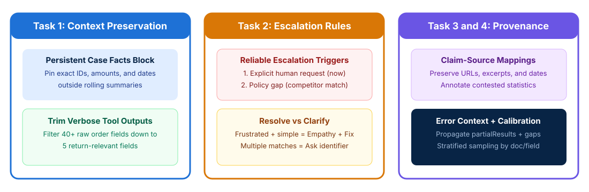

# Context Preservation, Provenance, and Escalation Workflows

## Time Required

60 minutes

## Overview

In this lab, you will preserve critical context across long interactions, configure reliable escalation rules, and maintain source provenance across multi-agent workflows.

### You learn how to:
- Preserve transactional facts and trim verbose tool outputs in long sessions.
- Configure escalation rules, ambiguity resolution, and human handoffs.
- Propagate structured error context and preserve source provenance during synthesis.
- Design crash-recovery state manifests and calibrated human review workflows.

## Scenario

Your production support and research agents lose exact dollar amounts over long conversations, escalate straightforward customer issues while mishandling policy gaps, and drop source citations when combining research findings. You need to improve context reliability, escalation accuracy, and citation provenance across these workflows.



## Lab Instructions

### Task 1: Trim verbose tool outputs and build a persistent case facts block

In this task, you create your lab workspace, strip a bloated order lookup payload down to only the fields relevant to return processing, and build a persistent `CASE_FACTS` block placed at the top of the prompt outside summarized history.

1. Open your terminal (Terminal on macOS or PowerShell / Command Prompt / VS Code Terminal on Windows) and create a working folder for this lab:

```bash
mkdir ccarf-lab-04
cd ccarf-lab-04
```

2. Open `ccarf-lab-04` in VS Code (or your preferred text editor) and create a file named `bloated-context.json` that shows how verbose tool outputs and rolling summaries lose critical numbers:

```json
{
  "progressive_summary_bad": "The customer asked about two recent orders and wants a refund for a damaged monitor and a late keyboard.",
  "raw_order_lookup_bloated": {
    "order_id": "ORD-77410",
    "customer_id": "CUST-901",
    "order_total": 389.50,
    "delivered_date": "2026-10-18",
    "return_eligible": true,
    "items": [{ "sku": "MON-27-4K", "price": 329.50 }, { "sku": "KBD-MECH", "price": 60.00 }],
    "warehouse_zone": "US-EAST-BIN-44B",
    "picker_employee_id": "EMP-8821",
    "Forklift_route_id": "RT-09",
    "packaging_weight_grams": 6420,
    "carrier_raw_webhook_log": ["SCAN_1", "SCAN_2", "SCAN_3", "SCAN_4", "SCAN_5"],
    "internal_erp_sync_hash": "9f86d081884c7d659a2feaa0c55ad015a3bf4f1b2b0b822cd15d6c15b0f00a08"
  }
}
```

3. Create a file named `context-optimizer.json` in `ccarf-lab-04` that defines the Domain 5.1 architecture for preserving exact transactional facts and trimming verbose tool outputs:

```json
{
  "CASE_FACTS": {
    "placement_rule": "Injected at the very top of every prompt, outside rolling conversation summaries",
    "verified_customer_id": "CUST-901",
    "issues": [
      {
        "order_id": "ORD-77410",
        "sku": "MON-27-4K",
        "exact_amount": 329.50,
        "delivered_date": "2026-10-18",
        "issue_type": "damaged_on_arrival",
        "status": "photo_verified_eligible_for_replacement"
      },
      {
        "order_id": "ORD-77410",
        "sku": "KBD-MECH",
        "exact_amount": 60.00,
        "delivered_date": "2026-10-18",
        "issue_type": "late_delivery_inquiry",
        "status": "delivered_within_sla"
      }
    ]
  },
  "trimmed_order_lookup_result": {
    "order_id": "ORD-77410",
    "customer_id": "CUST-901",
    "order_total": 389.50,
    "delivered_date": "2026-10-18",
    "return_eligible": true
  }
}
```

4. Launch Claude Code in `ccarf-lab-04`:

```bash
claude
```

5. Ask Claude Code to compare `bloated-context.json` with `context-optimizer.json` and generate a multi-issue customer response in `multi-issue-resolution.md`:

```text
Read bloated-context.json and context-optimizer.json. Explain why relying on progressive_summary_bad causes contradictions in multi-turn conversations, and then write multi-issue-resolution.md containing a customer response generated strictly from the persistent CASE_FACTS block (citing the exact $329.50 and $60.00 amounts, SKU names, and 2026-10-18 delivery date).
```

> [!IMPORTANT]
> On the exam, remember three Domain 5.1 rules:
> 1. Extract transactional facts (exact amounts, dates, order IDs, statuses) into a persistent **`CASE_FACTS` block** placed outside progressive summarization.
> 2. Trim verbose MCP tool outputs (such as 40+ database fields) down to only relevant fields before they accumulate in conversation history.
> 3. Place key findings summaries at the **beginning** of long aggregated inputs with explicit section headers to counter the `"lost in the middle"` effect.

### Task 2: Configure escalation triggers, ambiguity resolution, and handoff payloads

In this task, you configure explicit escalation criteria with few-shot examples and test your agent’s decision-making across four classic exam scenarios: an explicit human request, a frustrated customer with a simple issue, a silent policy gap, and multiple customer matches.

1. In `ccarf-lab-04`, create a file named `escalation-test-cases.json` containing four incoming customer support situations:

```json
{
  "cases": [
    {
      "case_id": "CASE-1-EXPLICIT-HUMAN",
      "customer_message": "I do not want to talk to a bot. Transfer me to a human supervisor right now.",
      "tool_context": { "verified_customer_id": "CUST-101" }
    },
    {
      "case_id": "CASE-2-FRUSTRATED-SIMPLE",
      "customer_message": "This is ridiculous! My $45 coffee carafe arrived shattered in the box! Here is the photo of the broken glass.",
      "tool_context": {
        "verified_customer_id": "CUST-202",
        "order_id": "ORD-551",
        "amount": 45.00,
        "photo_attached": true,
        "policy_rule": "Standard damage replacements under $500 with photo evidence are approved autonomously."
      }
    },
    {
      "case_id": "CASE-3-POLICY-GAP",
      "customer_message": "CompetitorX is selling this exact laptop for $150 less today. Please refund me the $150 price match difference on order #ORD-882.",
      "tool_context": {
        "verified_customer_id": "CUST-303",
        "order_id": "ORD-882",
        "policy_rule": "Return policy covers defective items and our own website price drops within 14 days. Policy document is completely silent on competitor price matching."
      }
    },
    {
      "case_id": "CASE-4-MULTIPLE-MATCHES",
      "customer_message": "Hi, my name is John Smith and I need to check the status of my recent order.",
      "tool_context": {
        "get_customer_results": [
          { "customer_id": "CUST-401", "name": "John Smith", "city": "Austin" },
          { "customer_id": "CUST-402", "name": "John Smith", "city": "Boston" },
          { "customer_id": "CUST-403", "name": "John Smith", "city": "Seattle" }
        ]
      }
    }
  ]
}
```

2. Ask Claude Code to evaluate all four cases in `escalation-test-cases.json` using the official CCAR-F Domain 5.2 rules and write the decisions (including structured human handoff payloads where escalated) to `escalation-decisions.json`:

```text
Read escalation-test-cases.json. Create a file named escalation-decisions.json that evaluates each of the 4 cases using these exact rules:
- Rule 1 (Explicit Human Request): Escalate immediately without attempting investigation first.
- Rule 2 (Frustrated Customer + Straightforward In-Scope Issue): Do NOT escalate based on negative sentiment. Acknowledge frustration with empathy and resolve the $45 damage replacement autonomously (escalate only if the customer reiterates a request for a human).
- Rule 3 (Policy Gap / Silent Policy): Escalate whenever company policy is silent or ambiguous (such as competitor price matching). Include a structured handoff summary containing customer_id, root_cause, refund_amount, and recommended_action because human agents do not have access to the conversation transcript.
- Rule 4 (Multiple Customer Matches): Never pick a record heuristically (such as most recent). Ask the customer for an additional unique identifier (email address, phone number, or order ID).
```

3. Open `escalation-decisions.json` in your editor and verify the decision and rationale for each of the four cases.

> [!WARNING]
> **Exam Trap**: Never choose **sentiment analysis** or **uncalibrated self-reported confidence scores (1 to 10)** to trigger customer support escalations. Customer frustration does not correlate with case complexity, and LLM self-reported confidence is often overconfident on policy exceptions. Always start by adding **explicit escalation criteria and few-shot examples** to the system prompt.

### Task 3: Propagate structured subagent errors and preserve multi-source provenance

In this task, you construct a structured subagent error propagation payload and test a synthesis workflow that preserves `claim-source` mappings, publication dates, contested statistics, and coverage gap annotations.

1. In `ccarf-lab-04`, create a file named `subagent-inputs.json` representing findings from two research subagents (where one subagent encountered a partial timeout and two credible sources report different adoption numbers from different years):

```json
{
  "web_search_subagent_output": {
    "status": "success",
    "findings": [
      {
        "claim": "Enterprise adoption of AI coding assistants reached 42% among surveyed organizations.",
        "evidence_excerpt": "In our Q1 2024 survey of 500 enterprise IT leaders, 42% reported active deployment.",
        "source_url": "https://research.example.com/2024-enterprise-ai-survey",
        "publication_date": "2024-03-15",
        "methodology": "Survey of 500 North American companies with 1,000+ employees"
      },
      {
        "claim": "Enterprise adoption of AI coding assistants reached 78% across global software teams.",
        "evidence_excerpt": "By Q2 2026, 78% of global engineering teams had deployed AI coding assistants in production.",
        "source_url": "https://benchmark.example.org/2026-global-dev-report",
        "publication_date": "2026-06-10",
        "methodology": "Telemetry and survey across 2,400 global organizations of all sizes"
      },
      {
        "claim": "Median pull request cycle time decreased by 18% in controlled trials.",
        "evidence_excerpt": "Controlled cohort analysis measured an 18% reduction in PR cycle time.",
        "source_url": "https://journal.example.edu/pr-velocity-study",
        "publication_date": "2026-01-20",
        "methodology": "Randomized trial of 120 repositories"
      },
      {
        "claim": "Median pull request cycle time increased by 9% due to larger review queues.",
        "evidence_excerpt": "Teams without automated PR review experienced a 9% increase in review wait times.",
        "source_url": "https://ops-institute.example.org/review-bottlenecks-2026",
        "publication_date": "2026-02-11",
        "methodology": "Observational study of 85 enterprise monorepos"
      }
    ]
  },
  "regulatory_doc_subagent_output": {
    "status": "partial_failure",
    "failureType": "UPSTREAM_TIMEOUT",
    "attemptedQuery": "SELECT compliance_penalties FROM eu_ai_act_2026_annex WHERE sector = 'financial_services'",
    "partialResults": [
      {
        "claim": "General prohibited AI practice penalties reach up to 7% of global annual turnover.",
        "document_name": "eu-ai-act-summary.pdf",
        "page_number": 14,
        "publication_date": "2025-11-01"
      }
    ],
    "suggestedAlternatives": [
      "Retry query against local cached MCP resource catalog://regulatory/eu-ai-act-annex"
    ]
  }
}
```

2. Ask Claude Code to synthesize `subagent-inputs.json` into a structured report `synthesized-research-report.md` following the Domain 5.3 and Domain 5.6 rules:

```text
Read subagent-inputs.json. Generate synthesized-research-report.md following these strict provenance and error-handling rules:
1. Preserve every claim-source mapping (source_url or document_name, page_number, publication_date, and methodology).
2. Explain temporal differences accurately: show that the 42% (March 2024) vs 78% (June 2026) adoption figures reflect different collection dates and sample methodologies rather than a contradiction.
3. Annotate genuine conflicts: for the 2026 PR cycle time findings (-18% vs +9%), do NOT average them or pick one arbitrarily. Present both under a "Contested Findings" section with full source attribution and methodological context.
4. Annotate coverage gaps: use the structured error context from regulatory_doc_subagent_output to include the partial result (page 14) while explicitly annotating the coverage gap on financial-services annex penalties caused by the upstream timeout.
5. Format financial/numerical comparisons as a Markdown table and narrative findings as structured lists.
```

3. Open `synthesized-research-report.md` in your editor and confirm that both conflicting statistics are preserved with their citations, temporal dates are included, and the regulatory coverage gap is explicitly annotated.

### Bonus Task 4: Use scratchpads, crash recovery manifests, and calibrated review routing

In this bonus task, you create a crash-recovery state manifest for long-running codebase explorations and design a confidence-calibrated human review routing plan using stratified random sampling.

1. In `ccarf-lab-04`, create a file named `crash-recovery-manifest.json` that shows how a coordinator and subagents persist verified state to disk so an interrupted session can resume without re-exploring the codebase:

```json
{
  "workflow_id": "legacy-billing-migration-01",
  "last_updated_iso": "2026-10-30T15:30:00Z",
  "completed_phases": [
    {
      "phase": "phase_1_entry_point_mapping",
      "scratchpad_file": "scratchpads/phase1-entrypoints.md",
      "verified_findings_summary": "Identified 4 billing entry points in src/billing/handlers.ts and 2 wrapper modules in src/common/http.ts."
    }
  ],
  "pending_phases": [
    "phase_2_trace_refund_dependencies",
    "phase_3_generate_characterization_tests"
  ]
}
```

2. Next, ask Claude Code to create `human-review-calibration.md` explaining how to fix the 97% aggregate accuracy trap on your document extraction pipeline:

```text
Create human-review-calibration.md that outlines a 4-step quality plan for an extraction pipeline where overall accuracy is 97% but customs forms fail 38% of the time:
1. Segment accuracy evaluation by document_type AND field name before automating high-confidence outputs.
2. Require the model to output field-level confidence scores alongside each extracted value, and calibrate routing thresholds using a labeled validation set.
3. Route low-confidence fields and contradictory source documents to human reviewers to prioritize limited reviewer capacity.
4. Run ongoing stratified random sampling of high-confidence extractions in production to detect novel error patterns and schema drift.
```

3. Review `human-review-calibration.md` in your editor to solidify the Domain 5.4 and Domain 5.5 exam patterns.

## Congratulations!

In this lab, you have:
- Preserved transactional facts and trimmed verbose tool outputs in long sessions.
- Configured escalation rules, ambiguity resolution, and human handoffs.
- Propagated structured error context and preserved source provenance during synthesis.
- Designed crash-recovery state manifests and calibrated human review workflows.
