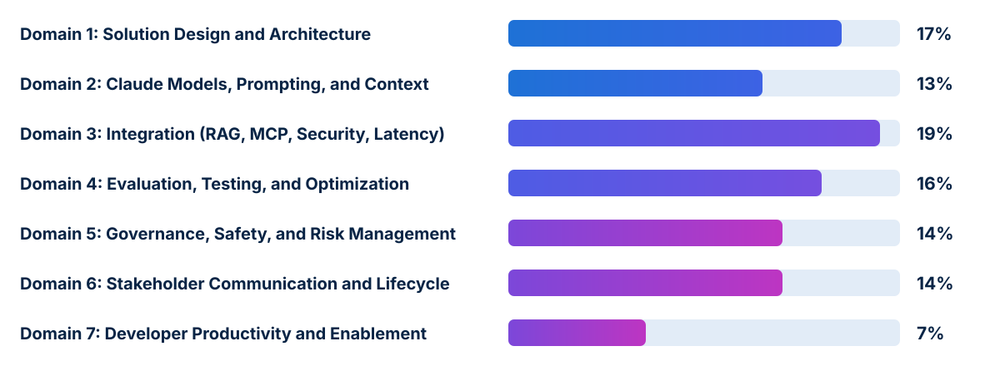

<!-- course-title: Claude Certified Architect - Professional: Hands-On Exam Prep Workshop -->
<!-- course-theme: roi-alt-theme -->

<!-- layout: title -->


Claude Certified Architect - Professional: Hands-On Exam Prep Workshop

# Chapter 1: Claude Certified Architect - Professional Overview

---

# Chapter 1: Objectives

- Review the CCAR-P exam format, scoring, and domain weights
- Compare CCAR-P scope with the Foundations exam
- Evaluate Minimally Qualified Candidate competencies
- Apply a structured framework to deconstruct exam questions

---

<!-- layout: navigation -->
# Chapter 1

- **Understanding the Exam**
- Preparing to Pass the Exam

---

<!-- layout: card-layout -->
# Exam Details at a Glance (CCAR-P)

### Format and Time Limit
- 63 multiple-choice and multiple-response items in 120 minutes.
- Multiple-response items state how many options to select.

### Passing Standard
- Scored on a criterion-referenced scale from 100 to 1,000; the passing score is 720.
- Every candidate is measured against a fixed bar, not graded on a curve.

### Score Report Diagnostics
- The report shows pass or fail and your scaled score.
- It also shows percentage correct for each of the seven domains, so you can see strengths and gaps.

### Validity and Renewal
- The credential is valid for 12 months ($175 USD exam fee).
- Renew on time with a free, non-proctored assessment on the Anthropic Partner Academy.

---

<!-- layout: stacked -->
# Exam Blueprint Across Seven Domains

- **Integration (19%)**, **Solution Design and Architecture (17%)**, and **Evaluation, Testing, and Optimization (16%)** make up over half (52%) of the exam
- **Governance, Safety, and Risk (14%)** and **Stakeholder Communication and Lifecycle (14%)** test enterprise delivery maturity
- **Models, Prompting, and Context (13%)** and **Developer Productivity (7%)** complete the blueprint



---

<!-- layout: 2-column -->
# Minimally Qualified Candidate (MQC) Profile

### Recommended Experience
- 3+ years of experience in systems architecture or platform engineering
- 6+ months of hands-on production experience with Claude or comparable LLM systems
- A track record of delivering systems from discovery through deployment and operations
- Grounded in engineering fundamentals: modularity, separation of concerns, and scalability

### Enterprise Responsibilities
- Translating business problems in finance, healthcare, retail, technology, and government into scalable AI architectures
- Balancing trade-offs across accuracy, latency, token cost, safety, compliance, and maintainability
- Aligning engineering, security, legal, compliance, and executive sponsors

---

<!-- layout: 2-column -->
# How Professional Builds on Foundations

### Foundations Focus (CCAR-F)
- Core mechanics of `stop_reason` loops, `Task` subagent spawning, and SDK hooks
- Writing MCP tool descriptions, `isError` payloads, and `.mcp.json` files
- Configuring `CLAUDE.md`, `.claude/rules/`, skills, and `claude -p` in CI/CD
- `tool_use` JSON extraction, retry loops, and context preservation

### Professional Focus (CCAR-P)
- **End-to-end enterprise architecture** aligned to business value pillars and strict SLAs
- **Production RAG pipelines**: chunking, hybrid retrieval, embedding refreshes, and progressive discovery
- **Protocol selection**: MCP vs direct API/CLI vs Agent-to-Agent (A2A)
- **Governance and regulations**: GDPR, HIPAA, FedRAMP, least-privilege capability removal, and lifecycle management

<!-- below-columns -->

> [!NOTE]
> The Foundations exam calls the subagent-spawning tool `Task`. In current Claude Code and Agent SDK releases it is named `Agent`. This course uses `Task` where it quotes exam language.

---

<!-- layout: navigation -->
# Chapter 1

- Understanding the Exam
- **Preparing to Pass the Exam**

---

<!-- layout: card-layout -->
# Three Canonical CCAR-P Exam Patterns

### 1. Least Privilege
- A support agent can read tickets, draft replies, issue refunds, and delete accounts, but the role only reads and drafts: **remove the refund and delete tools**.
- Logging and confirmation prompts leave the attack surface in place.

### 2. Cache Prefix Order
- An app sends the same 8,000-token system prompt and policy on every request, followed by a short query: **put static content first and enable prompt caching**.
- Cuts time to first token (TTFT) and cost without truncating policy or blindly downsizing the model.

### 3. RAG Regressions
- A RAG system gives confident wrong answers right after a document refresh, with model and latency unchanged: **check retrieval and indexing first**.
- A broken re-index or mismatched embeddings feed stale chunks to a healthy model.

---

<!-- layout: 2-column -->
# Evaluating Architectural Trade-Offs on the Exam

### Eliminate Distractors That...
- Apply **detective or compensating controls** (audit logs, polite system prompts) when **preventive structural controls** (removing unneeded tools, enforcing IAM boundaries) are available
- **Truncate critical business policy** or **blindly switch to the smallest model** without evaluating task capability fit
- Blame **silent model weight changes** or **temperature settings** when an upstream data or retrieval pipeline just changed
- Treat LLM outputs as 100% deterministic when communicating SLAs to business stakeholders

### Favor Answers That...
- Enforce **least privilege** and separation of concerns at the architectural boundary
- Cut cost and latency together with **prompt caching**, **tiered model routing**, and **batch processing**
- Diagnose regressions systematically across **retrieval -> context -> prompt -> model -> integration**
- Align technical designs to measurable **SLAs**, **regulatory frameworks** (GDPR, HIPAA, FedRAMP), and **human-in-the-loop** guardrails

---

<!-- layout: card-layout -->
# How to Dissect a CCAR-P Scenario Question

### 1. Find the Binding Constraint
- Find the one requirement that cannot bend: money moving, regulated data, a latency SLA, a cost ceiling, or an executive commitment.
- It sets how strong the fix must be. A compliance or financial rule needs a structural control, not a prompt.

### 2. Locate the Layer That Changed
- Map the symptom to a layer: business requirement, retrieval, prompt and context, model, integration and tools, or operations.
- Clues such as “after a document refresh” or “after the new prompt shipped” point to exactly one layer.

### 3. Eliminate by Control Strength
- Drop answers that monitor (logging), add friction (confirmation prompts), or hope (bigger model, stronger wording) when a preventive option exists.
- Drop answers that fix a layer that did not change.

### 4. Choose the Proportionate Fix
- Among the survivors, pick the smallest change that fully meets the constraint.
- Rebuilding the architecture, fine-tuning, or adding a new agent is rarely the first answer.

---

<!-- layout: 2-column -->
# Worked Example: A Professional-Level Question

### The Question
- **Stem:** A bank’s internal research assistant answers analyst questions from 40,000 policy and product documents. Legal now requires that analysts in the retail division never see answers drawn from investment-banking documents. Retrieval quality is otherwise good. What is the best change?
- **A.** Add a system prompt rule: “Never use investment-banking documents for retail analysts”
- **B.** Filter retrieval by the caller’s division metadata before chunks reach the context window
- **C.** Log every answer and have compliance review the logs weekly
- **D.** Move to a larger model that follows confidentiality instructions more reliably

### Applying the Four Steps
- **Constraint:** a legal access rule, so it needs 100% enforcement
- **Layer:** retrieval decides what Claude can see; the model and prompt are not the problem
- **Eliminate:** A and D are probabilistic; C is detective and finds leaks after they happen
- **Answer: B.** An ACL pre-filter is preventive: unauthorized chunks never reach the model

<!-- below-columns -->

> [!TIP]
> Most CCAR-P questions are architecture questions disguised as model questions. An option that changes *what the model can see or do* usually beats one that asks the model to behave.

---

# Weighted Study Plan

| Domain | Weight | Approx. Items | Where in This Course | Study Priority |
| :--- | :---: | :---: | :--- | :--- |
| **3: Integration** | 19% | 12 | Chapter 4, Lab 2 | Highest: RAG, protocols, auth, observability |
| **1: Solution Design and Architecture** | 17% | 11 | Chapter 2, Lab 1 | High: pattern selection and decomposition |
| **4: Evaluation, Testing, and Optimization** | 16% | 10 | Chapter 5, Lab 3 | High: datasets, A/B, diagnosis |
| **5: Governance, Safety, and Risk** | 14% | 9 | Chapter 6, Lab 3 | Medium: control types, HITL, compliance |
| **6: Stakeholder Communication and Lifecycle** | 14% | 9 | Chapter 7, Lab 4 | Medium: discovery, SLAs, ADRs |
| **2: Models, Prompting, and Context** | 13% | 8 | Chapter 3, Lab 2 | Medium: model trade-offs, caching, Skills |
| **7: Developer Productivity** | 7% | 4 | Chapter 8, Lab 4 | Lower: Claude Code team setup |

---

# Exam Policies, Retakes, and Pacing Strategy

- **Pacing**: 63 items in 120 minutes is about **1 minute 50 seconds per item**; flag long items and never leave blanks
- **Multiple-response items**: select exactly as many options as the item states
- **Retake waiting periods**:
  - 14 days after the 1st failed attempt, 30 days after the 2nd, 90 days after the 3rd
  - Maximum 4 attempts within a rolling 12-month period
- **Rescheduling rule**: cancel or reschedule through Pearson VUE at least 24 hours ahead, or forfeit the fee

---

# Demo: Using the Claude API

If you already finished Lab 0, open `ccarp-labs` with the virtual environment activated and skip to Step 6.

**Step 1. Create the `ccarp-labs` folder**

**macOS:**

```bash
cd ~
mkdir ccarp-labs
cd ccarp-labs
```

**Windows (PowerShell):**

```powershell
cd $HOME
mkdir ccarp-labs
cd ccarp-labs
```

**Step 2. Create a virtual environment and activate it**

**macOS:**

```bash
python3 -m venv .venv
source .venv/bin/activate
```

**Windows (PowerShell):**

```powershell
python -m venv .venv
.venv\Scripts\Activate.ps1
```

When the environment is active, the prompt starts with `(.venv)`. If Windows says that running scripts is disabled, run `Set-ExecutionPolicy -Scope CurrentUser RemoteSigned`, answer **Y**, and run the activate command again.

**Step 3. Install the packages for these demos**

```bash
pip install anthropic python-dotenv
```

**Step 4. Create a file named `.env` with your API key**

```text
ANTHROPIC_API_KEY=sk-ant-paste-your-key-here
```

**Step 5. Create a file named `.gitignore`**

```text
.env
.venv/
```

**Step 6. Create `demo_01_haiku.py` and paste this code**

```python
# demo_01_haiku.py - one Messages API call
from dotenv import load_dotenv
import anthropic

load_dotenv()
client = anthropic.Anthropic()

response = client.messages.create(
    model="claude-haiku-5-5",
    max_tokens=1028,
    output_config={"effort": "low"},  # keep this short reply from being spent on thinking
    messages=[{
        "role": "user",
        "content": "Write a Haiku about the Claude Certified Architect - Professional exam.",
    }],
)

text = "".join(block.text for block in response.content if block.type == "text")
print(text)
print("usage:", response.usage.input_tokens, "in /", response.usage.output_tokens, "out")
```

**Step 7. Run it**

```bash
python demo_01_haiku.py
```

**Step 8. Examine the output**

- The terminal prints a haiku: three short lines whose wording varies run to run
- The last line shows the input and output token counts for the call

> [!NOTE]
> You sent one prompt and printed the reply and its token usage. Later demos read the `usage` object to make trade-offs visible, and all of them use this folder, virtual environment, and `.env` file. Demos that run Claude Code use your Claude subscription instead of the key.

---

# What You Learned

- Reviewed the CCAR-P exam format, scoring, and domain weights
- Compared CCAR-P scope with the Foundations exam
- Evaluated Minimally Qualified Candidate competencies
- Applied a structured framework to deconstruct exam questions

---

<!-- layout: stacked -->
# Questions and Answers


