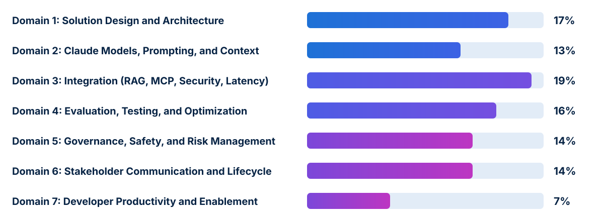

<!-- course-title: Claude Certified Architect - Professional: Hands-On Exam Prep Workshop -->
<!-- course-theme: roi-alt-theme -->

<!-- layout: title -->

Claude Certified Architect - Professional: Hands-On Exam Prep Workshop

# Chapter 1: Claude Certified Architect - Professional Overview

---

# Chapter 1: Objectives

- Describe the exam format, scoring standard, and seven domain weights of the Claude Certified Architect - Professional (CCAR-P) exam
- Compare the enterprise architectural scope of CCAR-P with the Foundations exam
- Evaluate Minimally Qualified Candidate (MQC) competencies across RAG, governance, observability, and stakeholder management
- Apply a systematic trade-off framework to deconstruct CCAR-P exam items and eliminate distractors

---

<!-- layout: navigation -->
# Chapter 1

- **Understanding the Exam**
- Preparing to Pass the Exam

---

<!-- layout: card-layout -->
# Exam Details at a Glance (CCAR-P)

### Format and Time Limit
- The CCAR-P exam consists of 63 multiple-choice and multiple-response items completed within 120 minutes.
- Multiple-response items state explicitly how many options you must select.

### Passing Standard
- Scored on a criterion-referenced scale from 100 to 1,000 with a passing cut score of 720.
- Every candidate is evaluated against a fixed professional competency bar, never graded on a curve.

### Score Report Diagnostics
- Your score report provides an overall pass or fail status with your scaled score.
- It also breaks down percentage-correct across each of the seven domains to highlight strengths and gaps.

### Validity and Renewal
- The credential is valid for 12 months from the date awarded ($175 USD exam fee).
- On-time recertification requires completing a free, non-proctored renewal assessment on the Anthropic Partner Academy.

---

<!-- layout: stacked -->
# Exam Blueprint Across Seven Domains

- **Integration (19%)**, **Solution Design and Architecture (17%)**, and **Evaluation, Testing, and Optimization (16%)** make up over half (52%) of the exam
- **Governance, Safety, and Risk (14%)** and **Stakeholder Communication and Lifecycle (14%)** test enterprise delivery maturity
- **Models, Prompting, and Context (13%)** and **Developer Productivity (7%)** complete the blueprint

---

<!-- layout: 2-column -->
# Minimally Qualified Candidate (MQC) Profile

### Recommended Experience
- 3+ years of experience in systems architecture or platform engineering
- 6+ months of hands-on production experience with Claude or comparable LLM systems
- Proven track record delivering end-to-end systems from discovery through deployment and operationalization
- Grounded in software engineering fundamentals: modularity, separation of concerns, and scalability

### Enterprise Responsibilities
- Translating business problems across finance, healthcare, retail, technology, and government into scalable AI architectures
- Balancing trade-offs across accuracy, latency, token cost, safety, compliance, and maintainability
- Leading stakeholder alignment across engineering, security, legal, compliance, and executive sponsors

---

<!-- layout: 2-column -->
# How Architect Professional Expands Beyond Foundations

### Foundations Focus (CCAR-F)
- Core mechanics of `stop_reason` loops, `Task` subagent spawning, and SDK hooks
- Writing MCP tool descriptions, `isError` payloads, and `.mcp.json` files
- Configuring `CLAUDE.md`, `.claude/rules/`, skills, and `claude -p` in CI/CD
- `tool_use` JSON extraction, retry loops, and context preservation

### Professional Focus (CCAR-P)
- **End-to-end enterprise architecture** aligned to business value pillars and strict SLAs
- **Production RAG pipelines**: chunking, hybrid retrieval, embedding refreshes, and progressive discovery
- **Protocol selection**: weighing MCP vs direct API/CLI vs Agent-to-Agent (A2A) orchestration
- **Governance and regulations**: GDPR, HIPAA, FedRAMP, least-privilege capability removal, and lifecycle management

---

<!-- layout: navigation -->
# Chapter 1

- Understanding the Exam
- **Preparing to Pass the Exam**

---

<!-- layout: card-layout -->
# Three Canonical CCAR-P Exam Patterns

### 1. Least Privilege Over Detective Controls
- When a support agent has tools to read tickets, draft replies, issue refunds, and delete accounts, but the role only needs reading and drafting, **remove the refund and delete tools entirely**.
- Detective logging and confirmation prompts leave unnecessary attack surface in place.

### 2. Prefix Ordering for Prompt Caching
- When an application sends the same 8,000-token system prompt and policy document on every request followed by a short user query, **place static content first and enable prompt caching**.
- Cuts both time-to-first-token (TTFT) latency and per-request cost without truncating policy rules or downsizing models blindly.

### 3. Isolating RAG Regressions After Data Changes
- When a RAG system suddenly returns confident but wrong answers right after a document refresh while model version and latency are unchanged, **investigate the retrieval and indexing pipeline first**.
- Broken re-indexing or mismatched embeddings feed stale or irrelevant chunks to an otherwise healthy model.

---

<!-- layout: 2-column -->
# Evaluating Architectural Trade-Offs on the Exam

### Eliminate Distractors That...
- Apply **detective or compensating controls** (audit logs, polite system prompts) when **preventive structural controls** (removing unneeded tools, enforcing IAM boundaries) are available
- **Truncate critical business policy** or **blindly switch to the smallest model** without evaluating task capability fit
- Blame **silent model weight changes** or **temperature settings** when an upstream data or retrieval pipeline just changed
- Treat LLM outputs as 100% deterministic when communicating SLAs to business stakeholders

### Favor Answers That...
- Enforce **least privilege** and separation of concerns at the architectural boundary
- Optimize cost and latency simultaneously using **prompt caching**, **tiered model routing**, and **batch processing**
- Diagnose regressions systematically across **retrieval -> context -> prompt -> model -> integration**
- Align technical designs to measurable **SLAs**, **regulatory frameworks** (GDPR, HIPAA, FedRAMP), and **human-in-the-loop** guardrails

---

# Exam Policies, Retakes, and Pacing Strategy

- **Pacing**: 63 items in 120 minutes gives you roughly **1 minute 50 seconds per item**; flag lengthy multi-requirement items and never leave blanks
- **Retake waiting periods**:
  - 14 days after the 1st failed attempt
  - 30 days after the 2nd failed attempt
  - 90 days after the 3rd failed attempt (maximum 4 attempts within a rolling 12-month period)
- **Rescheduling rule**: cancel or reschedule at least 24 hours before your appointment via Pearson VUE to avoid forfeiting the exam fee

---

# What You Learned

- Described the CCAR-P format (63 items, 120 minutes, 720/1,000 passing score) and seven domain weights
- Compared the enterprise architectural scope of CCAR-P with the Foundations exam
- Evaluated Minimally Qualified Candidate competencies across RAG, security, observability, compliance, and stakeholder alignment
- Applied a structured trade-off framework to deconstruct CCAR-P questions and eliminate distractors

---

<!-- layout: stacked -->
# Questions and Answers

