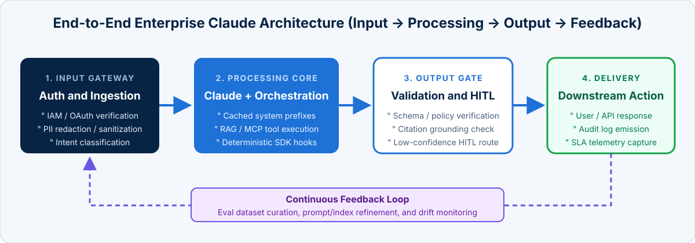

<!-- course-title: Claude Certified Architect - Professional: Hands-On Exam Prep Workshop -->
<!-- course-theme: roi-alt-theme -->

<!-- layout: title -->


Claude Certified Architect - Professional: Hands-On Exam Prep Workshop

# Chapter 2: Solution Design and Architecture

---

# Chapter 2: Objectives

- Translate business problems into end-to-end Claude architectures with feedback loops
- Select between Augmented LLMs, Workflows, and Agents, and decide where the agent loop runs
- Design multi-agent orchestration and decomposition patterns, and recognize when not to use them
- Align architectures to business value pillars, unit economics, and SLAs

---

# Domain 1: Solution Design and Architecture (17% of Exam)

| Task # | Task Statement |
| :--- | :--- |
| **1.1** | Translate business problems into Claude-based AI solutions |
| **1.2** | Design end-to-end architectures (input, processing, output, and feedback loops) |
| **1.3** | Select appropriate architectural patterns (workflow, agentic, augmented LLM) |
| **1.4** | Design multi-agent systems and orchestration strategies |
| **1.5** | Apply decomposition techniques for complex problem solving |
| **1.6** | Align solutions to business value pillars (efficiency, transformation, productivity, cost, performance SLAs) |

---

<!-- layout: navigation -->
# Chapter 2

- **End-to-End Architectures**
- Architectural Patterns
- Multi-Agent Orchestration
- Business Value Alignment

---

<!-- layout: stacked -->
# Designing End-to-End Claude Architectures

- **Four architectural stages**: every production AI solution requires structured **Input Ingestion**, **Contextual Processing**, **Output Validation**, and **Feedback Loops**
- **Decouple state from reasoning**: keep session state, auth enforcement, and retry counters in deterministic application code rather than inside the LLM prompt
- **Design feedback loops from day one**: capture user corrections, human-in-the-loop (HITL) overrides, and validation failures to continuously expand your evaluation dataset



---

<!-- layout: 2-column -->
# Translating Business Problems into AI System Boundaries

### What Belongs in Deterministic Code
- Authentication, RBAC/ABAC authorization, and tenant isolation
- Exact financial arithmetic, tax/fee calculations, and hard policy thresholds
- Database transactions, idempotency keys, and audit trail persistence
- Workflow state machines when the step sequence is fixed by regulation

### What Belongs in Claude Reasoning
- Unstructured document comprehension and cross-source synthesis
- Ambiguous intent classification and multi-concern decomposition
- Dynamic tool selection when investigation paths depend on live findings
- Natural language generation, code refactoring, and contextual explanations

<!-- below-columns -->

> [!IMPORTANT]
> Architectural Golden Rule: Start with the simplest, most deterministic architecture that meets the business goal, and add agentic autonomy only where task variability demands it.

---

<!-- layout: card-layout -->
# Should This Be an Agent? Four Checks

### 1. Complexity
- Is the task multi-step and hard to specify in advance, such as “investigate why checkout latency doubled”?
- If you can draw the flowchart before the first request, you need a workflow, not an agent.

### 2. Value
- Does the outcome justify higher token cost, higher latency, and more variance per request?
- Routine, high-volume tasks rarely justify an agent’s cost per transaction.

### 3. Viability
- Is Claude demonstrably good at this task type today? Prove it on an evaluation set before committing the architecture.

### 4. Cost of Error
- Can mistakes be caught and reversed through tests, review, or rollback?
- If an error is expensive and irreversible, keep the action behind a deterministic gate or human approval, or stay with a workflow.

---

<!-- layout: 2-column -->
# Worked Example: Insurance Claims Intake

### The Business Problem
- An insurer receives 18,000 auto claims per week by email, PDF, and photo
- Adjusters spend 25 minutes per claim gathering facts before any judgment happens
- **Goals**: cut intake time by 60%, keep adjusters as the decision makers, and meet a 4-hour first-response SLA
- **Constraints**: claimant PII and medical notes, state-specific regulations, and an audit trail for every decision

### The Architecture
- **Input**: email and upload gateway that normalizes files and attaches `claim_id` and `trace_id`
- **Processing**: a **workflow**: Claude extracts facts into a schema, code validates policy number and coverage dates, Claude drafts a summary with cited source pages
- **Output**: a structured claim file in the adjuster queue; no payout action exists in the AI path
- **Feedback**: adjuster corrections to extracted fields flow back into the extraction eval set weekly

<!-- below-columns -->

> [!TIP]
> Notice what was left out: no autonomous agent, no payout tool, no multi-agent hierarchy. The business goal was faster fact gathering, and a workflow meets it with the lowest risk.

---

# Closing the Feedback Loop

| Signal | How It Is Captured | What It Feeds | Owner |
| :--- | :--- | :--- | :--- |
| **User correction or thumbs-down** | UI event tagged with `trace_id` | Candidate eval cases after triage | Product owner |
| **HITL override** | Reviewer decision plus a reason code | Golden dataset and prompt fixes | Operations lead |
| **Guardrail or schema validation failure** | Structured application log | Regression test suite | Engineering |
| **Escalation outcome** | Ticketing or case system | Escalation criteria tuning | Support lead |

- **A loop is only closed when four things exist**: a `trace_id` that links the signal to the exact request, an owner, a review cadence, and an eval gate that every fix must pass before it ships

---

<!-- layout: navigation -->
# Chapter 2

- End-to-End Architectures
- **Architectural Patterns**
- Multi-Agent Orchestration
- Business Value Alignment

---

<!-- layout: 3-column -->
# Selecting the Right Architectural Pattern

### 1. Augmented LLM
- Single Claude call enhanced with retrieved context (RAG), scoped tools, and structured output schemas
- Lowest latency, lowest token cost, and easiest predictability to test
- **Best for**: Q and A over docs, single-step data extraction, and ticket classification

### 2. Workflow (Code-Driven)
- LLMs and tools orchestrated through **predefined code paths** (prompt chaining, routing, parallel execution)
- High predictability, bounded cost, and explicit quality gates between steps
- **Best for**: multi-stage document pipelines, regulated onboarding, and multi-pass PR reviews

### 3. Autonomous Agent
- Claude dynamically directs its own control flow, tool selection, and iteration count (`stop_reason` loop)
- Highest flexibility for open-ended problems, but higher latency, cost variance, and compounding error risk
- **Best for**: open-ended codebase debugging, complex research, and ambiguous support resolution

---

# Where the Agent Loop Runs

| Surface | You Build and Host | Anthropic Provides | Choose When |
| :--- | :--- | :--- | :--- |
| **Messages API: single call or workflow** | Prompts and the code that orchestrates steps | The model | The flow is predictable and you want full control |
| **Messages API with tool use (manual loop or Tool Runner)** | The tools, the loop or its hooks, and the compute | The model and an SDK loop helper | You need custom control flow and already run the infrastructure |
| **Claude Agent SDK** | A prompt, options, and the host | The Claude Code harness: file and shell tools, subagents, hooks, permissions | A coding or file-system agent running on your own infrastructure |
| **Claude Managed Agents (beta)** | Agent configuration and any custom tools | The loop plus a hosted per-session sandbox, versioned agent configs, and sessions | A long-running agent without running agent infrastructure yourself |

> [!WARNING]
> Hosting choice is also a compliance choice. Managed Agents keeps session history until you delete it and is not currently eligible for Zero Data Retention or HIPAA BAA coverage. For regulated workloads, verify eligibility in current docs or run the loop yourself.

---

<!-- layout: card-layout -->
# Four Decomposition Patterns for Complex Problems

### Prompt Chaining (Sequential)
- Decompose a task into fixed sequential subtasks where each step’s output feeds the next step.
- Insert programmatic validation checks between steps to catch errors before they cascade.

### Routing (Classification and Dispatch)
- Classify an incoming request (often with a fast model like Claude Haiku) and route it to a specialized prompt, toolset, or model tier.
- Prevents prompt bloat from trying to handle 10 unrelated intents in one monolithic prompt.

### Parallelization (Sectioning and Voting)
- **Sectioning**: split independent subtasks (such as reviewing 10 files or checking content guardrails alongside main generation) to run concurrently.
- **Voting**: run multiple independent passes on high-stakes security reviews to aggregate findings.

### Evaluator-Optimizer Loop
- One Claude instance generates an artifact while a second independent evaluator instance critiques it against explicit rubric criteria until quality thresholds pass.

---

<!-- layout: 2-column -->
# Worked Example: Decomposing a Vendor Due-Diligence Review

### The Request
- “Review this new vendor’s contract, SOC 2 report, and financial statements, and tell procurement whether to approve.”
- Three document types, three expert lenses, one decision, and a 15-minute turnaround target
- A single prompt that does everything produces shallow coverage and no way to test each part

### The Decomposition
- **Routing**: classify each uploaded file as contract, security report, or financials
- **Parallel sectioning**: run legal, security, and financial reviews concurrently, each with its own prompt and output schema
- **Prompt chaining**: feed the three structured findings into a synthesis step that applies the approval policy
- **Code gate**: a deterministic check blocks “approve” when any review returns a critical finding

<!-- below-columns -->

> [!NOTE]
> Each step can now be evaluated on its own. When approvals go wrong, you can tell whether classification, a specialist review, or the synthesis failed.

---

# Demo: Pick the Pattern

For each scenario, choose **Augmented LLM**, **Workflow** (name the decomposition), or **Agent**, and write one sentence on why.

1. Classify 2 million inbound support emails per month into 12 categories and extract the order ID from each
2. Process mortgage applications through a regulator-mandated sequence: extract documents, verify income, calculate debt-to-income ratio, run a compliance check, and draft the decision letter
3. Investigate production incidents across logs, metrics, and recent deploys, where each next step depends on what the last query found
4. Handle a mixed inbound queue of billing, technical, and sales requests, each needing a different knowledge base and tone

---

<!-- layout: 2-column -->
# Demo Debrief: Pick the Pattern

### Answers
- **1. Augmented LLM**: one call with a structured output schema; use the Message Batches API if results are not needed in real time
- **2. Workflow: prompt chaining**: the order is fixed by regulation, and the ratio is calculated in code, not by Claude
- **3. Agent**: the path cannot be drawn in advance; give it read-only tools and require human approval for any remediation
- **4. Workflow: routing**: a fast classifier dispatches to three specialized prompts and knowledge bases

### Exam Takeaway
- Ask “Can I draw the flowchart before the request arrives?” If yes, it is a workflow
- Agents earn their cost only when the next step genuinely depends on what was just discovered
- Distractors put agents and multi-agent hierarchies on problems with fixed steps

---

<!-- layout: navigation -->
# Chapter 2

- End-to-End Architectures
- Architectural Patterns
- **Multi-Agent Orchestration**
- Business Value Alignment

---

<!-- layout: 2-column -->
# Multi-Agent Topologies and Trade-Offs

### Orchestrator-Workers (Hub-and-Spoke)
- Central coordinator dynamically decomposes unpredictable tasks, delegates to specialized workers, and synthesizes results
- Workers operate with **isolated context windows** and scoped tools (4 to 5 tools per role)
- All inter-agent communication and error recovery flow through the coordinator for unified observability

### Hierarchical and Handoff Topologies
- **Hierarchical**: domain supervisors manage sub-teams when a system spans dozens of distinct enterprise domains
- **Handoff pipeline**: triage agent transfers session ownership and a structured state summary to a specialist agent
- **Watch out**: every extra hop increases p95 latency and token overhead; flatten hierarchies unless tool or context isolation requires them

<!-- below-columns -->

> [!NOTE]
> Exam questions may call the subagent-spawning tool `Task`. In current Claude Code and Agent SDK releases it is named `Agent`.

---

<!-- layout: 2-column -->
# When Multi-Agent Is the Wrong Answer

### Where Multi-Agent Wins
- **Breadth-first work that splits cleanly**: researching 8 competitors, reviewing 20 independent files, or checking 5 regulatory regimes in parallel
- **Context isolation**: each worker reads thousands of tokens of raw material and returns a compact summary, keeping the coordinator’s context clean
- **Different tools or permissions per role**: a read-only research worker and a write-capable worker with an approval gate

### Where It Loses
- **Token cost multiplies**: every worker re-reads instructions and context, so a multi-agent run can cost several times a single agent
- **Tightly coupled tasks suffer**: most coding and design work needs shared, evolving context that summaries between agents lose
- **More hops, more failure points**: each handoff adds latency, a place for context to be dropped, and another trace to debug

<!-- below-columns -->

> [!TIP]
> On the exam, a multi-agent answer needs a reason: parallelism, context isolation, or separation of permissions. “It is more advanced” is not a reason.

---

# Designing Multi-Agent Context Contracts

- **Explicit context contracts**: define strict JSON/Pydantic input and output schemas between the coordinator and every worker subagent
- **Contain blast radius**: enforce per-subagent token budgets, timeouts, and local retry policies so a slow worker never stalls the entire request

```python
class ClaimCitation(BaseModel):
    claim: str
    source_id: str
    quoted_evidence: str

class SubagentTaskContract(BaseModel):
    task_id: str
    research_goal: str
    verified_facts_context: list[str]
    max_tokens_budget: int = 4096
    timeout_seconds: float = 15.0

class SubagentResultContract(BaseModel):
    task_id: str
    status: Literal["success", "partial_failure", "failed"]
    claims_with_citations: list[ClaimCitation]
    coverage_gaps: list[str]
```

---

<!-- layout: navigation -->
# Chapter 2

- End-to-End Architectures
- Architectural Patterns
- Multi-Agent Orchestration
- **Business Value Alignment**

---

<!-- layout: card-layout -->
# Aligning Architecture to Business Value Pillars

### Operational Efficiency and Cost
- Reduce cost per transaction through prompt caching, Message Batches API (50% discount for async jobs), and tiered model routing.
- Measure **cost per successful resolution**, not raw cost per 1,000 tokens.

### Workforce Productivity
- Accelerate engineering, legal, and analyst workflows by automating repetitive synthesis and first-draft generation while keeping humans in the decision seat.

### Business Transformation
- Enable capabilities that were previously impossible at scale, such as 100% contract clause auditing or real-time multilingual support synthesis.

### Performance and Reliability SLAs
- Match architectural patterns to strict latency (p50/p99 TTFT and total duration), throughput, and availability targets.

---

# Worked Cost: What Actually Drives Cost per Resolved Ticket

- **Support agent on `claude-sonnet-5-5`** ($2 / MTok input, $10 / MTok output, cache reads $0.10 / MTok): 50,000 tickets per month, 6 turns per ticket, a 10,000-token shared prefix plus 2,000 new input tokens and 400 output tokens per turn
- **Token cost per ticket**:
  - Uncached: (72,000 × $2 + 2,400 × $10) / 1M = **$0.17**
  - With prompt caching on the prefix: (60,000 × $0.10 + 12,000 × $2 + 2,400 × $10) / 1M = **$0.05**
- **Human cost per ticket**: 30% of tickets escalate to an agent at $6 each = **$1.80**
- **The lesson**: caching saves about $6,000 per month; raising AI resolution from 70% to 80% saves **$30,000 per month**

> [!IMPORTANT]
> Optimize the metric the business pays for. Token optimizations matter, but resolution rate, escalation rate, and rework usually dominate the unit economics.

---

# Mapping SLA Constraints to Architectural Decisions

| SLA / Business Requirement | Architectural Design Choice | Why Alternatives Fail |
| :--- | :--- | :--- |
| **Sub-2-second interactive TTFT with 10K-token policy** | Enable **Prompt Caching** on the static prefix + stream response tokens | Re-processing 10K uncached tokens on every turn violates TTFT budgets |
| **Strict 99.9% compliance on financial refund caps** | **Deterministic PreToolUse hook** / code gate before API execution | System prompts and few-shot examples remain probabilistic |
| **Overnight processing of 50,000 compliance reports** | **Message Batches API** with `custom_id` tracking and chunked retries | Synchronous real-time calls cost 2x more and hit rate-limit contention |
| **Complex multi-domain research under a 15-second SLA** | **Parallel subagent execution** (emit multiple `Task` calls in one turn) | Sequential subagent turns multiply end-to-end latency |

---

# Demo: Sequential vs Parallel Calls

In `ccarp-labs`, with the virtual environment still active:

**Step 1. Create `demo_02_parallel.py`**

**Step 2. Paste this code**

```python
# demo_02_parallel.py - independent calls: sequential time adds up, parallel time does not
import asyncio
import time
from dotenv import load_dotenv
import anthropic

load_dotenv()
client = anthropic.AsyncAnthropic()

REVIEWS = [
    "In two sentences, what is the main legal risk in a vendor contract with no liability cap?",
    "In two sentences, what is the main security risk when a vendor stores customer data offshore?",
    "In two sentences, what is the main financial risk when a vendor has 30 days of cash on hand?",
]

async def review(question):
    return await client.messages.create(
        model="claude-haiku-5-5",
        max_tokens=1028,
        output_config={"effort": "low"},
        messages=[{"role": "user", "content": question}],
    )

async def main():
    start = time.perf_counter()
    for question in REVIEWS:
        await review(question)
    sequential = time.perf_counter() - start

    start = time.perf_counter()
    await asyncio.gather(*(review(question) for question in REVIEWS))
    parallel = time.perf_counter() - start

    print(f"Sequential: {sequential:.1f} s")
    print(f"Parallel:   {parallel:.1f} s")

asyncio.run(main())
```

**Step 3. Run it**

```bash
python demo_02_parallel.py
```

**Step 4. Examine the output**

- The sequential time is roughly the sum of three calls
- The parallel time is roughly the time of the slowest single call
- Exact numbers vary run to run, but parallel is consistently a fraction of sequential

> [!NOTE]
> Latency SLAs are arithmetic. Independent work that runs in sequence adds up, while parallel work costs only the slowest branch. The token cost is the same either way: parallelism buys time, not savings.

---

# Worked Exam Question: Customs Declarations

A logistics company wants to automate customs declarations. Every shipment needs the same five steps in a regulator-mandated order: extract line items from the invoice, assign each item a tariff code, calculate duties from the official rate table, screen parties against sanctions lists, and produce the declaration. Volume is 30,000 shipments per day with a 2-minute SLA. Which architecture best fits?

- **A.** An autonomous agent with five tools that decides the order of steps for each shipment
- **B.** A prompt-chaining workflow: Claude extracts line items and proposes tariff codes; code calculates duties and runs sanctions screening; validation gates sit between steps
- **C.** A hierarchical multi-agent system with a supervisor and five specialist agents
- **D.** A single Claude call with all five instructions and the full rate table in the prompt

---

<!-- layout: 2-column -->
# Worked Exam Question: Reasoning

### Applying the Four Steps
- **Constraint:** a fixed, regulated order and exact arithmetic at high volume
- **Layer:** pattern selection: the steps are known before the request arrives
- **Eliminate:** A lets the model choose the order; C adds hops, latency, and cost with no need for context isolation; D makes duty math and sanctions screening probabilistic
- **Answer: B.** A workflow uses Claude for the unstructured steps and code for the exact ones

### Why It Matters
- Regulated sequences, exact math, and screening against lists are deterministic code’s job
- Claude adds value in extraction and classification, where inputs are messy
- Gates between steps catch a bad extraction before it reaches the declaration

---

# Domain 1 Quiz: Solution Design and Architecture

- [Open Quiz](https://claude-certification-exam-prep-1077635956541.us-east4.run.app/questions?file=public/2026-10-31-11-44-ccar-p-realistic-instructor.json)

---

# Lab 1: Designing a Multi-Agent Architecture

**Time:** 45 minutes

- [Open Lab](https://labv.roitraining.com/?lab=https://github.com/roitraining/claude-exam-cert-prep-courses/tree/main/claude-certified-architect-professional-exam-prep-workshop/labs/lab-01-designing-a-multi-agent-architecture)

---

<!-- layout: 2-column -->
# What You Learned

### Architecture and Patterns
- Translated business problems into end-to-end Claude architectures with feedback loops
- Selected between Augmented LLMs, Workflows, and Agents, and decided where the agent loop runs

### Orchestration and Value
- Designed multi-agent orchestration and decomposition patterns, and recognized when not to use them
- Aligned architectures to business value pillars, unit economics, and SLAs

---

<!-- layout: stacked -->
# Questions and Answers


