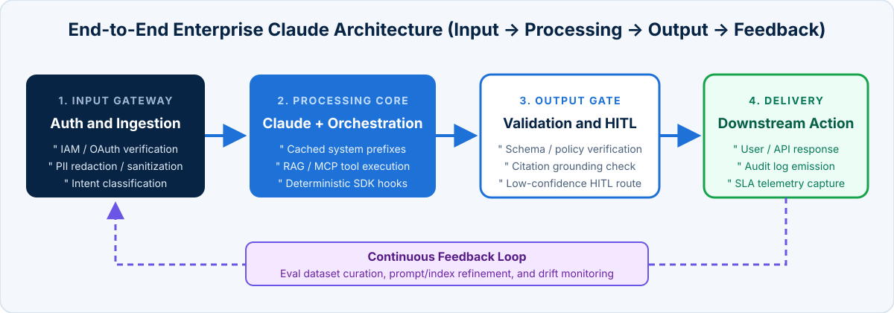

<!-- course-title: Claude Certified Architect - Professional: Hands-On Exam Prep Workshop -->
<!-- course-theme: roi-alt-theme -->

<!-- layout: title -->


Claude Certified Architect - Professional: Hands-On Exam Prep Workshop

# Chapter 2: Solution Design and Architecture

---

# Chapter 2: Objectives

- Translate business problems into end-to-end Claude architectures
- Select between Augmented LLMs, Workflows, and Agents
- Design multi-agent orchestration and decomposition patterns
- Align architectures to business value pillars and SLAs

---

# Domain 1: Solution Design and Architecture

| Task # | Task Statement |
| :--- | :--- |
| **1.1** | Translate business problems into Claude-based AI solutions |
| **1.2** | Design end-to-end architectures (input, processing, output, and feedback loops) |
| **1.3** | Select appropriate architectural patterns (workflow, agentic, augmented LLM) |
| **1.4** | Design multi-agent systems and orchestration strategies |
| **1.5** | Apply decomposition techniques for complex problem solving |
| **1.6** | Align solutions to business value pillars (efficiency, transformation, productivity, cost, performance SLAs) |

---

<!-- layout: navigation -->
# Chapter 2

- **End-to-End Architectures**
- Architectural Patterns
- Multi-Agent Orchestration
- Business Value Alignment

---

<!-- layout: stacked -->
# Designing End-to-End Claude Architectures

- **Four architectural stages**: every production AI solution requires structured **Input Ingestion**, **Contextual Processing**, **Output Validation**, and **Feedback Loops**
- **Decouple state from reasoning**: keep session state, auth enforcement, and retry counters in deterministic application code rather than inside the LLM prompt
- **Design feedback loops from day one**: capture user corrections, human-in-the-loop (HITL) overrides, and validation failures to continuously expand your evaluation dataset



---

<!-- layout: 2-column -->
# Translating Business Problems into AI System Boundaries

### What Belongs in Deterministic Code
- Authentication, RBAC/ABAC authorization, and tenant isolation
- Exact financial arithmetic, tax/fee calculations, and hard policy thresholds
- Database transactions, idempotency keys, and audit trail persistence
- Workflow state machines when the step sequence is fixed by regulation

### What Belongs in Claude Reasoning
- Unstructured document comprehension and cross-source synthesis
- Ambiguous intent classification and multi-concern decomposition
- Dynamic tool selection when investigation paths depend on live findings
- Natural language generation, code refactoring, and contextual explanations

<!-- below-columns -->

> [!IMPORTANT]
> Architectural Golden Rule: Start with the simplest, most deterministic architecture that meets the business goal, and add agentic autonomy only where task variability demands it.

---

<!-- layout: navigation -->
# Chapter 2

- End-to-End Architectures
- **Architectural Patterns**
- Multi-Agent Orchestration
- Business Value Alignment

---

<!-- layout: 3-column -->
# Selecting the Right Architectural Pattern

### 1. Augmented LLM
- Single Claude call enhanced with retrieved context (RAG), scoped tools, and structured output schemas
- Lowest latency, lowest token cost, and easiest predictability to test
- **Best for**: Q and A over docs, single-step data extraction, and ticket classification

### 2. Workflow (Code-Driven)
- LLMs and tools orchestrated through **predefined code paths** (prompt chaining, routing, parallel execution)
- High predictability, bounded cost, and explicit quality gates between steps
- **Best for**: multi-stage document pipelines, regulated onboarding, and multi-pass PR reviews

### 3. Autonomous Agent
- Claude dynamically directs its own control flow, tool selection, and iteration count (`stop_reason` loop)
- Highest flexibility for open-ended problems, but higher latency, cost variance, and compounding error risk
- **Best for**: open-ended codebase debugging, complex research, and ambiguous support resolution

---

<!-- layout: card-layout -->
# Four Decomposition Patterns for Complex Problems

### Prompt Chaining (Sequential)
- Decompose a task into fixed sequential subtasks where each step’s output feeds the next step.
- Insert programmatic validation checks between steps to catch errors before they cascade.

### Routing (Classification + Dispatch)
- Classify an incoming request (often with a fast model like Claude Haiku) and route it to a specialized prompt, toolset, or model tier.
- Prevents prompt bloat from trying to handle 10 unrelated intents in one monolithic prompt.

### Parallelization (Sectioning and Voting)
- **Sectioning**: split independent subtasks (such as reviewing 10 files or checking content guardrails alongside main generation) to run concurrently.
- **Voting**: run multiple independent passes on high-stakes security reviews to aggregate findings.

### Evaluator-Optimizer Loop
- One Claude instance generates an artifact while a second independent evaluator instance critiques it against explicit rubric criteria until quality thresholds pass.

---

<!-- layout: navigation -->
# Chapter 2

- End-to-End Architectures
- Architectural Patterns
- **Multi-Agent Orchestration**
- Business Value Alignment

---

<!-- layout: 2-column -->
# Multi-Agent Topologies and Trade-Offs

### Orchestrator-Workers (Hub-and-Spoke)
- Central coordinator dynamically decomposes unpredictable tasks, delegates to specialized workers, and synthesizes results
- Workers operate with **isolated context windows** and scoped tools (4 to 5 tools per role)
- All inter-agent communication and error recovery flow through the coordinator for unified observability

### Hierarchical and Handoff Topologies
- **Hierarchical**: domain supervisors manage sub-teams when a system spans dozens of distinct enterprise domains
- **Handoff pipeline**: triage agent transfers session ownership and a structured state summary to a specialist agent
- **Watch out**: every extra hop increases p95 latency and token overhead; flatten hierarchies unless tool or context isolation requires them

---

# Designing Multi-Agent Context Contracts

- **Explicit context contracts**: define strict JSON/Pydantic input and output schemas between the coordinator and every worker subagent
- **Contain blast radius**: enforce per-subagent token budgets, timeouts, and local retry policies so a slow worker never stalls the entire request

```python
class SubagentTaskContract(BaseModel):
    task_id: str
    research_goal: str
    verified_facts_context: list[str]
    max_tokens_budget: int = 4096
    timeout_seconds: float = 15.0

class SubagentResultContract(BaseModel):
    task_id: str
    status: Literal["success", "partial_failure", "failed"]
    claims_with_citations: list[ClaimCitation]
    coverage_gaps: list[str]
```

---

<!-- layout: navigation -->
# Chapter 2

- End-to-End Architectures
- Architectural Patterns
- Multi-Agent Orchestration
- **Business Value Alignment**

---

<!-- layout: card-layout -->
# Aligning Architecture to Business Value Pillars

### Operational Efficiency and Cost
- Reduce cost per transaction through prompt caching, Message Batches API (50% discount for async jobs), and tiered model routing.
- Measure **cost per successful resolution**, not raw cost per 1,000 tokens.

### Workforce Productivity
- Accelerate engineering, legal, and analyst workflows by automating repetitive synthesis and first-draft generation while keeping humans in the decision seat.

### Business Transformation
- Enable capabilities that were previously impossible at scale, such as 100% contract clause auditing or real-time multilingual support synthesis.

### Performance and Reliability SLAs
- Match architectural patterns to strict latency (p50/p99 TTFT and total duration), throughput, and availability targets.

---

# Mapping SLA Constraints to Architectural Decisions

| SLA / Business Requirement | Architectural Design Choice | Why Alternatives Fail |
| :--- | :--- | :--- |
| **Sub-2-second interactive TTFT with 10K-token policy** | Enable **Prompt Caching** on the static prefix + stream response tokens | Re-processing 10K uncached tokens on every turn violates TTFT budgets |
| **Strict 99.9% compliance on financial refund caps** | **Deterministic PreToolUse hook** / code gate before API execution | System prompts and few-shot examples remain probabilistic |
| **Overnight processing of 50,000 compliance reports** | **Message Batches API** with `custom_id` tracking and chunked retries | Synchronous real-time calls cost 2x more and hit rate-limit contention |
| **Complex multi-domain research under a 15-second SLA** | **Parallel subagent execution** (emit multiple `Task` calls in one turn) | Sequential subagent turns multiply end-to-end latency |

---

# Domain 1 Quiz: Solution Design and Architecture

- [Open Quiz](https://claude-certification-exam-prep-1077635956541.us-east4.run.app/questions?file=public/2026-10-31-11-44-ccar-p-realistic-instructor.json)

---

# Lab 1: Designing a Multi-Agent Architecture

**Time:** 45 minutes

- [Open Lab](https://labv.roitraining.com/?lab=https://github.com/roitraining/claude-exam-cert-prep-courses/tree/main/claude-certified-architect-professional-exam-prep-workshop/labs/lab-01-designing-a-multi-agent-architecture)

---

<!-- layout: 2-column -->
# What You Learned

### Architecture and Patterns
- Translated business problems into end-to-end Claude architectures
- Selected between Augmented LLMs, Workflows, and Agents

### Orchestration and Value
- Designed multi-agent orchestration and decomposition patterns
- Aligned architectures to business value pillars and SLAs

---

<!-- layout: stacked -->
# Questions and Answers


