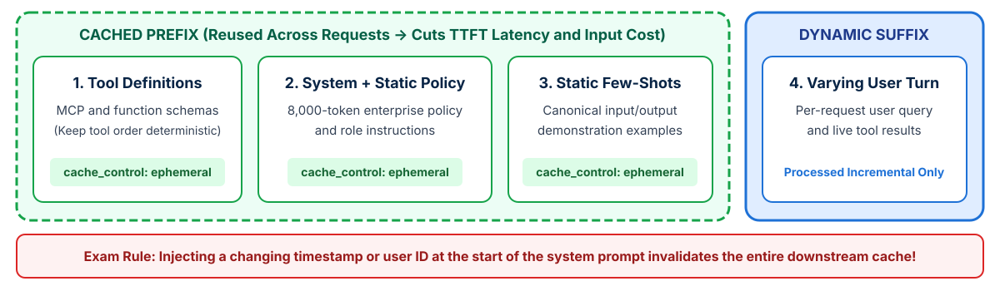

<!-- course-title: Claude Certified Architect - Professional: Hands-On Exam Prep Workshop -->
<!-- course-theme: roi-alt-theme -->

<!-- layout: title -->


Claude Certified Architect - Professional: Hands-On Exam Prep Workshop

# Chapter 3: Claude Models, Prompting, and Context Engineering

---

# Chapter 3: Objectives

- Select Claude models and tiered routing strategies
- Design modular system prompts with XML trust boundaries
- Apply zero-shot, few-shot, and extended thinking techniques
- Optimize context windows with Prompt Caching and Skills

---

# Domain 2: Claude Models, Prompting, and Context Engineering

| Task # | Task Statement |
| :--- | :--- |
| **2.1** | Select appropriate Claude models based on trade-offs |
| **2.2** | Design system prompts, templates, and guardrails |
| **2.3** | Apply prompt engineering techniques (zero-shot, few-shot, chain-of-thought) |
| **2.4** | Optimize context windows and manage token usage |
| **2.5** | Implement prompt reuse strategies (caching, modular prompts, Skills) |

---

<!-- layout: navigation -->
# Chapter 3

- **Model Selection**
- System Prompts and Techniques
- Context Optimization and Caching

---

<!-- layout: 3-column -->
# Selecting Across the Claude Model Family

### Claude Opus
- Highest reasoning depth for ambiguous, multi-constraint architectural and research problems
- Ideal as a complex orchestrator, deep code/security auditor, or legal/financial synthesis engine
- Higher latency and per-token cost: reserve for high-complexity reasoning turns

### Claude Sonnet
- Balanced enterprise workhorse combining strong intelligence, tool-use reliability, and fast throughput
- Default choice for production customer-facing agents, code generation, RAG synthesis, and multi-turn workflows
- Best quality-to-latency ratio for most production workloads

### Claude Haiku
- Ultra-low latency and lowest cost per token
- Ideal for high-volume intent routing, input/output guardrail screening, simple entity extraction, and real-time classification
- Not suited for deep multi-hop reasoning or subtle policy disambiguation

---

<!-- layout: 2-column -->
# Tiered Model Routing and Extended Thinking

### Tiered Routing Cascades
- Route incoming traffic through **Claude Haiku** first for intent classification, PII/injection screening, and simple FAQ resolution
- Dispatch standard multi-tool workflows to **Claude Sonnet**
- Escalate only ambiguous multi-document synthesis or architectural planning turns to **Claude Opus**
- Achieves low p50 latency and low blended cost without sacrificing accuracy on hard cases

### Extended Thinking Trade-Offs
- Enables Claude to allocate internal reasoning tokens before emitting its final response or tool call
- Significantly improves accuracy on complex math, multi-step code refactoring, and conflicting policy reconciliation
- **Trade-off**: increases time-to-first-token (TTFT) and output token billing; disable or lower thinking budgets on simple latency-sensitive lookups

<!-- below-columns -->

> [!WARNING]
> Exam Trap: Never blindly downsize to the smallest model regardless of task fit to save money, and never use the largest model with max thinking for trivial classification tasks.

---

<!-- layout: navigation -->
# Chapter 3

- Model Selection
- **System Prompts and Techniques**
- Context Optimization and Caching

---

<!-- layout: card-layout -->
# Designing Production System Prompts and Templates

### Clear Role and Behavioral Guardrails
- Define the agent’s role, domain boundaries, allowed actions, and explicit refusal/escalation rules in the `system` parameter.
- Specify negative constraints alongside positive actions (for example, “Never extrapolate policy rules not explicitly present in `<policy_document>`”).

### XML Structural Delimiters
- Use distinct XML tags (`<policy_document>`, `<customer_context>`, `<untrusted_user_input>`, `<retrieved_chunks>`) to separate trusted instructions from untrusted external content.
- Prevents indirect prompt injection inside retrieved documents from overriding system directives.

### Modular Prompt Templates
- Version-control prompt templates with typed variable slots rather than concatenating ad-hoc strings in application code.
- Enables independent A/B evaluation and clean rollback when a prompt edit causes a regression.

---

<!-- layout: 3-column -->
# Matching Prompting Techniques to Task Needs

### Zero-Shot Prompting
- Direct instructions with explicit criteria and output schema, without demonstration examples
- Lowest token overhead
- **Use when**: the task is well-defined and structured output schemas (`tool_use`) already constrain the format

### Few-Shot Prompting
- Includes 2 to 4 canonical input/output examples demonstrating edge-case judgment and target formatting
- **Use when**: zero-shot output formatting is inconsistent, or the model needs calibrated examples for ambiguous boundary decisions

### Chain-of-Thought / Thinking
- Instructs the model to reason step-by-step (via `<thinking>` tags or native extended thinking) before producing the final answer
- **Use when**: solving multi-constraint logic, reconciling conflicting sources, or auditing complex code paths

---

<!-- layout: navigation -->
# Chapter 3

- Model Selection
- System Prompts and Techniques
- **Context Optimization and Caching**

---

<!-- layout: stacked -->
# Ordering Prefixes for Prompt Caching

- **How Prompt Caching works**: Claude caches identical request prefixes across calls (`tools` -> `system` -> early `messages`) when marked with `cache_control`
- **Solves both latency and cost**: when an app sends the same 8,000-token system prompt and policy document on every turn, placing static content **first** and enabling prompt caching slashes both TTFT latency and per-request input token cost
- **Prefix stability rule**: any dynamic text (such as `current_timestamp` or `request_uuid`) placed at the top of the system prompt breaks the prefix match and invalidates the cache



---

# Implementing Prompt Caching Breakpoints

- **Keep static blocks at the front** and place dynamic user turns at the end of the payload:

```python
response = client.messages.create(
    model="claude-sonnet-4-20250514",
    max_tokens=1024,
    tools=STATIC_MCP_TOOLS,
    system=[
        {
            "type": "text",
            "text": ENTERPRISE_SYSTEM_INSTRUCTIONS,
        },
        {
            "type": "text",
            "text": f"<policy_document>{EIGHT_THOUSAND_TOKEN_POLICY}</policy_document>",
            "cache_control": {"type": "ephemeral"},
        },
    ],
    messages=[
        {"role": "user", "content": dynamic_user_message}
    ],
)
```

---

<!-- layout: 2-column -->
# Prompt Reuse Strategies and Context Optimization

### Three Prompt Reuse Mechanisms
- **Prompt Caching**: reuses identical static prefixes in memory across API calls to cut latency and token cost
- **Modular Prompt Registries**: shares versioned, parameterized system prompt components across microservices
- **Claude Skills (`SKILL.md`)**: packages reusable, on-demand domain instructions and tool restrictions that load only when invoked

### Context Window Optimization
- **Avoid context truncation traps**: truncating an 8,000-token policy document to 1,000 tokens loses critical rules; cache it or retrieve relevant sections instead
- **Prune verbose tool outputs**: strip unneeded JSON fields before appending `tool_result` blocks to conversation history
- **Compaction and persistent facts**: summarize older conversational turns while keeping exact IDs, dates, and amounts in a persistent facts block

---

# Domain 2 Quiz: Claude Models, Prompting, and Context Engineering

- Open the Exam Prep Program to complete the Domain 2 review questions

<!-- TODO: Add Exam Prep Program URL for Domain 2 Quiz -->

---

# What You Learned

- Selected Claude models and tiered routing strategies
- Designed modular system prompts with XML trust boundaries
- Applied zero-shot, few-shot, and extended thinking techniques
- Optimized context windows with Prompt Caching and Skills

---

<!-- layout: stacked -->
# Questions and Answers


