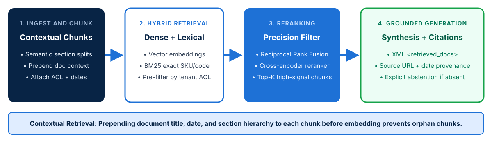

<!-- course-title: Claude Certified Architect - Professional: Hands-On Exam Prep Workshop -->
<!-- course-theme: roi-alt-theme -->

<!-- layout: title -->


Claude Certified Architect - Professional: Hands-On Exam Prep Workshop

# Chapter 4: Integration

---

# Chapter 4: Objectives

- Design RAG pipelines with appropriate chunking, indexing, and retrieval strategies
- Select between MCP, Direct API/CLI, and Agent-to-Agent protocols, and between progressive discovery and monolithic context
- Eliminate capability bloat and close authentication and authorization gaps
- Justify accuracy-latency configuration decisions and design observability at scale

---

# Domain 3: Integration (19% of Exam)

| Task # | Task Statement |
| :--- | :--- |
| **3.1** | Evaluate tool and agent configuration for capability bloat |
| **3.2** | Analyze authentication and authorization requirements to identify security gaps |
| **3.3** | Evaluate accuracy-latency trade-offs and justify configuration decisions |
| **3.4** | Analyze observability challenges and select monitoring strategies at scale |
| **3.5** | Design a RAG pipeline with appropriate chunking and indexing strategies |
| **3.6** | Apply retrieval strategies matched to data shape and query pattern |
| **3.7** | Evaluate connection protocols and select the appropriate integration mechanism (MCP, API/CLI, agent-to-agent) |
| **3.8** | Evaluate progressive discovery vs monolithic context strategy |

---

<!-- layout: navigation -->
# Chapter 4

- **RAG and Retrieval Strategies**
- Connection Protocols
- Tooling and Security
- Latency and Observability

---

<!-- layout: stacked -->
# Designing Enterprise RAG Pipelines

- **Structure-aware and contextual chunking**: split documents along semantic headings or table boundaries rather than arbitrary character counts, and prepend document metadata (title, effective date, section path) to each chunk before indexing
- **Hybrid retrieval**: combine **dense vector embeddings** (for conceptual semantic similarity) with **BM25 lexical search** (for exact product codes, SKUs, error IDs, and legal clauses)
- **Reranking and metadata pre-filtering**: enforce tenant/role ACL filters at query time and rerank top candidates before injecting into Claude’s context window



---

<!-- layout: 2-column -->
# Chunking Trade-Offs

### Small Chunks (about 100 to 300 tokens)
- **Precise matches**: each chunk is about one idea, so similarity scores are sharp
- **Lost context**: “the limit is $5,000” loses which product and which year it applies to
- **Good for**: FAQs, glossaries, short policy clauses, and catalog entries

### Large Chunks (about 800 to 1,500 tokens)
- **Rich context**: the answer and its qualifiers travel together
- **Diluted matches**: one embedding must represent several ideas, so recall drops on narrow questions
- **Good for**: narrative documents, procedures, and contracts where clauses depend on each other

<!-- below-columns -->

> [!TIP]
> Chunk by structure first (headings, sections, table rows), then tune size and overlap with a retrieval evaluation. A 10 to 20% overlap keeps a sentence that crosses a boundary findable from both sides.

---

# Contextual Retrieval: Give Every Chunk Its Missing Context

- **The problem**: a chunk that says “Revenue grew 3% over the prior quarter” does not say which company or which quarter, so neither embeddings nor BM25 can match it to the question
- **The technique**: before indexing, have Claude write one or two sentences that place each chunk within its document, and prepend them to the chunk for both the embedding and the BM25 index
- **Make it affordable**: the full document is the same for every chunk, so prompt caching cuts the cost of generating the context
- **The payoff**: Anthropic reported that contextual embeddings plus contextual BM25 cut failed retrievals by about half, and by about two-thirds when combined with reranking

```text
Original chunk:  "Revenue grew 3% over the prior quarter."
Indexed chunk:   "From ACME Corp's Q2 2026 10-Q, section on financial results.
                  Revenue grew 3% over the prior quarter."
```

---

<!-- layout: card-layout -->
# Indexing Lifecycle: Embedding Versions and Safe Refreshes

### Version the Embedding Model
- Store the embedding model and version with every vector.
- Queries embedded with a new model cannot be compared with documents embedded by an old one: change the model, re-embed everything.

### Refresh with Blue/Green Indexes
- Build the refreshed index beside the live one, run the retrieval evaluation against it, and switch traffic only when it passes.
- Keep the previous index for instant rollback.

### Prefer Incremental Updates
- Re-index only changed documents, using content hashes to detect changes.
- Remove superseded versions so stale policy chunks cannot outrank current ones.

### Support Deletion
- Index by document ID so you can delete every chunk of a document on request.
- This is how a RAG system honors retention rules and data-subject erasure requests.

---

<!-- layout: card-layout -->
# Matching Retrieval Strategy to Data Shape and Query Pattern

### Dense Vector Retrieval
- Best for natural language conceptual queries where users phrase ideas differently from the source document.
- Struggles on exact alphanumeric identifiers (such as `ERR-4092-B` or part numbers) unless paired with lexical search.

### Lexical / Keyword Search (BM25)
- Excels at exact phrase matching, legal citations, function names, and regulatory article numbers.
- Combine with vector search via Reciprocal Rank Fusion (RRF) for resilient hybrid retrieval.

### Metadata and Structured Filtering
- Filter by `tenant_id`, `department`, `effective_date`, or `document_status == "active"` **before** or **during** vector search.
- Prevents stale or unauthorized documents from ever entering the top-K context window.

### Relational / Graph Lookup
- When queries require exact aggregations, joins, or multi-hop entity relationships, expose a parameterized SQL or graph tool rather than relying on text chunk similarity.

---

# Query Pattern to Retrieval Strategy

| Query Pattern | Example | Retrieval Strategy | Why Others Fail |
| :--- | :--- | :--- | :--- |
| **Exact identifier** | “What does error ERR-4092-B mean?” | BM25 or a structured lookup | Embeddings blur alphanumeric codes |
| **Conceptual** | “How do I recover a stalled replication node?” | Dense vectors, hybrid with BM25 | Keywords miss paraphrases |
| **Aggregation** | “How many P1 incidents did EMEA have in Q3?” | A parameterized SQL tool | Chunks cannot count or join |
| **Multi-hop** | “Which suppliers of our top 3 products failed audits?” | Iterative or agentic retrieval across steps | One query cannot see the second hop |
| **Recency or permission bound** | “What is the current travel policy for my division?” | Metadata filter, then search | Similarity ranks old and unauthorized versions too |
| **Source code** | “Where do we validate refund amounts?” | Agentic search with grep and file reads | Embeddings of code fragments lose structure |

---

<!-- layout: 2-column -->
# Progressive Discovery vs Monolithic Context Strategy

### Monolithic Context Strategy
- Loads the entire knowledge corpus or policy manual directly into the prompt prefix (paired with **Prompt Caching**)
- **Use when**: the corpus is relatively small (such as an 8,000 to 50,000 token policy guide), changes infrequently, and is needed on nearly every request
- Eliminates retrieval miss risk completely

### Progressive Discovery Strategy
- Starts with lightweight catalog metadata (such as MCP resources, table of contents, or high-level summaries) and retrieves detailed chunks or invokes tools on demand
- **Use when**: the knowledge base spans millions of documents, changes frequently, or each user query touches only a tiny fraction of the corpus
- Prevents context window bloat and attention dilution

---

# Progressive Discovery Beyond RAG

| Mechanism | What Loads Up Front | What Loads on Demand | Use It For |
| :--- | :--- | :--- | :--- |
| **RAG retrieval** | Nothing, or a short catalog | Top-K chunks per question | Large, changing document collections |
| **Tool search** | The search tool and a few core tools | Tool definitions matching the task | Hundreds of tools across many MCP servers |
| **Skills** | Each Skill’s name and description | The Skill’s instructions and files | Many procedures, each rarely needed |
| **MCP resources** | A list of resource names | The resource contents the agent selects | Reference data the agent browses |
| **Agentic file search** | A directory listing | Files found with search and read tools | Codebases and file shares |

- **Decision factors**: corpus size, how often it changes, what fraction each request needs, whether the static part can be cached, and how much latency an extra lookup step adds

---

<!-- layout: navigation -->
# Chapter 4

- RAG and Retrieval Strategies
- **Connection Protocols**
- Tooling and Security
- Latency and Observability

---

<!-- layout: 3-column -->
# Selecting Enterprise Connection Protocols

### Model Context Protocol (MCP)
- Open client-server protocol connecting an agent to **tools**, **resources**, and **prompts**
- **Best when**: the same capabilities must be reused across multiple Claude applications, Claude Code, and agent workflows while maintained independently
- Decouples tool implementation from agent orchestration

### Direct API / CLI Integration
- Point-to-point REST or gRPC calls wrapped as function tools, or command-line tools the agent runs through a shell
- **Best when**: one application needs tightly coupled, low-latency access to one service, or a well-known CLI (`git`, `gh`, a cloud CLI) already does the job
- A known CLI often costs fewer context tokens than a large MCP tool catalog

### Agent-to-Agent (A2A)
- Open protocol for agents built by different teams or vendors to discover each other (agent cards) and delegate tasks with a defined lifecycle
- **Best when**: a workflow crosses organizational or platform boundaries and each agent is owned and operated independently
- Not the same as subagents inside one application, which are in-process delegation

---

# Protocol Decision Table

| Scenario | Choose | Why Other Options Fail |
| :--- | :--- | :--- |
| **4 internal apps and Claude Code users all need Jira and ServiceNow actions** | **MCP server** maintained once | Direct API wrappers get duplicated in every app; A2A adds an agent where only tools are needed |
| **One payment service calls a fraud-scoring endpoint with a 15 ms budget** | **Direct API** call as a function tool | An MCP hop adds overhead and a server to operate for a single consumer |
| **CI pipeline must review every pull request** | **CLI**: `claude -p` in the pipeline | An interactive session hangs; a custom agent service is over-engineering |
| **Procurement’s agent must hand a vendor review to a partner company’s compliance agent** | **A2A** task delegation | MCP exposes tools, not an independently operated agent; a shared database breaks the partner’s ownership boundary |
| **One app’s coordinator splits a research task into 5 parallel workers** | **Subagents** in the same application | A2A’s discovery and remote task lifecycle add latency with no ownership boundary to cross |

> [!TIP]
> MCP connects an agent to tools and data. A2A connects an agent to another agent. Direct API and CLI calls connect one application to one service with the least machinery.

---

<!-- layout: 2-column -->
# MCP in Practice: Local and Remote Servers

### Local Servers (stdio)
- Run as a process on the same machine as the client, such as a developer’s laptop running Claude Code
- Configured per project in `.mcp.json`, with secrets expanded from environment variables
- Inherit the local user’s permissions, so scope them to development use

### Remote Servers (Streamable HTTP)
- Run as a shared service that many clients and users connect to over HTTPS
- Require real authentication and authorization (next section), plus rate limits and monitoring
- Claude API requests can connect to remote MCP servers directly through the MCP connector, without writing a client

<!-- below-columns -->

> [!NOTE]
> Choosing remote MCP turns a tool into a production service. It now needs an owner, an SLA, versioning, and security review, just like any other API.

---

<!-- layout: navigation -->
# Chapter 4

- RAG and Retrieval Strategies
- Connection Protocols
- **Tooling and Security**
- Latency and Observability

---

<!-- layout: 2-column -->
# Tool Definitions Cost Tokens on Every Request

### The Hidden Cost of Capability Bloat
- Every attached tool’s name, description, and schema is sent with every request
- Connecting several MCP servers can load tens of thousands of tokens of tool definitions before the user says a word
- More tools also means more similar descriptions to choose between, so tool selection errors rise

### The Fixes, in Order
- **Remove what the role never uses**: the least-privilege fix is also the cheapest
- **Split by role**: give each subagent or route only its 4 to 5 tools
- **Use tool search when the catalog must stay large**: mark tools with `defer_loading: true` so Claude searches for and loads only the definitions a task needs

---

# Demo: What 40 Tools Cost Before Claude Says a Word

In `ccarp-labs`, with the virtual environment still active:

**Step 1. Create `demo_05_tool_tokens.py`**

**Step 2. Paste this code**

```python
# demo_05_tool_tokens.py - every attached tool costs input tokens on every request
from dotenv import load_dotenv
import anthropic

load_dotenv()
client = anthropic.Anthropic()

def tool(name, description):
    return {
        "name": name,
        "description": description,
        "input_schema": {
            "type": "object",
            "properties": {
                "record_id": {"type": "string", "description": "The record ID, such as CUST-1001 or ORD-1001."},
                "reason": {"type": "string", "description": "Why the agent is taking this action, for the audit log."},
            },
            "required": ["record_id"],
        },
    }

NEEDED = [
    tool("read_ticket", "Read one support ticket by ID, including its full history."),
    tool("draft_reply", "Draft a reply to a ticket for a human agent to review."),
    tool("lookup_order", "Look up one order by ID: items, status, and shipping."),
    tool("search_kb", "Search the help-center knowledge base for relevant articles."),
]
AREAS = ["billing", "shipping", "accounts", "inventory", "returns", "loyalty", "fraud", "tax", "warranty"]
VERBS = ["get", "update", "delete", "export"]
UNUSED = [tool(f"{verb}_{area}_record", f"{verb.capitalize()} one {area} record by ID in the {area} system.")
          for area in AREAS for verb in VERBS]  # 36 tools this support role never needs

messages = [{"role": "user", "content": "Where is order ORD-1001?"}]

def count(tools):
    return client.messages.count_tokens(model="claude-sonnet-5-5", tools=tools, messages=messages).input_tokens

small = count(NEEDED)
large = count(NEEDED + UNUSED)
extra = large - small
print(f"4 tools:  {small:6} input tokens")
print(f"40 tools: {large:6} input tokens")
print(f"Extra per request: {extra} tokens")
print(f"At 1M requests per month on Sonnet ($2 / MTok): ${extra * 2:,.0f} per month")
```

**Step 3. Run it**

```bash
python demo_05_tool_tokens.py
```

**Step 4. Examine the output**

- The 40-tool request costs thousands of extra input tokens, though the question is identical
- The monthly line shows what those unused tools cost at scale
- Token counting is free, so this demo costs nothing to run

> [!NOTE]
> These tools have one-line descriptions. Real MCP tools carry longer descriptions and schemas, so production catalogs cost far more. Removing unused tools cuts risk, cost, and tool-selection errors at the same time.

---

<!-- layout: 2-column -->
# Eliminating Capability Bloat with Least Privilege

### The Capability Bloat Anti-Pattern
- A customer-support agent is configured with `read_ticket`, `draft_reply`, `issue_refund`, and `delete_user_account`
- Support staff using this agent only ever need to read tickets and draft replies
- Leaving `issue_refund` and `delete_user_account` attached creates severe prompt-injection and accidental-execution risk

### The Least-Privilege Fix (Exam Standard)
- **Remove `issue_refund` and `delete_user_account` from the agent’s configuration entirely**
- **Why other options fail on the exam**:
  - Adding audit logging is only a *detective* control after damage occurs
  - Adding a confirmation prompt is a *compensating* control that still leaves the capability exposed
  - Switching to a larger model does not reduce authorization scope

<!-- below-columns -->

> [!IMPORTANT]
> CCAR-P Exam Rule: Least privilege means **removing capabilities the role does not require** to eliminate the attack surface, plus keeping per-agent tool counts small (4 to 5 tools) to avoid capability bloat.

---

# Authentication, Authorization, and Identity Propagation

- **Prevent the “Confused Deputy” vulnerability**: never execute backend tools using a single shared superuser service account when acting on behalf of an end user
- **Propagate caller identity**: pass short-lived, user-scoped OAuth/JWT tokens or verified user claims to the tool execution layer so backend RBAC/ABAC policies enforce row-level security
- **Minimize scopes**: grant each tool the narrowest scope it needs (`tickets:read`, not `admin:*`), and isolate tenants at the data layer, not in the prompt
- **Environment-scoped secrets**: inject credentials via environment variables (such as `${SERVICE_TOKEN}` in `.mcp.json`) or secret managers; never pass raw API keys inside LLM prompts or tool arguments

---

<!-- layout: 2-column -->
# Securing Remote MCP Servers

### Authorization Requirements
- Remote MCP servers use **OAuth 2.1** authorization: the client obtains a token for the user, and the server validates it on every request
- **Validate the audience**: a server accepts only tokens issued for it, not tokens minted for some other service
- **No token passthrough**: the server must not forward the client’s token to upstream APIs; it obtains its own scoped credentials for those calls

### Operational Controls
- **Allowlist servers**: approve which MCP servers teams may connect to, and pin versions
- **Review tool descriptions**: a malicious or compromised server can hide instructions in its tool descriptions or results
- **Log every tool call** with user identity, arguments, and result status, so security can reconstruct who did what

<!-- below-columns -->

> [!WARNING]
> Treat every third-party MCP server as untrusted code with access to your agent. Least privilege applies to servers as well as to tools.

---

# Demo: Find the Security Gaps

Read this agent configuration for an internal HR assistant that answers employees’ questions about their own leave balances and benefits. List every security gap you can find and the preventive fix for each.

```json
{
  "agent": "hr-benefits-assistant",
  "tools": ["get_leave_balance", "get_benefits_summary", "update_salary", "search_hr_policies"],
  "mcp_servers": {
    "hris": {
      "url": "https://hris-mcp.internal.example.com",
      "auth": { "mode": "service_account", "account": "hris-admin", "scopes": ["hris:*"] },
      "headers": { "Authorization": "Bearer sk-live-7f3a9c2e" }
    }
  },
  "employee_id_source": "Ask the user for their employee ID at the start of the chat"
}
```

---

<!-- layout: 2-column -->
# Demo Debrief: Find the Security Gaps

### The Gaps and Fixes
- **`update_salary` attached**: the role only reads; remove the tool
- **Shared admin service account**: every employee acts as `hris-admin`; propagate the user’s own identity
- **Wildcard scope `hris:*`**: scope to `leave:read` and `benefits:read`
- **Hard-coded bearer key**: move it to a secret manager and rotate the exposed key now
- **Self-reported employee ID**: anyone can type a colleague’s ID; take identity from the authenticated session

### Exam Takeaway
- Authorization questions are about **whose authority** a tool call runs under
- The fix is almost always structural: remove, scope down, or bind to the authenticated user
- “Add a system prompt rule telling the agent to only look up the user’s own data” is the classic wrong answer

---

<!-- layout: navigation -->
# Chapter 4

- RAG and Retrieval Strategies
- Connection Protocols
- Tooling and Security
- **Latency and Observability**

---

<!-- layout: card-layout -->
# Balancing Accuracy-Latency Trade-Offs

### Parallel Tool and Subagent Calls
- Emit independent tool calls and subagent delegations in a single turn so network I/O executes concurrently rather than sequentially.

### Retrieval Depth vs Context Latency
- Fetching top-50 chunks increases input token count, time-to-first-token (TTFT), and “lost in the middle” noise.
- Retrieve top-25 fast, then apply a compact cross-encoder reranker to pass only the top-5 highest-signal chunks to Claude.

### Streaming and Speculative Execution
- Stream responses to users to minimize perceived latency while running fast input guardrails in parallel with initial context retrieval.

---

# Justifying Configuration Decisions

| Setting | Raising It Improves | Raising It Costs | Justify It With |
| :--- | :--- | :--- | :--- |
| **Retrieval top-K** | Recall on broad questions | Input tokens, TTFT, and noise | Retrieval recall at K on your eval set |
| **Reranker** | Precision of the chunks Claude sees | 50 to 300 ms per request | Answer accuracy with and without it |
| **Model tier** | Quality on hard, multi-step cases | Price and latency | Accuracy on the hard slice of the eval set |
| **Effort** | Reasoning depth and thoroughness | Output tokens and time to the final answer | Quality gain per added second and dollar |
| **Streaming** | Perceived latency | Client complexity; output must be checked after it completes | TTFT and user-satisfaction measures |

> [!IMPORTANT]
> A configuration decision is justified by measurement on an evaluation set, stated as a trade-off: “Adding the reranker raised accuracy from 84% to 91% for 120 ms at p95, within our 2-second SLA.”

---

# Observability and Monitoring Strategies at Scale

- **Distributed tracing across agent turns**: assign a correlation `trace_id` to every user request and record child spans for every retrieval query, prompt cache check, model call, hook execution, and MCP tool invocation
- **Key production metrics to monitor**:
  - **Latency breakdown**: TTFT, tokens per second, tool execution duration, and total multi-turn wall-clock time
  - **Token and cache efficiency**: `cache_read_input_tokens` vs `cache_creation_input_tokens` hit rates
  - **Tool health**: `isError` rates segmented by the error category your tools return (transient, validation, business, permission)
  - **Quality signals**: escalation rate, user thumbs-down rate, and retrieval similarity score drop-offs

---

<!-- layout: card-layout -->
# Observability at Scale: Sampling, Privacy, and Cost

### Sample Deliberately
- At millions of requests, full prompts and responses for every request cost more than the model calls.
- Keep metrics for 100% of traffic, and full traces for every error, slow request, and escalation, plus a random sample of the rest.

### Redact Before You Store
- Prompts and responses contain the same PII and PHI as your source systems.
- Redact or tokenize sensitive fields before logging, and apply the same retention limits as the source data.

### Use Standard Telemetry
- Export spans with OpenTelemetry so model calls appear in the same traces as your services.
- Tag every span with tenant, route, model, and prompt version.

### Attribute Cost
- Report spend by tenant, feature, and model from tagged usage data and the provider’s usage and cost reporting.
- Unattributed spend is how one runaway agent loop goes unnoticed for a month.

---

# Worked Exam Question: Exact Codes Go Missing

A manufacturer’s support assistant uses vector-only retrieval over 400,000 service manuals. Users report that conceptual questions work well, but questions containing exact part numbers and error codes (such as `ERR-4092-B`) often return unrelated sections. Latency and model are fine. What is the most effective change?

- **A.** Increase top-K from 10 to 50 so the right chunk is more likely to be included
- **B.** Add BM25 lexical search and fuse its results with the vector results
- **C.** Switch to a more capable model so it can work out the code’s meaning
- **D.** Fine-tune the embedding model on a sample of manuals

---

<!-- layout: 2-column -->
# Worked Exam Question: Reasoning

### Applying the Four Steps
- **Constraint:** exact identifiers must be found; conceptual queries already work
- **Layer:** retrieval: the right chunks never reach the model
- **Eliminate:** A adds noise and latency without matching codes; C cannot reason about chunks it never sees; D is expensive and still weak on arbitrary codes
- **Answer: B.** Hybrid retrieval matches exact tokens and keeps semantic recall

### Why It Matters
- Match the retrieval strategy to the query pattern, not one strategy to every query
- Retrieval problems are not fixed by the model
- “Increase top-K” is the classic distractor: more chunks is not better chunks

---

# Domain 3 Quiz: Integration

- [Open Quiz](https://claude-certification-exam-prep-1077635956541.us-east4.run.app/questions?file=public/2026-10-31-11-48-ccar-p-realistic-instructor.json)

---

# Lab 2: Prompt Engineering and RAG Integration

**Time:** 45 minutes

- [Open Lab](https://labv.roitraining.com/?lab=https://github.com/roitraining/claude-exam-cert-prep-courses/tree/main/claude-certified-architect-professional-exam-prep-workshop/labs/lab-02-prompt-engineering-and-rag-integration)

---

<!-- layout: 2-column -->
# What You Learned

### RAG and Protocols
- Designed RAG pipelines with appropriate chunking, indexing, and retrieval strategies
- Selected between MCP, Direct API/CLI, and Agent-to-Agent protocols, and between progressive discovery and monolithic context

### Security and Operations
- Eliminated capability bloat and closed authentication and authorization gaps
- Justified accuracy-latency configuration decisions and designed observability at scale

---

<!-- layout: stacked -->
# Questions and Answers


