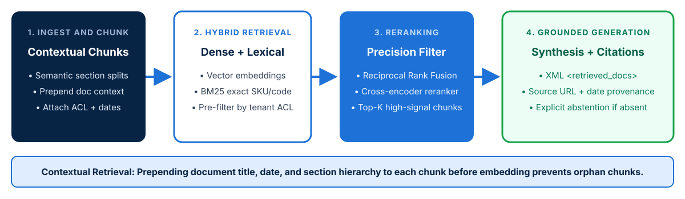

<!-- course-title: Claude Certified Architect - Professional: Hands-On Exam Prep Workshop -->
<!-- course-theme: roi-alt-theme -->

<!-- layout: title -->

Claude Certified Architect - Professional: Hands-On Exam Prep Workshop

# Chapter 4: Integration

---

# Chapter 4: Objectives

- Design RAG pipelines with hybrid retrieval and reranking
- Select between MCP, Direct API/CLI, and Agent-to-Agent protocols
- Eliminate capability bloat using least-privilege principles
- Balance accuracy-latency trade-offs and observability at scale

---

# Domain 3: Integration

| Task # | Task Statement |
| :--- | :--- |
| **3.1** | Evaluate tool and agent configuration for capability bloat |
| **3.2** | Analyze authentication and authorization requirements to identify security gaps |
| **3.3** | Evaluate accuracy-latency trade-offs and justify configuration decisions |
| **3.4** | Analyze observability challenges and select monitoring strategies at scale |
| **3.5** | Design a RAG pipeline with appropriate chunking and indexing strategies |
| **3.6** | Apply retrieval strategies matched to data shape and query pattern |
| **3.7** | Evaluate connection protocols and select the appropriate integration mechanism (MCP, API/CLI, agent-to-agent) |
| **3.8** | Evaluate progressive discovery vs monolithic context strategy |

---

<!-- layout: navigation -->
# Chapter 4

- **RAG and Retrieval Strategies**
- Connection Protocols
- Tooling and Security
- Latency and Observability

---

<!-- layout: stacked -->
# Designing Enterprise RAG Pipelines

- **Structure-aware and contextual chunking**: split documents along semantic headings or table boundaries rather than arbitrary character counts, and prepend document metadata (title, effective date, section path) to each chunk before indexing
- **Hybrid retrieval**: combine **dense vector embeddings** (for conceptual semantic similarity) with **BM25 lexical search** (for exact product codes, SKUs, error IDs, and legal clauses)
- **Reranking and metadata pre-filtering**: enforce tenant/role ACL filters at query time and rerank top candidates before injecting into Claude’s context window

---

<!-- layout: card-layout -->
# Matching Retrieval Strategy to Data Shape and Query Pattern

### Dense Vector Retrieval
- Best for natural language conceptual queries where users phrase ideas differently from the source document.
- Struggle on exact alphanumeric identifiers (such as `ERR-4092-B` or part numbers) unless paired with lexical search.

### Lexical / Keyword Search (BM25)
- Excels at exact phrase matching, legal citations, function names, and regulatory article numbers.
- Combine with vector search via Reciprocal Rank Fusion (RRF) for resilient hybrid retrieval.

### Metadata and Structured Filtering
- Filter by `tenant_id`, `department`, `effective_date`, or `document_status == "active"` **before** or **during** vector search.
- Prevents stale or unauthorized documents from ever entering the top-K context window.

### Relational / Graph Lookup
- When queries require exact aggregations, joins, or multi-hop entity relationships, expose a parameterized SQL or graph tool rather than relying on text chunk similarity.

---

<!-- layout: 2-column -->
# Progressive Discovery vs Monolithic Context Strategy

### Monolithic Context Strategy
- Loads the entire knowledge corpus or policy manual directly into the prompt prefix (paired with **Prompt Caching**)
- **Use when**: the corpus is relatively small (such as an 8,000 to 50,000 token policy guide), changes infrequently, and is needed on nearly every request
- Eliminates retrieval miss risk completely

### Progressive Discovery Strategy
- Starts with lightweight catalog metadata (such as MCP resources, table of contents, or high-level summaries) and retrieves detailed chunks or invokes tools on demand
- **Use when**: the knowledge base spans millions of documents, changes frequently, or each user query touches only a tiny fraction of the corpus
- Prevents context window bloat and attention dilution

---

<!-- layout: navigation -->
# Chapter 4

- RAG and Retrieval Strategies
- **Connection Protocols**
- Tooling and Security
- Latency and Observability

---

<!-- layout: 3-column -->
# Selecting Enterprise Connection Protocols

### Model Context Protocol (MCP)
- Standardized client-server protocol exposing **tools**, **resources**, and **prompts**
- **Best when**: capabilities must be reused across multiple Claude applications, IDEs (Claude Code), and agent workflows while maintained independently
- Decouples tool implementation from agent orchestration

### Direct API / CLI Integration
- Point-to-point REST/gRPC calls wrapped as in-process function tools, or headless CLI invocations (`claude -p`)
- **Best when**: a single application needs ultra-low-latency, tightly coupled access to one internal service or automated CI/CD pipeline execution

### Agent-to-Agent (A2A)
- Autonomous specialist agents communicating via structured task handoffs and coordinator protocols
- **Best when**: complex cross-domain workflows require separate context windows, distinct model tiers, or independent team ownership per specialist agent

---

<!-- layout: navigation -->
# Chapter 4

- RAG and Retrieval Strategies
- Connection Protocols
- **Tooling and Security**
- Latency and Observability

---

<!-- layout: 2-column -->
# Eliminating Capability Bloat with Least Privilege

### The Capability Bloat Anti-Pattern
- A customer-support agent is configured with `read_ticket`, `draft_reply`, `issue_refund`, and `delete_user_account`
- Support staff using this agent only ever need to read tickets and draft replies
- Leaving `issue_refund` and `delete_user_account` attached creates severe prompt-injection and accidental-execution risk

### The Least-Privilege Fix (Exam Standard)
- **Remove `issue_refund` and `delete_user_account` from the agent’s configuration entirely**
- **Why other options fail on the exam**:
  - Adding audit logging is only a *detective* control after damage occurs
  - Adding a confirmation prompt is a *compensating* control that still leaves the capability exposed
  - Switching to a larger model does not reduce authorization scope

<!-- below-columns -->

> [!IMPORTANT]
> CCAR-P Exam Rule: Least privilege means **removing capabilities the role does not require** to eliminate the attack surface, plus keeping per-agent tool counts small (4 to 5 tools) to avoid capability bloat.

---

# Authentication, Authorization, and Identity Propagation

- **Prevent the “Confused Deputy” vulnerability**: never execute backend MCP tools using a single shared superuser service account when acting on behalf of an end user
- **Propagate caller identity**: pass short-lived, user-scoped OAuth/JWT tokens or verified user claims to the tool execution layer so backend RBAC/ABAC policies enforce row-level security
- **Environment-scoped secrets**: inject credentials via environment variables (such as `${SERVICE_TOKEN}` in `.mcp.json`) or secret managers; never pass raw API keys inside LLM prompts or tool arguments

---

<!-- layout: navigation -->
# Chapter 4

- RAG and Retrieval Strategies
- Connection Protocols
- Tooling and Security
- **Latency and Observability**

---

<!-- layout: card-layout -->
# Balancing Accuracy-Latency Trade-Offs

### Parallel Tool and Subagent Calls
- Emit independent tool calls and `Task` delegations in a single turn so network I/O executes concurrently rather than sequentially.

### Retrieval Depth vs Context Latency
- Fetching top-50 chunks increases input token count, time-to-first-token (TTFT), and “lost in the middle” noise.
- Retrieve top-25 fast, then apply a compact cross-encoder reranker to pass only the top-5 highest-signal chunks to Claude.

### Streaming and Speculative Execution
- Stream responses to users to minimize perceived latency while running fast input guardrails in parallel with initial context retrieval.

---

# Observability and Monitoring Strategies at Scale

- **Distributed tracing across agent turns**: assign a correlation `trace_id` to every user request and record child spans for every retrieval query, prompt cache check, model call, hook execution, and MCP tool invocation
- **Key production metrics to monitor**:
  - **Latency breakdown**: TTFT, tokens per second, tool execution duration, and total multi-turn wall-clock time
  - **Token and cache efficiency**: `cache_read_input_tokens` vs `cache_creation_input_tokens` hit rates
  - **Tool health**: MCP `isError` rates segmented by `errorCategory` (transient, validation, business, permission)
  - **Quality signals**: escalation rate, user thumbs-down rate, and retrieval similarity score drop-offs

---

# Domain 3 Quiz: Integration

- Open the Exam Prep Program to complete the Domain 3 review questions

<!-- TODO: Add Exam Prep Program URL for Domain 3 Quiz -->

---

# Lab 2: Prompt Engineering and RAG Integration

**Time:** 45 minutes

---

<!-- layout: 2-column -->
# What You Learned

### RAG and Protocols
- Designed RAG pipelines with hybrid retrieval and reranking
- Selected between MCP, Direct API/CLI, and Agent-to-Agent protocols

### Security and Observability
- Eliminated capability bloat using least-privilege principles
- Balanced accuracy-latency trade-offs and observability at scale

---

<!-- layout: stacked -->
# Questions and Answers

