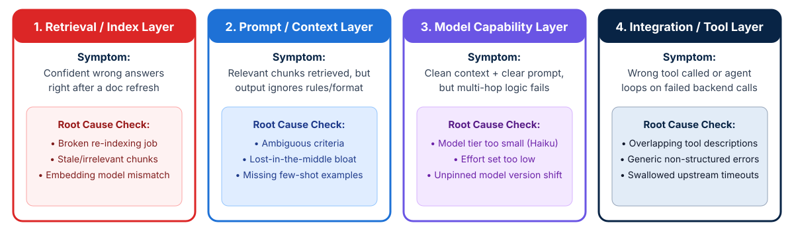

<!-- course-title: Claude Certified Architect - Professional: Hands-On Exam Prep Workshop -->
<!-- course-theme: roi-alt-theme -->

<!-- layout: title -->


Claude Certified Architect - Professional: Hands-On Exam Prep Workshop

# Chapter 5: Evaluation, Testing, and Optimization

---

# Chapter 5: Objectives

- Define accuracy, latency, cost, safety, and security evaluation metrics with measurable thresholds
- Design mixed-methodology evaluation datasets and calibrated graders
- Run A/B tests that account for non-determinism and diagnose regressions across retrieval, prompt, and model layers
- Optimize cost and latency and detect drift using production telemetry

---

# Domain 4: Evaluation, Testing, and Optimization

**Evaluation, Testing, and Optimization** is **16%** of the exam.

| Task # | Task Statement |
| :--- | :--- |
| **4.1** | Define evaluation metrics (accuracy, latency, cost, safety, security) |
| **4.2** | Design evaluation datasets and test frameworks using mixed methodologies |
| **4.3** | Conduct A/B testing and iterative improvements |
| **4.4** | Diagnose system issues (prompt failure, hallucinations, model mismatch) |
| **4.5** | Optimize token usage, latency, and cost-performance trade-offs |
| **4.6** | Monitor system performance using logging and observability tools |

---

<!-- layout: navigation -->
# Chapter 5

- **Evaluation Metrics and Datasets**
- Testing and Diagnostics
- Performance Optimization

---

<!-- layout: card-layout -->
# Five Dimensions of Enterprise AI Evaluation

### 1. Accuracy
- Measure answer correctness, context precision and recall (for RAG), and citation faithfulness (zero unsupported claims).
- Segment by document type, intent, and edge-case tier rather than relying on one aggregate score.

### 2. Latency
- Track time to first token (TTFT) for interactive responsiveness and p50/p95/p99 end-to-end duration across multi-turn agent loops.

### 3. Cost Efficiency
- Measure total cost per successful task completion, including retries, subagent calls, and reranking, not just unit token price.

### 4. Safety
- Measure harmful or policy-violating output rates alongside false-refusal rates on benign requests: an over-cautious system also fails users.

### 5. Security
- Measure resistance to prompt injection, data exfiltration, and tool misuse with an adversarial test suite, including attacks hidden in retrieved documents and tool results.

---

# Turning Dimensions into Measurable Metrics

| Dimension | Metric | How It Is Measured | Example Release Gate |
| :--- | :--- | :--- | :--- |
| **Accuracy** | Field-level extraction accuracy | Code grader against a labeled golden set | At least 97% on critical fields |
| **Faithfulness** | Unsupported-claim rate | Calibrated LLM judge checks each claim against sources | Below 1% |
| **Retrieval** | Recall at K | Labeled question-to-chunk pairs | At least 90% at K = 5 |
| **Latency** | p95 end-to-end time | Load test on production-like traffic | Under 4 seconds |
| **Cost** | Cost per resolved case | Usage logs joined to outcomes | Under $0.08 |
| **Safety** | False-refusal rate | Benign prompts near policy boundaries | Below 2% |
| **Security** | Injection success rate | Adversarial suite, including indirect injection | 0 successful tool actions |

---

<!-- layout: card-layout -->
# Designing Evaluation Datasets

### Source from Reality
- Start with sampled production traffic or historical cases; add SME-written cases for rare but critical scenarios.
- Use Claude to generate synthetic variations, then have experts review them before they count.

### Stratify on Purpose
- Cover every intent, document type, language, and customer segment in proportion to risk, not just volume.
- Deliberately include edge cases, ambiguous inputs, adversarial inputs, and questions with no answer in the sources.

### Separate the Sets
- A **development set** for iterating on prompts, a **held-out test set** that is scored but never tuned against, and a **regression set** of every past production failure.
- Tuning on the test set produces scores that do not survive production.

### Version Everything
- Version datasets, labels, and grader rubrics alongside prompts and model IDs, so any score can be reproduced and compared.

---

<!-- layout: 3-column -->
# Mixed-Methodology Evaluation Frameworks

### Deterministic Code Graders
- Fast, zero-cost, 100% reproducible checks
- JSON Schema / Pydantic validation, exact regex/keyword matches, tool-call sequence assertions, and math verification
- Run on **every commit in CI/CD**

### LLM-as-a-Judge Graders
- Uses a strong model with an explicit rubric and pairwise or 1-to-5 scale criteria to grade tone, faithfulness, and completeness
- **Must be calibrated** against a golden set of human-labeled examples to verify judge alignment

### Human Expert Review
- Domain experts label golden evaluation datasets, audit ambiguous edge cases, and review stratified samples of production traffic
- Provides the ground truth that calibrates automated LLM judges

---

<!-- layout: 2-column -->
# Calibrating LLM-as-a-Judge

### Known Judge Biases
- **Position bias**: in pairwise comparisons, the judge favors whichever answer appears first (or second)
- **Verbosity bias**: longer, more detailed-looking answers score higher regardless of correctness
- **Self-preference**: a judge can favor outputs written in its own style or by the same model
- **Vague rubrics**: “rate quality 1 to 10” produces scores that drift and cannot be reproduced

### Mitigations
- Run pairwise comparisons in both orders and count only consistent wins
- Grade against specific, binary rubric items (“cites a source for every number: yes or no”)
- Ask the judge for its reasoning before its score, and use a different model or prompt than the system under test
- Measure agreement with human labels on 100 or more cases before trusting the judge, and re-check after any rubric change

---

<!-- layout: navigation -->
# Chapter 5

- Evaluation Metrics and Datasets
- **Testing and Diagnostics**
- Performance Optimization

---

<!-- layout: 2-column -->
# Conducting A/B Testing and Iterative Improvements

### Offline Pre-Deployment Eval Gates
- Pin an explicit model ID (such as `claude-sonnet-5-5`) and run your golden dataset benchmark before promoting any prompt, chunking, or tool change
- Block deployment if faithfulness drops or p95 latency breaches the SLA threshold
- Change **one variable at a time** (prompt vs retrieval top-K vs model tier) so attribution is unambiguous

### Online Production Validation
- **Shadow testing**: run the candidate pipeline asynchronously on a copy of live traffic and compare outputs without exposing users
- **Canary and A/B testing**: route 5% to 10% of traffic to the new configuration and compare business KPIs (first-contact resolution, user acceptance rate, escalation rate)

---

<!-- layout: 2-column -->
# A/B Testing a Non-Deterministic System

### Why One Run Proves Nothing
- The same prompt can produce different outputs on different runs, and current models do not accept settings such as `temperature` that would force identical outputs
- A borderline case may pass on one run and fail on the next, so compare **pass rates over several trials**, not single outputs
- Track consistency as its own metric: an answer that flips between runs is a quality problem even if it is sometimes right

### How Many Cases You Need
- At 85% accuracy on **100 cases**, the 95% margin of error is about **plus or minus 7 points**
- On **1,000 cases**, it shrinks to about **plus or minus 2 points**
- So an 85% vs 88% result on 100 cases is noise; the same gap on 1,000 cases is a real improvement

<!-- below-columns -->

> [!TIP]
> When an exam option declares a winner from a handful of examples, or from one run of each prompt, it is a distractor. Look for larger samples, multiple trials, and one variable changed at a time.

---

# Demo: One Answer, Ten Judge Scores

In `ccarp-labs`, with the virtual environment still active:

**Step 1. Create `demo_06_judge_variance.py`**

**Step 2. Paste this code**

```python
# demo_06_judge_variance.py - the same judge, the same answer, ten runs: scores are a distribution
import asyncio
from collections import Counter
from dotenv import load_dotenv
import anthropic

load_dotenv()
client = anthropic.AsyncAnthropic()

JUDGE_PROMPT = (
    "Rate how well this answer addresses the question, from 1 to 10. Reply with the number only.\n\n"
    "Question: How do I reset my password?\n"
    "Answer: You can reset it from the login page. If that does not work, contact IT."
)

async def judge():
    response = await client.messages.create(
        model="claude-haiku-5-5",
        max_tokens=1028,
        output_config={"effort": "low"},
        messages=[{"role": "user", "content": JUDGE_PROMPT}],
    )
    return "".join(b.text for b in response.content if b.type == "text").strip()

async def main():
    scores = await asyncio.gather(*(judge() for _ in range(10)))
    for score, count in sorted(Counter(scores).items()):
        print(f"score {score}: {'#' * count} ({count} of 10)")

asyncio.run(main())
```

**Step 3. Run it two or three times**

```bash
python demo_06_judge_variance.py
```

**Step 4. Examine the output**

- Ten identical requests usually produce more than one score, such as a mix of 6s and 7s
- The mix changes from one run of the script to the next
- A one-point gap between two prompt versions, each judged once, could be nothing but this noise

> [!NOTE]
> A vague 1-to-10 rubric turns a judge into a noisy instrument. Score each case several times, compare averages over many cases, and replace open scales with specific yes-or-no rubric items, which are far more stable.

---

<!-- layout: stacked -->
# Diagnosing System Regressions Across Layers

- **Correlate symptoms with what changed**: when a RAG system suddenly returns confident but wrong answers right after a document refresh (while latency and model version are unchanged), **investigate the retrieval and indexing step first**
- **Why retrieval is the culprit**: broken re-indexing, chunk boundary shifts, or mismatched embeddings feed irrelevant or stale chunks to the model, which then synthesizes confident answers from bad context
- **Separate retrieval evals from generation evals**: measure whether the right chunk appeared in top-K before blaming the prompt or model



---

# Symptom to Root Cause

| Symptom | Most Likely Cause | First Check |
| :--- | :--- | :--- |
| **Confident wrong answers right after a data refresh** | Retrieval: stale chunks, broken re-index, or mismatched embeddings | Is the correct chunk in the top-K for failing questions? |
| **Right chunks retrieved, but rules or format ignored** | Prompt failure: ambiguous criteria, buried instructions, or conflicting rules | Does the prompt state the rule explicitly, near the task, and only once? |
| **Specific facts, numbers, or citations that appear in no source** | Hallucination: missing context and no permission to say “unknown” | Was the fact in the context? Does the prompt allow abstaining? |
| **Correct on easy cases, wrong on multi-step cases** | Model mismatch: tier or effort too low for the hard slice | Does a higher tier or effort fix the hard slice in the eval? |
| **Behavior changed with no prompt or data change** | Model mismatch: the model ID changed through an alias or upgrade | Which model ID served the failing requests? |
| **Wrong tool called, or retry loops** | Integration: overlapping tool descriptions or unstructured errors | Do two tool descriptions overlap? Do errors say what to do next? |

---

<!-- layout: 2-column -->
# Model Mismatch Has Two Forms

### The Wrong Tier or Effort for the Task
- **Underpowered**: clean context and a clear prompt, but the model fails multi-constraint reasoning on the hard slice
- **Overpowered**: Opus at high effort classifying simple tickets, paying many times the cost for no measurable gain
- **Fix**: evaluate the hard slice and the easy slice separately, and set tier and effort per route

### A Prompt Written for a Different Model
- **After an upgrade**: output length, tone, tool-use frequency, or instruction-following changes, though nothing in your code changed
- **Over-prescriptive prompts**: emphatic rules written to push an older model (“CRITICAL: ALWAYS…”) can make a newer model over-apply them
- **Fix**: run the golden set on old and new models side by side, retune the prompt and effort, and only then switch traffic

<!-- below-columns -->

> [!IMPORTANT]
> Models are retired on a published schedule, so upgrades are not optional. Treat every model change as a release: pinned ID, side-by-side evaluation, staged rollout, and a rollback plan.

---

# Demo: Stale Chunk, Confident Wrong Answer

In `ccarp-labs`, with the virtual environment still active:

**Step 1. Create `demo_07_stale_chunk.py`**

**Step 2. Paste this code**

```python
# demo_07_stale_chunk.py - the model is faithful to whatever retrieval hands it
from dotenv import load_dotenv
import anthropic

load_dotenv()
client = anthropic.Anthropic()

STALE = "[POL-7 v3, effective 2025-01-01] Employees may expense home internet up to $50 per month."
CURRENT = ("[POL-7 v4, effective 2026-07-01] Employees may expense home internet up to $30 per month. "
           "Version 3 of this policy is withdrawn.")
QUESTION = "How much home internet can I expense each month?"

def ask(label, chunks, rules):
    context = "\n".join(chunks)
    response = client.messages.create(
        model="claude-haiku-5-5",
        max_tokens=1028,
        output_config={"effort": "low"},
        system=f"Answer from the retrieved chunks only. {rules}",
        messages=[{"role": "user", "content": f"<retrieved_chunks>\n{context}\n</retrieved_chunks>\n\n{QUESTION}"}],
    )
    text = "".join(b.text for b in response.content if b.type == "text").strip()
    print(f"{label}\n  {text}\n")

ask("1. Stale chunk only", [STALE], "Answer in one sentence.")
ask("2. Current chunk only", [CURRENT], "Answer in one sentence.")
ask("3. Both chunks, cite and flag conflicts", [STALE, CURRENT],
    "Cite the policy ID and version. If chunks conflict, say so and use the latest effective date.")
```

**Step 3. Run it**

```bash
python demo_07_stale_chunk.py
```

**Step 4. Examine the output**

- Call 1 answers **$50** with confidence: nothing in its context says the policy changed
- Call 2 answers **$30**
- Call 3 answers $30, cites v4, and notes that v3 conflicted and was withdrawn

> [!NOTE]
> The model did nothing wrong in Call 1: it was faithful to bad context. That is why “confident wrong answers after a document refresh” points to retrieval and indexing, and why citations with versions make retrieval failures visible.

---

<!-- layout: navigation -->
# Chapter 5

- Evaluation Metrics and Datasets
- Testing and Diagnostics
- **Performance Optimization**

---

<!-- layout: card-layout -->
# Optimizing Cost, Latency, and Token Usage

### 1. Prompt Caching
- Keep tools, system instructions, and static reference documents in a deterministic order at the start of the request with `cache_control`.
- Reduces cached input token costs and cuts TTFT on repeated prefixes.

### 2. Model Tier and Effort per Route
- Use Claude Haiku for high-volume classification, routing, and guardrail checks; reserve Sonnet and Opus for complex synthesis and agentic reasoning.
- Lower effort on simple routes cuts output tokens and latency without changing models.

### 3. Asynchronous Batch Processing
- Offload non-blocking workloads (nightly evaluations, bulk extraction, compliance audits) to the **Message Batches API** for a 50% cost reduction.

### 4. Context and Tool Output Pruning
- Trim verbose tool responses before they enter the conversation, remove unused tools, clear stale tool results, and cap `max_tokens` where outputs are short by design.

---

# Worked Cost: Stacking the Levers

- **Nightly document extraction**: 100,000 documents per day, each with a 4,000-token shared instruction and schema prefix, 2,000 tokens of document text, and 500 output tokens

| Configuration | Input Cost | Output Cost | Daily Total |
| :--- | :---: | :---: | :---: |
| **Sonnet 5.5, no optimization** | 600 MTok × $2 = $1,200 | 50 MTok × $10 = $500 | **$1,700** |
| **Plus prompt caching on the prefix** | $40 cached + $400 uncached | $500 | **$940** |
| **Plus Message Batches API (50% off)** | $220 | $250 | **$470** |
| **Haiku 5.5 with caching and batch, if it passes the eval** | about $12 | about $12.50 | **about $25** |

- **The order matters**: caching and batching are free wins that do not change quality; changing the model tier is a quality trade-off that must pass the evaluation set first

---

# Production Observability and Drift Detection

- **Monitor cache efficiency**: a sudden drop in `cache_read_input_tokens` indicates a developer accidentally injected dynamic variables (such as a timestamp) into the system prompt prefix
- **Track token burn per session**: alert on multi-agent loops that exceed expected turn counts or token budgets
- **Detect data and query drift**: sample production traces weekly (using **stratified random sampling** across intent types) and promote newly discovered failure cases into your regression test suite
- **Watch quality proxies continuously**: escalation rate, user corrections, abstention rate, and the share of answers with citations; a shift in any of them is an early warning before the next scheduled eval run

---

# Worked Exam Question: Declaring a Winner

A team tests a new system prompt for a contract-review assistant. They run 40 contracts once through the old prompt and once through the new prompt. The new prompt scores 31 of 40 and the old prompt 29 of 40, so they propose shipping it to all users. As the architect, what should you require first?

- **A.** Ship it, because the new prompt scored higher on the same contracts
- **B.** Re-run on a larger stratified set with several trials per contract, and roll out through a canary that compares production KPIs
- **C.** Switch to a larger model so both prompts score higher
- **D.** Ask the assistant to rate its own confidence on each contract and ship if the average rises

---

<!-- layout: 2-column -->
# Worked Exam Question: Reasoning

### Applying the Four Steps
- **Constraint:** a release decision that needs evidence the change is real
- **Layer:** evaluation method: 2 contracts out of 40, on single runs, is within noise
- **Eliminate:** A trusts noise; C changes a different variable; D relies on uncalibrated self-reported confidence
- **Answer: B.** More cases, several trials, and a staged rollout separate a real gain from chance

### Why It Matters
- Non-deterministic systems need sample sizes and repeated trials
- Change one variable at a time
- Offline evals gate a release; online canaries confirm it with business metrics

---

# Domain 4 Quiz: Evaluation, Testing, and Optimization

- [Open Quiz](https://claude-certification-exam-prep-1077635956541.us-east4.run.app/questions?file=public/2026-10-31-11-50-ccar-p-realistic-instructor.json)

---

<!-- layout: 2-column -->
# What You Learned

### Metrics and Datasets
- Defined accuracy, latency, cost, safety, and security evaluation metrics with measurable thresholds
- Designed mixed-methodology evaluation datasets and calibrated graders

### Testing and Optimization
- Ran A/B tests that account for non-determinism and diagnosed regressions across retrieval, prompt, and model layers
- Optimized cost and latency and detected drift using production telemetry

---

<!-- layout: stacked -->
# Questions and Answers


