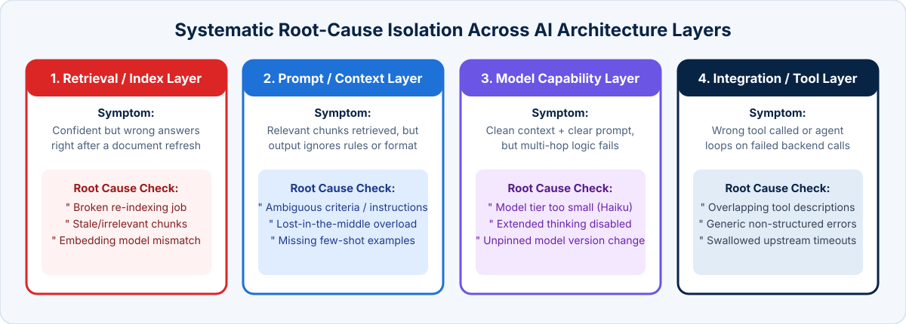

<!-- course-title: Claude Certified Architect - Professional: Hands-On Exam Prep Workshop -->
<!-- course-theme: roi-alt-theme -->

<!-- layout: title -->

Claude Certified Architect - Professional: Hands-On Exam Prep Workshop

# Chapter 5: Evaluation, Testing, and Optimization

---

# Chapter 5: Objectives

- Define multi-dimensional evaluation metrics across accuracy, latency, cost, safety, and security
- Design evaluation datasets and mixed-methodology grading frameworks (deterministic, LLM-as-a-judge, and human review)
- Diagnose system regressions across retrieval, prompt, model, and integration layers and conduct A/B testing
- Optimize token usage, latency, and cost-performance trade-offs using production telemetry

---

# Domain 4: Evaluation, Testing, and Optimization

| Task # | Task Statement |
| :--- | :--- |
| **4.1** | Define evaluation metrics (accuracy, latency, cost, safety, security) |
| **4.2** | Design evaluation datasets and test frameworks using mixed methodologies |
| **4.3** | Conduct A/B testing and iterative improvements |
| **4.4** | Diagnose system issues (prompt failure, hallucinations, model mismatch) |
| **4.5** | Optimize token usage, latency, and cost-performance trade-offs |
| **4.6** | Monitor system performance using logging and observability tools |

---

<!-- layout: navigation -->
# Chapter 5

- **Evaluation Metrics and Datasets**
- Testing and Diagnostics
- Performance Optimization

---

<!-- layout: card-layout -->
# Five Dimensions of Enterprise AI Evaluation

### 1. Accuracy and Faithfulness
- Measure **answer relevance**, **context precision/recall** (for RAG), and **citation faithfulness** (zero unsupported claims).
- Segment accuracy by document type, intent category, and edge-case tier rather than relying on one aggregate score.

### 2. Latency (TTFT and End-to-End)
- Track **Time to First Token (TTFT)** for interactive responsiveness and **p50/p95/p99 end-to-end duration** across multi-turn agent loops.

### 3. Cost Efficiency
- Measure **total cost per successful task completion** (including retries, subagent calls, and reranking), not just unit token price.

### 4. Safety and Security Resilience
- Measure false-refusal rates on benign requests alongside pass/block rates against adversarial prompt injection, jailbreak, and PII leakage test suites.

---

<!-- layout: 3-column -->
# Mixed-Methodology Evaluation Frameworks

### Deterministic Code Graders
- Fast, zero-cost, 100% reproducible checks
- JSON Schema / Pydantic validation, exact regex/keyword matches, tool-call sequence assertions, and math verification
- Run on **every commit in CI/CD**

### LLM-as-a-Judge Graders
- Uses a strong model with an explicit rubric and pairwise or 1-to-5 scale criteria to grade tone, faithfulness, and completeness
- **Must be calibrated** against a golden set of human-labeled examples to verify judge alignment

### Human Expert Review
- Domain experts label golden evaluation datasets, audit ambiguous edge cases, and review stratified samples of production traffic
- Provides the ground truth that calibrates automated LLM judges

---

<!-- layout: navigation -->
# Chapter 5

- Evaluation Metrics and Datasets
- **Testing and Diagnostics**
- Performance Optimization

---

<!-- layout: stacked -->
# Diagnosing System Regressions Across Layers

- **Correlate symptoms with what changed**: when a RAG system suddenly returns confident but wrong answers right after a document refresh (while latency and model version are unchanged), **investigate the retrieval and indexing step first**
- **Why retrieval is the culprit**: broken re-indexing, chunk boundary shifts, or mismatched embeddings feed irrelevant or stale chunks to the model, which then synthesizes confident answers from bad context
- **Separate retrieval evals from generation evals**: measure whether the right chunk appeared in top-K before blaming the prompt or model

---

<!-- layout: 2-column -->
# Conducting A/B Testing and Iterative Improvements

### Offline Pre-Deployment Eval Gates
- Pin model versions (such as `claude-sonnet-4-20250514`) and run your golden dataset benchmark before promoting any prompt, chunking, or tool change
- Block deployment if faithfulness drops or p95 latency breaches the SLA threshold
- Change **one variable at a time** (prompt vs retrieval top-K vs model tier) so attribution is unambiguous

### Online Production Validation
- **Shadow testing**: run the candidate pipeline asynchronously on a copy of live traffic and compare outputs without exposing users
- **Canary and A/B testing**: route 5% to 10% of traffic to the new configuration and compare business KPIs (first-contact resolution, user acceptance rate, escalation rate)

---

<!-- layout: navigation -->
# Chapter 5

- Evaluation Metrics and Datasets
- Testing and Diagnostics
- **Performance Optimization**

---

<!-- layout: card-layout -->
# Optimizing Cost, Latency, and Token Usage

### 1. Prefix Alignment and Prompt Caching
- Keep tools, system instructions, and static reference documents in a deterministic order at the start of the request with `cache_control`.
- Reduces cached input token costs and cuts TTFT on repeated prefixes.

### 2. Tiered Model Routing
- Use Claude Haiku for high-volume classification, routing, and guardrail checks; reserve Sonnet and Opus for complex synthesis and agentic reasoning.

### 3. Asynchronous Batch Processing
- Offload non-blocking workloads (nightly evaluations, bulk extraction, compliance audits) to the **Message Batches API** for a 50% cost reduction.

### 4. Context and Tool Output Pruning
- Trim verbose MCP tool responses via `PostToolUse` hooks, cap `max_tokens` appropriately, and use `.claude/rules/` path globs to avoid loading unneeded context.

---

# Production Observability and Drift Detection

- **Monitor cache efficiency**: a sudden drop in `cache_read_input_tokens` indicates a developer accidentally injected dynamic variables (such as a timestamp) into the system prompt prefix
- **Track token burn per session**: alert on multi-agent loops that exceed expected turn counts or token budgets
- **Detect data and query drift**: sample production traces weekly (using **stratified random sampling** across intent types) and promote newly discovered failure cases into your regression test suite

---

# Domain 4 Quiz: Evaluation, Testing, and Optimization

- Open the Exam Prep Program to complete the Domain 4 review questions

<!-- TODO: Add Exam Prep Program URL for Domain 4 Quiz -->

---

# What You Learned

- Defined multi-dimensional evaluation metrics across accuracy, latency, cost per task, safety, and security
- Combined deterministic code graders, calibrated LLM-as-a-judge rubrics, and human expert review into a mixed-methodology framework
- Diagnosed regressions systematically across retrieval, prompt, model, and integration layers
- Optimized token usage, latency, and cost using Prompt Caching, tiered model routing, batch processing, and continuous telemetry

---

<!-- layout: stacked -->
# Questions and Answers

