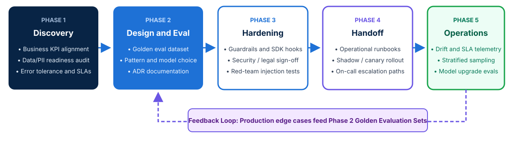

<!-- course-title: Claude Certified Architect - Professional: Hands-On Exam Prep Workshop -->
<!-- course-theme: roi-alt-theme -->

<!-- layout: title -->


Claude Certified Architect - Professional: Hands-On Exam Prep Workshop

# Chapter 7: Stakeholder Communication and Lifecycle Management

---

# Chapter 7: Objectives

- Conduct structured AI discovery and turn vague requests into measurable success criteria
- Communicate architectural decisions and trade-offs to executive, risk, and engineering audiences
- Manage stakeholder feedback loops and expectations around statistical quality and SLAs
- Document architectures and govern the full lifecycle, from handoff to model migration

---

# Domain 6: Stakeholders and Lifecycle

**Stakeholder Communication and Lifecycle Management** is **14%** of the exam.

| Task # | Task Statement |
| :--- | :--- |
| **6.1** | Conduct structured discovery and requirement gathering |
| **6.2** | Communicate architectural decisions and trade-offs |
| **6.3** | Manage stakeholder feedback loops and expectation alignment (including SLAs) |
| **6.4** | Document architectures and provide implementation guidance |
| **6.5** | Support lifecycle phases (discovery, design, handoff, monitoring, iteration) |

---

<!-- layout: navigation -->
# Chapter 7

- **Discovery and Requirements**
- Communicating Trade-Offs and SLAs
- Documentation and Lifecycle Management

---

<!-- layout: card-layout -->
# Conducting Structured AI Discovery

### 1. Problem Suitability Assessment
- Decide which parts of the workflow need LLM reasoning and which need business rules, SQL, or code.
- Do not force an autonomous agent onto a fixed 3-step form validation.

### 2. Data Readiness Audit
- Inventory source quality, update frequency, access control lists (ACLs), and data classification (PII, PHI, PCI, confidential IP).
- Flag stale or contradictory sources before promising high RAG accuracy.

### 3. Error Cost and Risk Tolerance
- Quantify the cost of a false positive vs a false negative (for example, an internal draft summary vs an automatic customer refund).
- High-consequence actions need code hooks or mandatory human-in-the-loop (HITL) sign-off.

### 4. Baseline Metrics and Target SLAs
- Measure current human performance, volume, latency expectations, and unit cost targets before locking in the architecture.

---

<!-- layout: 3-column -->
# Discovery Questions by Stakeholder

### Business Sponsor
- What decision or task gets better, and how will we know?
- What does the process cost today, per case and in total?
- What error rate does the current human process have?
- What happens to the people whose work changes?

### Process Owners and Users
- Walk me through the last ten cases: which were hard, and why?
- Where does the information come from, and how current is it?
- Which mistakes are embarrassing, and which are dangerous?
- What would make you stop trusting the system?

### Security, Legal, and IT
- What data classes are involved, and where may they be processed?
- Which actions need an approval or an audit trail?
- Which identity system and access model must we honor?
- Which vendors and data-processing terms are already approved?

---

<!-- layout: 2-column -->
# Writing Measurable Success Criteria

### Weak Criteria
- “The assistant should be accurate”
- “Responses should be fast”
- “Customers should be happy with it”
- “It should be safe and compliant”

### Strong Criteria
- **Accuracy**: at least 95% correct on a 500-case labeled set covering all 12 intents, with no intent below 90%
- **Latency**: p95 first token under 1.5 seconds, full answer under 6 seconds
- **Outcome**: first-contact resolution up from 58% to 70% within 90 days, with no drop in satisfaction
- **Safety**: zero successful tool actions in the adversarial suite; human approval on every refund over $100

<!-- below-columns -->

> [!IMPORTANT]
> Good success criteria are specific, measurable, achievable, and tied to a business outcome. Agree on them, and on the evaluation set that measures them, before design starts.

---

<!-- layout: 2-column -->
# Worked Example: From Vague Ask to Requirements

### The Ask
- A COO says: “Use AI to fix our vendor invoice backlog.”
- Discovery finds 9,000 invoices per week, a 6-day backlog, 3% of invoices paid twice or wrongly, and 12 AP clerks
- Invoices arrive as PDFs in 40 layouts; payments run through the ERP; finance requires approval on anything over $10,000

### The Requirements
- **Scope**: extract and validate invoice data and propose a three-way match; no payment action in the AI path
- **Success**: field accuracy of at least 98% on critical fields, backlog under 1 day, payment errors below 1%
- **Controls**: ERP match logic in code; human approval over $10,000 and on any mismatch
- **Out of scope for phase 1**: vendor dispute emails, a separate and riskier problem

---

# Demo: From Vague Ask to Success Criteria

A VP of Customer Support says: **“Make support faster with AI.”**

Write:

1. Three discovery questions you would ask before designing anything
2. Three measurable success criteria (one for quality, one for speed, one for a business outcome)
3. One SLA you would commit to, and one you would refuse to commit to, and why

---

<!-- layout: 2-column -->
# Demo Debrief: From Vague Ask to Success Criteria

### Strong Answers Include
- **Questions**: What is the current handle time and backlog? Which ticket types dominate? What does a wrong answer cost?
- **Quality**: at least 92% of AI-drafted replies accepted by agents with no or minor edits, on a labeled sample
- **Speed**: median handle time down 30%, p95 draft latency under 5 seconds
- **Outcome**: first-contact resolution up 10 points with satisfaction flat or better

### SLA Judgment
- **Commit to**: latency, availability, and a measured quality floor on the agreed evaluation set
- **Refuse**: “The AI will never give a wrong answer.” Quality is a measured rate, backed by code gates and human review where errors are costly
- **Exam takeaway**: the right answer turns an ambition into measurable criteria before choosing an architecture

---

<!-- layout: navigation -->
# Chapter 7

- Discovery and Requirements
- **Communicating Trade-Offs and SLAs**
- Documentation and Lifecycle Management

---

<!-- layout: 3-column -->
# Tailoring Communication by Stakeholder Audience

### Business Leaders
- Focus on **business value pillars**: cost per resolved case, cycle-time reduction, revenue protection, and time-to-market
- Frame model and pattern choices as ROI, customer experience, and rollout milestones
- Avoid token and embedding jargon

### Security and Compliance
- Focus on **trust boundaries**, data retention (Zero Data Retention, BAA), GDPR, HIPAA, and FedRAMP alignment, and least-privilege tools
- Show how code hooks and audit trails block unauthorized actions even if an injection succeeds

### Engineering and Operations
- Focus on **API contracts**, structured JSON schemas, p50/p99 latency budgets, prompt caching strategy, error taxonomy (`isError`), and CI/CD eval gates
- Provide concrete fallback and rollback procedures

---

# Presenting a Trade-Off: The Option Comparison

| | **Option A: Sonnet for All Traffic** | **Option B: Haiku Router, Sonnet for Complex Cases** | **Option C: Opus for All Traffic** |
| :--- | :--- | :--- | :--- |
| **Accuracy on eval set** | 93% | 92% (router misroutes 2% of complex cases) | 95% |
| **p95 latency** | 3.1 s | 1.4 s for 70% of traffic, 3.3 s for the rest | 5.8 s, over the 4 s SLA |
| **Monthly model cost** | $41,000 | $19,000 | $83,000 |
| **Operational complexity** | Low | Medium: a router to evaluate and monitor | Low |
| **Recommendation** | | **Chosen**: meets the SLA at the lowest cost; misroutes are tracked as a quality metric | |

- **Show the rejected options and the numbers**: stakeholders trust a recommendation when they see what it beat and why

---

<!-- layout: 3-column -->
# One Decision, Three Audiences

### To the CFO
- “Routing simple requests to a smaller model cuts our monthly model cost from $41,000 to $19,000.”
- “Quality on our test set drops by one point, which we offset with a human-review queue that costs $2,000 a month.”
- “The router takes about two engineer-weeks to build and pays for itself in the first month.”

### To the CISO
- “Both models run under the same zero-retention terms and in the same region.”
- “The router only classifies; it has no tools and no data access.”
- “Every routing decision is logged with the request’s trace ID.”

### To the Engineering Lead
- “The router is a Haiku call with a structured output schema and a 300 ms budget.”
- “We evaluate misroutes weekly on a 500-case set and alert above 3%.”
- “Rollback is a config flag that sends all traffic to Sonnet.”

<!-- below-columns -->

> [!TIP]
> Same decision, same facts, different consequences emphasized. Exam answers that hand executives token counts, or hand engineers ROI slides, are distractors.

---

<!-- layout: 2-column -->
# Non-Determinism and Realistic SLAs

### Managing Probabilistic Reality
- Stakeholders used to traditional software often expect 100% deterministic outputs on every edge case
- Explain that LLM output quality is a **statistical distribution** measured on evaluation sets
- Show how **hybrid architectures** pair probabilistic LLM comprehension with 100% deterministic code gates for financial and compliance rules

### Defining Realistic Production SLAs
- Specify **tiered SLAs**:
  - **Latency**: p50 and p95 Time to First Token (TTFT) and end-to-end completion time
  - **Quality floor**: minimum faithfulness and escalation precision on the golden set
  - **Graceful degradation**: defined fallbacks (human queues, secondary regions) during rate limits or outages

---

<!-- layout: 2-column -->
# Staged Rollout and Quality SLOs

### Roll Out in Stages
- **Shadow**: the AI runs on live traffic, and nobody sees its output; compare it with what humans did
- **Assisted**: the AI drafts, and humans approve every output; measure acceptance and edit rates
- **Partial autonomy**: low-risk categories go straight through, and the rest stay assisted
- Each stage has an exit criterion agreed with stakeholders in advance

### Quality SLOs and Error Budgets
- **SLO example**: at least 95% of sampled answers rated correct each week
- **Error budget**: the 5% allowance; when it is spent, changes pause until quality recovers
- Report SLOs beside latency and availability, so quality is managed like uptime

---

<!-- layout: 2-column -->
# Managing Stakeholder Feedback Loops

### Set the Cadence Early
- **Weekly**: operations review of quality, latency, cost, and the top failure categories
- **Monthly**: sponsor review against the success criteria and the roadmap
- **Per release**: evaluation results and a change summary sent to every stakeholder group

### When Users Say “It’s Wrong”
- Ask for the examples, and add them to the evaluation set with their trace IDs
- Show the measured error rate and its trend, not reassurance
- Agree which errors matter most, then prioritize fixes by business impact
- Close the loop: tell the reporter what changed and how it was verified

---

<!-- layout: navigation -->
# Chapter 7

- Discovery and Requirements
- Communicating Trade-Offs and SLAs
- **Documentation and Lifecycle Management**

---

<!-- layout: stacked -->
# Supporting the Full AI System Lifecycle

- **Five lifecycle phases**: **Discovery** -> **Design and Eval Baseline** -> **Governance Hardening** -> **Operational Handoff** -> **Continuous Monitoring and Iteration**
- **Never skip the Eval Baseline**: build the golden dataset in Phase 2, before scaling implementation
- **Planned iteration**: treat model releases, prompt changes, and knowledge-base refreshes as versioned events gated by regression tests



---

<!-- layout: card-layout -->
# Essential Architecture and Handoff Documentation

### Architectural Decision Records (ADRs)
- Record **why** choices were made: Sonnet over Opus, MCP over direct REST, or a tool removed for least privilege.
- Include the rejected alternatives and quantitative trade-offs.

### Prompt and Model Version Manifests
- Pin the model ID (for example, `claude-sonnet-5-5`, never a moving alias), prompt versions, JSON schemas, and embedding model versions in source control.

### Operational Runbooks
- Give on-call teams step-by-step playbooks: inspect traces, check cache hit rates, isolate RAG index failures, and roll back a prompt or model.

### Model Upgrade Playbooks
- When a new model ships, evaluate it side by side on the golden set to catch behavior shifts before switching traffic.

---

# Code: An Architectural Decision Record

```markdown
# ADR-014: Route simple support requests to Claude Haiku

Status: Accepted (2026-11-02)    Owners: Support Platform team

## Context
70% of support traffic is order status, password, and shipping questions.
All traffic runs on Sonnet today: p95 latency 3.1 s (SLA 4 s), cost $41,000 per month.

## Decision
A Haiku classifier routes simple intents to a Haiku responder; everything else goes to Sonnet.

## Alternatives Considered
- Opus for all traffic: +2 points accuracy, p95 5.8 s (breaks SLA), $83,000 per month. Rejected.
- Sonnet at lower effort: -1 point accuracy, $36,000 per month. Kept as the fallback.

## Consequences
- Cost $19,000 per month; accuracy 92% vs 93% on the 500-case evaluation set.
- New risk: misrouting. Measured weekly; alert above 3%.
- Rollback: set ROUTER_ENABLED=false to send all traffic to Sonnet.
```

---

<!-- layout: 2-column -->
# The Operational Handoff Checklist

### What the Receiving Team Gets
- Architecture diagram, ADRs, and the data-flow and trust-boundary map
- Pinned model IDs, prompt versions, schemas, and the evaluation set with its baseline scores
- Dashboards for quality, latency, cost, and cache hit rate, with alert thresholds
- Runbooks for the top incident types, including rollback and graceful degradation

### What Must Be True Before Handoff
- The on-call team has run each runbook once in a drill
- Every alert has an owner and a documented first response
- Release gates in CI run the evaluation set on every prompt, model, or index change
- Stakeholders have signed off on the success criteria and the SLA in writing

---

<!-- layout: 2-column -->
# Planning for Model Deprecation and Migration

### Why It Is a Lifecycle Event
- Claude models are retired on a published schedule, so every production system will migrate
- New models can change output length, tone, tool use, and how strictly they follow emphatic instructions
- A migration touches cost, latency, quality, and sometimes the API parameters your code sends

### The Migration Playbook
- Track deprecation notices and migrate well before the retirement date
- Run the golden set on the current and candidate models side by side, then retune prompts and effort
- Re-baseline cost with token counting, because tokenizers can change between generations
- Roll out through shadow and canary stages, keeping the old model ID as the rollback path

---

# Worked Exam Question: The Disappointed Sponsor

Six weeks after launch, a business sponsor says the claims-summary assistant “makes too many mistakes” and asks to shut it down. The assistant meets its agreed accuracy target of 94% on the evaluation set. What should the architect do first?

- **A.** Switch to the most capable model to reduce mistakes
- **B.** Collect the sponsor’s examples, check them against the evaluation set and success criteria, and review the error categories and their business impact together
- **C.** Explain that LLMs are non-deterministic, so some mistakes are expected
- **D.** Add a disclaimer to every summary telling users to verify the content

---

<!-- layout: 2-column -->
# Worked Exam Question: Reasoning

### Applying the Four Steps
- **Constraint:** stakeholder trust and an agreed definition of success
- **Layer:** the feedback loop, not the model
- **Eliminate:** A acts before diagnosing; C dismisses the concern; D shifts the burden to users without fixing anything
- **Answer: B.** Ground the conversation in evidence and agreed criteria, then fix what matters most

### Why It Matters
- The examples may reveal a gap in the evaluation set, or errors that are rare but costly
- Expectation alignment uses data, not reassurance
- The feedback loop ends with a change, its verification, and a report back to the stakeholder

---

# Domain 6 Quiz: Stakeholders and Lifecycle

- [Open Quiz](https://claude-certification-exam-prep-1077635956541.us-east4.run.app/questions?file=public/2026-10-31-11-53-ccar-p-realistic-instructor.json)

---

<!-- layout: 2-column -->
# What You Learned

### Discovery and Communication
- Conducted structured AI discovery and turned vague requests into measurable success criteria
- Communicated architectural decisions and trade-offs to executive, risk, and engineering audiences

### Expectations and Lifecycle
- Managed stakeholder feedback loops and expectations around statistical quality and SLAs
- Documented architectures and governed the full lifecycle, from handoff to model migration

---

<!-- layout: stacked -->
# Questions and Answers


