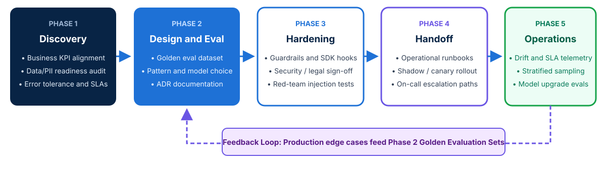

<!-- course-title: Claude Certified Architect - Professional: Hands-On Exam Prep Workshop -->
<!-- course-theme: roi-alt-theme -->

<!-- layout: title -->

Claude Certified Architect - Professional: Hands-On Exam Prep Workshop

# Chapter 7: Stakeholder Communication and Lifecycle Management

---

# Chapter 7: Objectives

- Conduct structured AI discovery and requirement gathering
- Communicate trade-offs and SLAs across stakeholder groups
- Align expectations around statistical quality and guardrails
- Govern the full system lifecycle with ADRs and runbooks

---

# Domain 6: Stakeholder Communication and Lifecycle Management

| Task # | Task Statement |
| :--- | :--- |
| **6.1** | Conduct structured discovery and requirement gathering |
| **6.2** | Communicate architectural decisions and trade-offs |
| **6.3** | Manage stakeholder feedback loops and expectation alignment (including SLAs) |
| **6.4** | Document architectures and provide implementation guidance |
| **6.5** | Support lifecycle phases (discovery, design, handoff, monitoring, iteration) |

---

<!-- layout: navigation -->
# Chapter 7

- **Discovery and Requirements**
- Communicating Trade-Offs and SLAs
- Documentation and Lifecycle Management

---

<!-- layout: card-layout -->
# Conducting Structured AI Discovery

### 1. Problem Suitability Assessment
- Determine which parts of the workflow genuinely require LLM reasoning versus deterministic business rules or traditional SQL/code.
- Reject forcing an autonomous agent onto a process that is a fixed 3-step deterministic form validation.

### 2. Data Readiness and Sensitivity Audit
- Inventory source document quality, update frequency, access control lists (ACLs), and regulatory classification (PII, PHI, PCI, confidential IP).
- Poorly maintained or contradictory source documents must be flagged before promising high RAG accuracy.

### 3. Error Cost and Risk Tolerance
- Quantify the business cost of a false positive vs a false negative (for example, an internal draft summary vs an autonomous customer refund).
- High-consequence actions dictate deterministic hooks or mandatory Human-in-the-Loop (HITL) sign-off.

### 4. Baseline Metrics and Target SLAs
- Measure current human benchmark performance, ticket volume, latency expectations, and unit cost targets before locking in the architecture.

---

<!-- layout: navigation -->
# Chapter 7

- Discovery and Requirements
- **Communicating Trade-Offs and SLAs**
- Documentation and Lifecycle Management

---

<!-- layout: 3-column -->
# Tailoring Communication by Stakeholder Audience

### Executive and Business Leaders
- Focus on **business value pillars**: cost per resolved case, cycle-time reduction, revenue protection, and time-to-market
- Frame model and pattern choices in terms of ROI, customer experience impact, and phased rollout milestones
- Avoid low-level token or embedding jargon

### Security, Legal, and Compliance
- Focus on **trust boundaries**, data retention (Zero Data Retention / BAA), GDPR/HIPAA/FedRAMP alignment, and least-privilege tool scoping
- Demonstrate how deterministic hooks and audit trails prevent unauthorized actions even if a prompt injection occurs

### Engineering and Operations
- Focus on **API contracts**, structured JSON schemas, p50/p99 latency budgets, prompt caching strategy, error taxonomy (`isError`), and CI/CD eval gates
- Provide concrete fallback and rollback procedures

---

<!-- layout: 2-column -->
# Aligning Expectations Around Non-Determinism and SLAs

### Managing Probabilistic Reality
- Stakeholders accustomed to traditional software often expect 100% deterministic outputs on every edge case
- Educate stakeholders that LLM outputs follow a **statistical quality distribution** measured on evaluation benchmarks
- Show how **hybrid architectures** pair probabilistic LLM comprehension with 100% deterministic code gates for financial and compliance boundaries

### Defining Realistic Production SLAs
- Specify **tiered SLAs**:
  - **Latency**: p50 and p95 Time to First Token (TTFT) and end-to-end completion time
  - **Quality floor**: minimum faithfulness and escalation precision on the golden evaluation suite
  - **Graceful degradation**: clear fallback behavior (such as routing to human queues or secondary regions) during upstream rate limits or outages

---

<!-- layout: navigation -->
# Chapter 7

- Discovery and Requirements
- Communicating Trade-Offs and SLAs
- **Documentation and Lifecycle Management**

---

<!-- layout: stacked -->
# Supporting the Full AI System Lifecycle

- **Five lifecycle phases**: **Discovery** -> **Design and Eval Baseline** -> **Governance Hardening** -> **Operational Handoff** -> **Continuous Monitoring and Iteration**
- **Never skip the Eval Baseline**: build the golden evaluation dataset during Phase 2 before scaling implementation
- **Planned iteration**: treat model releases, prompt refinements, and knowledge-base refreshes as versioned lifecycle events governed by regression testing

---

<!-- layout: card-layout -->
# Essential Architecture and Handoff Documentation

### Architectural Decision Records (ADRs)
- Document **why** specific choices were made: why Sonnet was chosen over Opus, why MCP was chosen over direct REST, or why a tool was removed for least privilege.
- Include the rejected alternatives and quantitative trade-offs.

### Prompt and Model Version Manifests
- Pin exact model snapshot IDs (for example, `claude-sonnet-4-20250514`), system prompt versions, JSON schemas, and embedding model versions in source control.

### Operational Runbooks
- Provide on-call teams with step-by-step diagnostic playbooks: how to inspect trace logs, verify prompt cache hit rates, isolate RAG index failures, and trigger an immediate prompt/model rollback.

### Model Upgrade Playbooks
- When a new Claude model version is released, run side-by-side evaluations against the golden dataset to check for behavioral shifts before switching production traffic.

---

# Domain 6 Quiz: Stakeholder Communication and Lifecycle Management

- [Open Quiz](https://claude-certification-exam-prep-1077635956541.us-east4.run.app/questions?file=public/2026-10-31-11-53-ccar-p-realistic-instructor.json)

---

# What You Learned

- Conducted structured AI discovery and requirement gathering
- Communicated trade-offs and SLAs across stakeholder groups
- Aligned expectations around statistical quality and guardrails
- Governed the full system lifecycle with ADRs and runbooks

---

<!-- layout: stacked -->
# Questions and Answers

