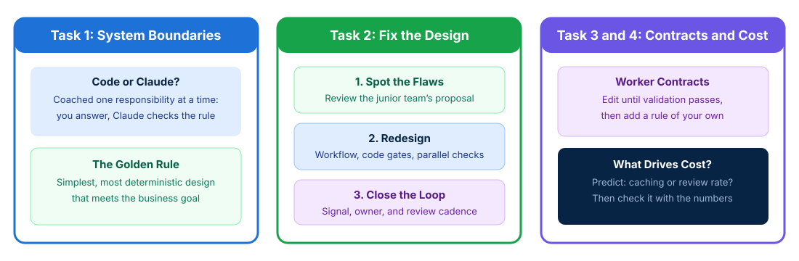

# Designing a Multi-Agent Architecture

## Time Required

45 minutes

## Overview

In this lab, you will make the core solution-design decisions for a merchant onboarding platform: what belongs in code versus Claude, which architecture fits the business problem, how worker agents are scoped, and what really drives cost.

### You learn how to:
- Separate deterministic code responsibilities from Claude reasoning tasks.
- Find and fix the design flaws in an over-agentified architecture.
- Scope worker subagents with explicit context contracts and blast-radius controls.
- Identify what really drives the unit economics of an AI solution.

## Scenario

Your architecture group is designing a merchant onboarding and underwriting platform for a payments company. It must process about 3,000 applications per day, decide each one within 10 minutes, protect owner PII and bank statements, and allow automatic fee waivers only up to $500. A junior team has proposed a design. Before it goes to the architecture review board, you will check their thinking and fix what is wrong.



## Lab Instructions

### Task 1: Draw the system boundary

In this task, you create your workspace and decide, responsibility by responsibility, what deterministic code should own and what Claude should own. Claude Code acts as your coach: it asks, you answer, and it tells you whether you applied the rule correctly.

1. Open a terminal, go to your course workspace, and create a folder for this lab:

**macOS:**

```bash
cd ~/ccarp-labs
mkdir ccarp-lab-01
cd ccarp-lab-01
```

**Windows (PowerShell):**

```powershell
cd $HOME\ccarp-labs
mkdir ccarp-lab-01
cd ccarp-lab-01
```

2. Open `ccarp-lab-01` in VS Code (or your preferred editor) and create a file named `responsibilities.md`:

```markdown
# Merchant onboarding: responsibilities to assign

1. Verify the caller's JWT and enforce tenant RBAC permissions
2. Read articles of incorporation (PDF) and extract the owners' names and addresses
3. Calculate the debt service coverage ratio and the fee tier
4. Enforce the 4-step KYC sequence required by regulation
5. Classify an applicant's free-text complaint that mixes a billing dispute and a fraud concern
6. Decide whether a requested fee waiver is within the $500 automatic limit
7. Summarize three credit bureau reports that disagree into a one-page risk memo
8. Decide which extra documents to request when a beneficial owner's identity is unclear
```

3. Start Claude Code in `ccarp-lab-01`:

```bash
claude
```

4. Paste this prompt to start the coaching round:

```text
Act as my architecture coach. Read responsibilities.md. Present the responsibilities one at a time.
For each one, wait for my answer ("code" or "Claude", plus a short reason), then tell me whether
I'm right and name the principle. Do not reveal answers before I reply.

Judge using these principles:
- Deterministic code owns authentication and authorization, exact arithmetic and thresholds,
  transactions and audit records, and any sequence fixed by regulation.
- Claude owns unstructured comprehension, ambiguous classification, synthesis across sources,
  and choosing the next step when the path depends on what was just found.
- Start with the simplest, most deterministic design that meets the business goal.
```

5. Answer each question in the chat. When the round ends, ask Claude for your score.

**Success criteria**

- **Code**: 1 (identity and permissions), 3 (exact math), 4 (regulated sequence), 6 (a hard threshold)
- **Claude**: 2 (unstructured documents), 5 (ambiguous, multi-concern text), 7 (synthesis of conflicting sources), 8 (the next step depends on what was found)
- Item 6 is the one most people miss: Claude may *propose* a waiver, but code decides whether it is within the limit

> [!IMPORTANT]
> On the exam, anything with financial, security, or regulatory consequences that must hold 100% of the time belongs in deterministic code, not in a prompt.

### Task 2: Fix an over-agentified design

In this task, you review the junior team’s proposal, name its flaws, and have Claude redraw a corrected architecture.

1. In `ccarp-lab-01`, create a file named `proposed-design.md`:

```markdown
# Proposed design: OnboardBot (v0.1)

Business: 3,000 applications per day, decision within 10 minutes. Applications contain owner PII
and bank statements. Fee waivers up to $500 may be granted automatically; larger ones need a human.

## Design
- One autonomous agent, OnboardBot, on the largest model at maximum effort, handles every
  application end to end and decides its own order of steps.
- OnboardBot has 14 tools: read_application, parse_pdf, ocr_image, verify_jwt, check_rbac,
  calc_dscr, credit_bureau_lookup, sanctions_screen, legal_search, update_crm,
  grant_fee_waiver, send_email, delete_application, export_all_applications.
- The system prompt says: "Always verify the JWT first. Never grant waivers above $500.
  Follow the KYC steps in order."
- For background checks, OnboardBot asks a Supervisor Agent, which asks a Compliance Manager
  Agent, which asks three specialist agents (sanctions, financials, legal) one after another.
- All agents share one service account with admin access to the CRM.
- Quality: the team will read a few outputs each week.
```

2. Read the proposal and decide what is wrong with it. In Claude Code, send **one message** that lists every flaw you found, each with one sentence on why it matters. Start your message with:

```text
Here are the flaws I found in proposed-design.md:
```

3. When you have sent your list, paste this prompt:

```text
Act as the architecture review board. Compare my list of flaws with proposed-design.md.
Confirm the flaws I found, tell me which ones I missed and why they matter, and point out
anything I listed that is not actually a problem. Then write corrected-design.md with:
1. The architecture pattern and why it fits (use the four checks: complexity, value,
   viability, cost of error).
2. A Mermaid flowchart of the corrected flow, showing where Claude is used, where code
   gates sit, and which steps run in parallel.
3. The tool list for each component, scoped to what it needs.
4. One feedback loop: the signal, who owns it, and how often it is reviewed.
```

4. Open `corrected-design.md` and read the flowchart. VS Code shows Mermaid diagrams in the Markdown preview if you install a Mermaid extension. Otherwise, paste the Mermaid block into https://mermaid.live.

**Success criteria**

Your list, together with the board’s additions, should cover these flaws:
- **Wrong pattern**: a fixed, regulated sequence is a **workflow**, not an autonomous agent
- **Rules in the prompt**: JWT checks, the $500 limit, and the KYC order must be **code gates**, not system prompt sentences
- **Capability bloat**: identity checks are not tools; `delete_application`, `export_all_applications`, and `send_email` are not needed
- **Deep sequential hierarchy**: three independent checks should run **in parallel** from one coordinator or workflow step, not through two management layers
- **Shared admin account**: each component needs scoped credentials tied to the caller
- **Largest model for everything**: cost and latency without a measured need; reserve the larger tier for the steps that need it
- **No real feedback loop or evaluation**: “read a few outputs” has no owner, cadence, or eval gate

### Task 3: Scope the worker contracts

In this task, you fix a bloated worker contract until it passes validation, then add a validation rule of your own.

1. In `ccarp-lab-01`, create a file named `subagent_contracts.py`:

```python
# subagent_contracts.py - contracts between the coordinator and its worker subagents
from dataclasses import dataclass, field
from typing import List, Literal

WRITE_TOOLS = {"update_crm", "grant_fee_waiver", "send_email", "delete_application"}

@dataclass
class ClaimCitation:
    claim: str
    source_id: str
    quoted_evidence: str

@dataclass
class SubagentTaskContract:
    task_id: str
    role: Literal["sanctions", "financials", "legal"]
    goal: str
    context: List[str]
    allowed_tools: List[str]
    timeout_seconds: float = 15.0
    max_tokens_budget: int = 4096
    approval_required: bool = False

    def problems(self):
        found = []
        if len(self.allowed_tools) > 5:
            found.append(f"CAPABILITY_BLOAT: {len(self.allowed_tools)} tools; scope the worker to what its role needs")
        if not self.context:
            found.append("NO_CONTEXT: workers start with an empty context window; pass the facts they need")
        if self.timeout_seconds > 30:
            found.append("BLAST_RADIUS: a slow worker must not stall the 10-minute decision; lower the timeout")
        # TODO (you decide): add one rule of your own below this line
        return found

@dataclass
class SubagentResultContract:
    task_id: str
    status: Literal["success", "partial_failure", "failed"]
    claims_with_citations: List[ClaimCitation] = field(default_factory=list)
    coverage_gaps: List[str] = field(default_factory=list)

if __name__ == "__main__":
    sanctions = SubagentTaskContract(
        task_id="APP-7731-sanctions",
        role="sanctions",
        goal="Screen the applicant's owners against sanctions lists.",
        context=[],
        allowed_tools=["read_application", "parse_pdf", "sanctions_screen", "credit_bureau_lookup",
                       "legal_search", "update_crm", "grant_fee_waiver", "send_email"],
        timeout_seconds=120,
    )
    for contract in [sanctions]:
        issues = contract.problems()
        print(f"{contract.task_id}: {'OK' if not issues else 'FAILS VALIDATION'}")
        for issue in issues:
            print("  -", issue)
```

2. Open a **second terminal**, go to `~/ccarp-labs`, activate the virtual environment, and run the script:

**macOS:**

```bash
cd ~/ccarp-labs
source .venv/bin/activate
cd ccarp-lab-01
python subagent_contracts.py
```

**Windows (PowerShell):**

```powershell
cd $HOME\ccarp-labs
.venv\Scripts\Activate.ps1
cd ccarp-lab-01
python subagent_contracts.py
```

3. Read the three problems it reports. Edit the `sanctions` contract yourself until the script prints `OK`:
   - Keep only the tools a sanctions screener needs
   - Pass the facts the worker needs in `context` (for example, the owners’ names and countries of residence, extracted earlier in the workflow)
   - Set a timeout that fits inside the 10-minute decision

4. Add one validation rule of your own at the `TODO` line. A good candidate: a worker that holds any tool in `WRITE_TOOLS` must have `approval_required=True`.

5. Prove your rule works: add `"update_crm"` to the sanctions worker’s tools, run the script, and confirm that your rule fires. Then remove it again.

6. (Optional) Ask Claude Code to review your contract and your new rule:

```text
Review subagent_contracts.py. Is my sanctions contract scoped correctly, and does my new
validation rule catch a real risk? Suggest one more rule a production system would need.
```

**Success criteria**

- The sanctions worker keeps about 2 to 3 tools, such as `read_application` and `sanctions_screen`, with no write tools
- `context` carries the specific facts the worker needs, because subagents do not inherit the coordinator’s conversation
- Your new rule fires on a bad contract and stays quiet on a good one

> [!NOTE]
> Exam questions may call the subagent-spawning tool `Task`. In current Claude Code and Agent SDK releases it is named `Agent`.

### Bonus Task 4: Find what really drives cost

In this bonus task, you predict which change saves more money, then check your prediction with numbers.

1. Before calculating anything, decide which of these saves more per month, and why:
   - **Option A**: enable prompt caching on the shared prefix of every model call
   - **Option B**: improve automation quality so that human review drops from 25% to 15% of applications

2. In Claude Code, paste this prompt:

```text
Calculate the monthly saving of each option. Show your arithmetic.

Volume: 90,000 applications per month on claude-sonnet-5-5 ($2 per million input tokens,
$10 per million output tokens, cache reads $0.10 per million).
Per application: 40,000 input tokens, of which 25,000 are a shared, cacheable prefix,
and 3,000 output tokens.
Human review: an analyst spends 30 minutes per reviewed application at $36 per hour.

Option A: enable prompt caching on the shared prefix (ignore cache-write cost).
Option B: reduce human review from 25% to 15% of applications.
```

3. Compare the answer with your prediction.

**Success criteria**

- Option A saves about $4,300 per month (model cost drops from about $9,900 to about $5,600)
- Option B saves about $162,000 per month (review cost drops from $405,000 to $243,000)
- The lesson: token optimizations are worth doing, but the resolution and review rates dominate the business case, which is why quality work pays for itself

## Congratulations!

In this lab, you have:
- Separated deterministic code responsibilities from Claude reasoning tasks.
- Found and fixed the design flaws in an over-agentified architecture.
- Scoped worker subagents with explicit context contracts and blast-radius controls.
- Identified what really drives the unit economics of an AI solution.
