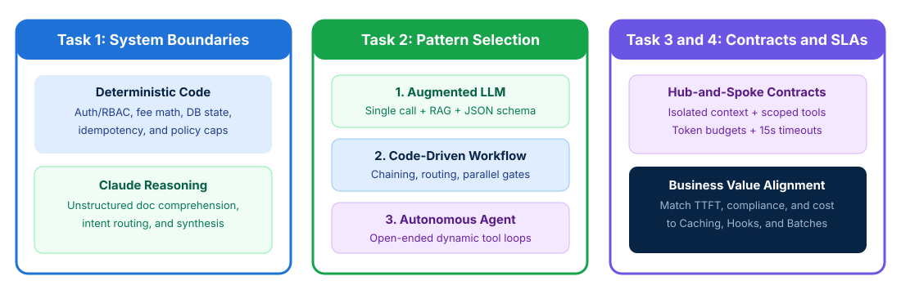

# Designing a Multi-Agent Architecture

## Time Required

45 minutes

## Overview

In this lab, you will translate complex enterprise requirements into an end-to-end Claude architecture with clear system boundaries, orchestration topologies, and SLA alignment.

### You learn how to:
- Separate deterministic code responsibilities from Claude reasoning tasks.
- Select between Augmented LLMs, Code-Driven Workflows, and Autonomous Agents.
- Define multi-agent context contracts and blast-radius controls.
- Align architectural mechanisms to latency, compliance, and cost SLAs.

## Scenario

Your enterprise architecture group is designing a commercial loan underwriting and merchant onboarding platform. A junior team proposed routing the entire workflow - including RBAC checks, interest calculations, document analysis, and risk synthesis - through a single unconstrained autonomous agent, resulting in unpredictable latency and compliance risks.



## Lab Instructions

### Task 1: Separate deterministic code boundaries from Claude reasoning

In this task, you create your lab workspace, audit an over-agentified system proposal, and partition responsibilities between deterministic application code and Claude reasoning.

1. Open your terminal (Terminal on macOS or PowerShell / Command Prompt / VS Code Terminal on Windows) and create a working folder for this lab:

```bash
mkdir ccarp-lab-01
cd ccarp-lab-01
```

2. Open `ccarp-lab-01` in VS Code (or your preferred text editor) and create a file named `flawed-proposal.json` representing the junior team’s design:

```json
{
  "system_name": "Merchant Underwriting Monolith Agent",
  "proposed_agent_responsibilities": [
    "1. Verify caller JWT signature and enforce tenant RBAC permissions",
    "2. Parse unstructured PDF articles of incorporation and vendor contracts",
    "3. Calculate exact debt-service coverage ratios (DSCR) and regulatory fee tiers",
    "4. Classify ambiguous applicant disputes and route multi-concern inquiries",
    "5. Execute database writes with idempotency keys and persist immutable audit logs",
    "6. Synthesize conflicting credit bureau narratives into an executive risk summary",
    "7. Enforce the mandatory 4-step regulatory KYC state machine sequence"
  ]
}
```

3. Launch Claude Code inside `ccarp-lab-01`:

```bash
claude
```

4. In Claude Code, run the following prompt to partition `flawed-proposal.json` into a clean end-to-end architecture specification saved as `boundary-architecture.json`:

```text
Read flawed-proposal.json. Create a file named boundary-architecture.json that splits the 7 responsibilities into two explicit arrays: "deterministic_application_code" and "claude_reasoning_layer". For each item, include a one-sentence architectural justification explaining why it belongs in deterministic code vs LLM reasoning, and add an "end_to_end_stages" object defining Input Ingestion, Contextual Processing, Output Validation, and Feedback Loops.
```

5. Open `boundary-architecture.json` in your editor and verify that authentication/RBAC, exact financial math, database transactions/idempotency, and fixed regulatory state machines are assigned to **deterministic application code**, while unstructured PDF comprehension, ambiguous intent classification, and cross-source synthesis are assigned to **Claude reasoning**.

> [!IMPORTANT]
> Architectural Golden Rule on the CCAR-P exam: always start with the simplest, most deterministic architecture that satisfies the business requirement, and introduce LLM reasoning or agentic autonomy only where unstructured inputs or dynamic investigation paths require it.

### Task 2: Select architectural and decomposition patterns

In this task, you evaluate four enterprise workloads and match each one to the appropriate architectural pattern (**Augmented LLM**, **Code-Driven Workflow**, or **Autonomous Agent**) and decomposition strategy (**Prompt Chaining**, **Routing**, **Parallelization**, or **Evaluator-Optimizer**).

1. In `ccarp-lab-01`, create a file named `enterprise-workloads.json` describing four incoming project requests:

```json
{
  "workloads": [
    {
      "id": "WL-1",
      "name": "Single-Document NDA Clause Extractor",
      "description": "Extracts 8 standard commercial fields (effective date, governing law, liability cap) from a single uploaded NDA PDF into a strict JSON schema under a 3-second latency target."
    },
    {
      "id": "WL-2",
      "name": "14-File Pull Request Security and Integration Auditor",
      "description": "Analyzes every modified file in a pull request for local security defects, then runs a final pass checking cross-file API contract compatibility."
    },
    {
      "id": "WL-3",
      "name": "High-Volume Omnichannel Support Triage",
      "description": "Receives 50,000 incoming customer messages per hour spanning billing questions, password resets, technical bugs, and legal complaints, dispatching each to a specialized handler."
    },
    {
      "id": "WL-4",
      "name": "Legacy Mainframe Root-Cause Investigator",
      "description": "Investigates unfamiliar multi-repository production incidents where each search result determines which logs, config files, or dependency graphs to inspect next."
    }
  ]
}
```

2. Ask Claude Code to evaluate `enterprise-workloads.json` and generate `pattern-selection-matrix.md`:

```text
Read enterprise-workloads.json. Create pattern-selection-matrix.md containing a Markdown table and architectural justification that maps each workload (WL-1 through WL-4) to:
1. Primary Architectural Pattern ("Augmented LLM", "Code-Driven Workflow", or "Autonomous Agent").
2. Decomposition Technique ("None / Single Call", "Prompt Chaining + Parallel Sectioning", "Routing", or "Dynamic Adaptive Decomposition").
3. Why choosing an unconstrained Autonomous Agent for WL-1, WL-2, or WL-3 would hurt latency, cost, or predictability.
```

3. Review `pattern-selection-matrix.md` and confirm:
   - **WL-1** uses an **Augmented LLM** (single call with structured `tool_use` schema).
   - **WL-2** uses a **Code-Driven Workflow** combining **Parallel Sectioning** (per-file passes) and **Prompt Chaining** (cross-file integration pass).
   - **WL-3** uses a **Code-Driven Workflow** with **Routing** (fast classification via Claude Haiku to specialized prompts/tiers).
   - **WL-4** uses an **Autonomous Agent** because the investigation path depends dynamically on what each tool call discovers.

### Task 3: Define multi-agent context contracts and blast-radius controls

In this task, you design a hub-and-spoke multi-agent orchestration contract that enforces context isolation, scoped tool counts (4 to 5 tools per worker), token budgets, and timeouts so a slow subagent never stalls the entire pipeline.

1. In `ccarp-lab-01`, create a file named `subagent_contracts.py` with the following hub-and-spoke contract definitions:

```python
# subagent_contracts.py
from dataclasses import dataclass, field
from typing import List, Literal

@dataclass
class ClaimCitation:
    claim: str
    evidence_excerpt: str
    source_id: str
    publication_date: str

@dataclass
class SubagentTaskContract:
    task_id: str
    subagent_role: Literal["sanctions_screening", "financial_statement_analysis", "legal_dispute_search"]
    research_goal: str
    verified_facts_context: List[str]
    allowed_tools: List[str]
    max_tokens_budget: int = 4096
    timeout_seconds: float = 15.0

    def validate_contract(self) -> List[str]:
        errors = []
        if len(self.allowed_tools) > 5:
            errors.append(f"CAPABILITY_BLOAT: {len(self.allowed_tools)} tools attached; scope to 4-5 role-specific tools.")
        if not self.verified_facts_context:
            errors.append("MISSING_EXPLICIT_CONTEXT: Subagents have isolated context windows and require explicit context.")
        if self.timeout_seconds > 30.0:
            errors.append("BLAST_RADIUS_RISK: Subagent timeout exceeds p95 orchestration budget.")
        return errors

@dataclass
class SubagentResultContract:
    task_id: str
    status: Literal["success", "partial_failure", "failed"]
    claims_with_citations: List[ClaimCitation] = field(default_factory=list)
    coverage_gaps: List[str] = field(default_factory=list)
    error_category: str = ""
    is_retryable: bool = False
```

2. In Claude Code, ask Claude to add a test block to `subagent_contracts.py` that validates both a bloated/broken contract and a well-scoped parallel delegation contract, then run it:

```text
Add a __main__ test block to subagent_contracts.py that:
1. Tests an invalid SubagentTaskContract that attaches 12 unscoped tools, omits verified_facts_context, and sets a 120s timeout (printing the validation errors).
2. Tests a valid parallel dispatch of two scoped worker contracts (4 tools each, explicit verified_facts_context, 15s timeout) and a SubagentResultContract that reports status="partial_failure" with partial claims_with_citations and explicit coverage_gaps.
Run subagent_contracts.py and show the output.
```

3. Verify the terminal output in Claude Code to confirm that the contract catches capability bloat and enforces explicit context passing.

> [!WARNING]
> On the exam, watch out for deep multi-level agent hierarchies when a flat hub-and-spoke coordinator will work: every extra agent hop compounds p95 latency and token overhead.

### Bonus Task 4: Map business SLAs to architectural decisions

In this bonus task, you complete an enterprise SLA-to-architecture decision table covering the four classic SLA trade-offs tested on the CCAR-P exam.

1. In `ccarp-lab-01`, ask Claude Code to create `sla-architecture-alignment.md` mapping the following four business requirements to the exact Claude architectural mechanism and explaining why common alternatives fail:
   - **Requirement 1**: Sub-2-second interactive Time to First Token (TTFT) when every request includes a static 10,000-token underwriting policy manual.
   - **Requirement 2**: 100% deterministic compliance on a `$500` autonomous fee-waiver ceiling.
   - **Requirement 3**: Processing 50,000 quarterly merchant compliance audits overnight at minimum cost.
   - **Requirement 4**: Completing a 3-domain merchant background investigation within a 15-second end-to-end SLA.

2. Open `sla-architecture-alignment.md` and verify that your four solutions match the exam standard:
   - **Requirement 1**: Place the 10,000-token policy in the static prefix with **Prompt Caching** (`cache_control`) + token streaming.
   - **Requirement 2**: Enforce the `$500` ceiling with a **deterministic `PreToolUse` hook / code gate** before tool execution.
   - **Requirement 3**: Use the **Message Batches API** (50% cost reduction, up to 24-hour window, `custom_id` correlation).
   - **Requirement 4**: Emit **parallel subagent `Task` calls in a single coordinator turn** so all 3 domain checks run concurrently.

## Congratulations!

In this lab, you have:
- Separated deterministic code responsibilities from Claude reasoning tasks.
- Selected between Augmented LLMs, Code-Driven Workflows, and Autonomous Agents.
- Defined multi-agent context contracts and blast-radius controls.
- Aligned architectural mechanisms to latency, compliance, and cost SLAs.
