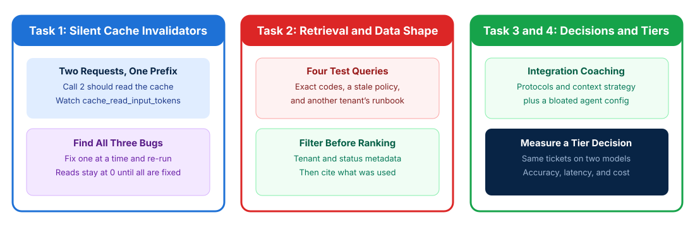

# Prompt Engineering and RAG Integration

## Time Required

45 minutes

## Overview

In this lab, you will find and fix the bugs that silently break prompt caching, make a retrieval pipeline respect tenants and document versions, practice integration decisions with a coach, and measure a model tier decision instead of guessing.

### You learn how to:
- Diagnose prompt caching failures from the `usage` fields and fix the prefix order.
- Filter retrieval by metadata so stale and unauthorized chunks never reach Claude.
- Choose integration mechanisms and harden an over-privileged agent configuration.
- Measure accuracy, latency, and cost before choosing a model tier.

## Scenario

You support Northwind’s customer-support assistant. Finance reports that the assistant’s input costs are far higher than the caching design promised. Customers report answers based on an old returns policy, and one enterprise tenant saw another tenant’s private runbook. Before the next release, you must find the causes, fix them, and justify the model the assistant uses.



## Lab Instructions

### Task 1: Find the silent cache invalidators

In this task, you create your workspace, run a support request twice, and fix the request builder until the second call reads the cache. The code has **three** separate bugs, and the cache read stays at 0 until all three are fixed.

1. Open a terminal, go to your course workspace, activate the virtual environment, and create a folder for this lab:

**macOS:**

```bash
cd ~/ccarp-labs
source .venv/bin/activate
mkdir ccarp-lab-02
cd ccarp-lab-02
```

**Windows (PowerShell):**

```powershell
cd $HOME\ccarp-labs
.venv\Scripts\Activate.ps1
mkdir ccarp-lab-02
cd ccarp-lab-02
```

2. Open `ccarp-lab-02` in VS Code (or your preferred editor) and create a file named `support_request.py`:

```python
# support_request.py - two support requests: does the second one read the cache?
from datetime import datetime, timezone
from dotenv import load_dotenv
import anthropic

load_dotenv()
client = anthropic.Anthropic()

RULES = [
    "Orders ship within 2 business days; expedited orders ship the same day if placed before 1 pm.",
    "Customers may return unopened items within 30 days for a full refund.",
    "Opened small appliances may be returned within 14 days for store credit only.",
    "Never promise a delivery date; quote the carrier's estimate and say it is an estimate.",
    "Refunds over $200 require a supervisor; tell the customer a supervisor will follow up.",
    "Never ask for or repeat full card numbers; the last four digits are enough to identify a card.",
    "Damaged-on-arrival items are replaced free of charge; ask for one photo of the damage.",
    "Loyalty points expire 12 months after they are earned and cannot be exchanged for cash.",
    "Price-match requests are honored within 7 days of purchase for identical items in stock.",
    "Escalate any mention of injury, legal action, or a regulator to a supervisor immediately.",
]
POLICY = "\n".join(f"Section {i + 1}: {rule}" for i, rule in enumerate(RULES * 4))

TOOLS = [{
    "name": "lookup_order",
    "description": "Look up one order by ID, such as ORD-1001: items, status, and carrier estimate.",
    "input_schema": {
        "type": "object",
        "properties": {"order_id": {"type": "string"}},
        "required": ["order_id"],
    },
}]

def build_request(customer_name, question):
    now = datetime.now(timezone.utc).isoformat()
    return {
        "model": "claude-haiku-5-5",
        "max_tokens": 1028,
        "output_config": {"effort": "low"},
        "tools": TOOLS,
        "system": [
            {"type": "text", "text": f"Request time: {now}\nYou are Northwind's support assistant, helping {customer_name}."},
            {"type": "text", "text": f"<support_policy>\n{POLICY}\n</support_policy>"},
        ],
        "messages": [{
            "role": "user",
            "content": [{"type": "text", "text": question, "cache_control": {"type": "ephemeral"}}],
        }],
    }

def send(label, customer_name, question):
    usage = client.messages.create(**build_request(customer_name, question)).usage
    print(f"{label}: cache write={usage.cache_creation_input_tokens:5}  cache read={usage.cache_read_input_tokens:5}")

send("Call 1", "Ana Lopez", "Can I return an opened blender?")
send("Call 2", "Ben Okafor", "How long do loyalty points last?")
```

3. Run it:

```bash
python support_request.py
```

4. Confirm the problem: both calls show `cache write` above 0 and `cache read` at 0. Every request pays the write premium, and nothing is ever reused.

5. Read `build_request()` and find the three bugs yourself. Ask: what changes between the two calls, and where does it sit relative to the cache breakpoint?

6. Fix the bugs one at a time, running the script after each fix. You can edit the code yourself or describe a fix to Claude Code, but decide the fix before you ask.

**Success criteria**

- Call 2 shows `cache write` at 0 and `cache read` equal to the size of the static prefix (about 1,700 tokens)
- The three bugs, and why each breaks caching:
  - **Timestamp at the top of `system`**: it changes on every request, so no two prefixes match
  - **Customer name in `system`**: it differs per customer, so the prefix is unique per customer
  - **Breakpoint on the user’s question**: the cache is written at a point that is different on every request, so nothing can be read back. Put `cache_control` on the last static block (the policy)
- The fix moves the timestamp and customer name into the user message, after the cached prefix

> [!TIP]
> If you run the fixed script again within 5 minutes, Call 1 reads the cache too. The cache lives across requests and processes, not just within one run.

### Task 2: Make retrieval respect tenants and versions

In this task, you run four queries through a small retrieval pipeline, predict each result, and add the metadata filter that fixes what goes wrong.

1. In `ccarp-lab-02`, create a file named `kb.json`:

```json
[
  {"id": "KB-101", "tenant_id": "all", "status": "active", "effective": "2026-01-10",
   "text": "Error ERR-4092-B means the replication queue is full. Clear stalled jobs with the queue-drain command, then restart replication."},
  {"id": "KB-102", "tenant_id": "all", "status": "active", "effective": "2026-02-01",
   "text": "Error ERR-5110-A means an expired API certificate. Rotate the certificate in the admin console and reconnect."},
  {"id": "POL-RET-v1", "tenant_id": "all", "status": "superseded", "effective": "2024-03-01",
   "text": "Returns: customers may return any item for a full refund within 60 days. Customers can return items in any condition, and customers get the refund in 5 days."},
  {"id": "POL-RET-v2", "tenant_id": "all", "status": "active", "effective": "2026-07-01",
   "text": "Return policy: unopened items qualify for a full refund within 30 days of delivery. Opened appliances qualify for store credit within 14 days."},
  {"id": "KB-130", "tenant_id": "all", "status": "active", "effective": "2025-11-20",
   "text": "Customers can track an order from the Orders page. Carrier estimates update every 4 hours."},
  {"id": "RUN-ACME-7", "tenant_id": "acme", "status": "active", "effective": "2026-05-02",
   "text": "Acme private runbook: to restart a stalled replication node, run acme-repl restart --node, then page the Acme on-call DBA at extension 4471."},
  {"id": "RUN-GLOBEX-2", "tenant_id": "globex", "status": "active", "effective": "2026-04-18",
   "text": "Globex runbook: replication nodes are managed by your hosting provider. Open a provider ticket instead of restarting nodes yourself."},
  {"id": "KB-140", "tenant_id": "all", "status": "active", "effective": "2026-03-03",
   "text": "Loyalty points expire 12 months after they are earned and cannot be exchanged for cash."},
  {"id": "KB-150", "tenant_id": "all", "status": "active", "effective": "2026-06-12",
   "text": "Damaged items are replaced free of charge. Ask the customer for one photo of the damage."},
  {"id": "KB-160", "tenant_id": "all", "status": "active", "effective": "2026-02-27",
   "text": "Price-match requests are honored within 7 days of purchase for identical items that are in stock."}
]
```

2. Create a file named `rag.py`. It ranks chunks with BM25, a lexical algorithm, so it runs without an embedding service:

```python
# rag.py - BM25 retrieval over kb.json, then a cited answer from Claude
import json
import math
import re
import sys
from dotenv import load_dotenv
import anthropic

load_dotenv()
client = anthropic.Anthropic()
KB = json.load(open("kb.json"))

def tokens(text):
    return re.findall(r"[a-z0-9]+(?:-[a-z0-9]+)*", text.lower())

def bm25(query, chunks, k1=1.5, b=0.75):
    docs = [tokens(c["text"]) for c in chunks]
    avg = sum(len(d) for d in docs) / len(docs)
    scores = []
    for chunk, doc in zip(chunks, docs):
        score = 0.0
        for term in set(tokens(query)):
            df = sum(term in d for d in docs)
            if df:
                idf = math.log(1 + (len(docs) - df + 0.5) / (df + 0.5))
                tf = doc.count(term)
                score += idf * tf * (k1 + 1) / (tf + k1 * (1 - b + b * len(doc) / avg))
        scores.append((score, chunk))
    return [c for s, c in sorted(scores, key=lambda x: -x[0]) if s > 0]

def allowed(chunk, tenant):
    # TODO (you decide): which chunks may this tenant's question ever see?
    return True

def retrieve(query, tenant, top_k=2):
    candidates = [c for c in KB if allowed(c, tenant)]
    return bm25(query, candidates)[:top_k]

def answer(query, tenant):
    chunks = retrieve(query, tenant)
    context = "\n".join(f"[{c['id']}] {c['text']}" for c in chunks)
    response = client.messages.create(
        model="claude-haiku-5-5",
        max_tokens=1028,
        output_config={"effort": "low"},
        system="Answer from the retrieved chunks only, in one or two sentences. Cite the chunk ID in brackets. "
               "If the chunks do not answer the question, say so.",
        messages=[{"role": "user", "content": f"<retrieved_chunks>\n{context}\n</retrieved_chunks>\n\n{query}"}],
    )
    print(f"Tenant: {tenant}   Retrieved: {[c['id'] for c in chunks]}")
    print("Answer:", "".join(b.text for b in response.content if b.type == "text").strip())

if __name__ == "__main__":
    answer(sys.argv[2], sys.argv[1])
```

3. Before you run each command below, predict what the answer will be. Then run it.

```bash
python rag.py acme "What does error ERR-4092-B mean?"
python rag.py acme "Can customers return an item for a refund?"
python rag.py globex "How do I restart a stalled replication node?"
```

4. Compare the results with your predictions:
   - The error-code query works: BM25 matches the exact identifier
   - The returns answer is confident, cited, and wrong: it quotes the superseded 60-day policy
   - Globex receives Acme’s private runbook, including an internal phone extension

5. Fix `allowed()` at the `TODO` line. Decide which metadata must be checked **before** ranking, then write the one-line condition.

6. Run the second and third queries again, then run the third query for `acme`:

```bash
python rag.py acme "Can customers return an item for a refund?"
python rag.py globex "How do I restart a stalled replication node?"
python rag.py acme "How do I restart a stalled replication node?"
```

**Success criteria**

- The returns answer now cites `POL-RET-v2` (30 days unopened, 14 days store credit for opened appliances)
- Globex now gets its own runbook (`RUN-GLOBEX-2`) and never sees `RUN-ACME-7`, while Acme still gets `RUN-ACME-7`
- Your filter checks both `tenant_id` (the tenant’s own chunks plus `all`) and `status == "active"`, before ranking
- The model never misbehaved: it answered faithfully from what retrieval gave it. Both failures were retrieval failures

> [!IMPORTANT]
> Permission and version rules belong in the retrieval layer, applied before ranking. A system prompt that says “ignore other tenants’ documents” is not access control.

### Task 3: Make integration decisions with a coach

In this task, Claude Code coaches you through five integration decisions, and then you find what is wrong with an over-privileged agent configuration.

1. In `ccarp-lab-02`, create a file named `integration-cases.md`:

```markdown
# Integration cases

1. Jira and ServiceNow actions are needed by four internal apps and by developers using Claude Code.
2. One payment service must call a fraud-scoring endpoint with a 15 ms budget.
3. A procurement agent must hand vendor reviews to a partner company's compliance agent,
   which the partner builds and operates.
4. A 6,000-token returns policy is needed on nearly every request and changes twice a year.
5. An operations agent is connected to 9 MCP servers exposing 220 tools, and each request needs 2 or 3 of them.
```

2. Start Claude Code in `ccarp-lab-02` if it is not already running, and paste:

```text
Act as my integration architecture coach. Read integration-cases.md. Present the cases one at a time.
For each, wait for my answer, then tell me whether I'm right and name the principle.
Do not reveal answers before I reply.

Judge using these principles:
- MCP connects agents to tools and data that several applications share.
- A direct API call or CLI fits one tightly coupled consumer with the least machinery.
- A2A connects independently owned agents across organizational boundaries.
- Small, stable, always-needed context can be loaded in full and cached; large or rarely needed
  context should be discovered progressively (retrieval, tool search, Skills).
```

3. Answer each case in the chat.

4. Create a file named `support-agent-config.json`:

```json
{
  "agent": "tier1-support-drafting-assistant",
  "role": "Reads customer tickets and drafts replies for a human agent to review and send.",
  "tools": ["read_ticket", "lookup_order", "draft_reply", "issue_refund", "close_account", "send_email"],
  "mcp_auth": { "mode": "service_account", "account": "support-admin", "scopes": ["support:*", "billing:*"] },
  "customer_id_source": "Taken from the customer ID written in the ticket text"
}
```

5. In Claude Code, send one message listing every problem you see in `support-agent-config.json` and the fix for each. Then paste:

```text
Compare my list with support-agent-config.json. Tell me what I missed and anything I listed that is
not a real problem. Then write hardened-config.json applying least privilege and identity propagation.
```

**Success criteria**

- **Cases**: 1 MCP; 2 direct API; 3 A2A; 4 load in full with prompt caching; 5 tool search (progressive discovery) plus fewer servers per role
- **Config**: remove `issue_refund`, `close_account`, and `send_email` (the role only drafts); replace the shared admin account with the user’s identity; narrow scopes to read tickets and orders; never trust a customer ID written in untrusted ticket text

### Bonus Task 4: Measure a tier decision

In this bonus task, you run the same labeled tickets on two configurations and decide which one you would ship.

1. Create a file named `tier_test.py`:

```python
# tier_test.py - the same 8 labeled tickets on two tiers: accuracy, latency, and cost
import time
from dotenv import load_dotenv
import anthropic

load_dotenv()
client = anthropic.Anthropic()

LABELS = ["order_status", "return_request", "billing_problem", "account_access", "complaint"]
TICKETS = [
    ("Where is my package? It said out for delivery yesterday.", "order_status"),
    ("I want to send back the blender, it is too loud.", "return_request"),
    ("You charged my card twice for one order.", "billing_problem"),
    ("I can't log in, the reset email never arrives.", "account_access"),
    ("Third late delivery this month. Your service has gotten terrible.", "complaint"),
    ("The invoice shows a fee I never agreed to.", "billing_problem"),
    ("My order arrived but one item is missing. Can you check what shipped?", "order_status"),
    ("Your driver was rude and left the box in the rain. I want this on record.", "complaint"),
]
CONFIGS = [  # (model, effort, input $ / MTok, output $ / MTok)
    ("claude-haiku-5-5", "low", 0.10, 0.50),
    ("claude-sonnet-5-5", "medium", 2.00, 10.00),
]

for model, effort, price_in, price_out in CONFIGS:
    correct, cost, start = 0, 0.0, time.perf_counter()
    for text, expected in TICKETS:
        response = client.messages.create(
            model=model,
            max_tokens=2048,
            output_config={"effort": effort},
            system=f"Classify the support ticket as exactly one of: {', '.join(LABELS)}. Reply with the label only.",
            messages=[{"role": "user", "content": text}],
        )
        label = "".join(b.text for b in response.content if b.type == "text").strip()
        correct += label == expected
        cost += (response.usage.input_tokens * price_in + response.usage.output_tokens * price_out) / 1_000_000
    seconds = time.perf_counter() - start
    print(f"{model:18} effort={effort:6}  accuracy {correct}/8  {seconds:5.1f} s total  ${cost:.5f}")
```

2. Predict the accuracy and cost difference, then run it:

```bash
python tier_test.py
```

3. In Claude Code, tell Claude which configuration you would ship for this classification step and why, then ask: “What would make you change this decision?”

**Success criteria**

- Both configurations typically classify all 8 tickets correctly, and Sonnet costs roughly 20 times more
- For a simple, high-volume classification step, Haiku at low effort is the defensible choice
- Eight tickets are too few to prove equal quality: a production decision needs a larger labeled set, including the hard and ambiguous cases

## Congratulations!

In this lab, you have:
- Diagnosed prompt caching failures from the `usage` fields and fixed the prefix order.
- Filtered retrieval by metadata so stale and unauthorized chunks never reach Claude.
- Chosen integration mechanisms and hardened an over-privileged agent configuration.
- Measured accuracy, latency, and cost before choosing a model tier.
