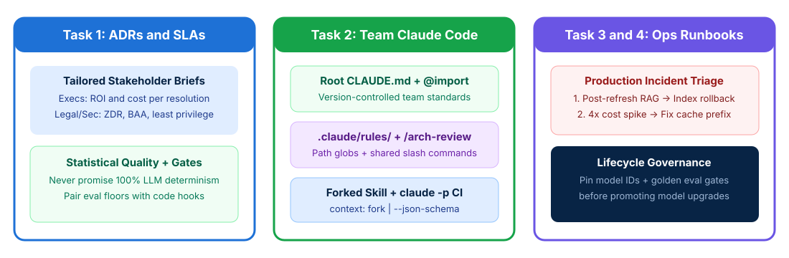

# Lifecycle Architecture Review and Team Enablement

## Time Required

60 minutes

## Overview

In this lab, you will author architectural handoff documentation and stakeholder briefs, standardize Claude Code across an engineering team, and triage simulated production incidents using an operational runbook.

### You learn how to:
- Document Architectural Decision Records (ADRs) and tailor SLA communications by stakeholder group.
- Standardize team repositories with `CLAUDE.md`, path-scoped `.claude/rules/`, commands, and isolated skills.
- Diagnose production telemetry alerts across retrieval, caching, hooks, and CI layers.
- Run non-interactive architectural checks with Claude Code in CI/CD pipelines.

## Scenario

Your team is preparing to hand off a new enterprise Claude platform to production operations while onboarding 40 software engineers onto Claude Code. Before launch, you must align executive, security, and engineering stakeholders on realistic SLAs, standardize repository configurations, and prepare an on-call runbook for production incidents.



## Lab Instructions

### Task 1: Author an Architectural Decision Record (ADR) and stakeholder SLA brief

In this task, you create your lab workspace, document key architectural trade-offs in an ADR, and craft stakeholder-specific communication briefs that align expectations around statistical LLM quality and deterministic guardrails.

1. Open your terminal (Terminal on macOS or PowerShell / Command Prompt / VS Code Terminal on Windows) and create a working folder for this lab:

```bash
mkdir ccarp-lab-04
cd ccarp-lab-04
```

2. Open `ccarp-lab-04` in VS Code (or your preferred text editor) and create a file named `project-discovery-notes.json` capturing the system context and stakeholder concerns:

```json
{
  "project_name": "Enterprise Claims and Policy Assistant",
  "pinned_model_id": "claude-sonnet-4-20250514",
  "router_model_id": "claude-haiku-4-5-20251001",
  "key_decisions": [
    "Chose tiered routing (Haiku -> Sonnet) + Prompt Caching on the 10K-token policy guide over downsizing all turns to Haiku.",
    "Chose Model Context Protocol (MCP) for Claims and Policy lookups so 3 internal apps and Claude Code share one governed integration.",
    "Removed delete_claim and issue_payout tools from the drafting agent configuration to enforce least privilege."
  ],
  "stakeholder_questions": {
    "executive_sponsor": "How does this reduce our cost per resolved claim and accelerate turnaround time?",
    "chief_information_security_officer": "How do you guarantee a prompt injection cannot trigger an unauthorized payout or leak PHI under HIPAA?",
    "vp_of_operations": "Can you guarantee 100% deterministic accuracy on every claim summary?"
  }
}
```

3. Launch Claude Code in `ccarp-lab-04`:

```bash
claude
```

4. In Claude Code, run the following prompt to generate `adr-001-claims-architecture.md` from `project-discovery-notes.json`:

```text
Read project-discovery-notes.json. Create adr-001-claims-architecture.md containing:
1. "Architectural Decision Record (ADR-001)": Context, Decisions Made (Model Tiering + Prompt Caching, MCP Protocol Selection, and Least-Privilege Capability Removal), Rejected Alternatives, and Quantitative Trade-Offs.
2. "Tailored Stakeholder Communication Briefs":
   - Executive Brief (business value pillars: cost per resolved claim, cycle-time reduction, phased rollout ROI without low-level token jargon).
   - Security and Legal Brief (HIPAA BAA + Zero Data Retention endpoints, XML trust boundaries, least-privilege tool removal, and deterministic PreToolUse hooks).
   - Operations and SLA Alignment Brief (explaining why LLM comprehension follows a statistical quality distribution measured against a golden evaluation floor, paired with 100% deterministic code gates for financial rules and graceful HITL fallback queues).
```

5. Review `adr-001-claims-architecture.md` in your editor to verify how each stakeholder group receives the exact framing they care about.

> [!IMPORTANT]
> On the CCAR-P exam, never promise stakeholders 100% deterministic LLM prose outputs. Instead, frame LLM quality as a **statistical benchmark distribution** governed by offline golden eval gates, and pair it with **deterministic code hooks and HITL fallbacks** where 100% policy compliance is mandatory.

### Task 2: Standardize Claude Code for an engineering team

In this task, you configure a shared repository layout so every developer and CI pipeline inherits universal standards via root `CLAUDE.md` and `@import`, conditional file conventions via `.claude/rules/`, shared slash commands in `.claude/commands/`, and isolated skills in `.claude/skills/`.

1. Inside `ccarp-lab-04`, create the standard directories for a team repository:

```bash
mkdir -p docs .claude/rules .claude/commands .claude/skills/perf-audit src/api
```

2. Create `docs/architecture-standards.md` with modular rules that will be imported into the root `CLAUDE.md`:

```markdown
# Enterprise Architecture Standards

- Always pin exact Claude model snapshot IDs (such as `claude-sonnet-4-20250514`) in production configs.
- Place static tools, system instructions, and `<policy_document>` blocks before dynamic per-request variables to preserve Prompt Caching hit rates.
- Never attach state-mutating or administrative tools to read/draft-only agents.
```

3. Create the project-level `CLAUDE.md` at the root of `ccarp-lab-04`:

```markdown
# Claims Platform Repository Instructions

This file is version-controlled in Git so all engineers and CI pipelines share the same standards.

## Architecture and Security Rules
@docs/architecture-standards.md

## Development Workflow
- Use Plan Mode before executing multi-file refactorings or schema migrations.
- Run golden evaluation gates before promoting any prompt, chunking, or model version change.
```

4. Create a path-scoped rule file at `.claude/rules/api-handlers.md` using YAML frontmatter `paths` globs so API conventions load only when editing files under `src/api/`:

```markdown
---
paths:
  - "src/api/**/*.ts"
  - "src/api/**/*.py"
---
# API Handler Conventions

- Propagate caller-scoped OAuth/JWT identity to downstream MCP tools; never use a shared superuser token.
- Attach a correlation `trace_id` to every model call, retrieval query, and MCP tool invocation.
```

5. Create a shared project slash command at `.claude/commands/arch-review.md`:

```markdown
Review the target service configuration against our enterprise architecture checklist:
1. Check for unpinned floating model aliases.
2. Check for dynamic variables (timestamps, UUIDs) placed ahead of cached static prompt prefixes.
3. Check for capability bloat (unneeded tools attached to the agent role).
4. Check for missing caller identity propagation or missing trace_id instrumentation.
```

6. Create an isolated skill at `.claude/skills/perf-audit/SKILL.md` with `context: fork`, `allowed-tools`, and `argument-hint`:

```markdown
---
name: perf-audit
description: Audits service configs for TTFT latency, prompt cache invalidation, and RAG top-K bloat
context: fork
allowed-tools: ["Read", "Grep", "Glob"]
argument-hint: "<config-file-path>"
---
Inspect the specified configuration file in an isolated subagent context and return a concise summary of latency, caching, and retrieval optimizations.
```

7. In Claude Code inside `ccarp-lab-04`, run `/memory` to verify that `CLAUDE.md`, `@docs/architecture-standards.md`, and `.claude/rules/api-handlers.md` are recognized.

### Task 3: Triage production incidents and write an operational runbook

In this task, you diagnose four simulated production telemetry alerts by correlating each symptom with the exact architectural layer that changed, and compile an on-call runbook with immediate rollback procedures.

1. In `ccarp-lab-04`, create a file named `production-alerts.json` containing four live on-call incidents:

```json
{
  "alerts": [
    {
      "alert_id": "SEV2-01",
      "symptom": "RAG claims assistant suddenly returns confident but wrong policy coverage answers starting at 03:15 UTC. Model snapshot ID and p50 latency are unchanged.",
      "recent_deploy": "Automated ingestion job re-indexed 8,500 updated policy PDFs at 03:00 UTC."
    },
    {
      "alert_id": "SEV2-02",
      "symptom": "Time-to-First-Token (TTFT) doubled from 0.9s to 2.1s and input token cost spiked 4x immediately after a minor prompt logging commit.",
      "telemetry": "cache_read_input_tokens dropped from 94% to 0%; cache_creation_input_tokens spiked to 100%."
    },
    {
      "alert_id": "SEV2-03",
      "symptom": "Audit logs show the support agent skipped caller identity verification in 9% of sessions despite a bold warning added to the system prompt.",
      "telemetry": "Verification currently relies on system prompt instructions rather than a PreToolUse code gate."
    },
    {
      "alert_id": "SEV2-04",
      "symptom": "Automated GitHub Actions pull request review job hangs indefinitely until the 60-minute CI runner timeout kills it.",
      "recent_deploy": "Added step: claude \"Review this PR diff for security issues\" to .github/workflows/pr-check.yml"
    }
  ]
}
```

2. Ask Claude Code to analyze `production-alerts.json` and generate `operational-runbook.md`:

```text
Read production-alerts.json. Create operational-runbook.md with a structured triage table and step-by-step remediation playbook for SEV2-01 through SEV2-04, specifying for each alert:
1. Failing Architectural Layer (Retrieval/Indexing, Prompt Cache Prefix, Deterministic Hook Gate, or CLI Invocation Mode).
2. First Diagnostic Verification Check.
3. Immediate Rollback / Remediation Action.
4. Model and Prompt Upgrade Governance Rule (how golden eval gates and pinned model snapshots prevent regressions before traffic promotion).
```

3. Open `operational-runbook.md` in your editor and confirm the four root causes and fixes:
   - **SEV2-01**: **Retrieval/Indexing layer** -> roll back to the previous verified vector index snapshot and fix chunking/embedding alignment.
   - **SEV2-02**: **Prompt Cache Prefix layer** -> a developer injected a dynamic per-request variable (such as a timestamp or request ID) ahead of the static cached prefix; move dynamic text after the `cache_control` breakpoint.
   - **SEV2-03**: **Deterministic Hook Gate layer** -> replace probabilistic prompt prose with a deterministic `PreToolUse` hook that blocks downstream tools until identity is verified.
   - **SEV2-04**: **CLI Invocation Mode** -> add `-p` (`--print`) along with `--output-format json` and `--json-schema` so Claude Code runs non-interactively in CI.

### Bonus Task 4: Execute a non-interactive CI architecture check with Claude Code

In this bonus task, you create a flawed service configuration file and audit it non-interactively from your terminal using `claude -p` and `--json-schema`.

1. In `ccarp-lab-04`, create a file named `src/api/claims_agent_config.json` that contains three intentional architectural defects:

```json
{
  "service": "claims-drafting-assistant",
  "model": "claude-sonnet-latest",
  "system_prompt_prefix": "Current Timestamp: {{NOW_ISO}} | Static 10K Policy: {{POLICY_TEXT}}",
  "attached_tools": ["read_claim", "draft_summary", "issue_wire_payout", "delete_customer_record"],
  "mcp_auth": "shared_admin_service_token"
}
```

2. Exit your interactive Claude Code session (`/exit` or `Ctrl+C`) and run `claude -p` from your terminal to audit `src/api/claims_agent_config.json` into structured JSON findings:

```bash
claude -p "Audit src/api/claims_agent_config.json against our CLAUDE.md architecture standards" \
  --output-format json \
  --json-schema '{"type":"object","properties":{"findings":{"type":"array","items":{"type":"object","properties":{"defect_category":{"type":"string"},"severity":{"type":"string","enum":["critical","high","medium"]},"issue":{"type":"string"},"remediation":{"type":"string"}},"required":["defect_category","severity","issue","remediation"]}}},"required":["findings"]}'
```

3. Confirm that the JSON output identifies the unpinned model alias (`claude-sonnet-latest`), the broken prompt cache prefix (`{{NOW_ISO}}` at the start), the capability bloat (`issue_wire_payout`, `delete_customer_record`), and the shared admin token.

## Congratulations!

In this lab, you have:
- Documented Architectural Decision Records (ADRs) and tailored SLA communications by stakeholder group.
- Standardized team repositories with `CLAUDE.md`, path-scoped `.claude/rules/`, commands, and isolated skills.
- Diagnosed production telemetry alerts across retrieval, caching, hooks, and CI layers.
- Run non-interactive architectural checks with Claude Code in CI/CD pipelines.
