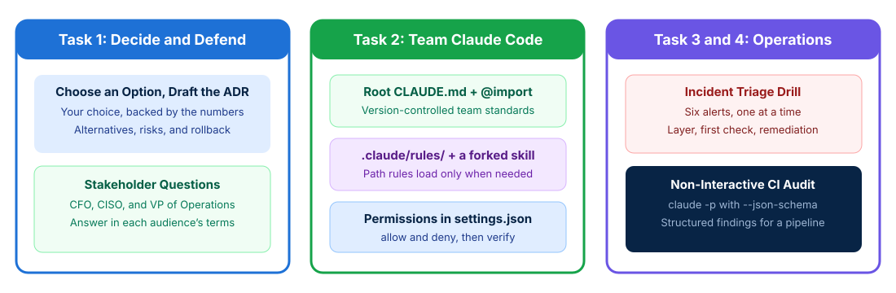

# Lifecycle Architecture Review and Team Enablement

## Time Required

60 minutes

## Overview

In this lab, you will choose and document an architecture decision, defend it to three skeptical stakeholders, set up Claude Code so a whole engineering team inherits the same standards and guardrails, and run an on-call incident drill.

### You learn how to:
- Choose between architecture options with data, document the decision in an ADR, and defend it to different audiences.
- Standardize Claude Code for a team with `CLAUDE.md`, path-scoped rules, a forked skill, and enforced permissions.
- Triage production incidents by mapping each symptom to the layer that changed.
- Run non-interactive architecture checks with Claude Code in a CI pipeline.

## Scenario

Your team is handing a claims-processing assistant to production operations and onboarding 40 engineers onto Claude Code. The executive sponsor, the CISO, and the VP of Operations each have concerns about the launch. Before go-live, you must settle the open model-routing decision, set up the shared repository, and make sure the on-call team can triage the incidents most likely to happen.



## Lab Instructions

### Task 1: Choose, document, and defend a decision

In this task, you create your workspace, choose a model-routing option from measured data, have Claude draft the ADR from your choice, and then defend the decision to three stakeholders.

1. Open a terminal, go to your course workspace, and create a folder for this lab:

**macOS:**

```bash
cd ~/ccarp-labs
mkdir ccarp-lab-04
cd ccarp-lab-04
```

**Windows (PowerShell):**

```powershell
cd $HOME\ccarp-labs
mkdir ccarp-lab-04
cd ccarp-lab-04
```

2. Open `ccarp-lab-04` in VS Code (or your preferred editor) and create a file named `options.md`:

```markdown
# Claims assistant: model routing options

Measured on the 500-case golden evaluation set. SLA: p95 under 4 seconds.
Volume: 1.2 million requests per month. 70% are simple status and coverage questions.

| Option | Accuracy | p95 latency | Monthly model cost | Notes |
| --- | --- | --- | --- | --- |
| A: Sonnet for all traffic | 93% | 3.1 s | $41,000 | One model, simplest to operate |
| B: Haiku router, Haiku for simple, Sonnet for the rest | 92% | 1.4 s simple, 3.3 s other | $19,000 | Router misroutes 2% of complex cases |
| C: Opus for all traffic | 95% | 5.8 s | $83,000 | Best accuracy |

Constraints: claims contain PHI; payouts are never made by the assistant;
a human adjuster reviews every claim decision.
```

3. Read the options and choose one. Start Claude Code in `ccarp-lab-04`:

```bash
claude
```

4. Send one message that states your choice and your reason in one or two sentences, starting with:

```text
I choose option
```

5. Then paste this prompt:

```text
Read options.md. Write adr-001-model-routing.md for the option I chose, with these sections:
Context, Decision, Alternatives Considered (with their numbers and why each was rejected),
Consequences (including new risks and how they are measured), and Rollback.
If my choice breaks a stated constraint or the SLA, say so plainly before writing the ADR.
```

6. Read the ADR. Then paste this prompt to start the stakeholder round:

```text
Now play three stakeholders, one at a time: the CFO, the CISO, and the VP of Operations.
Each asks me the hardest question they would ask about this ADR. Wait for my answer
before moving on. After each answer, grade it: did I use that stakeholder's terms
(money, risk and data protection, or reliability and process), did I use the numbers,
and did I avoid promising that the AI will always be right?
```

7. Answer each stakeholder in two or three sentences.

**Success criteria**

- Option C is rejected because it breaks the 4-second p95 SLA, whatever its accuracy
- Options A and B are both defensible. B’s case is cost and latency; its new risk, misrouting, must be measured and owned
- Your answer to the VP of Operations frames quality as a measured rate on the evaluation set, backed by adjuster review, never as a guarantee
- Your answer to the CISO addresses PHI handling and data retention, not model accuracy

> [!IMPORTANT]
> On the exam, the best stakeholder answer gives each audience the consequence it cares about, uses numbers, and never promises deterministic LLM output.

### Task 2: Standardize Claude Code for the team

In this task, you set up the shared repository configuration that every engineer and CI runner inherits, then verify that each piece works.

1. Exit Claude Code (`/exit`). In `ccarp-lab-04`, create the folders a team repository needs:

**macOS:**

```bash
mkdir -p docs .claude/rules .claude/skills/perf-audit src/api secrets
```

**Windows (PowerShell):**

```powershell
mkdir docs, .claude\rules, .claude\skills\perf-audit, src\api, secrets
```

2. Create `docs/architecture-standards.md`:

```markdown
# Enterprise Architecture Standards

- Always pin an explicit Claude model ID (such as `claude-sonnet-5-5`), never a moving alias, in production configs.
- Place static tools, system instructions, and policy documents before per-request content to preserve prompt caching.
- Never attach state-changing or administrative tools to read-only or drafting agents.
```

3. Create the project `CLAUDE.md` at the root of `ccarp-lab-04`:

```markdown
# Claims Platform Repository Instructions

## Architecture and Security Rules
@docs/architecture-standards.md

## Development Workflow
- Use Plan Mode before multi-file refactorings or schema migrations.
- Run the golden evaluation before promoting any prompt, chunking, or model change.
```

4. Create a path-scoped rule, `.claude/rules/api-handlers.md`, that loads only when Claude works on files under `src/api/`:

```markdown
---
paths:
  - "src/api/**/*.py"
---
# API Handler Conventions

- Every handler takes the caller's identity token as a parameter and passes it to downstream tools; never use a shared service account.
- Every handler accepts a `trace_id` and includes it in every log line and model call.
```

5. Create a skill, `.claude/skills/perf-audit/SKILL.md`, that runs in a forked context with read-only tools:

```markdown
---
name: perf-audit
description: Audits a service config for latency, prompt caching, and retrieval settings. Use when asked to review performance of a config file.
context: fork
allowed-tools: Read, Grep, Glob
argument-hint: "<config-file-path>"
---
Read the config file given as the argument. Report, in at most 6 bullets, anything that would hurt
time to first token, break the prompt cache prefix, or bloat retrieved context.
```

> [!NOTE]
> Older guides put shared team commands in `.claude/commands/`. In current releases, commands and skills are merged: a skill folder creates the same `/perf-audit` command and can also run in a forked context with restricted tools.

6. Create the team permissions file, `.claude/settings.json`:

```json
{
  "permissions": {
    "allow": ["Bash(git status)", "Bash(git diff:*)"],
    "deny": ["Read(./secrets/**)", "Bash(curl:*)"]
  }
}
```

7. Create a fake secret so you can test the deny rule. Put this one line in `secrets/claims-db.env`:

```text
CLAIMS_DB_PASSWORD=demo-not-a-real-secret
```

8. Start Claude Code in `ccarp-lab-04`. If it asks whether you trust this folder, accept: Claude Code ignores a project’s `allow` rules until the folder is trusted. Run `/memory`. Confirm that the project `CLAUDE.md` is listed, and close the menu.

9. Test the path-scoped rule. Ask Claude:

```text
Create src/api/claim_status.py with a function get_claim_status(claim_id) that looks up a claim
and logs the result. Keep it short.
```

10. Read the file Claude wrote, then ask:

```text
Which project rules did you follow when writing src/api/claim_status.py, and where did each come from?
```

11. Test the deny rule. Ask Claude:

```text
Print the contents of secrets/claims-db.env
```

12. Test the skill. Create `src/api/search_config.json`:

```json
{
  "service": "policy-search",
  "model": "claude-sonnet-5-5",
  "system_prompt": "Request {{request_id}} received at {{now}}. You are the policy search assistant. {{POLICY_TEXT}}",
  "retrieval": { "top_k": 50, "rerank": false },
  "stream": false
}
```

13. Run `/perf-audit src/api/search_config.json` and read the report. Then type `/exit`.

**Success criteria**

- `/memory` lists the project `CLAUDE.md`, which imports the architecture standards
- `claim_status.py` takes an identity token and a `trace_id`, as the path-scoped API rule requires, and Claude names `.claude/rules/api-handlers.md` as the source
- Claude cannot read `secrets/claims-db.env`: the deny rule blocks it, whatever the prompt says
- `/perf-audit` runs as a slash command and flags the per-request values at the start of the system prompt, the 50 retrieved chunks with no reranking, and the lack of streaming

> [!IMPORTANT]
> `CLAUDE.md` and rules are guidance that Claude follows. Permission rules in `settings.json` are enforced. For organization-wide policy that developers must not override, the same rules go in managed settings.

### Task 3: Run an incident triage drill

In this task, Claude Code runs an on-call drill. You diagnose six alerts one at a time, then turn the drill into a runbook.

1. In `ccarp-lab-04`, create `production-alerts.md`:

```markdown
# Production alerts

1. Since 03:15 UTC the claims assistant gives confident, specific, but wrong coverage limits.
   Latency and model ID are unchanged. Change log: the nightly ingestion job finished at 03:00 UTC.
2. Time to first token rose from 0.9 s to 2.1 s, and input-token spend rose 4x, right after a deploy
   that added the request ID and timestamp to the start of the system prompt for logging.
3. An audit shows identity verification was skipped in 9% of sessions. Last week the team added a
   bold "ALWAYS VERIFY IDENTITY FIRST" line to the system prompt.
4. The new PR-review job in CI never finishes; runners are killed at the 60-minute timeout.
   The job step runs: claude "Review this PR diff for security issues"
5. Between 9:00 and 9:15 each morning, 12% of requests fail with HTTP 429. The rest of the day is normal.
6. A small share of requests about medication dosages return no answer, and the logs show
   stop_reason "refusal".
```

2. Start Claude Code in `ccarp-lab-04` and paste:

```text
Run an on-call triage drill. Read production-alerts.md and present the alerts one at a time.
For each, wait for my answer: the failing layer, the first thing I would check, and the immediate
remediation. Then grade my answer and give the expert answer. Do not reveal answers first.

Judge using these principles:
- Map the symptom to the layer that most recently changed: retrieval and indexing, prompt and
  context, model, tools and integration, or platform and operations.
- Check the cheapest decisive evidence first: usage fields, traces, change logs, error codes.
- Prefer rollback and structural fixes (code gates, configuration) over stronger prompt wording.
```

3. Answer each alert in the chat.

4. When the drill ends, paste:

```text
Write operational-runbook.md from this drill: one section per alert with the symptom,
first check, remediation, and how to prevent it from happening again.
```

**Success criteria**

- **1**: retrieval and indexing. Check whether the right chunks are retrieved for failing questions; roll back the index
- **2**: the prompt cache prefix. Check `cache_read_input_tokens`; move the per-request values after the cached prefix
- **3**: a missing code gate. Prompt wording is probabilistic; enforce verification with a `PreToolUse` hook or a prerequisite check
- **4**: CLI invocation. The job runs Claude Code interactively and waits for input; add `-p`
- **5**: rate limits at peak. Retry with backoff that honors `retry-after`, smooth the burst with a queue, or request higher limits
- **6**: refusals. Handle `stop_reason == "refusal"` explicitly: route to a human or pharmacist workflow, and review whether the requests are legitimate

### Bonus Task 4: Run a non-interactive architecture check

In this bonus task, you audit a defective service configuration from the command line, the way a CI pipeline would, and get structured findings back.

1. Create `src/api/claims_agent_config.json`:

```json
{
  "service": "claims-drafting-assistant",
  "model": "claude-sonnet-latest",
  "system_prompt_prefix": "Current Timestamp: {{NOW_ISO}} | Static 10K Policy: {{POLICY_TEXT}}",
  "attached_tools": ["read_claim", "draft_summary", "issue_wire_payout", "delete_customer_record"],
  "mcp_auth": "shared_admin_service_token"
}
```

2. Before you run the audit, list the defects you expect it to find.

3. From your terminal in `ccarp-lab-04` (not inside a Claude Code session), run:

**macOS:**

```bash
claude -p "Audit src/api/claims_agent_config.json against our CLAUDE.md architecture standards" \
  --output-format json \
  --json-schema '{"type":"object","properties":{"findings":{"type":"array","items":{"type":"object","properties":{"defect_category":{"type":"string"},"severity":{"type":"string","enum":["critical","high","medium"]},"issue":{"type":"string"},"remediation":{"type":"string"}},"required":["defect_category","severity","issue","remediation"]}}},"required":["findings"]}'
```

**Windows (PowerShell):**

```powershell
claude -p "Audit src/api/claims_agent_config.json against our CLAUDE.md architecture standards" `
  --output-format json `
  --json-schema '{"type":"object","properties":{"findings":{"type":"array","items":{"type":"object","properties":{"defect_category":{"type":"string"},"severity":{"type":"string","enum":["critical","high","medium"]},"issue":{"type":"string"},"remediation":{"type":"string"}},"required":["defect_category","severity","issue","remediation"]}}},"required":["findings"]}'
```

4. Compare the findings with the list you made.

**Success criteria**

- The JSON output lists four defects: the unpinned alias (`claude-sonnet-latest`), the timestamp at the start of the cached prefix, the unneeded `issue_wire_payout` and `delete_customer_record` tools, and the shared admin token
- The findings appear in the `structured_output` field of the JSON result, ready for a pipeline to parse
- The command returns and exits without waiting for input, which is what a CI step needs

## Congratulations!

In this lab, you have:
- Chosen between architecture options with data, documented the decision in an ADR, and defended it to different audiences.
- Standardized Claude Code for a team with `CLAUDE.md`, path-scoped rules, a forked skill, and enforced permissions.
- Triaged production incidents by mapping each symptom to the layer that changed.
- Run non-interactive architecture checks with Claude Code in a CI pipeline.
