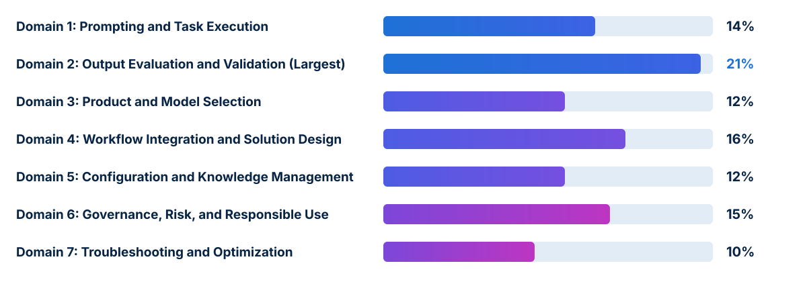

<!-- course-title: Claude Certified Associate - Foundations: Hands-On Exam Prep Workshop -->
<!-- course-theme: roi-alt-theme -->

<!-- layout: title -->

Claude Certified Associate - Foundations: Hands-On Exam Prep Workshop

# Chapter 1: Claude Certified Associate - Foundations Overview

---

# Chapter 1: Objectives

- Review the CCAO-F exam format, scoring, and domain weights
- Distinguish the Associate scope from Claude Developer and Architect roles
- Analyze the three official CCAO-F sample questions
- Apply a structured exam-day strategy to eliminate common distractors

---

<!-- layout: navigation -->
# Chapter 1

- **Understanding the Exam**
- The Associate Role vs Developer and Architect Scopes
- Preparing to Pass the Exam

---

<!-- layout: card-layout -->
# Exam Details at a Glance (CCAO-F)

### Format and Time Limit
- The CCAO-F exam contains 60 multiple-choice and multiple-response items completed within 120 minutes.
- Each multiple-response item states explicitly how many answer choices to select.

### Scoring Standard
- Criterion-referenced assessment reported on a scaled range from 100 to 1,000 with a passing cut score of 720.
- Your pass or fail status is determined by your total scaled score, accompanied by domain-level percentage breakdowns.

### Exam Fee and Validity
- The exam fee is $99 USD, and the credential is valid for 12 months from the date awarded.
- On-time renewal requires completing a free, non-proctored assessment on the Anthropic Partner Academy.

### Delivery Environment
- Delivered via Pearson VUE (online proctored or test center) under strict non-disclosure and clear-workspace rules.

---

<!-- layout: stacked -->
# Exam Blueprint Across Seven Domains

- **Domain 2: Output Evaluation and Validation (21%)** is the largest domain on the exam, representing over one-fifth of all questions
- **Domain 4: Workflow Integration and Solution Design (16%)**, **Domain 6: Governance, Risk, and Responsible Use (15%)**, and **Domain 1: Prompting and Task Execution (14%)** form the core operational block
- **Domain 3: Product and Model Selection (12%)**, **Domain 5: Configuration and Knowledge Management (12%)**, and **Domain 7: Troubleshooting and Optimization (10%)** complete the blueprint

---

<!-- layout: 2-column -->
# Minimally Qualified Candidate (MQC) Profile

### Professional Role Profile
- Professionals in **operations, marketing, project management, HR, education, communications, business analysis, and consulting**
- Positioned between casual AI prompt users and technical AI practitioners
- Uses Claude as a core daily productivity tool and builds **Claude Projects** to streamline real-world workflows
- **No software development or API experience is required**

### Core Associate Competencies
- Translating business objectives into structured prompts, task decompositions, and iterative workflows
- Selecting built-in platform features (**Projects**, **Artifacts**, **research mode**, **chat**, **connectors**) and model tiers (**Haiku**, **Sonnet**, **Opus**)
- Critically evaluating outputs for accuracy, hallucinations, and bias, and adapting content for different audiences
- Applying data privacy safeguards and escalating complex technical work to Claude Developers and Architects

---

<!-- layout: navigation -->
# Chapter 1

- Understanding the Exam
- **The Associate Role vs Developer and Architect Scopes**
- Preparing to Pass the Exam

---

<!-- layout: 3-column -->
# Where the Associate Credential Fits

### Claude Certified Associate (CCAO-F)
- Applies **built-in platform features** (Projects, Artifacts, research mode, connectors, chat) to business workflows
- Focuses on structured prompting, output verification, privacy redaction, and workflow redesign
- **No coding or API integration**

### Claude Certified Developer (CCDV-F)
- Builds and ships custom applications using the **Claude API**, **Claude Agent SDK**, **Claude Code**, and **MCP servers**
- Requires proficiency in Python or TypeScript, REST APIs, and software engineering
- **Escalation target** when a workflow requires custom code or API automation

### Claude Certified Architect (CCAR-F / CCAR-P)
- Designs enterprise-scale multi-agent systems, production RAG pipelines, and organizational governance architectures
- Evaluates system-wide SLAs, cloud infrastructure, and security guardrails
- **Escalation target** when an initiative requires enterprise system architecture

<!-- below-columns -->

> [!IMPORTANT]
> Exam Rule: Associates complete structured business workflows using built-in Claude features, and **escalate** custom API integrations, multi-agent code harnesses, or enterprise system designs to Claude Developers and Architects.

---

<!-- layout: navigation -->
# Chapter 1

- Understanding the Exam
- The Associate Role vs Developer and Architect Scopes
- **Preparing to Pass the Exam**

---

<!-- layout: card-layout -->
# Three Official CCAO-F Sample Question Patterns

### 1. Validating Confident Citations (Domain 2)
- **Scenario**: Claude summarizes a new regulation and confidently cites a specific subsection number for the compliance team.
- **Correct Choice**: **Verify the cited subsection against the official regulation text before sharing.** Never rely on the model’s expressed or self-rated confidence.

### 2. Aligning Model Tier with Task Needs (Domain 3)
- **Scenario**: Generate a high volume of short customer-reply drafts where speed and cost matter more than deep reasoning.
- **Correct Choice**: **Use a faster, lower-cost model (Claude Haiku)** suited to straightforward, high-volume tasks, reserving top models for complex reasoning.

### 3. Protecting Regulated Personal Data (Domain 6)
- **Scenario**: A project manager wants to upload a spreadsheet containing customer names and account numbers to analyze trends, but policy restricts sharing regulated personal data.
- **Correct Choice**: **Remove or anonymize the personal identifiers before uploading**, consistent with organizational policy.

---

<!-- layout: 2-column -->
# Eliminating Common Exam Distractors

### Distractor Traps to Reject
- **“Send it as-is because Claude expressed high confidence”** or **“Ask Claude to rate its own confidence”**
- **“Upload regulated personal data and instruct Claude not to retain it”**
- **“Always use the largest, highest-cost model for every task”** or **“Disable all product features to cut cost”**
- **“Abandon the analysis entirely”** or **“Switch to a different AI platform”** when a simple safeguard or model choice solves the problem

### Winning Associate Habits
- **Verify factual claims and citations** against authoritative primary sources before sharing with high-stakes audiences
- **Anonymize or redact** regulated PII before uploading files so analysis can proceed safely
- **Match model tier and feature choice** to task complexity, volume, speed, and budget
- **Iterate and decompose** prompts systematically rather than expecting one vague prompt to handle a complex workflow

---

# Exam-Day Pacing and Policies

- **Pacing**: 60 items in 120 minutes gives you **2 minutes per question** on average; flag tough items and never leave a question blank
- **Retake policy**: 14 days after the 1st failed attempt, 30 days after the 2nd, and 90 days after the 3rd (up to 4 attempts in a rolling 12-month period)
- **Rescheduling and ID rules**: reschedule at least 24 hours before your appointment via Pearson VUE, and present a valid government-issued photo ID matching your registration name exactly

---

# What You Learned

- Reviewed the CCAO-F exam format, scoring, and domain weights
- Distinguished the Associate scope from Claude Developer and Architect roles
- Analyzed the three official CCAO-F sample questions
- Applied a structured exam-day strategy to eliminate common distractors

---

<!-- layout: stacked -->
# Questions and Answers

