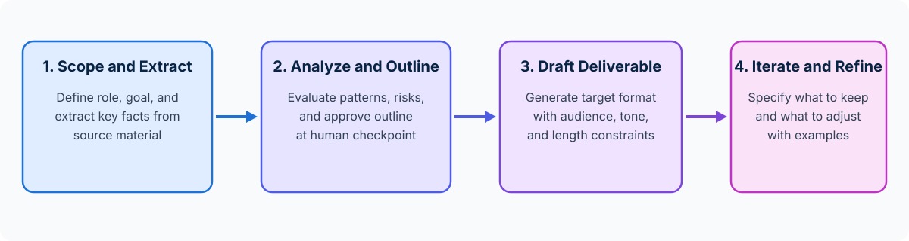

<!-- course-title: Claude Certified Associate - Foundations: Hands-On Exam Prep Workshop -->
<!-- course-theme: roi-alt-theme -->

<!-- layout: title -->


Claude Certified Associate - Foundations: Hands-On Exam Prep Workshop

# Chapter 2: Prompting and Task Execution

---

# Chapter 2: Objectives

- Create structured, high-clarity prompts for business and technical tasks
- Decompose complex multi-part requests into manageable steps
- Iterate prompts systematically to improve output quality
- Adapt prompting strategies across analysis, research, drafting, and brainstorming

---

# Domain 1: Prompting and Execution (14%)

| Objective | Exam Focus |
| :--- | :--- |
| **1.1** | Create effective prompts for business and technical tasks |
| **1.2** | Apply task decomposition techniques to structure complex requests |
| **1.3** | Iterate prompts to improve output quality |
| **1.4** | Adapt prompting strategies based on task type (analysis, research, drafting, brainstorming) |

---

<!-- layout: navigation -->
# Chapter 2

- **Effective Business Prompts**
- Task Decomposition
- Iterating by Task Type

---

<!-- layout: card-layout -->
# Four Pillars of an Effective Prompt

### 1. Role and Objective
- State clearly what task Claude is performing and the business goal you want to achieve.
- Example: “Act as an operations analyst reviewing quarterly vendor delivery logs to identify recurring bottlenecks.”

### 2. Context and Source Material
- Provide the background facts, data tables, or reference text Claude needs so it does not have to guess missing context.
- Clearly separate background data from your instructions.

### 3. Audience and Constraints
- Specify who will read the output (executive sponsor, frontline team, external client), required tone, length limits, and what to exclude.

### 4. Output Format and Examples
- Define the exact output shape (bulleted memo, comparison table, email draft) and provide 1 to 2 short examples when consistent structure matters.

---

<!-- layout: 2-column -->
# Vague vs Structured Business Prompts

### Vague Request (Unpredictable Output)
- **Prompt**: “Write an update about our Q3 software rollout delay.”
- **Why it fails**:
  - Leaves out the root cause of the delay and the revised launch date
  - Does not specify whether the audience is internal engineers, leadership, or customers
  - Forces Claude to invent placeholder reasons and guess the tone

### Structured Prompt (Consistent Output)
- **Prompt**: “Draft a 150-word status update for our executive steering committee explaining that the Q3 CRM rollout is moving from Sept 15 to Oct 1 due to vendor SSO testing. Include: (1) revised timeline, (2) zero impact to Q4 budget, and (3) next checkpoint on Sept 20. Use a direct, reassuring executive tone.”
- **Why it succeeds**: clear audience, explicit facts, bounded length, and defined structure

<!-- below-columns -->

> [!TIP]
> When you need outputs to follow a specific house style or template, include one or two concrete **examples (few-shot prompting)** showing the exact format you want.

---

<!-- layout: navigation -->
# Chapter 2

- Effective Business Prompts
- **Task Decomposition**
- Iterating by Task Type

---

<!-- layout: stacked -->
# Decomposing Complex Requests

- **Why monolithic prompts underperform**: asking Claude to analyze raw survey responses, identify root causes, design a 90-day action plan, and write three stakeholder emails in a single prompt often produces shallow or incomplete results
- **Sequential decomposition**: break complex workflows into logical stages where you review each output before triggering the next step
- **Checkpoints prevent compounding errors**: catching a misunderstood assumption in Step 1 saves rewriting the final deliverable in Step 4



---

<!-- layout: 3-column -->
# Three Task Decomposition Patterns

### 1. Outline First, Draft Second
- **Step 1**: Ask Claude to propose a structured outline and key arguments based on your source notes
- **Step 2**: Review and adjust the outline, then ask Claude to draft each section following the approved structure

### 2. Extract, Analyze, Recommend
- **Step 1**: Extract key facts, metrics, and risks from a long document into a clean table
- **Step 2**: Analyze patterns across the extracted table
- **Step 3**: Draft targeted recommendations for leadership

### 3. Draft, Critique, Refine
- **Step 1**: Generate an initial draft against your business criteria
- **Step 2**: Ask Claude to audit the draft against a specific rubric (clarity, missing objections, tone)
- **Step 3**: Produce the polished final version

---

<!-- layout: navigation -->
# Chapter 2

- Effective Business Prompts
- Task Decomposition
- **Iterating by Task Type**

---

# Adapting Strategies by Task Type

| Task Type | Goal | Recommended Prompting Strategy |
| :--- | :--- | :--- |
| **Analysis** | Evaluate data, compare options, or find root causes | Provide explicit evaluation criteria, ask for step-by-step reasoning, and request a structured pros/cons or risk table |
| **Research** | Gather background, synthesize themes, or map a topic | Define scope boundaries, ask Claude to separate verified facts from open questions, and require source citations |
| **Drafting** | Produce emails, reports, SOPs, or communications | Specify target audience, tone, length, structural template, and 1 to 2 style examples |
| **Brainstorming** | Generate creative options, campaign angles, or solutions | Ask for a diverse range of distinct categories first (divergent thinking), then narrow down using feasibility constraints |

---

<!-- layout: 2-column -->
# Iterating Prompts for Higher Quality

### Ineffective Iteration Habits
- Repeating “Make it better” or “Try again” without explaining what missed the mark
- Changing five unrelated requirements at once without noting which parts of the first draft were already good
- Starting from scratch when 80% of the response is accurate and only the tone or format needs adjustment

### Effective Targeted Iteration
- **Name what to keep and what to change**: “Keep the three cost-saving bullets in Section 2, but rewrite the opening paragraph for a non-technical HR audience and cut total length to 200 words.”
- **Add missing constraints or examples**: if formatting is too wordy, supply a 2-line example of the exact bullet style you want
- **Ask clarifying questions**: for unfamiliar topics, ask Claude “Before drafting, ask me 3 clarifying questions about our constraints”

---

# Do Now: Decomposing a Business Prompt

**Time:** 1–2 minutes

- Open Claude (`claude.ai` or Claude Desktop) in a new chat
- **Step 1**: Paste this decomposed, structured prompt:

```text
We are a 15-person project management team moving our 60-minute
Monday status meeting to an async Friday written check-in.
First, list 3 rollout risks and how to mitigate each in a
2-column table. Do not draft the team announcement email yet.
```

- **Step 2**: In one follow-up turn, paste this iteration prompt:

```text
Using Risk #1 and #2 above, draft a friendly 120-word
announcement email from the Operations Lead including the
start date (Nov 10) and a bulleted 3-item check-in template.
```

---

<!-- layout: 2-column -->
# Do Now Debrief: Exam Takeaways

### What Improved in Claude
- **Decomposition** stopped Claude from rushing into a generic email before addressing practical rollout risks
- **Explicit constraints** (15-person team, 120 words, Nov 10 start date, 3-item template) eliminated filler and invented placeholders
- **Targeted follow-up iteration** reused the approved risk table directly in the announcement draft

### Key Domain 1 Exam Takeaway
- When an exam scenario describes a complex request producing shallow, generic, or disorganized output, choose the option that **breaks the task into structured steps with explicit context, audience, and format constraints**

---

# What You Learned

- Created structured, high-clarity prompts for business and technical tasks
- Decomposed complex multi-part requests into manageable steps
- Iterated prompts systematically to improve output quality
- Adapted prompting strategies across analysis, research, drafting, and brainstorming

---

<!-- layout: stacked -->
# Questions and Answers


