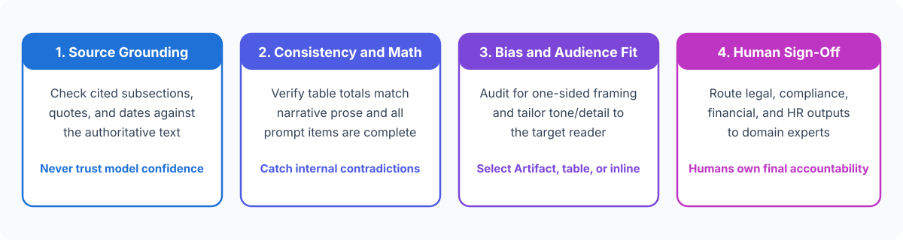

<!-- course-title: Claude Certified Associate - Foundations: Hands-On Exam Prep Workshop -->
<!-- course-theme: roi-alt-theme -->

<!-- layout: title -->

Claude Certified Associate - Foundations: Hands-On Exam Prep Workshop

# Chapter 3: Output Evaluation and Validation

---

# Chapter 3: Objectives

- Evaluate Claude outputs for factual accuracy and completeness
- Identify hallucinations, internal inconsistencies, and biases
- Apply fact-checking techniques and determine when human review is required
- Adapt outputs for target audiences and select between Artifacts, inline text, and structured data

---

# Domain 2: Output Evaluation and Validation (21%)

| Objective | Exam Focus |
| :--- | :--- |
| **2.1** | Evaluate Claude-generated outputs for accuracy and completeness |
| **2.2** | Identify hallucinations, inconsistencies, and biases in responses |
| **2.3** | Apply fact-checking and validation techniques |
| **2.4** | Determine when human review or additional verification is required |
| **2.5** | Edit, adapt, refine, and compare outputs for the intended audience |
| **2.6** | Organize and curate information and select appropriate output formats (Artifacts, inline, structured data) |

---

<!-- layout: navigation -->
# Chapter 3

- **Evaluating Accuracy, Hallucinations, and Bias**
- Fact-Checking and Human Review
- Audience Adaptation and Output Formats

---

<!-- layout: stacked -->
# Evaluating Accuracy, Completeness, and Hallucinations

- **Largest domain on the CCAO-F exam (21%)**: every Associate must verify AI outputs before using them in business decisions
- **Hallucinations look fluent and confident**: language models can fabricate specific-looking details - such as regulation subsection numbers, legal citations, financial figures, or URLs - while sounding completely certain
- **Completeness and internal consistency checks**: verify that every requirement in your prompt was addressed and that numbers in summary paragraphs match the numbers in tables

---

<!-- layout: card-layout -->
# Spotting Hallucinations, Inconsistencies, and Biases

### Fabricated Details (Hallucinations)
- Invented policy clauses, non-existent study authors, or made-up statistics when the source document does not contain the answer.
- Mitigation: instruct Claude to answer **only** from provided documents and state explicitly when information is not present.

### Internal Inconsistencies
- A project summary states “total budget is $120K” in the intro, while the milestone table rows add up to $145K.
- Always cross-check dates, totals, and action owners across sections.

### Framing and Selection Bias
- Summarizing only positive customer feedback while omitting recurring complaints, or using loaded language that favors one vendor.
- Prompt Claude to present balanced evidence, counterarguments, and explicit selection criteria.

---

<!-- layout: navigation -->
# Chapter 3

- Evaluating Accuracy, Hallucinations, and Bias
- **Fact-Checking and Human Review**
- Audience Adaptation and Output Formats

---

<!-- layout: 2-column -->
# Fact-Checking Techniques vs Exam Traps

### Reliable Validation Practices
- **Check primary authoritative sources**: verify cited regulation subsections, contract terms, and statistics directly against the official document
- **Require grounded quotes**: ask Claude to include verbatim excerpts and section headings from your uploaded reference file alongside each claim
- **Cross-verify calculations**: confirm financial sums, percentages, and timelines independently

### Common Exam Traps (Never Choose)
- **Trusting expressed confidence**: sending a compliance summary as-is because Claude wrote it in a confident, authoritative tone
- **Self-reported confidence ratings**: asking Claude “Rate your confidence from 1 to 10” and sharing the output if it says 9/10
- **Cosmetic rewording as validation**: rephrasing a summary to sound more formal without checking whether the underlying facts are true

<!-- below-columns -->

> [!IMPORTANT]
> **CCAO-F Sample Question Rule**: When Claude summarizes a regulation and cites a specific subsection number for the compliance team, **always verify the cited subsection against the official regulation text before sharing**.

---

# Determining When Human Expertise and Review Are Required

- **High-stakes external or regulated outputs**: legal, compliance, medical, financial, HR policy, and external customer commitments always require qualified human review before release
- **Subject-matter judgment calls**: strategic trade-offs, personnel evaluations, and exceptions to company policy cannot be delegated solely to an AI model
- **Ambiguous or conflicting source data**: when source documents contradict each other or lack key information, flag the gap for a human decision-maker rather than letting Claude guess

---

<!-- layout: navigation -->
# Chapter 3

- Evaluating Accuracy, Hallucinations, and Bias
- Fact-Checking and Human Review
- **Audience Adaptation and Output Formats**

---

<!-- layout: 2-column -->
# Editing, Adapting, and Comparing Outputs for Your Audience

### Adapting for Different Audiences
- **Executive leadership**: concise bottom-line-up-front (BLUF) summary, business impact, cost/risk trade-offs, and clear decisions needed
- **Cross-functional / operations teams**: clear action items, owners, deadlines, step-by-step procedures, and edge-case handling
- **External clients or general audiences**: plain language free of internal acronyms, empathetic tone, and clear next steps

### Comparing Candidate Drafts
- Generate 2 to 3 variations (for example, direct vs consultative tone) and compare them against your audience’s priorities
- Combine the strongest elements of each draft and edit out repetitive filler

---

<!-- layout: 3-column -->
# Selecting the Right Output Format

### Artifacts
- Dedicated side-by-side workspace window for substantial, standalone deliverables you want to view, edit, iterate on, or share independently
- **Best for**: full report drafts, interactive HTML/chart prototypes, standalone SOP documents, and reusable templates

### Inline Chat Responses
- Standard conversational text inside the message thread
- **Best for**: quick answers, brainstorming lists, short email replies, and clarifying back-and-forth discussion

### Structured Data (Tables, CSV, JSON)
- Organized rows, columns, or key-value fields
- **Best for**: side-by-side vendor comparisons, project trackers, action registers, and data ready to paste into spreadsheets

---

# Do Now: Fact-Checking Citations and Formatting with Artifacts

**Time:** 1–2 minutes

- Open Claude (`claude.ai` or Claude Desktop) and paste this short policy excerpt along with a verification prompt:
  - `Policy Excerpt: "Section 4.1: Standard equipment requests under $750 are approved by team managers. Section 4.2: Requests over $750 require Finance VP sign-off. Travel meal per diem is capped at $65/day."`
  - `Prompt: A colleague wrote this summary for our compliance handbook: "Per Section 4.3, equipment requests up to $1,000 are approved by team managers, and daily meal per diem is $75." Compare this draft against the Policy Excerpt above. List every factual or citation error in a 3-column table (Claim, Policy Reality, Correction), and then create a clean standalone Artifact containing a 1-page Employee Expense Quick-Reference Guide tailored for new hires.`

---

<!-- layout: 2-column -->
# Do Now Debrief: What to Notice for the Exam

### What You Verified
- Grounding Claude against the **authoritative source text** immediately exposed three errors: the fabricated `Section 4.3` citation, the wrong `$1,000` threshold, and the wrong `$75` per diem
- Requesting an **Artifact** produced a clean, standalone reference document separated from the conversational verification table

### Key Domain 2 Exam Takeaways
- Never accept a specific subsection citation or number without checking the authoritative source
- Choose **Artifacts** for standalone documents/visuals meant for iteration or sharing, **structured tables** for comparisons, and **inline responses** for quick conversational turns

---

# What You Learned

- Evaluated Claude outputs for factual accuracy and completeness
- Identified hallucinations, internal inconsistencies, and biases
- Applied fact-checking techniques and determined when human review is required
- Adapted outputs for target audiences and selected between Artifacts, inline text, and structured data

---

<!-- layout: stacked -->
# Questions and Answers

