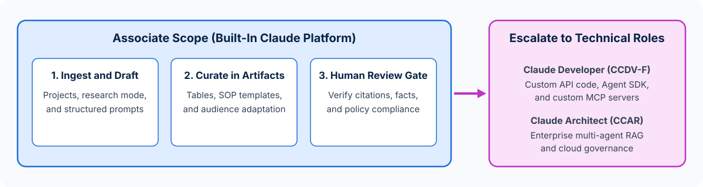

<!-- course-title: Claude Certified Associate - Foundations: Hands-On Exam Prep Workshop -->
<!-- course-theme: roi-alt-theme -->

<!-- layout: title -->


Claude Certified Associate - Foundations: Hands-On Exam Prep Workshop

# Chapter 5: Workflow Integration and Solution Design

---

# Chapter 5: Objectives

- Analyze business requirements to identify high-value Claude use cases
- Leverage Claude for research, planning, solution design, and process optimization
- Integrate Claude into existing workflows to augment or redesign processes
- Communicate Claude’s value and limitations to stakeholders and recognize when to escalate to Architects and Developers

---

# Domain 4: Workflow Integration and Solution Design (16%)

| Objective | Exam Focus |
| :--- | :--- |
| **4.1** | Apply Claude to analyze requirements and use cases |
| **4.2** | Leverage Claude for research, planning, and process optimization |
| **4.3** | Use Claude to support solution design, development, and iteration |
| **4.4** | Integrate Claude into existing workflows to augment or redesign them |
| **4.5** | Communicate Claude’s value and limitations to stakeholders |

---

<!-- layout: navigation -->
# Chapter 5

- **Analyzing Requirements and Use Cases**
- Augmenting and Redesigning Workflows
- Stakeholder Communication and Escalation

---

<!-- layout: card-layout -->
# Evaluating Business Use Cases for Claude

### High-Fit Associate Use Cases
- Summarizing unstructured documents, RFPs, meeting transcripts, and customer feedback.
- Drafting, adapting, and standardizing recurring business communications, SOPs, and project plans.
- Structuring messy qualitative inputs into comparison tables, action trackers, and initial requirement drafts.

### Use Cases Requiring Extra Care or Human Gatekeeping
- High-stakes compliance, legal, HR, or financial commitments where a human expert must verify and approve every output before use.

### Poor-Fit Use Cases for Standalone Prompting
- Workflows requiring 100% deterministic database transactions, real-time automated system-to-system API triggers, or zero-tolerance unattended execution.

---

<!-- layout: 2-column -->
# Using Claude for Research, Planning, and Solution Design

### Discovery and Requirement Analysis
- Turn raw stakeholder interview notes into structured user requirements, acceptance criteria, and risk registers
- Ask Claude to identify missing requirements, edge cases, and unstated assumptions before a project kicks off
- Compare alternative process designs against your team’s time, budget, and quality constraints

### Rapid Prototyping and Iteration
- Build interactive mockups, process flowcharts, and template drafts in **Artifacts** so stakeholders can react to something concrete in minutes
- Iterate live during planning workshops to refine scope and align teams faster

---

<!-- layout: navigation -->
# Chapter 5

- Analyzing Requirements and Use Cases
- **Augmenting and Redesigning Workflows**
- Stakeholder Communication and Escalation

---

<!-- layout: 2-column -->
# Task Augmentation vs Workflow Redesign

### Task Augmentation (Faster Single Step)
- Keeps the existing 6-step process unchanged, using Claude to speed up one individual step (for example, drafting an email faster)
- **Benefit**: immediate individual time savings with zero process change management
- **Limitation**: leaves upstream bottlenecks and redundant handoffs intact

### Workflow Redesign (End-to-End Improvement)
- Re-examines the entire workflow around a shared **Claude Project** with standardized instructions, templates, and human verification checkpoints
- **Benefit**: eliminates repetitive re-formatting across handoffs and raises consistency across the whole team

---

<!-- layout: stacked -->
# Designing Human-in-the-Loop Workflow Checkpoints

- **AI prepares, humans decide**: place Claude where unstructured synthesis and first-draft creation take the most time, and place human checkpoints before external or high-impact actions
- **Standardize inputs and outputs**: define what inputs the associate provides at the start of the workflow and what verification checklist must pass at the end
- **Know the escalation boundary**: when a redesigned workflow outgrows manual Project interactions and needs automated API triggers or multi-agent orchestration, escalate to technical specialists



---

<!-- layout: navigation -->
# Chapter 5

- Analyzing Requirements and Use Cases
- Augmenting and Redesigning Workflows
- **Stakeholder Communication and Escalation**

---

<!-- layout: card-layout -->
# Communicating Value and Limitations to Stakeholders

### Framing Business Value Realistically
- Highlight measurable improvements in cycle time, first-draft consistency, research breadth, and staff capacity for higher-judgment work.

### Setting Clear Expectation Boundaries
- Explain clearly that Claude is a probabilistic reasoning and drafting partner - not an infallible database or an autonomous decision-maker on regulated policy.

### Building Trust Through Governance
- Show stakeholders exactly where human fact-checking, source verification, and data-privacy redaction sit in the workflow.

---

# When to Handle as an Associate vs Escalate

| Business Need | Who Owns It | Why |
| :--- | :--- | :--- |
| **Create a repeatable team workspace with shared templates and reference docs** | **Claude Associate** | Handled directly with built-in **Claude Projects**, custom instructions, and Artifacts |
| **Connect an internal billing database to run automated nightly API jobs across 20,000 records** | **Escalate to Claude Developer** | Requires custom **Claude API / Message Batches API** code and backend integration |
| **Design an enterprise-wide multi-agent architecture with custom MCP servers and cloud IAM guardrails** | **Escalate to Claude Architect** | Requires enterprise system architecture, multi-agent orchestration, and infrastructure design |

---

# Do Now: Redesigning a Team Workflow and Scoping Escalations

**Time:** 1–2 minutes

- Open Claude (`claude.ai` or Claude Desktop) and paste this workflow redesign prompt:

```text
Our customer onboarding team manually processes new client intake:
1. Read a 15-page client questionnaire PDF
2. Extract key goals and timeline risks into a kickoff deck outline
3. Verify contract SLA clauses against our legal playbook
4. Email the verified kickoff summary to the client
5. Automatically sync the client's CRM record with our internal ERP database every night via REST API

Create a 4-column workflow table (Step, Associate Action in Claude, Required Human Validation Gate, Escalate to Developer/Architect?). Clearly identify which steps an Associate handles with built-in Claude features and which step must be escalated to a Claude Developer or Architect.
```

---

<!-- layout: 2-column -->
# Do Now Debrief: What to Notice for the Exam

### What the Workflow Table Shows
- **Steps 1 to 4** are classic Associate workflows: summarizing the intake PDF, structuring the kickoff outline in an Artifact, comparing SLA clauses against a legal reference doc (with mandatory human legal/account review before emailing the client)
- **Step 5 (automated nightly CRM-to-ERP REST API sync)** requires custom software integration and must be **escalated to a Claude Developer or Architect**

### Key Domain 4 Exam Takeaway
- Associates maximize business value using built-in platform capabilities paired with human review gates, and **escalate** custom API, agent harness, or enterprise architecture work

---

# What You Learned

- Analyzed business requirements to identify high-value Claude use cases
- Leveraged Claude for research, planning, solution design, and process optimization
- Integrated Claude into existing workflows to augment or redesign processes
- Communicated Claude’s value and limitations to stakeholders and recognized when to escalate to Architects and Developers

---

<!-- layout: stacked -->
# Questions and Answers


