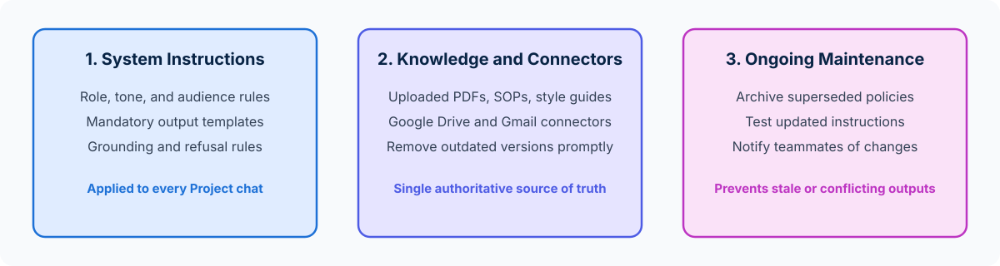

<!-- course-title: Claude Certified Associate - Foundations: Hands-On Exam Prep Workshop -->
<!-- course-theme: roi-alt-theme -->

<!-- layout: title -->

Claude Certified Associate - Foundations: Hands-On Exam Prep Workshop

# Chapter 6: Configuration and Knowledge Management

---

# Chapter 6: Objectives

- Configure Claude Projects with effective system-level instructions
- Curate and organize uploaded Project knowledge sources
- Use workspace connectors such as Google Drive and Gmail responsibly
- Maintain, audit, and update Project configurations over time

---

# Domain 5: Configuration and Knowledge Management (12%)

| Objective | Exam Focus |
| :--- | :--- |
| **5.1** | Configure Claude Projects with instructions and knowledge sources |
| **5.2** | Manage uploaded knowledge and connectors (for example, Google Drive, Gmail) |
| **5.3** | Create effective system-level instructions |
| **5.4** | Inform, maintain, and update Claude configurations, knowledge sources, and instructions |

---

<!-- layout: navigation -->
# Chapter 6

- **Configuring Projects and System Instructions**
- Managing Knowledge Sources and Connectors
- Maintaining Configurations Over Time

---

<!-- layout: stacked -->
# Anatomy of a Well-Configured Claude Project

- **System-level Project instructions**: persistent rules that automatically guide Claude’s role, tone, formatting, and boundaries in every chat within the Project
- **Project knowledge base**: curated reference files (style guides, product specs, approved templates, policy manuals) available across all Project conversations
- **Individual chat prompts**: the specific day-to-day task inputs that build on top of the shared Project foundation

---

<!-- layout: card-layout -->
# Writing Effective System-Level Instructions

### 1. Define Role, Audience, and Tone
- Specify who Claude is assisting, the default target audience, and house communication standards (for example, “Write in concise, plain business English; avoid jargon”).

### 2. Set Explicit Grounding and Citation Rules
- Instruct Claude to prioritize uploaded Project knowledge over general assumptions and cite the exact document name and section when answering policy or product questions.

### 3. Specify Default Output Structures
- Establish standard templates (such as required headings for weekly status reports or risk tables) so team members get consistent outputs without re-typing formatting rules.

### 4. Include Guardrails and Escalation Boundaries
- State what Claude should refuse or flag for human review (for example, “If a question is not covered in the uploaded Q4 Policy Guide, state that clearly rather than guessing”).

---

<!-- layout: navigation -->
# Chapter 6

- Configuring Projects and System Instructions
- **Managing Knowledge Sources and Connectors**
- Maintaining Configurations Over Time

---

<!-- layout: 2-column -->
# Uploaded Project Files vs Workspace Connectors

### Uploaded Project Knowledge
- Static files (PDFs, docs, CSVs, markdown templates) uploaded directly into a Claude Project
- **Best for**: stable reference materials such as brand guidelines, approved SOPs, product catalogs, and canonical templates
- Requires manual replacement when a new version is published

### Workspace Connectors (Google Drive, Gmail, etc.)
- Direct integrations that let Claude search and reference live documents or emails from your connected workspace accounts
- **Best for**: pulling up-to-date project docs stored in Google Drive or summarizing recent email threads in Gmail without manual downloads
- Respects user access permissions; only connect sources appropriate for the workflow’s sensitivity

---

<!-- layout: card-layout -->
# Best Practices for Curating Project Knowledge

### Avoid Uploading Conflicting Versions
- Uploading both `2024_Pricing_Policy.pdf` and `2026_Pricing_Policy_FINAL.pdf` in the same Project causes contradictory answers.
- Keep only the current, authoritative version of each document in Project knowledge.

### Use Clear, Descriptive Document Titles
- Name files clearly (`HR_Leave_Policy_Effective_July_2026.pdf` rather than `doc_v3_new.pdf`) so both Claude and teammates know what each source represents.

### Keep Knowledge Focused on the Project Scope
- Do not dump unrelated files from five different departments into one catch-all Project; create separate Projects for distinct workflows or clients.

---

<!-- layout: navigation -->
# Chapter 6

- Configuring Projects and System Instructions
- Managing Knowledge Sources and Connectors
- **Maintaining Configurations Over Time**

---

# Maintaining and Updating Project Configurations

- **Treat Project configurations as living assets**: when company policies, product pricing, or team templates change, outdated Project knowledge will cause Claude to produce confident but obsolete outputs
- **Four-step maintenance cadence**:
  1. **Remove or archive superseded files** immediately when a new policy or product release takes effect
  2. **Audit system-level instructions** to ensure hardcoded dates, team names, or escalation contacts are still accurate
  3. **Test with representative prompts** after updating knowledge files to verify Claude cites the new rules properly
  4. **Inform shared Project users** when instructions or reference sources are updated so the team knows what changed

---

# Do Now: Configuring a Claude Project with Custom Instructions

**Time:** 1–2 minutes

- Open Claude (`claude.ai` or Claude Desktop). You can either open **Projects** or test this directly in a new chat as a system-instruction simulation:
- Paste the following **System-Level Project Instruction** block and test question:
  - `Project Instructions: You are the Proposal Desk Assistant for Acme Advisory. Always follow these 3 rules: (1) Ground all pricing and SLA answers strictly in the Reference Knowledge below and cite the section number. (2) If a client asks for a capability or discount not listed in the Reference Knowledge, state "Requires VP Sales Approval - not covered in standard playbook" and do not invent terms. (3) Format all client responses as a 3-bullet Executive Summary.`
  - `Reference Knowledge: [Section 1.1: Standard implementation takes 4 weeks at $15,000. Section 1.2: Discounts up to 10% may be approved by the Regional Director.]`
  - `Test Task: A prospect asks for a 2-week rush implementation and a 20% discount. Draft our internal guidance note.`

---

<!-- layout: 2-column -->
# Do Now Debrief: What to Notice for the Exam

### How System Instructions Shaped the Output
- Without needing to repeat formatting or policy rules in the task prompt, Claude automatically formatted a 3-bullet summary, cited `Section 1.1` and `Section 1.2`, and flagged both the 2-week rush timeline and the 20% discount as **“Requires VP Sales Approval - not covered in standard playbook”**

### Key Domain 5 Exam Takeaways
- Put recurring role, tone, citation, and refusal rules in **system-level Project instructions**
- Remove outdated or conflicting knowledge files immediately when policies change so Claude never grounds answers in stale documents

---

# What You Learned

- Configured Claude Projects with effective system-level instructions
- Curated and organized uploaded Project knowledge sources
- Used workspace connectors such as Google Drive and Gmail responsibly
- Maintained, audited, and updated Project configurations over time

---

<!-- layout: stacked -->
# Questions and Answers

