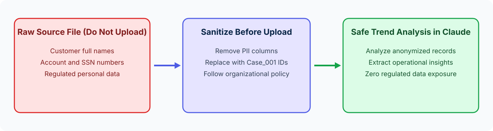

<!-- course-title: Claude Certified Associate - Foundations: Hands-On Exam Prep Workshop -->
<!-- course-theme: roi-alt-theme -->

<!-- layout: title -->


Claude Certified Associate - Foundations: Hands-On Exam Prep Workshop

# Chapter 7: Governance, Risk, and Responsible Use

---

# Chapter 7: Objectives

- Distinguish appropriate business AI use cases from inappropriate or high-risk uses
- Apply data sensitivity, regulatory, and privacy safeguards through redaction and anonymization
- Follow organizational AI policies and governance standards
- Evaluate ethical implications including bias, fairness, and transparency

---

# Domain 6: Governance, Risk, and Responsible Use (15%)

| Objective | Exam Focus |
| :--- | :--- |
| **6.1** | Identify appropriate and inappropriate use cases |
| **6.2** | Apply data sensitivity, regulatory, and privacy considerations |
| **6.3** | Follow organizational AI policies and governance standards |
| **6.4** | Understand the ethical implications of AI usage |

---

<!-- layout: navigation -->
# Chapter 7

- **Appropriate vs Inappropriate Use Cases**
- Data Sensitivity, Privacy, and Anonymization
- Organizational Policies and Ethical AI

---

<!-- layout: 2-column -->
# Identifying Appropriate vs Inappropriate Use Cases

### Appropriate Use Cases
- Drafting, summarizing, and analyzing business content using approved tools and sanitized datasets
- Using Claude as a decision-support and research partner where a qualified human reviews the output
- Accelerating internal documentation, training materials, and workflow templates within policy boundaries

### Inappropriate Use Cases
- Uploading restricted PII, PHI, payment card data, or trade secrets into unapproved environments in violation of company policy
- Using AI to make final, unreviewed automated decisions on hiring, credit, medical diagnosis, or legal liability
- Presenting unverified AI-generated legal or regulatory citations as authoritative fact

---

<!-- layout: navigation -->
# Chapter 7

- Appropriate vs Inappropriate Use Cases
- **Data Sensitivity, Privacy, and Anonymization**
- Organizational Policies and Ethical AI

---

<!-- layout: stacked -->
# Protecting Sensitive and Regulated Data

- **Remove or anonymize regulated identifiers before uploading**: strip customer names, account numbers, Social Security numbers, email addresses, and health details before sharing datasets for trend analysis
- **Why “instructing Claude not to retain it” fails**: typing “Do not save this data” inside a prompt does **not** satisfy organizational data-handling or regulatory privacy controls; data has already been transmitted once uploaded
- **Why abandoning the analysis is unnecessary**: you rarely need personal identifiers to analyze aggregate operational trends; anonymizing the file lets the work proceed safely



---

<!-- layout: card-layout -->
# Four Practical Data Sanitization Techniques

### 1. Column Removal
- Delete columns that are irrelevant to the analytical goal (such as `Customer_Full_Name`, `Account_Number`, `Street_Address`, `Phone`) before exporting a CSV or spreadsheet for analysis.

### 2. Pseudonymization / Synthetic IDs
- Replace real client or employee names with neutral placeholders (`Client_A`, `Client_B`, `Record_001`) when you need to track individual rows across a conversation.

### 3. Pre-Aggregation
- Summarize raw transaction rows into category or regional totals in your spreadsheet before uploading when Claude only needs to analyze high-level trends.

### 4. Approved Workspace Verification
- Confirm you are logged into your organization’s approved enterprise Claude workspace (rather than a personal consumer account) before working with internal business documents.

---

<!-- layout: navigation -->
# Chapter 7

- Appropriate vs Inappropriate Use Cases
- Data Sensitivity, Privacy, and Anonymization
- **Organizational Policies and Ethical AI**

---

<!-- layout: card-layout -->
# Following Governance Standards and Ethical AI Principles

### Organizational AI Policy Alignment
- Always follow your organization’s data classification tiers, approved tool lists, and mandatory human sign-off rules.
- If a workflow touches regulated data (such as GDPR personal data or HIPAA health records), consult compliance or legal teams before uploading.

### Mitigating Bias and Ensuring Fairness
- AI outputs can reflect historical biases in source material or framing bias in how a prompt is written.
- Audit HR job descriptions, performance rubrics, and customer communications for inclusive, objective criteria across all groups.

### Transparency and Accountability
- Disclose AI assistance according to organizational and client norms.
- Remember that **the human professional remains 100% accountable** for the accuracy, fairness, and compliance of any work product they deliver.

---

# Do Now: Anonymizing Sensitive Data Before Prompting

**Time:** 1–2 minutes

- Notice how the regulated personal identifiers (`Name`, `Acct #`, `Email`) have been replaced with `Case_1`, `Case_2`, and `Case_3` before uploading
- Open Claude (`claude.ai` or Claude Desktop) and paste this sanitized prompt:

```text
Analyze these 3 anonymized support escalations. Identify the top recurring billing defect and recommend one process fix:

Case_1 | Billing double-charged after plan upgrade | $149
Case_2 | Billing double-charged after annual renewal | $299
Case_3 | Password reset link expired after 2 minutes | $0
```

---

<!-- layout: 2-column -->
# Do Now Debrief: What to Notice for the Exam

### Why Anonymization Wins
- Claude identified the exact billing trend (double-charging on subscription changes) with **zero exposure** of customer names, account numbers, or emails
- This directly mirrors **CCAO-F Official Sample Question 3**

### Key Domain 6 Exam Takeaways
- **Never** upload regulated PII as-is because “the analysis is internal”
- **Never** rely on prompting Claude “please do not retain this file” as a privacy control
- **Always remove or anonymize personal identifiers before uploading**, consistent with organizational policy

---

# Quiz 2: Domains 4 to 6 Review

- [Open Quiz](https://claude-certification-exam-prep-1077635956541.us-east4.run.app/questions?file=public/2026-10-31-13-40-ccao-f-realistic-instructor.json)

---

# What You Learned

- Distinguished appropriate business AI use cases from inappropriate or high-risk uses
- Applied data sensitivity, regulatory, and privacy safeguards through redaction and anonymization
- Followed organizational AI policies and governance standards
- Evaluated ethical implications including bias, fairness, and transparency

---

<!-- layout: stacked -->
# Questions and Answers


