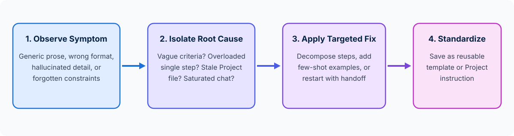

<!-- course-title: Claude Certified Associate - Foundations: Hands-On Exam Prep Workshop -->
<!-- course-theme: roi-alt-theme -->

<!-- layout: title -->

Claude Certified Associate - Foundations: Hands-On Exam Prep Workshop

# Chapter 8: Troubleshooting and Optimization

---

# Chapter 8: Objectives

- Identify, diagnose, and resolve underperforming prompts and poor outputs
- Adjust prompting and feature approaches based on feedback and results
- Optimize repeatable business workflows for efficiency, quality, and cost

---

# Domain 7: Troubleshooting and Optimization (10%)

| Objective | Exam Focus |
| :--- | :--- |
| **7.1** | Identify, diagnose, and resolve issues with underperforming prompts or poor outputs |
| **7.2** | Adjust approach based on feedback and results |
| **7.3** | Optimize workflows for efficiency and effectiveness |

---

<!-- layout: navigation -->
# Chapter 8

- **Diagnosing Underperforming Prompts**
- Adjusting Approaches from Feedback
- Optimizing Repeatable Workflows

---

<!-- layout: stacked -->
# Systematic Troubleshooting: Symptom -> Cause -> Fix

- **Do not guess randomly when an output misses the mark**: inspect the failure symptom first to identify what is missing or conflicting in your prompt, context, or feature choice
- **Most poor outputs trace to four root causes**:
  1. **Missing context or criteria** (vague instructions)
  2. **Overloaded single-turn task** (needs decomposition)
  3. **Polluted or stale context window** (needs a fresh chat or cleaned Project files)
  4. **Mismatched model or format** (needs a different model tier, few-shot example, or Artifact)

---

# Diagnostic Reference Table for the Exam

| Observed Output Symptom | Likely Root Cause | Best Corrective Action |
| :--- | :--- | :--- |
| **Output is generic, superficial, or misses key sections** | Monolithic, vague prompt with no structural criteria | Decompose into sequential steps and specify explicit section headings, audience, and constraints |
| **Formatting varies wildly from one run to the next** | Prose-only description of a complex layout | Add 1 to 2 concrete **few-shot examples** demonstrating the exact target format |
| **Claude invents facts or cites non-existent policy rules** | Missing source material or no grounding constraint | Provide the authoritative reference text and instruct Claude to answer **only** from that source and flag gaps |
| **Later turns forget rules or mix in an earlier topic** | Context window saturation or cross-topic bleed | Summarize verified decisions into a handoff block and **restart in a clean chat** |
| **Project answers reflect last year’s pricing or SOP** | Outdated or conflicting files in Project knowledge | Remove superseded files from the Project and upload the current authoritative version |

---

<!-- layout: navigation -->
# Chapter 8

- Diagnosing Underperforming Prompts
- **Adjusting Approaches from Feedback**
- Optimizing Repeatable Workflows

---

<!-- layout: 2-column -->
# Adjusting Your Approach Based on Results and Feedback

### When Prompt Tweaks Are Enough
- The model has the right source facts, but the tone is too formal, the summary is too long, or a table needs an extra column
- **Action**: give targeted follow-up feedback naming exactly what to preserve and what to adjust

### When You Need to Change the Approach
- After two targeted refinements, the single prompt still struggles with a 5-part analytical and drafting request
- **Action**: change the workflow approach - break the task into separate steps, switch from Haiku to Sonnet/Opus for deeper reasoning, or move recurring reference files into a **Claude Project**

---

<!-- layout: navigation -->
# Chapter 8

- Diagnosing Underperforming Prompts
- Adjusting Approaches from Feedback
- **Optimizing Repeatable Workflows**

---

<!-- layout: card-layout -->
# Four Levers for Optimizing Repeatable Workflows

### 1. Standardize Winning Prompts into Templates
- Once you iterate a prompt until it produces reliable results, save it as a reusable prompt template with clear `[BRACKETED_VARIABLES]` so teammates do not reinvent it from scratch.

### 2. Move Shared Context into Claude Projects
- Stop pasting the same 10-page brand guide and product sheet into every daily chat; store them once in a **Claude Project** with system-level instructions.

### 3. Right-Size Model Selection
- Use **Claude Haiku** for high-volume, routine drafting and categorization, **Claude Sonnet** for everyday synthesis and writing, and **Claude Opus** only where deep reasoning is required.

### 4. Build in Lightweight Verification Checklists
- Pair repeatable prompts with a 3-point human review checklist (source citations verified, numbers cross-checked, PII redacted) so quality stays high as volume scales.

---

# Do Now: Diagnosing and Fixing an Underperforming Prompt

**Time:** 1–2 minutes

- Open Claude (`claude.ai` or Claude Desktop) and inspect this underperforming prompt that a marketing coordinator used:
  - `Broken Prompt: "Read our product notes and write everything we need for next month's launch, make it good and accurate, and don't make anything up."`
- Paste this diagnostic exercise into Claude:
  - `A teammate used this prompt: "Read our product notes and write everything we need for next month's launch, make it good and accurate, and don't make anything up."`
  - `(1) Diagnose 3 specific reasons why this prompt produces poor, inconsistent outputs. (2) Rewrite it into a reusable, decomposed 2-step Prompt Template with [PLACEHOLDERS] for audience, source notes, and output format, plus a grounding rule for missing facts.`

---

<!-- layout: 2-column -->
# Do Now Debrief: What to Notice for the Exam

### Why the Broken Prompt Failed
- **“Write everything we need”** is an overloaded, undefined scope with no audience or format
- **“Make it good”** gives no measurable quality criteria or examples
- **No source grounding boundary**: it never defines what Claude should do when a launch detail (like final pricing) is missing from the notes

### Key Domain 7 Exam Takeaway
- When troubleshooting poor outputs on the exam, match the symptom to the root cause: **decompose overloaded prompts, add concrete examples for formatting consistency, clean up stale context, and convert ad-hoc wins into reusable Project templates**

---

# What You Learned

- Identified, diagnosed, and resolved underperforming prompts and poor outputs
- Adjusted prompting and feature approaches based on feedback and results
- Optimized repeatable business workflows for efficiency, quality, and cost

---

<!-- layout: stacked -->
# Questions and Answers

