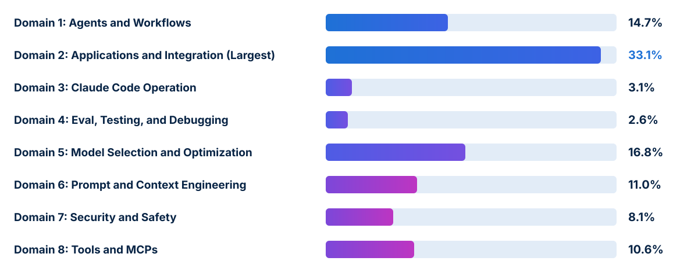

<!-- course-title: Claude Certified Developer - Foundations: Hands-On Exam Prep Workshop -->
<!-- course-theme: roi-alt-theme -->

<!-- layout: title -->


Claude Certified Developer - Foundations: Hands-On Exam Prep Workshop

# Chapter 1: Claude Certified Developer - Foundations Overview

---

# Chapter 1: Objectives

- Review the CCDV-F exam format, scoring, and domain weights
- Evaluate the Minimally Qualified Candidate developer profile
- Analyze canonical CCDV-F sample question patterns
- Deconstruct multi-constraint exam scenarios and apply a weighted study plan

---

<!-- layout: navigation -->
# Chapter 1

- **Understanding the Exam**
- Preparing to Pass the Exam

---

<!-- layout: card-layout -->
# Exam Details at a Glance (CCDV-F)

### Format and Time Limit
- The CCDV-F exam contains 53 multiple-choice and multiple-response items completed within 120 minutes.
- Each multiple-response item states explicitly how many answer choices to select.

### Scoring Standard
- Criterion-referenced assessment reported on a scaled range from 100 to 1,000 with a passing cut score of 720.
- Your pass or fail status is determined by your total scaled score, accompanied by domain-level percentage breakdowns.

### Exam Fee and Validity
- The exam fee is $125 USD, and the credential is valid for 12 months from the date awarded.
- On-time renewal requires completing a free, non-proctored assessment on the Anthropic Partner Academy.

### Delivery Environment
- Delivered via Pearson VUE (online proctored or test center) under strict non-disclosure and clear-workspace rules.

---

<!-- layout: stacked -->
# Exam Blueprint Across Eight Domains

- **Domain 2: Applications and Integration (33.1%)** is by far the largest section, accounting for roughly one-third of all scored items
- **Domain 5: Model Selection and Optimization (16.8%)** and **Domain 1: Agents and Workflows (14.7%)** together represent nearly another third
- **Prompt and Context Engineering (11.0%)**, **Tools and MCPs (10.6%)**, **Security and Safety (8.1%)**, **Claude Code (3.1%)**, and **Eval, Testing, and Debugging (2.6%)** complete the blueprint



---

<!-- layout: 2-column -->
# Minimally Qualified Candidate (MQC) Profile

### Software Engineering Profile
- 1 to 5 years of software engineering experience with proficiency in **Python** and/or **TypeScript**
- At least 6 months of hands-on experience building with Claude or comparable LLM systems
- Fluency with REST APIs, JSON schemas, asynchronous programming, version control, and CLI tools

### Core Developer Competencies
- Building custom agent loops and workflows with the **Claude Agent SDK** and agentic frameworks (**PydanticAI**, **LangGraph**, **Strands**)
- Integrating the **Messages API** and **Message Batches API** across direct and cloud-provider SDKs
- Operating **Claude Code** (`CLAUDE.md`, `settings.json`, Rules, Skills, Commands, headless mode)
- Implementing custom tools, **MCP servers** (`stdio` and Streamable HTTP), prompt caching, and security hooks

---

<!-- layout: navigation -->
# Chapter 1

- Understanding the Exam
- **Preparing to Pass the Exam**

---

<!-- layout: card-layout -->
# Three Canonical CCDV-F Sample Question Patterns

### 1. Realtime vs Message Batches API (Domain 2)
- **Scenario**: Process 10,000 documents overnight for a non-urgent morning analytics report with cost as the primary concern.
- **Correct Choice**: Use the **Message Batches API**, which processes large asynchronous workloads within a 24-hour window at a 50% cost reduction.

### 2. Defending Against Prompt Injection (Domain 7)
- **Scenario**: An agent summarizes user-submitted web pages; one page contains hidden text instructing the model to reveal its system prompt.
- **Correct Choice**: Treat retrieved page content as **untrusted input**, keep it separate from trusted instructions, and use **guardrails or hooks** so injected instructions cannot trigger sensitive actions.

### 3. Reusable Internal Tooling with MCP (Domain 8)
- **Scenario**: Expose an internal inventory REST API so multiple Claude applications can share it and maintain it independently.
- **Correct Choice**: Build an **MCP server** that exposes the inventory operations as tools so multiple Claude applications can connect to it.

---

<!-- layout: 2-column -->
# Eliminating Developer Exam Distractors

### Common Distractor Traps
- **Sending 10,000 synchronous requests in parallel** or **lowering `max_tokens`** when an overnight batch workload can use the Message Batches API
- **Raising model temperature**, **switching to a larger model**, or **asking users politely in the system prompt** to mitigate prompt injection
- **Hard-coding API logic into system prompts**, **pasting live inventory into every context window**, or assuming **built-in tools can reach arbitrary internal REST APIs**
- Blaming the model when an **integration layer** bug (bad parser, retired model ID, or truncated payload) caused the failure

### Winning Developer Habits
- Match **synchronous vs batch APIs** to latency tolerance and cost goals
- Enforce **trust boundaries** (XML tags + hooks + least-privilege tools) around all untrusted external content
- Choose the right customization primitive: **Built-in Tools** vs **Custom Tools** vs **Skills** vs **MCP Servers**
- Inspect execution traces to isolate **integration-layer bugs** from **model output errors**

---

<!-- layout: card-layout -->
# How to Dissect a Scenario Question on Exam Day

### 1. Highlight the Hard Constraint
- Look for words like *“guaranteed”*, *“deterministic”*, *“real-time”*, *“overnight”*, *“shared across 4 applications”*, or *“inside the customer’s AWS VPC”*.

### 2. Identify the Architectural Layer
- If the stem says *“guaranteed enforcement regardless of model reasoning”*, eliminate every prompt-only, few-shot, or model-tier option and look for **`PreToolUse` hooks** or **`settings.json` `deny` rules**.
- If the trace shows *“valid tool output returned, wrong number in final answer”*, eliminate network/auth/schema fixes and look for **model-layer prompt or validation** fixes.

### 3. Check Paired-Claim Options Carefully
- On multi-part options, verify **both** halves of the statement: distractors frequently pair one true best practice with one subtle anti-pattern.

---

# Weighted Study Plan Across the Eight Domains

| Priority Tier | Domains Covered | Share of Exam (~Items) | High-Yield Focus Areas |
| :--- | :--- | :--- | :--- |
| **Tier 1 (Core ~65%)** | **D2: Applications and Integration (33.1%)**, **D5: Model Selection and Optimization (16.8%)**, **D1: Agents and Workflows (14.7%)** | ~34 of 53 items | Messages API vs Batches (`custom_id`), SSE streaming, Files API + citations, Prompt Caching (`tools` -> `system` -> `messages`), Opus/Sonnet/Haiku + `effort`, Workflow vs Agent vs Subagent, `PreToolUse` / `PostToolUse` |
| **Tier 2 (Core ~30%)** | **D6: Prompt and Context (11.0%)**, **D8: Tools and MCPs (10.6%)**, **D7: Security and Safety (8.1%)** | ~16 of 53 items | Context editing + `<case_facts>`, structured outputs + `stop_reason` checks, `strict: true` tools + `is_error: true`, MCP Tools vs Resources vs Prompts (`stdio` vs Streamable HTTP), prompt injection + least privilege |
| **Tier 3 (Targeted ~6%)** | **D3: Claude Code (3.1%)**, **D4: Eval, Testing, and Debugging (2.6%)** | ~3 of 53 items | `CLAUDE.md` hierarchy, `.claude/rules/` globs, `settings.json` `deny` precedence, `claude -p`, trace isolation, two-stage eval suites |

---

# Exam-Day Pacing and Logistics

- **Generous time per question**: 53 items in 120 minutes gives you roughly **2 minutes 15 seconds per item**
- **Allocate extra focus to Domain 2 (33.1%)**: expect roughly 17 to 18 questions on API mechanics, application design, SDLC integration, and configuration management
- **Retake policy**: 14 days after the 1st failed attempt, 30 days after the 2nd, and 90 days after the 3rd (up to 4 attempts in a rolling 12-month period)

---

# Demo: Using the Claude API

If you already finished Lab 0, open `ccdvf-labs` with the virtual environment activated and skip to Step 6.

**Step 1. Create the `ccdvf-labs` folder**

**macOS:**

```bash
cd ~
mkdir ccdvf-labs
cd ccdvf-labs
```

**Windows (PowerShell):**

```powershell
cd $HOME
mkdir ccdvf-labs
cd ccdvf-labs
```

**Step 2. Create a virtual environment and activate it**

**macOS:**

```bash
python3 -m venv .venv
source .venv/bin/activate
```

**Windows (PowerShell):**

```powershell
python -m venv .venv
.venv\Scripts\Activate.ps1
```

When the environment is active, the prompt starts with `(.venv)`. If Windows says that running scripts is disabled, run `Set-ExecutionPolicy -Scope CurrentUser RemoteSigned`, answer **Y**, and run the activate command again.

**Step 3. Install the packages for these demos**

```bash
pip install anthropic python-dotenv
```

**Step 4. Create a file named `.env` with your API key**

```text
ANTHROPIC_API_KEY=sk-ant-paste-your-key-here
```

**Step 5. Create a file named `.gitignore`**

```text
.env
.venv/
```

**Step 6. Create `demo_01_haiku.py` and paste this code**

```python
# demo_01_haiku.py - one Messages API call
from dotenv import load_dotenv
import anthropic

load_dotenv()
client = anthropic.Anthropic()

response = client.messages.create(
    model="claude-haiku-5-5",
    max_tokens=1028,
    output_config={"effort": "low"},  # keep this short reply from being spent on thinking
    messages=[{
        "role": "user",
        "content": "Write a Haiku about the Claude Developer Certification.",
    }],
)

text = "".join(block.text for block in response.content if block.type == "text")
print(text)
```

**Step 7. Run it**

```bash
python demo_01_haiku.py
```

**Step 8. Examine the output**

- The terminal prints a haiku
- The wording will vary, and you should see three short lines

> [!NOTE]
> You sent one prompt and printed Claude’s reply. This folder, virtual environment, and `.env` file are what every later demo uses.

---

# What You Learned

- Reviewed the CCDV-F exam format, scoring, and domain weights
- Evaluated the Minimally Qualified Candidate developer profile
- Analyzed canonical CCDV-F sample question patterns
- Deconstructed multi-constraint exam scenarios and applied a weighted study plan

---

<!-- layout: stacked -->
# Questions and Answers


