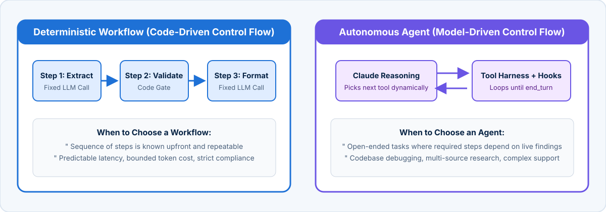

<!-- course-title: Claude Certified Developer - Foundations: Hands-On Exam Prep Workshop -->
<!-- course-theme: roi-alt-theme -->

<!-- layout: title -->


Claude Certified Developer - Foundations: Hands-On Exam Prep Workshop

# Chapter 2: Agents and Workflows

---

# Chapter 2: Objectives

- Choose between deterministic workflows and autonomous agents
- Implement prompt chaining, routing, parallel, orchestrator, and evaluator patterns
- Design supervisor hierarchies and manage subagent costs and failure modes
- Build custom agent loops, Tool Runner harnesses, and Claude Agent SDK systems
- Intercept tool execution deterministically with `PreToolUse` and `PostToolUse` hooks
- Select between `PydanticAI`, `LangGraph`, and `Strands` for production agents

---

# Domain 1: Agents and Workflows

| Task # | Task Statement |
| :--- | :--- |
| **1.1** | Agent Architecture: Principles, patterns, and trade-offs of workflow vs agent architecture, manager/supervisor hierarchies, and subagents |
| **1.2** | Agent Construction with Claude: Claude Agent SDK, custom agent loops and harnesses, managed vs self-hosted deployment, and deterministic hooks |
| **1.3** | Agent Patterns and Frameworks: Tool-use loops, subagents, memory, context-window management, and frameworks (`Strands`, `LangGraph`, `PydanticAI`) |

---

<!-- layout: navigation -->
# Chapter 2

- **Agent Architecture**
- Agent Construction with Claude
- Agent Patterns and Frameworks

---

<!-- layout: stacked -->
# Decision Criteria: Workflow vs Agent

- **Choose a Workflow** when the task follows a predictable, repeatable sequence of steps that can be orchestrated in application code (prompt chaining, routing, parallel execution)
- **Choose an Agent** when the problem is open-ended and the number or order of tool calls depends dynamically on what the model discovers at runtime
- **Hybrid reliability**: wrap autonomous agent loops inside deterministic guardrails and prerequisite hooks



---

# Workflow Pattern 1: Prompt Chaining with Code Gates

- **Mechanism**: break a fixed multi-stage task into sequential LLM calls, with deterministic validation code (“gates”) between every stage
- **Failure mode**: one monolithic prompt tries to extract, validate, and draft a customer email in a single pass, making it impossible to halt before drafting when extraction fails

```python
async def process_claim_workflow(raw_email: str) -> str:
    # Step 1: Extract structured claim fields
    claim = await extract_claim_fields(raw_email)
    # Deterministic code gate: verify policy exists and claim is within window
    if not claim.policy_id or claim.amount_usd <= 0:
        raise ClaimValidationError("Missing policy ID or invalid amount")
    policy = db.get_policy(claim.policy_id)
    if not policy.is_active:
        return render_inactive_policy_template(policy)
    # Step 2: Draft tailored response only after gate passes
    return await draft_claim_decision_letter(claim, policy)
```

---

<!-- layout: 2-column -->
# Workflow Pattern 2: Routing and Classification

### How Routing Works
- A fast, low-cost classifier call (typically **Claude Haiku 5.5**) inspects the incoming input and assigns it to a strict category
- Application code routes the request to a specialized downstream prompt, tool set, or model tier (**Sonnet 5.5** or **Opus 5.5**)
- Keeps prompts focused: the billing prompt does not need 3,000 tokens of technical troubleshooting instructions

### Worked Code Sketch
```python
class TicketRoute(BaseModel):
    category: Literal["billing", "bug", "refund", "other"]

route = (await client.messages.parse(
    model="claude-haiku-5-5",
    max_tokens=256,
    output_format=TicketRoute,
    messages=[{"role": "user", "content": ticket}],
)).parsed_output

handler = {
    "billing": handle_billing_workflow,
    "bug": run_bug_triage_agent,       # escalates to Sonnet
    "refund": run_refund_pipeline,
    "other": escalate_to_human_queue,
}[route.category]
return await handler(ticket)
```

---

<!-- layout: 2-column -->
# Workflow Pattern 3: Parallelization (Sectioning vs Voting)

### Sectioning (Independent Subtasks)
- Split a single request into independent aspects and run them concurrently with `asyncio.gather`
- **Example**: one call reviews a pull request diff for SQL injection while a parallel call checks the same diff against API naming standards, and a third checks customer-facing copy
- Reduces wall-clock latency to the slowest single call while keeping each prompt small and accurate

### Voting (Confidence Consensus)
- Run the exact same high-stakes classification or vulnerability check 3 times in parallel (or with varied prompt framings) and aggregate the votes in code
- **Example**: flag a production deployment as blocked if at least 2 of 3 reviewers report a critical severity finding

```python
results = await asyncio.gather(
    check_security(diff),
    check_api_contracts(diff),
    check_migration_safety(diff),
)
```

---

<!-- layout: 2-column -->
# Workflow Patterns 4 and 5: Orchestrator-Workers and Evaluator-Optimizer

### Orchestrator-Workers
- A central lead model analyzes an input whose subtasks cannot be hardcoded in advance (such as refactoring a symbol across an unknown set of files)
- The orchestrator emits a dynamic task list, dispatches worker calls in parallel, and synthesizes their outputs
- **Differs from Parallelization**: the subtasks are chosen dynamically at runtime by the lead model rather than fixed in code

### Evaluator-Optimizer
- One LLM call generates a candidate artifact (such as a complex SQL query or translated code module), and a second evaluator call grades it against explicit rubric criteria
- If the evaluator rejects the draft, its structured critique is fed back into the generator for a bounded retry loop (for example, `max_iterations = 3`)

<!-- below-columns -->

> [!TIP]
> Use **Prompt Chaining**, **Routing**, or **Parallelization** when the step structure is known in advance. Step up to **Orchestrator-Workers** or an **Agent** only when runtime discovery dictates the steps.

---

# Five Workflow Patterns: Summary Decision Matrix

| Pattern | How It Works | Choose It When | Avoid It When |
| :--- | :--- | :--- | :--- |
| **Prompt chaining** | Output of step 1 feeds step 2, with code “gates” between steps | The task splits cleanly into fixed sequential stages | Later steps require dynamic tool discovery |
| **Routing** | A cheap classifier call sends each input to a specialized prompt or model | Distinct input categories need different prompts or model tiers | Every input needs the exact same handling |
| **Parallelization** | Sectioning (independent subtasks) or voting (same task run several times) | Subtasks are independent, or you need consensus confidence | Step B depends on the output of Step A |
| **Orchestrator-workers** | A lead model decides subtasks at runtime and delegates to workers | Subtasks depend on the input and cannot be predicted upfront | The subtask list is always identical |
| **Evaluator-optimizer** | One call generates, another critiques against a rubric, then loop | Clear pass/fail criteria exist and iterative refinement measurably helps | Single-pass generation already meets quality SLAs |

---

<!-- layout: 2-column -->
# Manager/Supervisor Hierarchies and Subagents

### Manager / Supervisor Role
- Receives the high-level goal, decomposes it into scoped subtasks, and delegates each subtask to the appropriate specialist subagent
- Routes all inter-agent communication, aggregates results, and evaluates whether additional iterations are needed
- Holds the `Agent` tool (formerly named `Task`) in its allowed tools so it can spawn subagents

### Role of Specialized Subagents
- **Context isolation**: subagents execute verbose searches or file inspections in separate context windows so raw outputs do not bloat the supervisor’s history
- **Focused tool sets**: each subagent is restricted to 4 to 5 role-specific tools, improving tool-selection accuracy
- **Explicit context passing**: a standard subagent does not inherit the supervisor’s history; pass all required inputs in the task prompt (only “fork” subagents copy the parent context)

---

<!-- layout: card-layout -->
# Subagent Trade-Offs and Failure Modes

### 1. Lost Context Across Boundaries
- A spawned subagent starts with a clean `messages` array and cannot see what the coordinator or sibling subagents discovered earlier.
- If the coordinator passes a vague prompt like `“Synthesize the findings so far”` without including the actual findings, the subagent will hallucinate or fail.

### 2. Serializing Independent Subagents
- Emitting one `Agent` call, waiting for completion, and then emitting a second independent `Agent` call doubles wall-clock latency.
- Prompt the coordinator to emit all independent `Agent` tool calls inside a **single** assistant turn so the harness runs them concurrently.

### 3. Token Multiplication Overhead
- Every subagent initializes its own system prompt, tool definitions, and reasoning trace.
- Spawning five subagents for a trivial 3-file task multiplies input token costs compared to a single agent or deterministic workflow.

### 4. Over-Fragmented Tool Handoffs
- Splitting tightly coupled steps across separate subagents forces constant serialization of intermediate state.
- Keep tightly coupled read-and-edit loops inside one agent when the intermediate context is small.

---

<!-- layout: navigation -->
# Chapter 2

- Agent Architecture
- **Agent Construction with Claude**
- Agent Patterns and Frameworks

---

# Constructing Custom Agent Loops and Harnesses

- **Handle every `stop_reason` and cap iterations**: unhandled values cause infinite loops or silent truncation

```python
async def run_agent_loop(user_prompt: str, tools: list[dict], max_turns: int = 20):
    messages = [{"role": "user", "content": user_prompt}]
    for _ in range(max_turns):
        resp = await client.messages.create(model="claude-sonnet-5-5",
            max_tokens=16000, tools=tools, messages=messages)
        messages.append({"role": "assistant", "content": resp.content})
        if resp.stop_reason == "end_turn": return resp
        if resp.stop_reason == "tool_use":  # all results in ONE user message
            messages.append({"role": "user", "content": await run_tools(resp.content)})
        elif resp.stop_reason != "pause_turn":  # pause_turn: resend to resume
            raise AgentStopError(resp.stop_reason)  # max_tokens, refusal
    raise AgentStopError("max_turns exceeded")
```

---

# Every `stop_reason` Value Your Loop Must Handle

| `stop_reason` | Why It Happened | Required Action in Your Agent Loop |
| :--- | :--- | :--- |
| **`"end_turn"`** | Claude finished its response naturally | Exit the loop and return the final assistant message to the caller |
| **`"tool_use"`** | Claude requested one or more client/MCP tool executions | Execute **all** requested `tool_use` blocks and append **all** `tool_result` blocks in a **single** `role: "user"` message |
| **`"pause_turn"`** | A long-running server-side tool loop (`web_search`, `code_execution`) hit its per-turn iteration limit | Append `resp.content` as the assistant turn and resend the conversation to let the server loop continue |
| **`"max_tokens"`** | Output hit the `max_tokens` ceiling mid-generation (HTTP 200) | Do **not** parse partial JSON as complete; raise an incomplete-output error or retry with a higher token limit |
| **`"refusal"`** | Safety classifiers intervened on the response (HTTP 200) | Do **not** blind-retry or parse `content` as normal output; log and surface a safe fallback message |
| **`"stop_sequence"`** | Generation matched a custom `stop_sequences` string | Handle according to your custom delimiter protocol |

> [!WARNING]
> Never terminate an agent loop by regex-matching phrases like `"Based on my analysis"` or checking whether a `text` block exists alongside `tool_use`. Claude frequently emits explanatory text in the same turn as `tool_use` blocks; **only** `stop_reason` tells you whether the loop is done.

---

<!-- layout: 2-column -->
# Using the SDK Tool Runner (`tool_runner`)

### Why Use `tool_runner`
- When you want custom Python or TypeScript tools without hand-writing the `while` loop
- `client.beta.messages.tool_runner` executes decorated functions, formats `tool_result` blocks, and loops until `end_turn`
- Supports client-side SDK compaction in TypeScript and Ruby for long loops

### Decorated Tool + Runner Call
```python
from anthropic import AsyncAnthropic, beta_async_tool

client = AsyncAnthropic()

@beta_async_tool
async def get_order_status(order_id: str) -> str:
    """Look up delivery status and carrier tracking for an order ID (format: ORD-NNNNN)."""
    record = await db.fetch_order(order_id)
    return json.dumps({"status": record.status, "eta": record.eta_iso})

async def handle_customer_query(question: str) -> str:
    runner = client.beta.messages.tool_runner(
        model="claude-sonnet-5-5",
        max_tokens=4096,
        tools=[get_order_status],
        messages=[{"role": "user", "content": question}],
    )
    final_message = await runner.until_done()
    return next(b.text for b in final_message.content if b.type == "text")
```

---

# Building with the Claude Agent SDK

- **Claude Code’s harness as a library**: built-in tools (`Read`, `Write`, `Edit`, `Bash`, `Grep`, `Glob`), subagent spawning (`Agent`), permission modes, and hooks

```python
from claude_agent_sdk import query, ClaudeAgentOptions, AgentDefinition

options = ClaudeAgentOptions(
    allowed_tools=["Read", "Grep", "Glob", "Agent"],  # Agent = spawn subagents
    permission_mode="default",
    agents={"security-reviewer": AgentDefinition(
        description="Reviews diffs for exploitable vulnerabilities",
        prompt="Report only exploitable flaws.", tools=["Read", "Grep"])},
)

async for message in query(prompt="Audit the auth module", options=options):
    print(message)
```

---

<!-- layout: 2-column -->
# Four Ways to Build and Deploy a Claude Agent

### Comparing the Four Approaches
| Approach | Loop Owner | Host Environment |
| :--- | :--- | :--- |
| **Manual loop** (Messages API) | Your code | Your VPC / containers |
| **Tool Runner** (`tool_runner`) | Client SDK | Your VPC / containers |
| **Claude Agent SDK** | Agent SDK harness | Your VPC / containers |
| **Claude Managed Agents** | Anthropic | Anthropic-managed sandbox |

### Self-Hosted vs Managed Deployment Trade-Offs
- **Self-hosted (Agent SDK / Tool Runner / Manual)**:
  - Runs inside your own VPC with direct network access to private databases, internal REST APIs, and strict data-residency boundaries
  - Your team owns container sandboxing, autoscaling, and runtime patching
- **Anthropic-hosted (Claude Managed Agents)**:
  - Anthropic manages per-session container sandboxes, versioned agent configs, automatic prompt caching, and credential vaults
  - Cannot reach private VPC services directly unless exposed through a secured remote MCP server

---

<!-- layout: card-layout -->
# Deterministic Actions with Agent SDK Hooks

### `PreToolUse` Interception
- Fires before a tool call executes and can return `permissionDecision: "deny"`, `"ask"`, or `"allow"`.
- Use to verify prerequisites (such as requiring `get_customer` before `process_refund`), enforce monetary thresholds, or block destructive shell commands (`rm -rf`).

### `PostToolUse` Normalization and Pruning
- Fires immediately after a tool returns its raw output, before the result is appended to Claude’s context window.
- Use to normalize inconsistent date/status formats, redact secrets, and strip verbose, irrelevant JSON fields.

### Why Hooks Beat Prompt Rules
- Prompt instructions (“Never issue a refund over $500”) are probabilistic: a persuasive user or edge case can still talk the model into calling the tool.
- Hooks run in deterministic code on every matching call, so the rule is enforced exactly as written.

### Other Lifecycle Hook Points
- `UserPromptSubmit` screens or enriches user prompts before the turn starts.
- `Stop` and `SubagentStop` run cleanup, audit logging, or completion checks when an agent turn finishes.

---

# Programmatic Hook Callbacks in the Agent SDK

- **Enforcing business rules in Python**: block refunds above `$500` and strip noisy fields from tool results before they enter context

```python
async def enforce_refund_limit(input_data: dict, tool_use_id: str, context: dict) -> dict:
    amount = input_data.get("tool_input", {}).get("amount_usd", 0)
    if amount > 500:
        return {
            "hookSpecificOutput": {
                "hookEventName": "PreToolUse",
                "permissionDecision": "deny",
                "permissionDecisionReason": f"Refund ${amount} exceeds $500 autonomous limit; escalate to human.",
            }
        }
    return {}
```

> [!IMPORTANT]
> When a `PreToolUse` hook returns `permissionDecision: "deny"`, the harness blocks the tool call and sends `permissionDecisionReason` back to Claude so the agent can adapt (for example, by invoking `escalate_to_human`).

---

<!-- layout: navigation -->
# Chapter 2

- Agent Architecture
- Agent Construction with Claude
- **Agent Patterns and Frameworks**

---

<!-- layout: card-layout -->
# Core Agent Design Patterns

### Tool-Use Loop Pattern
- Iterative cycle where Claude emits one or more `tool_use` blocks, inspects the returned `tool_result` data, and adapts its next step until `stop_reason == "end_turn"`.

### Subagent Delegation Pattern
- Spawning isolated worker agents (often in parallel by emitting multiple `Agent` tool calls, formerly `Task`, in a single turn) to prevent context window bloat on the main coordinator.

### Short-Term vs Long-Term Memory
- **Short-term memory**: the active `messages` array plus a persistent in-session `<case_facts>` block.
- **Long-term memory**: external vector/relational stores, scratchpad files, `memory_20250818` tool files, or `CLAUDE.md` files persisted across sessions.

### Context-Window Compaction
- Pruning verbose tool outputs and summarizing older turns so multi-step agents do not hit context drift or token ceilings.

---

<!-- layout: 2-column -->
# Implementing Short-Term and Long-Term Agent Memory

### Short-Term Pinned `<case_facts>` Block
- Summarizing a 30-turn conversation into prose often drops exact order numbers, dates, or dollar amounts
- Extract critical facts into a structured dictionary and inject it into the system prompt or top user block on every turn, independent of summarized history

```python
case_facts = {
    "customer_id": "CUST-88412",
    "order_id": "ORD-99201",
    "verified_refund_cap_usd": 142.50,
}
system_prompt = (
    f"{STATIC_POLICY}\n"
    f"<case_facts>{json.dumps(case_facts)}</case_facts>"
)
```

### Long-Term Cross-Session Memory
- **File-backed memory (`memory_20250818` / scratchpads)**: Claude reads and writes structured notes in a scoped directory that persists across sessions
- **`CLAUDE.md` and `MEMORY.md`**: repository conventions and auto-learned project notes loaded at session startup
- **External stores (Postgres / vector DB)**: application-queried customer history or semantic knowledge retrieved per turn

---

<!-- layout: 3-column -->
# Selecting Agentic Abstraction Frameworks

### PydanticAI
- Built around **type-safe structured outputs**, Pydantic schema validation, and clean dependency injection
- Automatically feeds Pydantic validation errors back to Claude for self-correction retries
- **Best when**: strict data contracts and Python type safety are top priorities

### LangGraph
- Models agent workflows as **stateful cyclic graphs** with explicit nodes, conditional edges, and durable state checkpointing
- Supports time-travel debugging and human-in-the-loop pause/resume interrupts
- **Best when**: orchestrating complex multi-step state machines with explicit branching and persistence

### Strands (Strands Agents)
- Lightweight, **model-driven** agent framework emphasizing simple `@tool` registration, native MCP integration, and letting Claude’s reasoning drive the loop
- Minimal boilerplate compared to explicit graph DSLs
- **Best when**: building clean, model-centric tool-use agents and supervisor workflows rapidly

---

# Framework Code Comparison on the Same Task

- **Look up how each framework expresses the same customer-support agent**:
  - **PydanticAI**: `Agent("anthropic:claude-sonnet-5-5", output_type=SupportDecision, deps_type=SupportDeps)`: centers on typed `deps` and validated `output_type`
  - **LangGraph**: `StateGraph(AgentState)` with `add_node("triage", ...)`, `add_conditional_edges(...)`, and `compile(checkpointer=PostgresSaver(...))`: centers on explicit graph state, cycles, and durable checkpoints
  - **Strands**: `Agent(model=AnthropicModel(...), tools=[lookup_order, issue_refund])`: centers on lightweight `@tool` functions and MCP servers driven by the model loop

| Requirement Signal in an Exam Scenario | Choose |
| :--- | :--- |
| **Strict Pydantic schema validation with automatic validation-error retry feedback to Claude** | **PydanticAI** |
| **Cyclic state machine, durable checkpointing across restarts, human-in-the-loop pause/resume interrupts** | **LangGraph** |
| **Lightweight model-driven tool loop with minimal boilerplate and direct MCP tool integration** | **Strands** |

---

# Domain 1 Quiz: Agents and Workflows

- [Open Quiz](https://claude-certification-exam-prep-1077635956541.us-east4.run.app/questions?file=public/2026-10-31-12-10-ccdv-f-realistic-instructor.json)

---

# Lab 1: Building Agents and Workflows

**Time:** 45 minutes

- [Open Lab](https://labv.roitraining.com/?lab=https://github.com/roitraining/claude-exam-cert-prep-courses/tree/main/claude-certified-developer-foundations-exam-prep-workshop/labs/lab-01-building-agents-and-workflows)

---

# What You Learned

- Chose between deterministic workflows and autonomous agents
- Implemented prompt chaining, routing, parallel, orchestrator, and evaluator patterns
- Designed supervisor hierarchies and managed subagent costs and failure modes
- Built custom agent loops, Tool Runner harnesses, and Claude Agent SDK systems
- Intercepted tool execution deterministically with `PreToolUse` and `PostToolUse` hooks
- Selected between `PydanticAI`, `LangGraph`, and `Strands` for production agents

---

<!-- layout: stacked -->
# Questions and Answers


