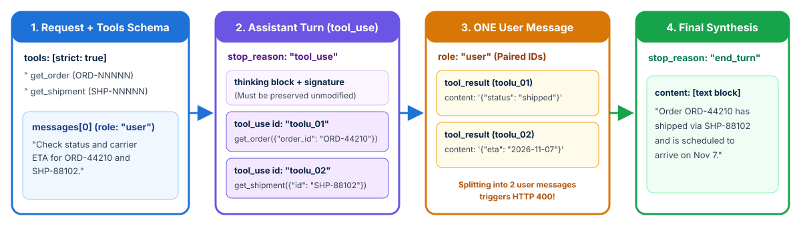
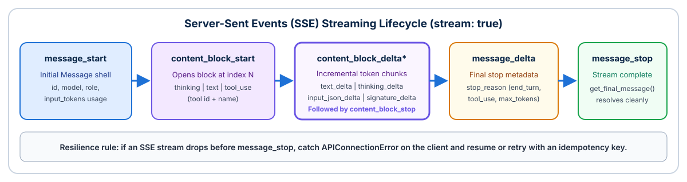
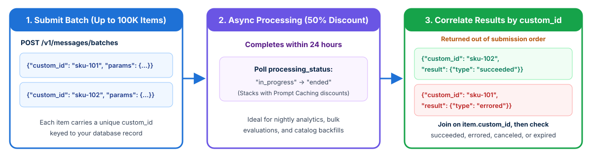

<!-- course-title: Claude Certified Developer - Foundations: Hands-On Exam Prep Workshop -->
<!-- course-theme: roi-alt-theme -->

<!-- layout: title -->


Claude Certified Developer - Foundations: Hands-On Exam Prep Workshop

# Chapter 3: Applications and Integration

---

# Chapter 3: Objectives

- Translate business needs into functional and infrastructure requirements across the SDLC
- Construct stateless Messages API requests, multi-turn tool round trips, and thinking histories
- Implement SSE streaming, vision, PDF documents, Files API uploads, and citations
- Process bulk asynchronous workloads with the Message Batches API and `custom_id` correlation
- Apply `AsyncAnthropic` concurrency, resilient retries, idempotency keys, and Claude-assisted SDLC workflows
- Enforce multi-tenant session boundaries, pinned configurations, and Claude Code plugins

---

# Domain 2: Applications and Integration (33.1% of Exam)

| Task # | Task Statement |
| :--- | :--- |
| **2.1** | Understanding Requirements: Functional and infrastructure requirements based on business and solution architecture |
| **2.2** | Systems Life Cycle: Concepts and frameworks to develop, implement, operate, and maintain IT systems |
| **2.3** | Claude API Mechanics: Messages, tools, streaming, vision, thinking, caching, third-party vendors, and Realtime vs Batch APIs |
| **2.4** | Software Engineering Foundations: REST APIs, JSON, async programming, version control, SDLC, code review, and refactoring |
| **2.5** | Claude Application Design: Instruction interpretation across interfaces, content boundaries, schema design, and session hygiene |
| **2.6** | Configuration Management: `CLAUDE.md`, `settings.json`, model version pinning, prompt versioning, and plugin dependencies |

---

<!-- layout: navigation -->
# Chapter 3

- **Requirements and Systems Life Cycle**
- Claude API Mechanics
- Software Engineering Foundations
- Application Design and Configuration

---

<!-- layout: 2-column -->
# Functional and Non-Functional Requirements

### Functional Requirements
- Define **what** the AI application must accomplish: supported input formats (text, images, PDFs), tool integrations, output schemas, citation rules, and human escalation triggers.

### Non-Functional Requirements
- Define **how** the system must perform and operate: latency SLAs (time-to-first-token vs end-to-end completion), concurrency and rate-limit capacity, VPC egress rules, data residency, and secret storage.

---

<!-- layout: card-layout -->
# Systems Life Cycle (SDLC) Phases

### Planning and Discovery
- Clarify measurable SLAs and build the initial golden evaluation dataset.

### Development and Integration
- Implement stateless API handlers, typed schemas, and deterministic hooks.

### Testing and Deployment
- Gate CI/CD merges on automated evaluations and roll out via feature flags or canary stages.

### Operations and Maintenance
- Monitor token usage, cache hit rates, latency p95, drift, and model deprecation timelines.

---

<!-- layout: 2-column -->
# Worked Example: Deconstructing a Stakeholder Request

### Stakeholder Prompt
> “We need Claude to review incoming vendor contracts, flag risky indemnity clauses for our legal team in the portal, and also re-score all 40,000 archived contracts before next quarter’s audit. All data must remain inside our AWS account.”

### Translating to Engineering Specs
- **Functional specs**:
  - Input: multi-page PDF contracts (text + tables)
  - Output: strict JSON schema (`risk_level`, `clauses[]`) plus verifiable page citations (`citations: {"enabled": true}`)
  - Escalation: route `high` risk flags to human legal review queue
- **Infrastructure and API specs**:
  - Interactive portal review: **Realtime Messages API** with SSE streaming for responsive UX
  - 40,000 archived contracts: **Message Batches API** (asynchronous, 24-hour window, 50% cost discount)
  - AWS boundary: invoke via **Amazon Bedrock** (`AnthropicBedrockMantle`) using IAM roles and regional endpoints

---

# Operating Across the Systems Life Cycle (Task 2.2)

- **Every stage of an AI application’s life cycle has a specific engineering artifact and gate**:

| Life Cycle Phase | Primary Engineering Artifact | Failure Mode If Skipped |
| :--- | :--- | :--- |
| **1. Requirements and Discovery** | Written SLA spec (TTFT, throughput, residency, retention) + golden test cases | Choosing synchronous Opus calls for a 500ms high-volume classifier |
| **2. Design and Prototyping** | Pinned model ID, prompt templates in Git, strict JSON schemas, hook guardrails | Unpinned aliases or regex parsers that break under edge cases |
| **3. Testing and CI Gate** | Automated offline evaluation suite (deterministic code checks + LLM-as-judge rubric) | Merging a prompt edit that fixes one bug but breaks 15% of existing cases |
| **4. Staged Rollout** | Feature flags, canary traffic split, and rollback runbook | Deploying a breaking model or prompt change to 100% of users at once |
| **5. Operations and Maintenance** | OpenTelemetry traces, cache-hit and refusal alerts, model retirement calendar | Total production outage when a pinned legacy model reaches its retirement date |

---

# From Requirement to Design Choice

| Requirement in the Scenario | Design Choice the Exam Expects |
| :--- | :--- |
| **Users watch the answer appear; low perceived latency** | Stream the response (SSE); consider Haiku 5.5 for simple fast-path tasks |
| **Thousands of non-urgent jobs; cost is the priority** | Message Batches API (50% discount, completes within 24 hours) |
| **Same long system prompt or document on every call** | Prompt caching on the stable prefix (`cache_control: {"type": "ephemeral"}`) |
| **Data must stay in a region or cloud account** | `inference_geo`, or Claude via Amazon Bedrock, Vertex AI, or Microsoft Foundry |
| **Strict data retention rules** | Check zero data retention (ZDR) eligibility per model and endpoint before committing |
| **Outputs feed a database or downstream API** | Structured outputs (`output_config.format` / `messages.parse()`), check `stop_reason`, then validate |
| **Agent must act on private internal systems** | Self-hosted harness (Agent SDK / Tool Runner) or a secured remote MCP server |

---

<!-- layout: navigation -->
# Chapter 3

- Requirements and Systems Life Cycle
- **Claude API Mechanics**
- Software Engineering Foundations
- Application Design and Configuration

---

<!-- layout: stacked -->
# Claude Messages API Mechanics

- **Stateless API contract**: `POST /v1/messages` stores zero conversation state on the server; your application must pass the required conversation history in the `messages` array on every request
- **Top-level `system` parameter**: put persistent role and policy instructions in the top-level `system` field; newer models also accept a mid-conversation `{"role": "system"}` message to add operator instructions without breaking the cache (never as `messages[0]`)
- **Multi-format content blocks**: a single message’s `content` is an array of typed blocks (`text`, `image`, `document`, `tool_use`, `tool_result`, `thinking`)


---

<!-- layout: 2-column -->
# Anatomy of a Messages API Request and Response

### Request Payload (`POST /v1/messages`)
```json
{
  "model": "claude-sonnet-5-5",
  "max_tokens": 4096,
  "system": "You are a support triage assistant.",
  "thinking": {"type": "adaptive"},
  "output_config": {"effort": "medium"},
  "tools": [
    {
      "name": "get_order",
      "description": "Fetch order by ID (ORD-NNNNN).",
      "strict": true,
      "input_schema": {
        "type": "object",
        "properties": {"order_id": {"type": "string"}},
        "required": ["order_id"],
        "additionalProperties": false
      }
    }
  ],
  "messages": [
    {"role": "user", "content": "Where is ORD-44210?"}
  ]
}
```

### Response Payload (`200 OK`)
```json
{
  "id": "msg_01Xz9...",
  "type": "message",
  "role": "assistant",
  "model": "claude-sonnet-5-5",
  "content": [
    {
      "type": "thinking",
      "thinking": "The user asked for ORD-44210...",
      "signature": "ErUBCkY..."
    },
    {
      "type": "tool_use",
      "id": "toolu_01AbC...",
      "name": "get_order",
      "input": {"order_id": "ORD-44210"}
    }
  ],
  "stop_reason": "tool_use",
  "usage": {
    "input_tokens": 412,
    "output_tokens": 89,
    "cache_creation_input_tokens": 0,
    "cache_read_input_tokens": 0
  }
}
```

---

<!-- layout: stacked -->
# Multi-Turn Tool-Use Round Trip Rules

- **Rule 1 - Preserve the full assistant `content`**: append `resp.content` (including `thinking` and `tool_use` blocks) as the `assistant` message
- **Rule 2 - Pair every `tool_use_id` in the very next `user` message**: if Claude emits two `tool_use` blocks in one turn, both `tool_result` blocks **must** go into a single `user` message immediately following the assistant turn
- **Rule 3 - Put `tool_result` blocks first**: if the `user` message also includes extra text blocks, the `tool_result` blocks must appear at the start of the `content` array



---

# Code: Preserving Thinking and Returning Parallel `tool_result` Blocks

- **Common exam bug**: sending two separate `{"role": "user"}` messages for two parallel tool calls, or stripping `thinking` blocks before appending `resp.content`, causes HTTP `400 invalid_request_error`

```python
# Assistant turn emitted TWO tool_use blocks (toolu_01 and toolu_02)
messages.append({"role": "assistant", "content": resp.content})  # keeps thinking + tool_use blocks

tool_uses = [b for b in resp.content if b.type == "tool_use"]
results = await asyncio.gather(*(execute_tool(b.name, b.input) for b in tool_uses))

# ALL tool_result blocks go into ONE user message immediately after the assistant turn
messages.append({
    "role": "user",
    "content": [
        {"type": "tool_result", "tool_use_id": b.id, "content": out}
        for b, out in zip(tool_uses, results)
    ],
})
```

---

<!-- layout: 2-column -->
# Thinking Blocks Across Multi-Turn Tool Loops

### Why `thinking` Blocks Carry a `signature`
- When adaptive thinking is active, Claude emits `{type: "thinking", thinking: "...", signature: "..."}` (and occasionally `redacted_thinking`) before its `tool_use` or `text` blocks
- The cryptographic `signature` proves the thinking block came from Claude unmodified
- During a multi-turn tool loop, passing the assistant’s prior `thinking` blocks back unmodified preserves reasoning continuity and keeps the prompt cache intact

### What Breaks If You Strip or Edit Them
- Modifying the text inside a `thinking` block invalidates its `signature` and returns HTTP `400 invalid_request_error`
- Stripping `thinking` blocks client-side in the middle of a tool loop invalidates cached prefixes and forces the model to re-derive its plan
- **Best practice**: always append `resp.content` as-is (`messages.append({"role": "assistant", "content": resp.content})`); use server-side `clear_thinking_20251015` if older turns must be cleared

---

<!-- layout: stacked -->
# SSE Streaming Event Lifecycle and Interruption Recovery

- **Why stream**: delivers incremental tokens via Server-Sent Events (`stream: true`) to lower perceived latency (time-to-first-token), and is required by the SDKs for very large `max_tokens` requests to avoid HTTP socket timeouts
- **Deterministic event sequence**: `message_start` -> (`content_block_start` -> `content_block_delta`* -> `content_block_stop`)+ -> `message_delta` (carries final `stop_reason` and cumulative `usage`) -> `message_stop`
- **Handling mid-stream disconnects**: SSE streams can drop over mobile or proxy networks; catch stream errors on the client, record partial state or idempotency keys, and retry or resume cleanly



---

# Demo: Watching a Reply Stream

In `ccdvf-labs`, with the virtual environment still active:

**Step 1. Create `demo_03_stream.py`**

**Step 2. Paste this code**

```python
# demo_03_stream.py - print each text delta, then read the finished message
from dotenv import load_dotenv
import anthropic

load_dotenv()
client = anthropic.Anthropic()

with client.messages.stream(
    model="claude-haiku-5-5",
    max_tokens=1028,
    output_config={"effort": "low"},
    messages=[{
        "role": "user",
        "content": "In two sentences, explain what a stop_reason is.",
    }],
) as stream:
    for text in stream.text_stream:
        print(text, end="", flush=True)
    print()
    final = stream.get_final_message()

print("stop_reason:", final.stop_reason)
print("input_tokens:", final.usage.input_tokens)
print("output_tokens:", final.usage.output_tokens)
```

**Step 3. Run it**

```bash
python demo_03_stream.py
```

**Step 4. Examine the output**

- The words appear on one line as they arrive, before the script finishes
- After the sentence, `stop_reason` is `end_turn`
- `input_tokens` and `output_tokens` print only after the stream completes

> [!NOTE]
> Streaming changes when the words appear. The final Message is the same kind of object you get from a normal call. You still read `stop_reason` and `usage` from that completed message.

---

# `AsyncAnthropic` and Handling Dropped Streams

- **Use `client.messages.stream()`** and wrap long streams in error-recovery logic so dropped connections do not leave the UI hung

```python
client = AsyncAnthropic()  # async client required for "async with"
partial_chunks: list[str] = []
try:
    async with client.messages.stream(
        model="claude-sonnet-5-5", max_tokens=16000,
        system="You are a production log analyzer.",
        messages=[{"role": "user", "content": "Summarize this stack trace."}],
    ) as stream:
        async for text in stream.text_stream:
            partial_chunks.append(text)
            await websocket.send_text(text)
        final = await stream.get_final_message()  # full Message, usage, stop_reason
except anthropic.APIConnectionError:
    await notify_client_stream_interrupted("".join(partial_chunks))
```

---

<!-- layout: card-layout -->
# Vision, Documents, and Files API Data Access

### Images (Vision)
- Send `image` blocks as base64, URL, or Files API `file_id` (JPEG, PNG, GIF, WebP).
- Current models read up to 2576 px on the long edge, which can cost several thousand tokens per image: downsample when high resolution is not needed.

### PDFs and Documents
- Send a `document` block (base64, URL, or `file_id`) placed **before** the question text.
- Claude reads both the extracted text and the rendered page images of a PDF, so charts, diagrams, and tables are understood.

### Files API (GA)
- Upload once with `client.files.upload(...)`, then reference the returned `file_id` across many requests instead of re-sending bytes on every turn.
- The content block type must match the file’s MIME type (`document` for PDF, `image` for images).

### Source Citations
- Set `citations: {"enabled": true}` on document blocks to receive structured `cited_text` and page or character locations for each claim.
- Use citations when answers must be auditable against source documents.

---

# Code: Uploading with Files API and Enabling Citations

- **Upload a regulatory PDF once, query it 30 times with verifiable page citations**:

```python
# 1. Upload once via the Files API
uploaded = await client.files.upload(file=Path("regulatory_handbook.pdf"))

# 2. Reference file_id in a document block BEFORE the question, with citations enabled
response = await client.messages.create(
    model="claude-sonnet-5-5",
    max_tokens=2048,
    messages=[{
        "role": "user",
        "content": [
            {
                "type": "document",
                "source": {"type": "file", "file_id": uploaded.id},
                "title": "Regulatory Handbook v4",
                "citations": {"enabled": True},
            },
            {"type": "text", "text": "What are the breach notification timelines?"},
        ],
    }],
)
```

---

<!-- layout: card-layout -->
# Invoking Claude via First-Party and Cloud Vendors

### Claude API (Anthropic)
- `Anthropic()` or `AsyncAnthropic()` authenticated with `ANTHROPIC_API_KEY` (or workload identity).
- First access to new features such as fast mode, Managed Agents, and new beta tools.

### Amazon Bedrock
- `AnthropicBedrockMantle(aws_region=...)` for the Messages API endpoint (`AnthropicBedrock` for legacy `InvokeModel`); model IDs take an `anthropic.` prefix (such as `anthropic.claude-sonnet-5-5`).
- Authenticates via AWS IAM roles/credentials and keeps traffic and billing inside AWS (`AnthropicAWS` is used for Claude Platform on AWS).

### Google Cloud Vertex AI
- `AnthropicVertex(project_id=..., region="global")` with Google Application Default Credentials (`AnthropicGoogleCloud` for the Anthropic-managed GCP offering).
- Keeps traffic, IAM governance, and billing inside the GCP project.

### Microsoft Foundry
- `AnthropicFoundry(...)` with an Azure resource; billed through the Microsoft Marketplace.
- **Exam rule across all vendors**: feature availability and retirement dates can differ by platform; verify a beta feature is supported on your target cloud before designing around it.

---

<!-- layout: stacked -->
# Realtime Messages API vs Message Batches API

- **Realtime Messages API**: synchronous request/response (or SSE stream) for live user sessions and blocking CI checks
- **Message Batches API**: asynchronous processing of up to **100,000 requests** per batch; completes within **24 hours** at a **50% cost discount**
- **Order is not preserved**: batch results complete out of order; you **must** set a unique `custom_id` on every request and join results back by `custom_id`



---

# Code: Creating, Polling, and Joining a Message Batch

- **Never map batch results by array index**: always match `item.custom_id` and inspect `item.result.type` (`"succeeded"`, `"errored"`, `"canceled"`, `"expired"`)

```python
batch = await client.messages.batches.create(requests=[
    {
        "custom_id": f"sku-{sku_id}",
        "params": {
            "model": "claude-haiku-5-5", "max_tokens": 512,
            "messages": [{"role": "user", "content": prompt}],
        },
    }
    for sku_id, prompt in catalog_rows.items()
])

# Poll until processing_status == "ended", then stream results and join by custom_id
async for item in await client.messages.batches.results(batch.id):
    if item.result.type == "succeeded":
        await db.save_enrichment(sku_id=item.custom_id, message=item.result.message)
    else:
        await db.log_batch_failure(sku_id=item.custom_id, result_type=item.result.type)
```

---

<!-- layout: navigation -->
# Chapter 3

- Requirements and Systems Life Cycle
- Claude API Mechanics
- **Software Engineering Foundations**
- Application Design and Configuration

---

<!-- layout: card-layout -->
# Software Engineering Foundations for AI Apps

### Asynchronous Programming (`AsyncAnthropic`)
- LLM calls are network I/O bound (seconds to minutes per call).
- Use `AsyncAnthropic` with `asyncio.gather` (or `Promise.all` in TypeScript) and an `asyncio.Semaphore` so concurrent requests never block the event loop or trip rate limits.

### Resilient REST Integration
- The official SDKs already retry `408`, `409`, `429`, and `5xx` twice by default with exponential backoff and jitter, and honor the `retry-after` header.
- Tune `max_retries` and `timeout` on the SDK client instead of wrapping the SDK in a custom immediate-retry loop.

### Idempotent Side-Effecting Tools
- If a network blip or agent retry re-runs a turn, a non-idempotent tool can charge a card or issue a ledger credit twice.
- Pass a deterministic `idempotency_key` (for example, `f"{ticket_id}:{action}"`) into every state-changing tool call.

### SDLC and Code Review Integration
- Treat prompts, tool schemas, `CLAUDE.md` files, and evaluation datasets as version-controlled code artifacts reviewed in pull requests alongside application code.

---

# Code: Async Concurrency and Idempotent Tool Calls

- **Bound concurrent in-flight requests with a semaphore** and **guard side effects with an idempotency key**:

```python
sem = asyncio.Semaphore(25)  # cap concurrent in-flight API calls
client = AsyncAnthropic(max_retries=3, timeout=60.0)

async def analyze_ticket_safe(ticket: Ticket) -> AnalysisResult:
    async with sem:
        resp = await client.messages.parse(
            model="claude-sonnet-5-5",
            max_tokens=2048,
            output_format=AnalysisResult,
            messages=[{"role": "user", "content": ticket.body}],
        )
        return resp.parsed_output

async def issue_ledger_credit(ticket_id: str, amount_cents: int) -> dict:
    # Deterministic key prevents duplicate credits when a turn is retried
    idem_key = f"credit:{ticket_id}:{amount_cents}"
    return await payments_api.post("/credits", json={"amount": amount_cents},
                                   headers={"Idempotency-Key": idem_key})
```

> [!NOTE]
> A semaphore is a counter with a fixed number of permits. `asyncio.Semaphore(25)` starts with 25 permits, so at most 25 calls run at the same time. Call 26 waits at `async with sem` until one running call finishes and hands its permit back. That keeps a burst of tickets from firing hundreds of API requests at once.

---

<!-- layout: 2-column -->
# Version Control, Code Review, and Refactoring

### Version Control and Code Review
- Roll out new Claude integrations on **feature branches** behind **feature flags** so a regression can be disabled or reverted without redeploying the monolith
- Keep **human peer review** on every pull request, including AI-authored code and prompt changes
- Run `claude -p` or the Claude Code GitHub Actions integration in CI for automated PR review comments, and `/security-review` for vulnerability checks

### Small- vs Large-Scale Refactoring
- **Small-scale refactoring**: a well-scoped fix or single-file rename where the stack trace or target is obvious; use direct execution (`Edit`) and verify with existing unit tests
- **Large-scale refactoring**: migrating 40+ files across modules with competing architectural choices; start in **Plan Mode** to map dependencies and agree on the design, then split execution across modules or subagents while keeping tests green at each step

---

<!-- layout: navigation -->
# Chapter 3

- Requirements and Systems Life Cycle
- Claude API Mechanics
- Software Engineering Foundations
- **Application Design and Configuration**

---

<!-- layout: card-layout -->
# How Claude Interprets Instructions Across Interfaces

### Claude Code (CLI / IDE)
- Automatically loads the `CLAUDE.md` hierarchy, `.claude/rules/` path globs, `settings.json`, and configured MCP servers.
- Operates directly on the local workspace with built-in file and bash tools.

### Claude Desktop and claude.ai
- **Claude Desktop** connects to local MCP servers configured in `claude_desktop_config.json` and adds its own desktop system context.
- **claude.ai** uses Project instructions, uploaded knowledge files, and Artifacts within a managed web session.

### API and Client SDKs
- Completely **stateless** and zero-magic: Claude sees **only** the exact `system` string, `tools` list, and `messages` array you send in that HTTP request.
- Does **not** automatically read `CLAUDE.md` or `.claude/settings.json` unless your application code explicitly reads and injects them.

### Why Behavior Differs Across Surfaces
- If a prompt works in `claude.ai` or Claude Code but behaves differently on the direct API, check for missing harness system instructions, tool descriptions, or content boundaries that the client surface was adding for you.

---

# Session Hygiene and Mid-Conversation Steering

- **Never share a mutable `messages` list across requests or tenants**: load and persist conversation history keyed by `(tenant_id, session_id)`
- **Mid-conversation operator steering**: when your backend needs to inject a runtime policy reminder on turn 8 without altering the top-level `system` prefix (which would invalidate the prompt cache), insert a `{"role": "system"}` message inside `messages` after `messages[0]`

```python
messages = await session_store.load(tenant_id=auth.tenant_id, session_id=req.session_id)

if req.flagged_high_value_account:
    # Mid-conversation system message (never at messages[0]) keeps the cached prefix intact
    messages.append({
        "role": "system",
        "content": "Operator note: this account requires dual approval for credits above $250.",
    })
messages.append({"role": "user", "content": f"<user_query>{req.text}</user_query>"})
```

---

<!-- layout: 2-column -->
# Configuration Management and Version Pinning

### Pinning Models, SDKs, and API Versions
- **Pin an explicit model ID** in version-controlled config (every Claude model ID is a pinned snapshot, such as `claude-sonnet-5-5` or `claude-haiku-4-5-20251001`)
- **Pin your SDK major version**: the SDK sets the `anthropic-version` header (`2026-10-21` in SDK v2.0+)
- **Track retirement dates**: query the Models API (`client.models.list()`) or maintain a deprecation calendar; a retired model ID fails every production call with HTTP 400/404

### Versioning Prompts and Config in Git
- Store system prompts, JSON schemas, `CLAUDE.md`, `.claude/rules/`, and `.claude/settings.json` in Git alongside application code
- Require pull request review and a passing evaluation suite before bumping a pinned model ID or merging a prompt change

---

# What a Plugin Is, and Where It Comes From

- A **plugin** is a versioned bundle of Skills, subagents, hooks, MCP servers, and slash commands, described by one manifest: `.claude-plugin/plugin.json`
- It is installed from a **marketplace**, a catalog of plugins. Add the catalog with `/plugin marketplace add <repo-or-url>`, then install one plugin with `/plugin install <name>@<marketplace>`
- Use a plugin when the same bundle must be shared across many repositories. Keep ordinary `.claude/` files in the repo when the configuration belongs to that one project

---

<!-- layout: 2-column -->
# Public Plugins and Internal Plugins

### Public Plugins
- Come from Anthropic’s official marketplace, or from any public Git repository someone publishes as a marketplace
- Fit general Skills and commands that contain no company secrets, internal URLs, or private credentials
- Anyone who adds that marketplace can install the plugin

### Internal Plugins
- Come from a private marketplace, usually a private Git repository your company controls
- Carry house Skills, security hooks, and MCP servers that talk to systems inside your network
- A repository still opts in. Listing the plugin in `.claude/settings.json` is what turns it on for that project

---

# Example: An Internal Security Plugin

The security team publishes `corp-sec-baseline` to the private marketplace. Each application repo installs it and records that requirement in Git.

```text
/plugin marketplace add git@github.com:acme/claude-marketplace.git
/plugin install corp-sec-baseline@internal-marketplace
```

```json
// .claude-plugin/plugin.json inside the plugin repository
{
  "name": "corp-sec-baseline",
  "version": "2.4.0",
  "description": "Shared security hooks, PR review skill, and SAST MCP server"
}
```

```json
// Application repository: .claude/settings.json
{
  "enabledPlugins": {
    "corp-sec-baseline@internal-marketplace": true
  }
}
```

> [!NOTE]
> The string in `enabledPlugins` is `name@marketplace`, the same pair you passed to `/plugin install`. That entry is how a repository declares the plugin it depends on, so every teammate who opens the repo gets the same hooks, Skill, and MCP server.

---

# Demo: Exploring a Public Plugin

**Step 1. Open Anthropic’s example plugin**

[plugins/example-plugin](https://github.com/anthropics/claude-plugins-official/tree/main/plugins/example-plugin)

**Step 2. Read the folder list before opening any file**

Look for `.claude-plugin/`, `skills/`, `commands/`, and `.mcp.json`.

**Step 3. Open these files**

- `.claude-plugin/plugin.json`
- `skills/example-skill/SKILL.md`
- `skills/example-command/SKILL.md`
- `commands/example-command.md`
- `.mcp.json`

**Step 4. Examine what each file is for**

- `plugin.json` names the plugin `example-plugin` and describes what it bundles
- `skills/example-skill/SKILL.md` is a Skill the model can invoke from the task
- `skills/example-command/SKILL.md` is a Skill the user invokes as a slash command
- `commands/example-command.md` is the older slash-command file for that same command
- `.mcp.json` names an MCP server, `example-server`, and gives it a URL

**Step 5. Go up to the repository root**

[claude-plugins-official](https://github.com/anthropics/claude-plugins-official)

`plugins/` holds the plugins Anthropic maintains. `external_plugins/` holds partner and community plugins. Both folders are public.

> [!NOTE]
> A plugin is a folder, and a marketplace is a Git repository full of those folders. The manifest, Skills, commands, and MCP config travel together, so one install can add all of them.

---

# Domain 2 Quiz: Applications and Integration

- [Open Quiz](https://claude-certification-exam-prep-1077635956541.us-east4.run.app/questions?file=public/2026-10-31-12-11-ccdv-f-realistic-instructor.json)

---

# What You Learned

- Translated business needs into functional and infrastructure requirements across the SDLC
- Constructed stateless Messages API requests, multi-turn tool round trips, and thinking histories
- Implemented SSE streaming, vision, PDF documents, Files API uploads, and citations
- Processed bulk asynchronous workloads with the Message Batches API and `custom_id` correlation
- Applied `AsyncAnthropic` concurrency, resilient retries, idempotency keys, and Claude-assisted SDLC workflows
- Enforced multi-tenant session boundaries, pinned configurations, and Claude Code plugins

---

<!-- layout: stacked -->
# Questions and Answers


