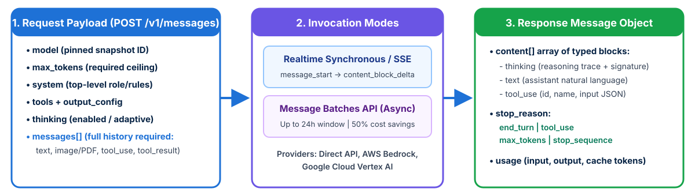

<!-- course-title: Claude Certified Developer - Foundations: Hands-On Exam Prep Workshop -->
<!-- course-theme: roi-alt-theme -->

<!-- layout: title -->


Claude Certified Developer - Foundations: Hands-On Exam Prep Workshop

# Chapter 3: Applications and Integration

---

# Chapter 3: Objectives

- Map functional and infrastructure requirements to design choices
- Integrate the Messages API, streaming, multi-format input, and batches
- Apply async I/O, resilient retries, and Claude-assisted SDLC practices
- Manage session boundaries, pinned configurations, and plugins

---

# Domain 2: Applications and Integration

| Task # | Task Statement |
| :--- | :--- |
| **2.1** | Understanding Requirements: Functional and infrastructure requirements based on business and solution architecture |
| **2.2** | Systems Life Cycle: Concepts and frameworks to develop, implement, operate, and maintain IT systems |
| **2.3** | Claude API Mechanics: Messages, tools, streaming, vision, thinking, caching, third-party vendors, and Realtime vs Batch APIs |
| **2.4** | Software Engineering Foundations: REST APIs, JSON, async programming, version control, SDLC, code review, and refactoring |
| **2.5** | Claude Application Design: Instruction interpretation across interfaces, content boundaries, schema design, and session hygiene |
| **2.6** | Configuration Management: `CLAUDE.md`, `settings.json`, model version pinning, prompt versioning, and plugin dependencies |

---

<!-- layout: navigation -->
# Chapter 3

- **Requirements and Systems Life Cycle**
- Claude API Mechanics
- Software Engineering Foundations
- Application Design and Configuration

---

<!-- layout: card-layout -->
# Translating Requirements Across the Systems Life Cycle

### Functional vs Infrastructure Requirements
- **Functional requirements** define what the AI application must accomplish: supported input formats (text, images, PDFs), tool integrations, output schemas, and escalation rules.
- **Infrastructure requirements** define latency SLAs (TTFT vs end-to-end), concurrency/rate-limit capacity, VPC egress rules, data residency, and secret storage.

### Systems Life Cycle (SDLC) Phases
- **Planning and Discovery**: define success metrics and build the initial golden evaluation dataset.
- **Development and Integration**: implement stateless API handlers, typed schemas, and deterministic hooks.
- **Testing and Deployment**: gate CI/CD merges on automated evaluations and roll out via canary/shadow stages.
- **Operations and Maintenance**: monitor token usage, cache hit rates, latency p95, and model deprecations and retirements.

---

# From Requirement to Design Choice

| Requirement in the Scenario | Design Choice the Exam Expects |
| :--- | :--- |
| **Users watch the answer appear; low perceived latency** | Stream the response (SSE); consider Haiku for the fast path |
| **Thousands of non-urgent jobs; cost is the priority** | Message Batches API (50% discount, results within 24 hours) |
| **Same long system prompt or document on every call** | Prompt caching on the stable prefix |
| **Data must stay in a region or cloud account** | `inference_geo`, or Claude via Bedrock, Vertex AI, or Foundry |
| **Strict data retention rules** | Check zero data retention eligibility per model before you commit |
| **Outputs feed a database or downstream API** | Structured outputs with a JSON Schema, then validate |
| **Agent must act on private internal systems** | Self-hosted harness or a secured remote MCP server |

---

<!-- layout: navigation -->
# Chapter 3

- Requirements and Systems Life Cycle
- **Claude API Mechanics**
- Software Engineering Foundations
- Application Design and Configuration

---

<!-- layout: stacked -->
# Claude Messages API Mechanics

- **Stateless API contract**: the Messages API does not store conversation state on the server; your application must pass the required conversation history in the `messages` array on every request
- **Top-level `system` parameter**: put the main system instructions in the top-level `system` field; newer models also accept a mid-conversation `{"role": "system"}` message to add operator instructions without breaking the cache (never as `messages[0]`)
- **Multi-format content blocks**: a single message’s `content` can contain an array of typed blocks (`text`, `image` base64/URL, `document` PDF, `tool_use`, `tool_result`, `thinking`)



---

# Streaming and Multi-Turn `tool_result` Rules

- **SSE streaming** lowers perceived latency; required for large `max_tokens` (avoids HTTP timeouts)
- **Strict pairing**: the user message after a `tool_use` must start with its `tool_result` blocks

```python
client = AsyncAnthropic()  # async client required for "async with"
async with client.messages.stream(
    model="claude-sonnet-5-5", max_tokens=16000,
    system="You are a production log analyzer.",
    messages=[{"role": "user", "content": "Summarize this stack trace."}],
) as stream:
    async for text in stream.text_stream:
        print(text, end="", flush=True)
    final = await stream.get_final_message()  # full Message, usage, stop_reason
```

---

<!-- layout: card-layout -->
# Vision, Documents, and Files API Data Access

### Images (Vision)
- Send `image` blocks as base64, URL, or Files API `file_id` (JPEG, PNG, GIF, WebP).
- Current models read up to 2576 px on the long edge, which can cost several thousand tokens per image: downsample when fidelity is not needed.

### PDFs and Documents
- Send a `document` block (base64, URL, or `file_id`) placed before the question text.
- Claude reads both the text and the page images of a PDF, so charts and tables are understood.

### Files API (GA)
- Upload once with `client.files.upload(...)`, then reference the `file_id` across many requests instead of re-sending bytes.
- The content block type must match the file’s MIME type (`document` for PDF, `image` for images).

### Citations
- Set `citations: {"enabled": true}` on document blocks to get `cited_text` and page or character locations for each claim.
- Use citations when answers must be traceable to source documents.

---

<!-- layout: card-layout -->
# Invoking Claude via First-Party and Cloud Vendors

### Claude API (Anthropic)
- `Anthropic()` or `AsyncAnthropic()` authenticated with `ANTHROPIC_API_KEY` (or workload identity federation).
- First access to new features such as fast mode, Managed Agents, and new beta tools.

### Amazon Bedrock
- `AnthropicBedrockMantle(aws_region=...)` with AWS IAM credentials; model IDs take an `anthropic.` prefix.
- Fits when workloads, VPC controls, and billing already live in AWS (Claude Platform on AWS is the Anthropic-operated alternative).

### Google Cloud Vertex AI
- `AnthropicVertex(project_id=..., region="global")` with Application Default Credentials.
- Keeps traffic and billing inside the GCP project.

### Microsoft Foundry
- `AnthropicFoundry(...)` with an Azure resource; billed through the Microsoft Marketplace.
- Feature availability differs by platform: check before you design around a beta feature.

---

<!-- layout: 2-column -->
# Realtime Messages API vs Message Batches API

### Realtime Messages API
- Synchronous request/response (or SSE stream) with immediate execution
- Supports interactive multi-turn `tool_use` loops
- **Use when**: a user or blocking CI pipeline is waiting on the result right now

### Message Batches API
- Asynchronous processing of up to 100,000 requests per batch; completes within **24 hours** at a **50% cost discount**
- Uses `custom_id` on each item to correlate results (since batch results may return in any order)
- **Use when**: running overnight analytics across 10,000 documents, bulk evaluations, or non-urgent backfills

<!-- below-columns -->

> [!IMPORTANT]
> Exam rule: parallel synchronous calls or a lower `max_tokens` do **not** get the 50% discount. Use the **Message Batches API** for latency-tolerant bulk jobs.

---

<!-- layout: navigation -->
# Chapter 3

- Requirements and Systems Life Cycle
- Claude API Mechanics
- **Software Engineering Foundations**
- Application Design and Configuration

---

<!-- layout: card-layout -->
# Software Engineering Foundations for AI Apps

### Asynchronous Programming (`AsyncAnthropic`)
- LLM calls are network I/O bound (seconds to minutes per call).
- Use `AsyncAnthropic` with `asyncio.gather` (or `Promise.all` in TypeScript) with bounded semaphores so concurrent requests never block the event loop.

### Resilient REST Integration
- The official SDKs already retry `408`, `409`, `429`, and `5xx` twice by default with backoff; tune `max_retries` and `timeout` instead of hand-rolling retries.
- Respect the `retry-after` header, and make your own side-effecting tools idempotent so a retry cannot double-charge or double-send.

### REST and JSON Contracts
- The SDKs wrap `POST /v1/messages`: know the request shape (`model`, `max_tokens`, `system`, `messages`, `tools`) and the response shape (`content` blocks, `stop_reason`, `usage`).
- Parse tool inputs and model JSON with a real JSON parser and schema validation, never string matching.

### SDLC and Code Review Integration
- Treat prompts, tool schemas, and evaluation datasets as version-controlled code artifacts reviewed in pull requests alongside application code.

---

<!-- layout: 2-column -->
# Version Control, Code Review, and Refactoring with Claude

### Version Control and Code Review
- Let Claude Code create branches, commits, and pull requests, but keep human review on every merge
- Run Claude in CI with the Claude Code GitHub Actions integration or `claude -p` for automated PR review comments
- Use `/security-review` (or a review Skill) to check diffs for vulnerabilities before merge

### Small- vs Large-Scale Refactoring
- **Small**: a targeted `Edit` in one file, verified by the existing tests
- **Large**: start in Plan Mode, map dependencies, split work by module across subagents or git worktrees, and verify each module before moving on
- Keep the test suite green as the contract: Claude refactors, tests decide

---

<!-- layout: navigation -->
# Chapter 3

- Requirements and Systems Life Cycle
- Claude API Mechanics
- Software Engineering Foundations
- **Application Design and Configuration**

---

<!-- layout: card-layout -->
# How Claude Interprets Instructions Across Interfaces

### Claude Code (CLI / IDE)
- Automatically loads the `CLAUDE.md` hierarchy, `.claude/rules/` path globs, `settings.json`, and local/project MCP servers.
- Operates directly on the local workspace with built-in file and bash tools.

### Claude Desktop and claude.ai
- **Claude Desktop** connects to local MCP servers configured in `claude_desktop_config.json`.
- **claude.ai** uses Project instructions, uploaded knowledge files, and Artifacts within a managed web session.

### API and Client SDKs
- Completely **stateless** and zero-magic: Claude only sees the exact `system` string, `tools` list, and `messages` array you send in that HTTP request.
- Does **not** automatically read `CLAUDE.md` unless your code explicitly loads and injects it.

---

<!-- layout: 2-column -->
# Session Hygiene and Configuration Management

### Content Boundaries and Session Hygiene
- Isolate per-user conversation histories and tool execution state so Tenant A’s data never leaks into Tenant B’s session
- Wrap external retrieved data or user uploads inside explicit XML delimiters (`<user_document>`) to maintain strict content boundaries
- Sanitize and validate all model outputs against strict JSON schemas before persisting

### Configuration Management and Version Pinning
- **Pin an explicit model ID** in config (for example, `claude-sonnet-5-5`), plus your SDK version and `anthropic-version` header, so upgrades happen only when you choose; older models use dated IDs such as `claude-haiku-4-5-20251001`
- Track deprecation and retirement dates: a retired model ID fails every request
- Version-control `CLAUDE.md`, `settings.json`, prompt templates, and plugin versions so any deployment can be reproduced or rolled back

---

<!-- layout: card-layout -->
# Claude Code Plugins and Plugin Management

### What a Plugin Bundles
- A plugin packages Skills, subagents, hooks, MCP servers, and commands behind one manifest (`.claude-plugin/plugin.json`).
- Install one plugin instead of copying many config files into every repository.

### Marketplaces and Installation
- Add a catalog with `/plugin marketplace add <repo-or-url>`, then `/plugin install <name>@<marketplace>`.
- Teams publish an internal marketplace repository for approved plugins.

### Configuration and Dependencies
- Enabled plugins are recorded in `settings.json` (`enabledPlugins`), so a project can require the same plugins for every developer.
- Pin plugin versions and review updates like any other dependency, because a plugin can add hooks and tools.

### When to Use a Plugin
- Use a plugin when a set of Skills, hooks, and MCP servers must be shared across many repositories or teams.
- Use project files (`.claude/`) when the configuration belongs to one repository.

---

# Domain 2 Quiz: Applications and Integration

- [Open Quiz](https://claude-certification-exam-prep-1077635956541.us-east4.run.app/questions?file=public/2026-10-31-12-11-ccdv-f-realistic-instructor.json)

---

# What You Learned

- Mapped functional and infrastructure requirements to design choices
- Integrated the Messages API, streaming, multi-format input, and batches
- Applied async I/O, resilient retries, and Claude-assisted SDLC practices
- Managed session boundaries, pinned configurations, and plugins

---

<!-- layout: stacked -->
# Questions and Answers


