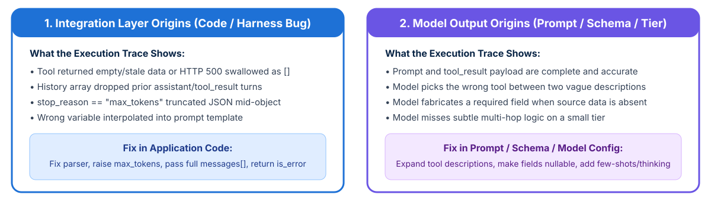

<!-- course-title: Claude Certified Developer - Foundations: Hands-On Exam Prep Workshop -->
<!-- course-theme: roi-alt-theme -->

<!-- layout: title -->


Claude Certified Developer - Foundations: Hands-On Exam Prep Workshop

# Chapter 4: Claude Code, Testing, and Debugging

---

# Chapter 4: Objectives

- Configure Claude Code memory, rules, skills, and permissions
- Operate interactive, Plan, Headless, and Streaming modes
- Handle API and tool errors with resilient recovery strategies
- Analyze execution traces to isolate root causes

---

# Domain 3: Claude Code and Domain 4: Eval, Testing, and Debugging

| Task # | Task Statement |
| :--- | :--- |
| **3.1** | Claude Code Operation: Core components (Rules, Skills, Commands, Agents, Agent Memory), session management, headless/streaming/auto modes, `CLAUDE.md` hierarchy, and `settings.json` |
| **4.1** | Debugging and Error Handling: Error type identification, recovery strategy selection, trace analysis, and problem origin isolation between the integration layer and model output |

---

<!-- layout: navigation -->
# Chapter 4

- **Core Components and Configuration**
- Session Management and Execution Modes
- Error Handling and Recovery
- Trace Analysis and Problem Isolation

---

<!-- layout: card-layout -->
# Five Core Components of Claude Code

### 1. Memory (`CLAUDE.md`)
- Hierarchical persistent context loaded automatically: user scope (`~/.claude/CLAUDE.md`), project scope (`CLAUDE.md` or `.claude/CLAUDE.md`), and subdirectory scope.
- Initialize a repository’s baseline `CLAUDE.md` with `/init` and inspect active files with `/memory`.

### 2. Rules (`.claude/rules/*.md`)
- Topic-specific markdown rules with YAML frontmatter `paths` globs (such as `paths: ["**/*.test.ts"]`) that activate conditionally when matching files are edited.

### 3. Skills (`.claude/skills/<name>/SKILL.md`)
- On-demand task workflows with frontmatter options (`context: fork` for isolated subagent execution, `allowed-tools` for safety restrictions, `argument-hint`).

### 4. Slash Commands and Agents
- Custom reusable prompt templates in `.claude/commands/` (team-shared) or `~/.claude/commands/` (personal), plus specialized subagents like `Explore`.

---

# Configuring `settings.json` and Permissions

- **Settings hierarchy**: user settings (`~/.claude/settings.json`), shared project settings (`.claude/settings.json`), and uncommitted local overrides (`.claude/settings.local.json`)
- **Granular tool permission rules**: control which shell commands, files, and MCP tools can run without manual prompts

```json
{
  "permissions": {
    "allow": [
      "Bash(npm run test:*)",
      "Bash(git status)",
      "Read(src/**)"
    ],
    "deny": [
      "Read(.env*)",
      "Bash(rm -rf:*)",
      "Bash(curl:*)"
    ]
  }
}
```

---

<!-- layout: navigation -->
# Chapter 4

- Core Components and Configuration
- **Session Management and Execution Modes**
- Error Handling and Recovery
- Trace Analysis and Problem Isolation

---

<!-- layout: 3-column -->
# Claude Code Execution Modes

### Interactive and Plan Mode
- Default conversational terminal/IDE loop
- Switch to **Plan Mode** for complex multi-file refactoring or architectural changes to explore dependencies safely before modifying files

### Headless Mode (`-p` / `--print`)
- Runs a single prompt non-interactively, prints to stdout, and exits immediately
- Combine with `--output-format json` and `--json-schema` for automated CI/CD PR checks

### Streaming and Auto-Mode
- `--output-format stream-json` emits real-time JSON events for programmatic harnesses
- Auto-approval modes must only run inside isolated containers/sandboxes with strict `deny` rules

---

<!-- layout: 2-column -->
# Session Management Commands and Workflows

### Resuming and Branching Sessions
- **`claude --continue` (`-c`)**: resumes the most recent conversation in the current directory
- **`claude --resume <session-name>` (`-r`)**: resumes a specific named investigation session across workdays
- **`fork_session`**: branches a conversation from a shared codebase analysis baseline to test two competing implementation strategies independently

### Managing Context Health Mid-Session
- **`/compact`**: summarizes verbose tool history into a concise state summary when the context window fills up during long debugging sessions
- **`/clear`**: resets conversation history completely when switching to an unrelated task so old file context does not bleed over

---

<!-- layout: navigation -->
# Chapter 4

- Core Components and Configuration
- Session Management and Execution Modes
- **Error Handling and Recovery**
- Trace Analysis and Problem Isolation

---

<!-- layout: card-layout -->
# Identifying API and Tool Error Types

### Client and Validation Errors (`400`, `401`, `403`, `404`)
- **`400 invalid_request_error`**: malformed JSON, missing `tool_result` block after `tool_use`, or exceeding context window limits (do **not** blind-retry without fixing the request).
- **`401/403`**: invalid API key or missing IAM permission (fail fast and alert).

### Rate Limits and Overloads (`429`, `500`, `529`)
- **`429 rate_limit_error`**: token or request quota exceeded; read the `retry-after` header and back off.
- **`529 overloaded_error` / `500`**: temporary service saturation; retry with **exponential backoff and jitter**.

### Tool Execution and Schema Errors
- MCP tool returns `isError: true` or model output fails Pydantic validation.
- Feed structured validation errors back to the model in a self-correction turn (up to a bounded max retry count).

---

<!-- layout: navigation -->
# Chapter 4

- Core Components and Configuration
- Session Management and Execution Modes
- Error Handling and Recovery
- **Trace Analysis and Problem Isolation**

---

<!-- layout: stacked -->
# Isolating Integration Bugs vs Model Output Failures

- **Inspect the full execution trace first**: before rewriting prompts or switching models, examine the exact HTTP request payload, `messages` history, `tool_use` arguments, `tool_result` outputs, and `stop_reason`
- **Integration-layer bug**: the model received corrupted, incomplete, or stale inputs (or its output was truncated by `stop_reason == "max_tokens"`)
- **Model-layer failure**: the model received clean, complete context and instructions, but misrouted a tool or hallucinated an absent field



---

# Trace Diagnostic Checklist for Developers

| Observed Failure in Production | What to Check in the Trace | Root Cause Layer and Fix |
| :--- | :--- | :--- |
| **`JSONDecodeError` when parsing structured output** | Check `response.stop_reason` | If `stop_reason == "max_tokens"`, **Integration Layer**: increase `max_tokens` and use `tool_use` schema |
| **API returns `400` on turn 3 of an agent loop** | Check message ordering after assistant `tool_use` | **Integration Layer**: ensure every `tool_use_id` has a matching `tool_result` in the very next user message |
| **Agent claims no orders exist when database timed out** | Check raw `tool_result` payload sent back to Claude | **Integration Layer**: tool caught the timeout and returned `[]` instead of `isError: true` |
| **Agent picks `get_customer` when given an order number** | Check `tools` array descriptions in the request | **Model / Tool Config Layer**: expand tool descriptions with explicit input formats and boundaries |

---

# Domains 3 and 4 Quiz: Claude Code, Testing, and Debugging

- Open the Exam Prep Program to complete the Domains 3 and 4 review questions

<!-- TODO: Add Exam Prep Program URL for Domains 3 and 4 Quiz -->

---

# Lab 2: API Integration, Claude Code, and Debugging

**Time:** 45 minutes

- [Open Lab](https://labv.roitraining.com/?lab=https://github.com/roitraining/claude-exam-cert-prep-courses/tree/main/claude-certified-developer-foundations-exam-prep-workshop/labs/lab-02-api-integration-claude-code-and-debugging)

---

<!-- layout: 2-column -->
# What You Learned

### Claude Code Configuration and Modes
- Configured Claude Code memory, rules, skills, and permissions
- Operated interactive, Plan, Headless, and Streaming modes

### Error Recovery and Trace Isolation
- Handled API and tool errors with resilient recovery strategies
- Analyzed execution traces to isolate root causes

---

<!-- layout: stacked -->
# Questions and Answers


