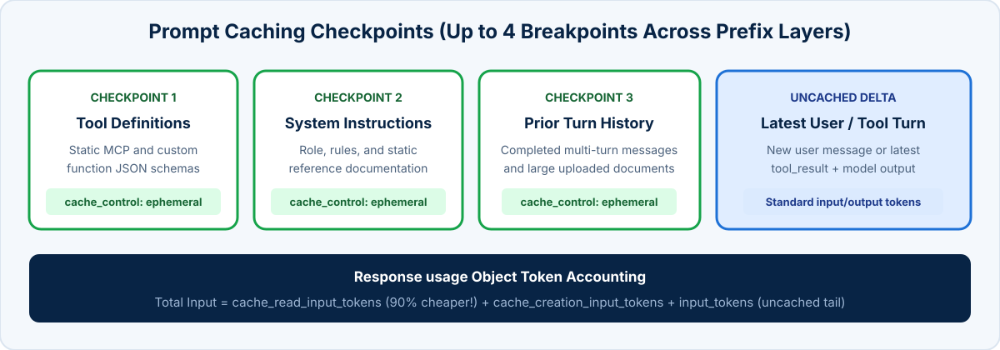

<!-- course-title: Claude Certified Developer - Foundations: Hands-On Exam Prep Workshop -->
<!-- course-theme: roi-alt-theme -->

<!-- layout: title -->


Claude Certified Developer - Foundations: Hands-On Exam Prep Workshop

# Chapter 5: Model Selection and Optimization

---

# Chapter 5: Objectives

- Apply LLM fundamentals including tokenization, context window limits, sampling parameters, and thinking/effort options
- Integrate client SDKs (`anthropic` Python / TypeScript) with REST APIs, SSE streams, and WebSockets
- Evaluate model capabilities and trade-offs across Claude Opus, Sonnet, and Haiku and manage breaking changes across releases
- Optimize token budgets and cost using usage tracking, Prompt Caching, and cache checkpointing

---

# Domain 5: Model Selection and Optimization

| Task # | Task Statement |
| :--- | :--- |
| **5.1** | LLM Fundamentals: Tokens, context windows, sampling, non-determinism, model options (fast mode, extended/adaptive thinking, effort levels), and prompting |
| **5.2** | Technical Fundamentals: Integrating with client SDKs that wrap REST APIs and WebSockets |
| **5.3** | Model Selection and Trade-Offs: Opus vs Sonnet vs Haiku use cases, quality/latency/cost trade-offs, and breaking behavior changes across releases |
| **5.4** | Cost and Token Management: Token usage tracking, cost modeling, Prompt Caching, and cache checkpointing |

---

<!-- layout: navigation -->
# Chapter 5

- **LLM Fundamentals**
- Technical Fundamentals
- Model Selection and Trade-Offs
- Cost and Token Management

---

<!-- layout: card-layout -->
# Core LLM Mechanics for Developers

### Tokenization and Context Windows
- Claude processes text in sub-word **tokens** (roughly 3 to 4 English characters per token); code, JSON keys, and base64 images also consume tokens.
- The context window ceiling covers **total input tokens + thinking tokens + output tokens (`max_tokens`)**.

### Next-Token Generation and Non-Determinism
- LLMs generate responses autoregressively one token at a time based on probability distributions.
- Even at `temperature = 0.0`, minor floating-point hardware variance means outputs are near-deterministic, not mathematically guaranteed bit-for-bit identical.

### Sampling Parameters (`temperature`, `top_p`, `top_k`)
- Use low `temperature` (near `0.0`) for code generation, data extraction, classification, and analytical reasoning.
- Adjust `temperature` or `top_p` (not both simultaneously) only when creative diversity is desired.

### Zero-Shot, Single-Shot, and Multi-Shot
- **Zero-shot** relies on instructions alone; **single-shot** provides 1 format example; **multi-shot (few-shot)** provides 2 to 5 examples to calibrate edge-case judgment.

---

<!-- layout: 2-column -->
# Extended Thinking, Adaptive Thinking, Effort, and Fast Mode

### Extended and Adaptive Thinking
- **Extended Thinking**: allocates a `budget_tokens` allowance for Claude to reason step-by-step inside `thinking` blocks before producing the visible response or tool call
- **Adaptive Thinking**: supported on newer Claude 4+ models, allowing the model to dynamically scale its thinking depth up or down based on query complexity
- Note: when Extended Thinking is enabled, `temperature` cannot be modified from its default (`1.0`)

### Effort Levels and Fast Mode
- **Effort levels (`low`, `medium`, `high`)**: let developers tune how much reasoning and token budget Claude invests per turn without rewriting prompts
- **Fast Mode**: prioritizes higher output tokens-per-second throughput for latency-critical interactive coding and agent sessions

---

<!-- layout: navigation -->
# Chapter 5

- LLM Fundamentals
- **Technical Fundamentals**
- Model Selection and Trade-Offs
- Cost and Token Management

---

# Integrating with Official Client SDKs

- **Why use the official SDKs** (`anthropic` for Python, `@anthropic-ai/sdk` for TypeScript) over raw `fetch`/`requests`:
  - Built-in connection pooling, automatic retries with exponential backoff on `429`/`5xx`, typed Pydantic/TypeScript models, and SSE stream helpers

```typescript
import Anthropic from "@anthropic-ai/sdk";

const client = new Anthropic({
  apiKey: process.env.ANTHROPIC_API_KEY,
  maxRetries: 3,
  timeout: 30_000,
});

const message = await client.messages.create({
  model: "claude-sonnet-4-20250514",
  max_tokens: 1024,
  thinking: { type: "enabled", budget_tokens: 1024 },
  messages: [{ role: "user", content: "Design an idempotent retry key schema." }],
});
```

---

<!-- layout: 2-column -->
# REST + SSE Streaming vs WebSockets

### REST + Server-Sent Events (SSE)
- Unidirectional server-to-client stream over standard HTTP (`POST /v1/messages` with `stream: true`)
- Firewall-friendly, stateless per turn, and natively supported by the Claude Messages API SDKs
- Ideal for standard chat UIs, code generation streaming, and single-turn tool calls

### WebSockets in Agent Architectures
- Persistent, full-duplex bi-directional connection between client applications and your backend agent server
- Ideal when your agent harness needs to push live intermediate status updates, accept mid-flight user cancellations, or coordinate interactive client-side tool approvals

---

<!-- layout: navigation -->
# Chapter 5

- LLM Fundamentals
- Technical Fundamentals
- **Model Selection and Trade-Offs**
- Cost and Token Management

---

<!-- layout: 3-column -->
# Selecting Between Opus, Sonnet, and Haiku

### Claude Opus
- **Highest capability** on complex architectural design, subtle bug root-causing, and multi-source synthesis
- Supports adaptive/extended thinking for deep reasoning
- **Trade-off**: highest cost and latency; reserve for complex planning or coordinator synthesis

### Claude Sonnet
- **Optimal balance** of coding fluency, agentic tool use, instruction following, and speed
- Supports adaptive/extended thinking
- **Default choice** for 80%+ of production software engineering and agentic workloads

### Claude Haiku
- **Fastest TTFT and lowest cost**
- Ideal for high-throughput classification, guardrail checks, routing, and simple entity extraction
- **Trade-off**: lower accuracy on complex multi-hop reasoning or ambiguous codebase refactoring

---

# Managing Breaking Behavior Changes Across Model Releases

- **Why upgrading models can break production apps**: even when the API schema stays identical, a newer model snapshot may change its verbosity, formatting habits, tool-calling eagerness, or refusal sensitivity
- **Safe model upgrade workflow**:
  1. **Pin exact snapshot IDs** (`claude-sonnet-4-20250514`) in production config rather than unpinned aliases
  2. Run your **automated evaluation suite** side-by-side against the new model snapshot
  3. Check tool selection rates, JSON schema compliance, latency p95, and token length shifts before switching live traffic

---

<!-- layout: navigation -->
# Chapter 5

- LLM Fundamentals
- Technical Fundamentals
- Model Selection and Trade-Offs
- **Cost and Token Management**

---

<!-- layout: stacked -->
# Token Budgeting and Cache Checkpointing

- **Track all four token counters** in `response.usage`: `input_tokens`, `output_tokens`, `cache_creation_input_tokens`, and `cache_read_input_tokens`
- **Multi-checkpoint Prompt Caching**: place `cache_control: {"type": "ephemeral"}` checkpoints at the end of static `tools`, static `system` instructions, and completed multi-turn `messages` history prefixes
- **Advancing the conversation checkpoint**: in long multi-turn agent loops, moving a cache checkpoint forward periodically caches earlier turns so you only pay full price for the newest turn



---

# Domain 5 Quiz: Model Selection and Optimization

- Open the Exam Prep Program to complete the Domain 5 review questions

<!-- TODO: Add Exam Prep Program URL for Domain 5 Quiz -->

---

# What You Learned

- Applied LLM fundamentals across tokenization, context windows, sampling (`temperature`), extended/adaptive thinking, and effort levels
- Integrated official client SDKs with timeouts, retries, SSE streaming, and WebSockets
- Selected between Claude Opus, Sonnet, and Haiku and managed behavioral changes across model releases
- Optimized token costs and latency using `response.usage` tracking, Prompt Caching prefixes, and cache checkpointing

---

<!-- layout: stacked -->
# Questions and Answers


