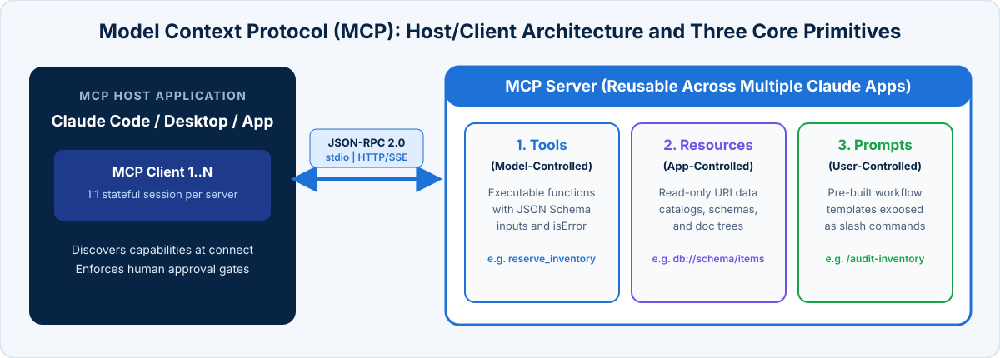

<!-- course-title: Claude Certified Developer - Foundations: Hands-On Exam Prep Workshop -->
<!-- course-theme: roi-alt-theme -->

<!-- layout: title -->


Claude Certified Developer - Foundations: Hands-On Exam Prep Workshop

# Chapter 8: Tools and MCPs

---

# Chapter 8: Objectives

- Implement custom tools with `strict: true` JSON schemas, clear boundaries, and `defer_loading`
- Return structured error results (`is_error: true`) with retryability metadata
- Build MCP servers exposing Tools, Resources, and Prompts over `stdio` and Streamable HTTP
- Configure `.mcp.json` scopes, remote OAuth/connector integration, and MCP Inspector debugging
- Select between Built-in Tools, Custom Tools, Skills, and MCP Servers

---

# Domain 8: Tools and MCPs (10.6% of Exam)

| Task # | Task Statement |
| :--- | :--- |
| **8.1** | Tool Implementation: Tool use and function calling, external system configuration, tool description writing, error handling, client-side vs server-side tools, and approval patterns |
| **8.2** | MCP Server Development: Server authoring, deployment, application integration, MCP resources, tools, and prompts, and communication patterns (`stdio`, Streamable HTTP) |
| **8.3** | Agentic Customization: Trade-offs among built-in Tools, custom Tools, Skills, and MCPs for selecting the appropriate approach |

---

<!-- layout: navigation -->
# Chapter 8

- **Tool Implementation**
- MCP Server Development
- Agentic Customization

---

<!-- layout: card-layout -->
# Tool Implementation Best Practices

### 1. Clear Descriptions and Boundaries
- Write descriptions that specify exact purpose, expected parameter formats (such as `ORD-NNNNN` or ISO-8601 dates), example queries, edge cases, and when **not** to use the tool relative to similar tools.

### 2. Focused Tool Sets and `defer_loading`
- Keep per-agent tool sets small (4 to 5 role-specific tools) to maximize selection accuracy.
- When an agent must access a catalog of 30+ tools, mark rarely used tools `defer_loading: true` and include the **tool search tool** so Claude loads detailed schemas on demand instead of paying 15,000+ tokens on every turn.

### 3. Structured Error Handling (`is_error: true`)
- Return failures as structured results, never unhandled exceptions or fake empty `[]` successes.
- Set `is_error: true` on a Messages API `tool_result` (MCP uses `isError: true`) with an `errorCategory` (`transient`, `validation`, `permission`, `business`) and `isRetryable` flag.

### 4. Approval Patterns for Sensitive Actions
- Gate destructive or state-changing tool calls (`delete_customer`, `execute_wire_transfer`) behind human confirmation or a `PreToolUse` hook while letting read-only tools run autonomously.

---

# Demo: An Empty Success Versus an Error Result

In `ccdvf-labs`, with the virtual environment still active:

**Step 1. Create `demo_06_tool_error.py`**

**Step 2. Paste this code**

```python
# demo_06_tool_error.py - [] means nothing found; is_error means the lookup failed
from dotenv import load_dotenv
import anthropic

load_dotenv()
client = anthropic.Anthropic()

tools = [{
    "name": "lookup_order",
    "description": "Look up one order by its ID. IDs look like ORD-1001.",
    "input_schema": {
        "type": "object",
        "properties": {
            "order_id": {"type": "string"},
        },
        "required": ["order_id"],
    },
}]

def follow_up(is_error):
    label = "Error result" if is_error else "Empty success"
    messages = [{
        "role": "user",
        "content": "Look up order ORD-MISSING and tell me the status.",
    }]
    first = client.messages.create(
        model="claude-haiku-5-5",
        max_tokens=512,
        tools=tools,
        messages=messages,
    )
    tool_uses = [block for block in first.content if block.type == "tool_use"]
    if not tool_uses:
        print(label)
        print("Claude answered without calling lookup_order. Run the file again.")
        print()
        return
    tool_use = tool_uses[0]
    if is_error:
        result = {
            "type": "tool_result",
            "tool_use_id": tool_use.id,
            "is_error": True,
            "content": "No order with that ID. Check the ORD-NNNNN format.",
        }
    else:
        result = {
            "type": "tool_result",
            "tool_use_id": tool_use.id,
            "content": "[]",
        }
    messages.append({"role": "assistant", "content": first.content})
    messages.append({"role": "user", "content": [result]})
    second = client.messages.create(
        model="claude-haiku-5-5",
        max_tokens=512,
        tools=tools,
        messages=messages,
    )
    text = "".join(block.text for block in second.content if block.type == "text")
    print(label)
    print(text)
    print()

follow_up(is_error=False)
follow_up(is_error=True)
```

**Step 3. Run it**

```bash
python demo_06_tool_error.py
```

**Step 4. Examine the output**

- **Empty success:** Claude treats `[]` as a finished lookup and says there is no such order
- **Error result:** Claude treats the tool as failed and asks you to check the `ORD-NNNNN` format

> [!NOTE]
> `[]` tells Claude the lookup worked and nothing was found, so it may answer “there is no such order.” `is_error: true` tells Claude the tool failed, so it can ask for a corrected ID instead of inventing a result.

---

<!-- layout: 2-column -->
# Weak vs Strong Tool Definitions (`strict: true`)

### Weak Definition (Causes Misrouting)
```json
{
  "name": "analyze_content",
  "description": "Analyzes content and returns insights.",
  "input_schema": {
    "type": "object",
    "properties": {
      "target": {"type": "string"},
      "date": {"type": "string"}
    }
  }
}
```
- Vague name and one-line description collide with `analyze_document`; unconstrained `input_schema` allows missing fields or malformed dates.

### Strong Definition (Disambiguated + Strict)
```json
{
  "name": "extract_web_article",
  "description": "Fetches and extracts main text from a public HTTP/HTTPS web URL (e.g., 'https://example.com/post'). Do NOT use for uploaded PDFs or local files; use analyze_uploaded_pdf instead.",
  "strict": true,
  "input_schema": {
    "type": "object",
    "properties": {
      "url": {"type": "string", "description": "Full https:// URL"},
      "published_after": {"type": "string", "description": "ISO-8601 date YYYY-MM-DD"}
    },
    "required": ["url", "published_after"],
    "additionalProperties": false
  }
}
```

---

# Scaling Large Tool Catalogs with `defer_loading` and Structured Errors

- **On-demand tool discovery** (`defer_loading: true`) and **actionable error payloads** (`is_error: true`):

```python
tools = [
    {"type": "tool_search_tool_regex_20251119", "name": "tool_search_tool_regex"},
    {
        "name": "lookup_customs_tariff",
        "description": "Look up HS tariff codes and duty rates for international shipments.",
        "defer_loading": True,  # schema loaded on demand only when discovered via tool search
        "strict": True,
        "input_schema": {
            "type": "object",
            "properties": {"hs_code": {"type": "string"}},
            "required": ["hs_code"],
            "additionalProperties": False,
        },
    },
]

# Structured error tool_result so Claude knows whether to retry, fix input, or explain policy
error_tool_result = {
    "type": "tool_result",
    "tool_use_id": tool_call.id,
    "is_error": True,
    "content": json.dumps({
        "errorCategory": "validation",
        "isRetryable": True,
        "message": "Invalid hs_code '99'. Expected 6-to-10 digit numeric string (e.g., '8471.30.0100').",
    }),
}
```

---

<!-- layout: 3-column -->
# Client-Side vs Server-Side Tools

### Client Tools (You Define)
- Declared in `tools` with `name`, `description`, and `input_schema` (add `strict: true` for guaranteed schema-valid input)
- Claude returns `stop_reason: "tool_use"`; **your harness** runs the function and returns a `tool_result`
- The only option (alongside your own MCP servers) that reaches private VPC systems directly

### Anthropic-Defined Client Tools
- Schema supplied by Anthropic, executed by your harness: `bash` (`bash_20250124`), `text_editor`, `memory` (`memory_20250818`), computer use
- Declare by `type` and `name` with no `input_schema`
- Your application still owns container sandboxing and command approval

### Server Tools (Anthropic Executes)
- `web_search` (`web_search_20250305`), `web_fetch`, `code_execution`, tool search: executed on Anthropic infrastructure; results arrive in the same response
- Long server loops can stop with `stop_reason: "pause_turn"`: resend to resume
- **Cannot** reach your private internal VPC services

---

<!-- layout: navigation -->
# Chapter 8

- Tool Implementation
- **MCP Server Development**
- Agentic Customization

---

<!-- layout: stacked -->
# Model Context Protocol (MCP) Architecture and Primitives

- **Standardized integration protocol**: an MCP Host (Claude Code, Claude Desktop, or your custom agent app) uses MCP Clients to maintain 1:1 stateful connections with MCP Servers
- **Three core server primitives**:
  - **Tools (Model-controlled)**: executable functions (`check_sku_stock`, `create_ticket`) that Claude chooses to invoke
  - **Resources (App-controlled)**: read-only URI-addressed data catalogs (`inventory://catalog/schema`, documentation trees) attached by the host/user without exploratory model tool calls
  - **Prompts (User-controlled)**: parameterized workflow templates exposed to users as slash commands



---

# Authoring an MCP Server with Tools, Resources, and Prompts

- **Exposing all three primitives** from one centrally maintained Python MCP server (`MCPServer`, called `FastMCP` prior to SDK 2.0):

```python
from mcp.server.mcpserver import MCPServer

mcp = MCPServer("inventory-service")

@mcp.resource("inventory://catalog/schema")
def get_inventory_schema() -> str:
    """Read-only warehouse schema and valid warehouse codes (App-controlled Resource)."""
    return "warehouses: [US-EAST, US-WEST, EU-CENTRAL] | SKU format: SKU-NNNNN"

@mcp.tool()
def check_sku_stock(sku: str, warehouse: str) -> dict:
    """Query live stock count for a SKU (format: SKU-NNNNN) in one warehouse (Model-controlled Tool)."""
    return query_internal_inventory_api(sku=sku, warehouse=warehouse)

@mcp.prompt()
def restock_incident_template(sku: str, warehouse: str) -> str:
    """User-invocable slash template for investigating a stockout incident (User-controlled Prompt)."""
    return f"Check stock and recent PO history for {sku} in {warehouse} and draft a supplier escalation."
```

---

<!-- layout: 2-column -->
# MCP Transports (`stdio` vs Streamable HTTP) and Debugging

### `stdio` Transport (Local Subprocess)
- Host spawns the server as a local child process; JSON-RPC 2.0 frames travel over `stdin` and `stdout`
- Ideal for single-user local tooling in Claude Code or Claude Desktop
- **Critical exam rule**: **never** write `print()` or debug logs to `stdout` in a `stdio` MCP server: it corrupts the JSON-RPC stream. Always log diagnostics to `stderr` (`sys.stderr` or Python’s `logging` module)

### Streamable HTTP Transport (Remote Service)
- Current standard for remote, multi-client MCP servers (replaces deprecated `HTTP+SSE`)
- Deployed once as a central cloud service with OAuth 2.1 / bearer authentication so multiple teams and agent services can share it
- Connect via `claude mcp add --transport http`, `.mcp.json`, or the Messages API **MCP connector** (`mcp_servers` + `mcp_toolset`)
- Test locally before connecting an LLM using **MCP Inspector** (`npx @modelcontextprotocol/inspector`)

---

<!-- layout: 2-column -->
# Safe Logging in `stdio` Servers and Testing with MCP Inspector

### Logging to `stderr` in Python `stdio` Servers
- Any stray character written to `stdout` breaks JSON-RPC framing and causes the host to drop the server connection
- Configure Python’s `logging` module (or `print(..., file=sys.stderr)`) to write exclusively to `stderr`

```python
import logging, sys

logging.basicConfig(
    stream=sys.stderr,  # NEVER sys.stdout!
    level=logging.INFO,
    format="%(levelname)s: %(message)s",
)
logger = logging.getLogger("inventory-mcp")
```

### Interactive Debugging with MCP Inspector
- Run **MCP Inspector** before wiring your server into Claude Code or production agents to verify tool schemas, resource URIs, and `isError: true` responses interactively:

```bash
npx @modelcontextprotocol/inspector \
  python3 inventory_server.py
```

---

<!-- layout: 2-column -->
# Configuring `.mcp.json` Scopes and the Messages API MCP Connector

### Shared Project `.mcp.json` vs User `~/.claude.json`
- **Project scope (`.mcp.json`)**: checked into Git so every teammate gets the shared server; always inject secrets via `${ENV_VAR}` expansion
- **User scope (`~/.claude.json`)**: personal or experimental MCP servers that should not affect teammates

```json
// Committed project .mcp.json
{
  "mcpServers": {
    "github-enterprise": {
      "type": "http",
      "url": "https://mcp.internal.example/github",
      "headers": {
        "Authorization": "Bearer ${GITHUB_MCP_TOKEN}"
      }
    }
  }
}
```

### Messages API Remote MCP Connector
- Connect a stateless Messages API call directly to a remote Streamable HTTP MCP server without writing client-side MCP connection plumbing:

```python
resp = await client.beta.messages.create(
    model="claude-sonnet-5-5",
    max_tokens=2048,
    betas=["mcp-client-2025-11-20"],
    mcp_servers=[{
        "type": "url",
        "name": "inventory",
        "url": "https://mcp.internal.example/inventory",
        "authorization_token": os.environ["INV_TOKEN"],
    }],
    tools=[{"type": "mcp_toolset", "mcp_server_name": "inventory"}],
    messages=[{"role": "user", "content": "Check SKU-10492 in US-EAST."}],
)
```

---

<!-- layout: navigation -->
# Chapter 8

- Tool Implementation
- MCP Server Development
- **Agentic Customization**

---

<!-- layout: card-layout -->
# Choosing the Right Agentic Customization Approach

### Built-In Tools (`Read`, `Write`, `Edit`, `Bash`, `Grep`, `Glob`)
- Use for local file inspection, targeted code edits, pattern searching, and local shell execution inside Claude Code or the Agent SDK.
- Built-in tools **cannot** automatically reach arbitrary internal REST APIs without custom wiring.

### Custom In-Process Tools
- Use when a single application needs a lightweight function wrapper around an internal service and no other apps need to share it.

### Claude Skills (`SKILL.md`)
- Use to package reusable know-how (instructions, report templates, review checklists, local helper scripts) that loads on demand: only the name and description sit in context until the Skill is invoked.
- Skills teach *how* to perform a task; they do not host a live external service connection.

### MCP Servers
- Use when a live external system integration (such as an internal inventory REST API, database, or issue tracker) must be **reusable across several Claude applications** and **maintained independently** of any single app.

---

# Agentic Customization Decision Matrix

| Requirement Scenario | Best Customization Choice | Why Other Options Fall Short |
| :--- | :--- | :--- |
| **Share an internal inventory REST API across 4 Claude apps** | **MCP Server** exposing inventory tools | Hard-coding into prompts is unmaintainable; pasting data wastes context; built-in tools lack internal API logic |
| **Search a local repo for all callers of `calculateTax()`** | **Built-in `Grep` tool** | `Glob` matches filenames only; building a custom MCP server for local file search is unnecessary overhead |
| **Run a verbose codebase security checklist on demand** | **Claude Skill (`.claude/skills/`)** with `context: fork` | Putting verbose task checklists in root `CLAUDE.md` bloats every unrelated session |
| **Single microservice needs one helper to format currency** | **Custom in-process function tool** | Full standalone MCP server adds deployment overhead when only one app uses the helper |
| **Teach every team the company’s quarterly report template** | **Claude Skill** (or distributed in a plugin) | An MCP server adds a live service connection that static procedural know-how does not need |

---

# Domain 8 Quiz: Tools and MCPs

- [Open Quiz](https://claude-certification-exam-prep-1077635956541.us-east4.run.app/questions?file=public/2026-10-31-12-17-ccdv-f-realistic-instructor.json)

---

# Lab 4: Developing Secure Tools and MCP Servers

**Time:** 45 minutes

- [Open Lab](https://labv.roitraining.com/?lab=https://github.com/roitraining/claude-exam-cert-prep-courses/tree/main/claude-certified-developer-foundations-exam-prep-workshop/labs/lab-04-developing-secure-tools-and-mcp-servers)

---

<!-- layout: 2-column -->
# What You Learned

### Tool Implementation and MCP
- Implemented custom tools with `strict: true` JSON schemas, clear boundaries, and `defer_loading`
- Returned structured error results (`is_error: true`) with retryability metadata
- Built MCP servers exposing Tools, Resources, and Prompts over `stdio` and Streamable HTTP

### Configuration and Customization Selection
- Configured `.mcp.json` scopes, remote OAuth/connector integration, and MCP Inspector debugging
- Selected between Built-in Tools, Custom Tools, Skills, and MCP Servers

---

<!-- layout: stacked -->
# Questions and Answers


