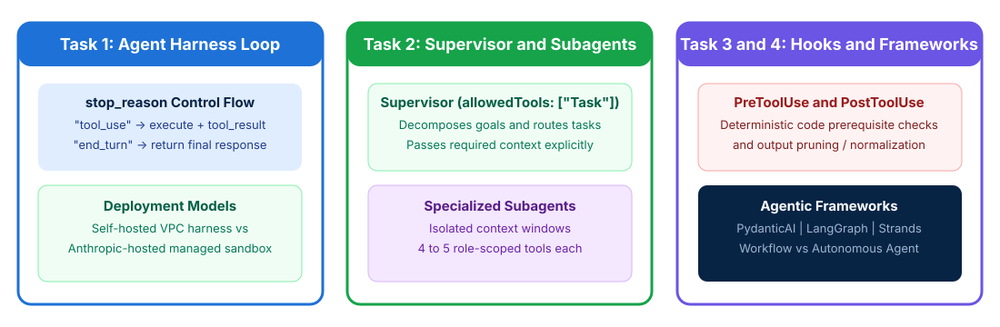

# Building Agents and Workflows

## Time Required

45 minutes

## Overview

In this lab, you will construct a custom tool-use agent loop, configure a supervisor and isolated subagents, enforce deterministic lifecycle hooks, and select appropriate agentic frameworks.

### You learn how to:
- Build a custom tool-use agent loop controlled by `stop_reason`.
- Configure a supervisor hierarchy with isolated, role-scoped subagents.
- Implement deterministic `PreToolUse` and `PostToolUse` lifecycle hooks.
- Choose between deterministic workflows, autonomous agents, and frameworks (`PydanticAI`, `LangGraph`, `Strands`).

## Scenario

Your engineering team is building a developer support and order-resolution assistant. Currently, the prototype agent loop exits prematurely when Claude emits explanatory text alongside a tool call, subagents are overloaded with 16 unscoped tools, and critical refund ceilings rely only on system prompt warnings.



## Lab Instructions

### Task 1: Construct a custom tool-use agent loop and harness

In this task, you create your lab workspace, build a custom agent harness loop that inspects `stop_reason` (`"tool_use"` vs `"end_turn"`), and compare self-hosted vs Anthropic-hosted deployment models.

1. Open your terminal (Terminal on macOS or PowerShell / Command Prompt / VS Code Terminal on Windows) and create a working folder for this lab:

```bash
mkdir ccdvf-lab-01
cd ccdvf-lab-01
```

2. Open `ccdvf-lab-01` in VS Code (or your preferred text editor) and create a file named `agent_harness.py` with the following starter code:

```python
# agent_harness.py
from dataclasses import dataclass
from typing import Any, List, Dict

@dataclass
class MockBlock:
    type: str
    text: str = ""
    id: str = ""
    name: str = ""
    input: Dict[str, Any] = None

@dataclass
class MockResponse:
    stop_reason: str
    content: List[MockBlock]

def execute_tool(name: str, tool_input: dict) -> str:
    if name == "lookup_order":
        return f'{{"order_id": "{tool_input["order_id"]}", "status": "DELIVERED", "amount": 120.00}}'
    return '{"status": "ok"}'

def run_agent_loop(mock_responses: List[MockResponse], user_prompt: str) -> str:
    messages = [{"role": "user", "content": user_prompt}]
    turn = 0

    while True:
        resp = mock_responses[turn]
        turn += 1

        # Always append the full assistant response to conversation history
        messages.append({"role": "assistant", "content": resp.content})

        if resp.stop_reason == "end_turn":
            final_text = [b.text for b in resp.content if b.type == "text"]
            return "\n".join(final_text)

        if resp.stop_reason == "tool_use":
            tool_results = []
            for block in resp.content:
                if block.type == "tool_use":
                    output = execute_tool(block.name, block.input)
                    tool_results.append({
                        "type": "tool_result",
                        "tool_use_id": block.id,
                        "content": output
                    })
            # Append all matching tool_result blocks in the very next user message
            messages.append({"role": "user", "content": tool_results})
```

3. Launch Claude Code inside `ccdvf-lab-01`:

```bash
claude
```

4. In Claude Code, run the following prompt to add a test harness and deployment comparison to `agent_harness.py`:

```text
Read agent_harness.py. Add a __main__ block to agent_harness.py that:
1. Simulates a 2-turn conversation where Turn 1 returns BOTH a text block ("Let me check order ORD-500 for you.") AND a tool_use block (id="toolu_01", name="lookup_order", input={"order_id": "ORD-500"}) with stop_reason="tool_use", and Turn 2 returns the final resolution with stop_reason="end_turn".
2. Prints the conversation messages array after completion to verify that assistant tool_use blocks and user tool_result blocks are properly paired.
3. Also create a file named deployment-models.md comparing when to choose a Self-Hosted Agent Harness (direct VPC database access, custom Python/TS hooks) vs an Anthropic-Hosted / Managed Agent environment (rapid deployment, managed container sandboxing).
Run agent_harness.py and show the output.
```

5. Review the output in Claude Code to confirm that the loop continues cleanly on `stop_reason == "tool_use"` even when explanatory text is present in the same response.

> [!IMPORTANT]
> Never terminate a tool-use loop just because `response.content` contains a `text` block or a natural-language phrase. Always control the loop using `response.stop_reason` (`"tool_use"` vs `"end_turn"`).

### Task 2: Configure a supervisor and isolated subagents

In this task, you configure a manager/supervisor agent (`allowedTools: ["Task"]`) and two specialized subagents with isolated context windows, 4 to 5 role-scoped tools, and explicit context passing.

1. In `ccdvf-lab-01`, create a file named `supervisor-subagents.json` defining the supervisor and its specialized worker subagents:

```json
{
  "supervisor": {
    "name": "incident-supervisor",
    "description": "Decomposes bug reports, delegates log search and patch generation to subagents, and verifies fixes.",
    "allowedTools": ["Task"],
    "contextRule": "Subagents operate in isolated context windows and never inherit supervisor history automatically. Always pass required stack traces, file paths, and findings explicitly in each Task prompt."
  },
  "subagents": [
    {
      "name": "log-investigator",
      "description": "Searches application logs and stack traces to identify the failing module and line number.",
      "allowedTools": ["Grep", "Glob", "Read", "fetch_error_trace"]
    },
    {
      "name": "patch-author",
      "description": "Applies targeted code fixes and runs unit tests on the identified file.",
      "allowedTools": ["Read", "Edit", "Write", "run_unit_tests"]
    }
  ]
}
```

2. Ask Claude Code to generate `delegation-trace.json` showing how `incident-supervisor` delegates to `log-investigator` and passes its structured findings explicitly to `patch-author`:

```text
Read supervisor-subagents.json. Create delegation-trace.json showing:
1. Why giving each subagent 4 role-scoped tools improves selection accuracy compared to giving one agent 16 mixed tools.
2. The exact Task tool_use payload sent from incident-supervisor to patch-author, demonstrating how the stack trace and file path discovered by log-investigator are passed explicitly inside the Task prompt.
```

3. Open `delegation-trace.json` in your editor and verify the explicit context payload passed to `patch-author`.

### Task 3: Enforce deterministic safety and normalization with SDK hooks

In this task, you write `PreToolUse` and `PostToolUse` lifecycle hooks that deterministically block unauthorized actions and prune/normalize verbose tool outputs before they enter the model’s context window.

1. In `ccdvf-lab-01`, create a file named `lifecycle_hooks.py`:

```python
# lifecycle_hooks.py
from datetime import datetime, timezone

def pre_tool_use_hook(tool_name: str, tool_input: dict, verified_customer_id: str | None) -> dict:
    # Block order or refund tools if customer identity has not been verified yet
    if tool_name in ("lookup_order", "issue_refund") and not verified_customer_id:
        return {"decision": "block", "reason": "Must verify customer via get_customer first."}

    # Block refunds over $500 deterministically
    if tool_name == "issue_refund" and float(tool_input.get("amount", 0)) > 500.0:
        return {"decision": "block", "reason": "Refund exceeds $500 limit; escalate to human."}

    return {"decision": "allow"}

def post_tool_use_hook(raw_order_payload: dict) -> dict:
    # Prune 30+ internal warehouse fields and normalize Unix epoch to ISO 8601
    created_epoch = raw_order_payload.get("created_epoch", 1761820800)
    iso_date = datetime.fromtimestamp(created_epoch, tz=timezone.utc).strftime("%Y-%m-%dT%H:%M:%SZ")
    return {
        "order_id": raw_order_payload.get("order_id"),
        "status": raw_order_payload.get("status"),
        "amount": raw_order_payload.get("amount"),
        "created_at_iso": iso_date
    }
```

2. Ask Claude Code to add a `__main__` verification block to `lifecycle_hooks.py` and run it:

```text
Add a __main__ test block to lifecycle_hooks.py that tests blocking an unverified lookup_order call, blocking a $750 issue_refund call, and pruning/normalizing a raw order payload containing extra warehouse noise fields. Run lifecycle_hooks.py and show the output.
```

3. Confirm in the terminal output that the hooks enforce the rules deterministically in code.

### Bonus Task 4: Select between PydanticAI, LangGraph, and Strands

In this bonus task, you match four developer project scenarios to either a deterministic Workflow or an Autonomous Agent, and select the best-fit agentic framework (**PydanticAI**, **LangGraph**, or **Strands**).

1. In `ccdvf-lab-01`, ask Claude Code to create `framework-selection-guide.md` containing a decision table for these four projects:
   - **Project A**: A fixed 3-step document intake pipeline that extracts invoice fields, validates every field against strict Python type contracts, and automatically feeds Pydantic validation errors back to Claude for retry.
   - **Project B**: A complex multi-step compliance workflow modeled as a stateful cyclic graph with explicit conditional edges, durable state checkpointing, time-travel debugging, and human-in-the-loop pause/resume interrupts.
   - **Project C**: A lightweight, model-driven coding assistant that registers MCP tools with minimal boilerplate and lets Claude’s native reasoning loop drive tool selection.
   - **Project D**: A predictable nightly job that translates release notes into 3 languages in a fixed sequence.

2. Verify in `framework-selection-guide.md` that:
   - **Project A** maps to **PydanticAI**.
   - **Project B** maps to **LangGraph**.
   - **Project C** maps to **Strands (Strands Agents)**.
   - **Project D** uses a **deterministic Workflow** (prompt chaining) rather than an open-ended autonomous agent.

## Congratulations!

In this lab, you have:
- Built a custom tool-use agent loop controlled by `stop_reason`.
- Configured a supervisor hierarchy with isolated, role-scoped subagents.
- Implemented deterministic `PreToolUse` and `PostToolUse` lifecycle hooks.
- Chosen between deterministic workflows, autonomous agents, and frameworks (`PydanticAI`, `LangGraph`, `Strands`).
