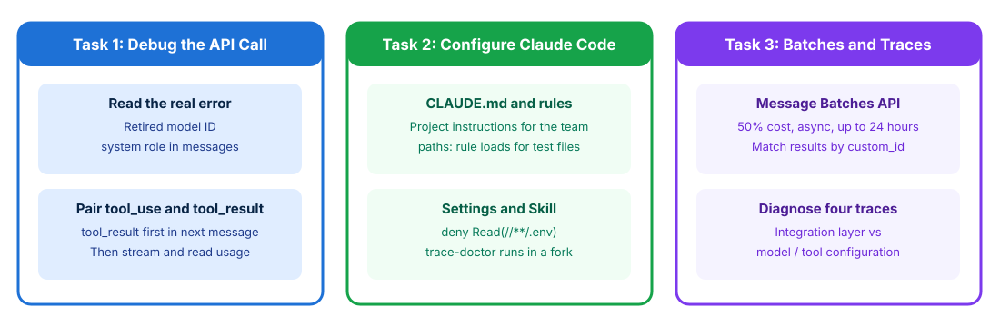

# API Integration, Claude Code, and Debugging

## Time Required

45 minutes

## Overview

In this lab, you will integrate the Messages API and Message Batches API, configure Claude Code project settings and skills, and debug production failures through trace analysis.

### You learn how to:
- Structure stateless Messages API requests and overnight Message Batches API workloads.
- Configure `CLAUDE.md`, path-scoped `.claude/rules/`, `.claude/settings.json` permissions, and isolated skills.
- Isolate integration-layer bugs from model output failures using execution traces.
- Run Claude Code in headless JSON mode for automated CI/CD checks.

## Scenario

Your team is shipping a document analytics service and standardizing developer workflows with Claude Code. Currently, an overnight job processing 10,000 documents is costing twice its budget by using synchronous API calls, developers lack shared permission guardrails in Claude Code, and several production errors are being misdiagnosed as model hallucinations when the integration layer is actually at fault.



## Lab Instructions

### Task 1: Build stateless Messages API and Message Batches API integrations

In this task, you create your lab workspace, fix a broken Messages API request payload, and design a Message Batches API job for processing 10,000 overnight documents (mirroring CCDV-F Sample Question 1).

1. Open your terminal (Terminal on macOS or PowerShell / Command Prompt / VS Code Terminal on Windows) and create a working folder for this lab:

```bash
mkdir ccdvf-lab-02
cd ccdvf-lab-02
```

2. Open `ccdvf-lab-02` in VS Code (or your preferred text editor) and create a file named `broken_api_integration.py` that contains four common Domain 2 integration mistakes:

```python
# broken_api_integration.py
def build_broken_messages_request(user_question: str):
    return {
        # BUG 1: Unpinned floating model alias in production
        "model": "claude-sonnet-latest",
        "max_tokens": 1024,
        "messages": [
            # BUG 2: Passing "system" as a message role instead of top-level system parameter
            {"role": "system", "content": "You are a financial analytics assistant."},
            {"role": "user", "content": user_question},
            {
                "role": "assistant",
                "content": [
                    {"type": "tool_use", "id": "toolu_99", "name": "fetch_metrics", "input": {"quarter": "Q3"}}
                ]
            },
            # BUG 3: Sending a new user text message BEFORE returning the matching tool_result for toolu_99!
            {"role": "user", "content": "Also include Q4 projections."}
        ]
    }

# BUG 4: Team plans to process 10,000 non-urgent overnight analytics documents by sending
# 10,000 parallel synchronous requests with lowered max_tokens instead of using the Message Batches API!
```

3. Launch Claude Code in `ccdvf-lab-02`:

```bash
claude
```

4. In Claude Code, run the following prompt to generate `fixed_api_integration.py` and `overnight-batch.jsonl`:

```text
Read broken_api_integration.py.
1. Create fixed_api_integration.py that fixes all 3 Messages API bugs: pins the exact model snapshot ("claude-sonnet-4-20250514"), moves system instructions to the top-level "system" parameter, and places the matching tool_result block (with tool_use_id="toolu_99") in the user message immediately following the assistant tool_use turn.
2. Create overnight-batch.jsonl with 3 sample Message Batches API requests correlated by custom_id ("doc-0001", "doc-0002", "doc-0003"), and add a docstring in fixed_api_integration.py explaining why the Message Batches API (50% cost reduction, 24-hour window) is the correct choice for 10,000 non-urgent overnight documents over parallel synchronous calls or lowering max_tokens.
```

5. Review `fixed_api_integration.py` and `overnight-batch.jsonl` in your editor to verify the stateless Messages API rules and batch format.

> [!IMPORTANT]
> **CCDV-F Sample Question Rule**: When a developer must process 10,000 documents overnight for a non-urgent morning analytics report with cost as the primary concern, always choose the **Message Batches API** (up to 24-hour window, 50% cost reduction). Sending synchronous requests in parallel or lowering `max_tokens` does not provide the batch discount.

### Task 2: Configure Claude Code memory, rules, skills, and permissions

In this task, you configure Claude Code’s core project files: root `CLAUDE.md`, path-scoped `.claude/rules/`, `.claude/settings.json` permission allow/deny lists, and an isolated skill in `.claude/skills/`.

1. In `ccdvf-lab-02`, create the `.claude` subdirectories:

```bash
mkdir -p .claude/rules .claude/commands .claude/skills/trace-doctor
```

2. Create a root `CLAUDE.md` file in `ccdvf-lab-02/CLAUDE.md`:

```markdown
# Analytics Service Developer Standards

- Pin exact Claude model snapshots (`claude-sonnet-4-20250514`) in all production code.
- Use `AsyncAnthropic` with bounded concurrency and exponential backoff on HTTP 429 and 529 errors.
- Never commit `.env` files or raw API keys.
```

3. Create a path-scoped rule at `.claude/rules/tests.md` that activates conditionally when editing test files:

```markdown
---
paths:
  - "**/*.test.py"
  - "**/test_*.py"
  - "**/*.test.ts"
---
# Automated Testing Rules

- Mock all external Claude API and MCP tool calls in unit tests.
- Include test cases for `stop_reason == "max_tokens"` truncation and `isError: true` tool responses.
```

4. Create a shared project permission configuration at `.claude/settings.json` that allows safe test/git commands while explicitly denying `.env` file reads and destructive shell commands:

```json
{
  "permissions": {
    "allow": [
      "Bash(pytest:*)",
      "Bash(git status)",
      "Read(src/**)"
    ],
    "deny": [
      "Read(.env*)",
      "Bash(rm -rf:*)",
      "Bash(curl:*)"
    ]
  }
}
```

5. Create an isolated skill at `.claude/skills/trace-doctor/SKILL.md` using `context: fork`, `allowed-tools`, and `argument-hint`:

```markdown
---
name: trace-doctor
description: Analyzes API execution traces in an isolated subagent context to separate integration bugs from model errors
context: fork
allowed-tools: ["Read", "Grep", "Glob"]
argument-hint: "<trace-file-path>"
---
Inspect the target execution trace file. Determine whether each failure originated in the integration layer or the model output layer, and return a concise remediation summary.
```

6. In Claude Code inside `ccdvf-lab-02`, run `/memory` to verify that your `CLAUDE.md` and `.claude/rules/tests.md` files are active.

### Task 3: Analyze execution traces to isolate integration vs model bugs

In this task, you inspect four realistic production execution traces and determine whether each failure originated in the **Integration Layer** or the **Model / Tool Config Layer**.

1. In `ccdvf-lab-02`, create a file named `production-traces.json` containing four captured failure traces:

```json
{
  "traces": [
    {
      "trace_id": "TRC-101",
      "observed_error": "json.decoder.JSONDecodeError: Unterminated string starting at line 1 column 412",
      "request_summary": { "model": "claude-sonnet-4-20250514", "max_tokens": 128 },
      "response_summary": {
        "stop_reason": "max_tokens",
        "raw_text": "{\"summary\": \"Quarterly revenue grew 14% driven by enterprise expansion, while operating margins..."
      }
    },
    {
      "trace_id": "TRC-102",
      "observed_error": "HTTP 400 invalid_request_error: messages.1: tool_use ids were found without tool_result blocks immediately after",
      "request_summary": {
        "messages_roles": ["user", "assistant (with tool_use id=toolu_01)", "user (plain text without tool_result)"]
      }
    },
    {
      "trace_id": "TRC-103",
      "observed_error": "Agent tells the customer: 'No orders exist for your account' during a database outage.",
      "tool_execution_log": "Database connection timed out after 5000ms; exception caught in Python wrapper which returned '[]' with isError=False."
    },
    {
      "trace_id": "TRC-104",
      "observed_error": "Agent calls get_customer instead of lookup_order when user asks 'Where is order #99281?'",
      "request_summary": {
        "tools": [
          { "name": "get_customer", "description": "Gets data" },
          { "name": "lookup_order", "description": "Gets data" }
        ]
      }
    }
  ]
}
```

2. Ask Claude Code to analyze `production-traces.json` and write the diagnostic report to `trace-diagnosis-report.md`:

```text
Read production-traces.json. Create trace-diagnosis-report.md with a table and explanation for TRC-101 through TRC-104 identifying:
1. Exact Evidence in the Trace.
2. Problem Origin Layer ("Integration Layer" vs "Model / Tool Config Layer").
3. Concrete Developer Fix (and why rewriting the system prompt would NOT fix TRC-101, TRC-102, or TRC-103).
```

3. Open `trace-diagnosis-report.md` in your editor and confirm:
   - **TRC-101 (`stop_reason == "max_tokens"`)**: **Integration Layer** - the response hit the 128-token ceiling mid-JSON; increase `max_tokens` and enforce structured output via `tool_use`.
   - **TRC-102 (HTTP 400 missing `tool_result`)**: **Integration Layer** - the harness failed to return a `tool_result` block immediately after the assistant `tool_use` turn.
   - **TRC-103 (Swallowed DB timeout)**: **Integration Layer** - the tool wrapper caught a timeout and returned `[]` as a valid empty result instead of `isError: true`.
   - **TRC-104 (Ambiguous 2-word tool descriptions)**: **Model / Tool Config Layer** - expand tool descriptions with explicit input formats (`#99281`) and boundaries.

### Bonus Task 4: Run Claude Code in headless JSON mode for CI/CD

In this bonus task, you run Claude Code non-interactively (`-p`) with `--output-format json` and `--json-schema` to audit `broken_api_integration.py` from your terminal.

1. Exit your interactive Claude Code session (`/exit` or `Ctrl+C`) so you are at your terminal prompt inside `ccdvf-lab-02`.

2. Run `claude -p` with `--output-format json` and `--json-schema`:

```bash
claude -p "Identify all API integration bugs in broken_api_integration.py" \
  --output-format json \
  --json-schema '{"type":"object","properties":{"bugs":{"type":"array","items":{"type":"object","properties":{"bug_number":{"type":"number"},"category":{"type":"string"},"fix":{"type":"string"}},"required":["bug_number","category","fix"]}}},"required":["bugs"]}'
```

3. Verify that the CLI prints schema-valid JSON to stdout and exits cleanly without waiting for interactive input.

## Congratulations!

In this lab, you have:
- Structured stateless Messages API requests and overnight Message Batches API workloads.
- Configured `CLAUDE.md`, path-scoped `.claude/rules/`, `.claude/settings.json` permissions, and isolated skills.
- Isolated integration-layer bugs from model output failures using execution traces.
- Run Claude Code in headless JSON mode for automated CI/CD checks.
